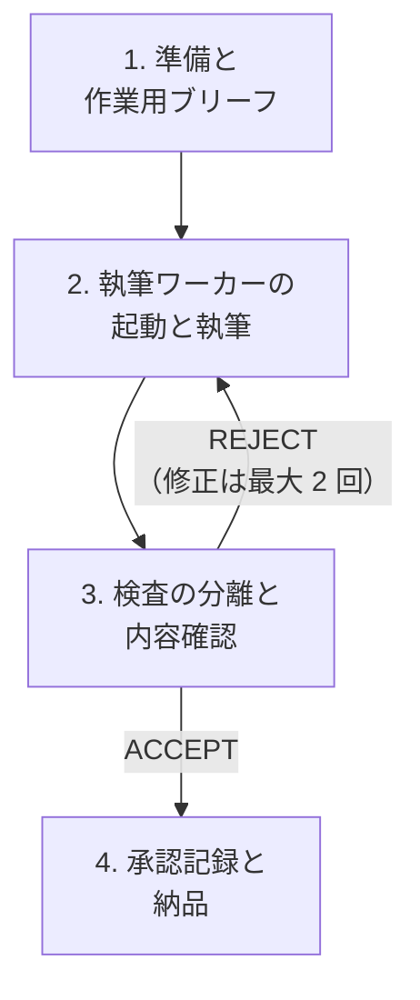
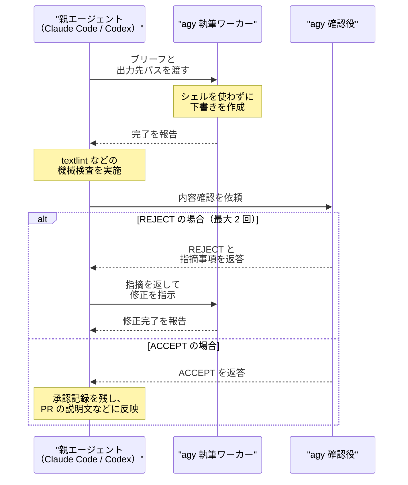

こんにちは [@shunk031](https://twitter.com/shunk031) です。本記事は [法政大学理工学部 Advent Calendar 2026](https://adventar.org/calendars/13106) の 2 日目の記事です。

https://adventar.org/calendars/13106

前回 12/1 の記事では、コーディングエージェントの作業スペースを管理するターミナルマルチプレクサ Herdr を紹介しました。あわせて解説したスキル `shunk031-herdr-orchestrate-workers` では、親 (オーケストレーター) が Herdr の上で Claude Code や Codex などのコーディングエージェントを複数起動します。親は `herdr agent prompt` で相手のエージェントに直接プロンプトを送ります。子 (ワーカー) も同じ方法で親へ結果を報告して作業を進めます。

https://zenn.dev/shunk031/articles/herdr-orchestrate-workers-skill

日々の開発でコーディングエージェントを使っていると、プルリクエスト (PR) の説明文などで Claude や Codex が書く日本語に違和感を覚える場面がありました。その一方で、Gemini の日本語は良さそうだという話を見かけました。そこで、Gemini に日本語を直させるスキルを作りました。

<!-- 感想: コーディングエージェントに PR 説明文やコミットメッセージを書かせたときの不自然さに直面した経験について、実際に使ってどうだったか一言 -->

同じ材料で Claude Code の Claude Opus 5.5 と Antigravity の Gemini 3.8 Flash に記事を書かせ、書き手を伏せて読み比べた例では、Gemini の文章が選ばれています[^1]。

<!-- textlint-disable -->
> 書き手を伏せて読み比べた結果、私はGeminiの文章を選びました。
<!-- textlint-enable -->

また、Claude Code で文章を作成した際の実感としても、次のような違和感が報告されています[^2]。

<!-- textlint-disable -->
> Claude Codeで文章を作ってもらうと、よく「イケてないなぁ・・・」と思います。
<!-- textlint-enable -->

本記事では、この AI 特有の不自然な日本語を抑制するために運用しているスキル `shunk031-writing-gemini-japanese` を紹介します。呼び出し元のエージェント自身には日本語を書かせません。同じモデルでは言い回しの癖が残りやすく、推敲まで任せるとやり取りが長くなるためです（詳しくは後述します）。執筆とレビューの委任先には、Gemini のモデルをターミナルから動かせるコーディングエージェントの CLI である Google の Antigravity CLI (`agy`) を使います。以下、agy のワーカーへ委任して動かす仕組みを解説します。

# 「AI 臭い日本語」とは何か

AI が生成する日本語には、文法上の明確な誤りではない不自然さが現れます。文脈にそぐわない定型表現や比喩、中身の薄い抽象名詞句などです。これらは技術文書としての読みやすさを損ない、読者に誤解を与える原因になります。

<!-- textlint-disable ja-spacing/ja-space-between-half-and-full-width -->
AI が喋る言葉は「AI語」と呼ばれ、「AI臭さ」「AI-ism」「AI slop」とも表現されています[^3]。厳密な定義ではなく、生成された文章を見て人間の側が事後的かつ主観的に判断したものとされています。水準としては単語・構文・文章構造・内容の 4 つに分類されています。例として「手触り」「解像度」「余白」のような語、「重要なのは」のような前置き、「X ではなく、Y です」の構文、3 つに分ける列挙が挙げられています。いずれも仮説であり、定量的には確かめていないと断られています。
<!-- textlint-enable ja-spacing/ja-space-between-half-and-full-width -->

<!-- textlint-disable ja-spacing/ja-space-between-half-and-full-width -->
流し読みでは自然に見えるものの、文字どおりに読むと意味が壊れる表現は「スロップ表現」と呼ばれます。意味破綻型と過剰圧縮型に分けて約 100 例が集められています[^4]。例として「窓ガラスが夜をやさしく折りたたんでいる」（意味破綻型）や、「成果で働く、場所は手段」（過剰圧縮型）が挙げられています。
<!-- textlint-enable ja-spacing/ja-space-between-half-and-full-width -->

本記事のスキルが直すのは、このうち筆者が PR の説明文やドキュメントで見かけてきた不自然な比喩や定型句、勝手な断定です。筆者が使っている外部の推敲スキルである `yomiyasu` や `natural-japanese` と、本スキルの編集ルールでは、こうした表現を分類しています。主な具体例と問題点は次の通りです。

比喩的に使われる動詞や直訳構文の例として、日本語の推敲スキル `yomiyasu` のカタログでは以下の表現が挙げられています。

- 「時間を溶かしました」→「時間を費やしてしまった」
- 「静かに壊れる」→「気づかないうちにデータがおかしくなる」

https://github.com/nanaism/yomiyasu/blob/c49d5f1bee91258e33e1febc3569c6c87be7669e/references/slop-catalog.md#L17
https://github.com/nanaism/yomiyasu/blob/c49d5f1bee91258e33e1febc3569c6c87be7669e/references/slop-catalog.md#L38

また、前後の文脈と乖離した言い回しについて、日本語の推敲スキル `natural-japanese` では実際の修正例として以下が報告されています。

<!-- textlint-disable -->
- 「まだ決着していない行」→「チェックインも取り消しもされていない行だけ」
- 「リマインドの失敗は握りつぶしていません。」→「リマインドの Slack 送信が1件でも失敗すると、同じ回の取り消しが実行されません。」
<!-- textlint-enable -->

https://github.com/coji/natural-japanese/blob/840bd400cbcb64c8b64d492a144da54fc05776c5/README.md#L14-L17

さらに、文頭の前置フィラーや空虚なまとめ表現も典型的なパターンです。「いかがでしょうか」や「まとめると」などが該当します。あわせて「〜の確立」や「〜による〜の実証」のような抽象名詞句の連用も挙げられます。

加えて、AI が文章を整える過程で本人の意図や確信度を勝手に強めてしまう問題もあります。`shunk031-writing-gemini-japanese` のチェックリストでは、勝手な断定を避ける方針を定めています。たとえば「案 A を実施する」と断定せず、「案 A を試してみたい」という本人の希望の強さを保ちます。

これらの表現は、特定の単語を機械的に禁止するものではありません。文脈の中で伝えるべき情報や、書き手の確信度が保たれているかを確認する観点として扱われます。

# なぜ別のモデルに書かせるのか

コーディングエージェントに「自然な日本語で書いて」と指示しても、同一モデル内では出力バイアスが残りやすくなります。修正を繰り返しても、同じような言い回しを再生産しがちです。人間の好みに合わせる事後学習 (RLHF など) では、出力の多様性が下がる場合もあると報告されています[^5]。好みのデータでは典型的な書き方が高く評価されやすくなります。それが出力をよくある言い回しに寄せる一因だという分析もあります[^6]。報酬の偏りとして実験で確かめられているのは、長い回答や箇条書きなどの書式です[^7][^8]。

また、親エージェントに推敲まで任せるとコンテキストが肥大化します。その結果、本来の開発タスクへの集中が削がれてしまいます。

この問題に対処するため、`shunk031-writing-gemini-japanese` では原則を定めています。呼び出し元である親エージェント自身は推敲せず、専用のワーカーを起動して処理させます。執筆やレビューを担当するワーカーには agy を採用しています。導入で触れたように、日本語が得意だと言われている Gemini を呼び出せるためです。

起動するワーカーにはシェルコマンドの実行権限を与えません。日本語を書くだけのはずの agy 執筆役や確認役が、`make test` のようなリポジトリのテストコマンドを自分の判断で実行していたためです。そのため、セッションごとに `permissions.deny` で `command(*)` を拒否する設定にしました。ただし、シェルを拒否してもファイルの読み書きツールは利用できます。そのため、設定だけでコード編集や設定変更を防ぐことはできません。スキルでは日本語成果物の執筆またはレビューのみを行わせ、プログラムコード自体を書かせないよう指示したうえで、呼び出し元が出力先ファイルパスを限定しています。

# スキルのワークフロー

`shunk031-writing-gemini-japanese` は、以下 4 つの段階で進みます。



ここでブリーフとは書く前に想定読者や必須の要件をまとめる作業メモであり、 `ACCEPT` と `REJECT` は確認役ワーカーによる判定を指します。

## 1. 準備と作業用ブリーフ

外部向けの文書を新規作成または構成変更する場合、下書きの前に作業用ブリーフを作成します。呼び出し元のエージェントがこれを準備します。ブリーフには想定読者、読者の判断や行動、3〜5 点の根拠付き必須要件を含めます。あわせて意図的に除外する事項や構成も定めます。各必須要件には裏づけとなる根拠資料を指定します。資料が不足している場合は下書きを直ちに停止し、利用者に確認を求めて事実の捏造を防ぎます。なお、ブリーフは執筆準備のための内部作業資料です。

## 2. 執筆ワーカーの起動と執筆

呼び出し元は Herdr を使って専用タブを作成し、シェルコマンドの実行を拒否した agy 執筆ワーカーを起動します。

```bash
herdr tab create --workspace <workspace-id> --label "✍️ agy" --no-focus
herdr agent start <writer-name> --kind agy --pane <root-pane-id> -- --settings '{"permissions":{"deny":["command(*)"]}}' --model gemini-3.8-flash-high
```

`--no-focus` は今の画面を切り替えずにタブを作り、 `--kind agy` は起動するエージェントの種類、 `--settings` はシェルコマンドを拒否する設定、 `--model` は使う Gemini のモデルを選んでいます。

ワーカーはプロンプトを受け取ると、受領文を出力したうえで作業を開始します。執筆担当ワーカーは、依頼内容に応じて `shunk031-writing-router` から適切なスキルを選択します。たとえば新規執筆や構成整理なら `natural-japanese` を適用します。原文の強さを保った局所修正なら `yomiyasu`、技術文書を端的にまとめるなら `tanteki` を選びます。執筆時は共通チェックリストに基づきます。読者に伝わる表現や本人の語彙を維持し、箇条書きの階層構造などを整えてファイルへ出力します。

## 3. 検査の分離と内容確認

書式や表記揺れ、リンク形式といった機械的に検証できる規則は、linter などの機械検査に任せます。内容の確認は、専用タブで起動した 1 人の agy 確認役ワーカーのみが担当します。修正のたびに別の確認役が全文を読み直すと、指摘が収束しなかったためです。

確認役ワーカーはファイルを直接編集せず、指摘事項を添えて `ACCEPT` または `REJECT` を返します。ここでの重要な原則として、進行を止める REJECT の判定は次の 2 点のみに限定されます。

- 捏造や数値の矛盾といった実質的な事実誤り
- 指摘理由が明確で、読者が文章の意味を取り違える具体的な箇所

文体の好みや「本人らしさ」といった主観的な基準、および細かな指摘は advisory として扱い、停止理由にはしません。修正が必要な場合も、修正と再確認の往復は最大 2 回までとし、レビューの無限ループを防ぎます。

## 4. 承認記録と納品

機械検査を通過し、1 人の内容確認役から `ACCEPT` を得た文書のみが納品可能となります。全条件を満たした段階で、承認記録を残します。ローカルの状態ファイル `~/.local/state/agy-japanese/accepted.tsv` に記録を保存します。成果物から計算したハッシュ値 (SHA-256) とタイムスタンプを保存し、以降の変更検知や納品確認に利用します。

承認された成果物は、PR の説明文やコミットメッセージなど、利用者が指定した宛先にのみ反映します。頼まれていない場所へエージェントが勝手に投稿することを防ぐための決まりです。

# エージェント運用の実際

このスキルは、前日の記事で紹介した Herdr による複数エージェント運用の枠組みと組み合わせて運用します。

親エージェントと agy ワーカーの間で交わされる指示、検査、承認の流れを以下に示します。



親エージェントが実装や調査を進め、PR を作成する段階になったとします。親エージェント自身が PR の説明文をその場の思いつきで書くのではなく、ブリーフをまとめて agy ワーカーを召喚します。起動された agy ワーカーは、シェルコマンドの実行を遮断した状態で指示を受け取ります。出力先パスや執筆範囲の限定を受け、ルーター経由で適切なスキルを適用して下書きを生成します。続いて確認役ワーカーが事実関係と読者の誤解がないかを検査し、問題がなければ承認記録が残されて親エージェントに引き渡されます。

このように、コードを書く作業と外部向けの日本語を書く作業を混同させません。親エージェントはコードの実装を受け持ち、専門ワーカーが日本語の執筆と確認を引き受けます。

# まとめと次回予告

AI による文章作成を安定させる鍵は、プロンプトの工夫だけに頼るのではなく、ワークフローの設計にあります。呼び出し元自身に文章を書かせず、agy が呼び出す Gemini などの外部モデルに執筆とレビューを委任します。シェルコマンドの実行を拒否し、指示や出力先で編集範囲を限定します。さらに機械検査と事実確認を分けることで、事実の誤りを見つけやすく、自然な日本語に近づけられます。

<!-- 感想: 日本語の執筆とレビューを外部モデルに委任するワークフローを実際に開発へ組み込んでみた実感について、実際に使ってどうだったか一言 -->

明日 12/3 の記事では、Markdown ベースでスライドを作成できるツール Marp を取り上げます。論文紹介スライドの構成スキル `shunk031-writing-technical-slides` と組み合わせた作成手順を紹介します。スライド本文の構成にも、書く役と確かめる役を分け、機械で確かめられることは機械に任せる考え方が引き継がれていますので、ぜひ続けてご覧ください。

<!-- textlint-disable -->

[^1]: 日本語の文章はGeminiに書かせると自然になる｜Claudeと比較してもかなりAI感がない - 田嶋正吾 https://note.com/st_dev0/n/n965df27a887a
[^2]: 文章達者は誰？ Gemini / Claude Code / ChatGPTを比べてみた - HJR@インフィニテック https://note.com/iwata9999/n/na962cdc5c829
[^3]: AI語に親しむ - まだいる https://ktrmnm.jp/blog/2026-08-29-what-is-ai-ism-jp/
[^4]: スロップ表現100連発 - todesking https://zenn.dev/todesking/articles/5bc43f449ecdf6
[^5]: Understanding the Effects of RLHF on LLM Generalisation and Diversity - Robert Kirk et al. https://arxiv.org/html/2310.06452v3
[^6]: Verbalized Sampling: How to Mitigate Mode Collapse and Unlock LLM Diversity - Jiayi Zhang et al. https://arxiv.org/html/2510.01171v3
[^7]: A Long Way to Go: Investigating Length Correlations in RLHF - Prasann Singhal et al. https://arxiv.org/html/2310.03716v2
[^8]: From Lists to Emojis: How Format Bias Affects Model Alignment - Xuanchang Zhang et al. https://aclanthology.org/2025.acl-long.1308.pdf

<!-- textlint-enable -->
