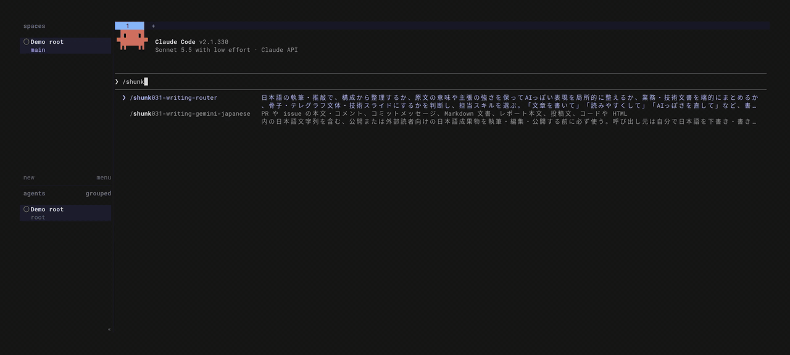
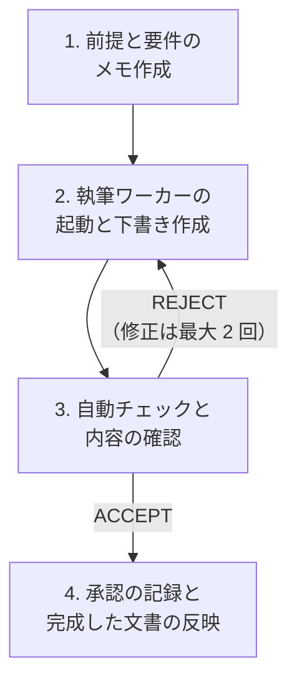
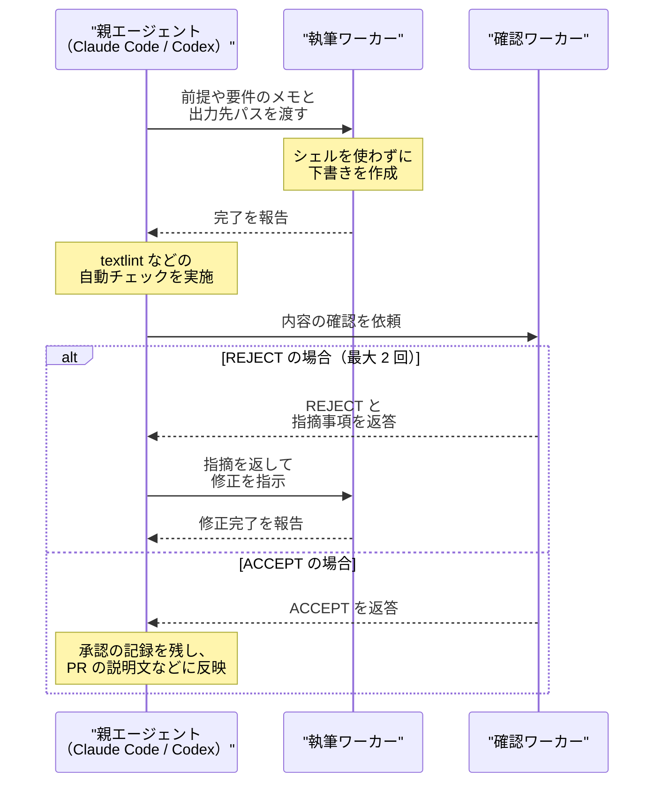

こんにちは [@shunk031](https://twitter.com/shunk031) です。本記事は [法政大学理工学部 Advent Calendar 2026](https://adventar.org/calendars/13106) の 2 日目の記事です。

https://adventar.org/calendars/13106

このアドベントカレンダーでは、12/1 から 12/3 まで 3 日連続で記事を投稿します。コーディングエージェントの運用に関する続き物です。全体の予定は次の通りです。

- 12/1: [Herdr で複数のエージェントを対話させるシンプルなスキルの紹介](https://zenn.dev/shunk031/articles/herdr-orchestrate-workers-skill)
- 12/2: [AI 臭い日本語を agy gemini スキルで一掃するゾォ〜](https://zenn.dev/shunk031/articles/agy-gemini-japanese-skill)（本記事）
- 12/3: [コーディングエージェントと Marp でいい感じに論文紹介スライドを作るぜ](https://zenn.dev/shunk031/articles/marp-paper-reading-slides)

12/1 の記事では、ターミナルマルチプレクサ Herdr による複数エージェントの連携手順を紹介しました。

https://zenn.dev/shunk031/articles/herdr-orchestrate-workers-skill

本記事では、親エージェント自身は日本語を書かず、Gemini の agy ワーカーへ執筆と確認を任せて不自然な日本語を解消する仕組みを解説します。

実際に動かしたときの動作例です。親エージェントへ次のように指示を入力しました。

```text
/shunk031-writing-gemini-japanese /demo/source-sentence.txt の文を、主張を変えず事実も足さずに自然な日本語へ直して。右側のペインに Herdr で書き手と確認役を順に起動して（起動には /opt/demo/start-agy-agent.sh を使う）。結果は /demo/result.md に保存して、その内容と ACCEPT か REJECT かをそのまま表示して
```



- <!-- textlint-disable -->直す前の文: 本PRでは、パフォーマンスの最適化を実現するとともに、ユーザー体験の向上と保守性の担保を両立させる、まさにゲームチェンジャーとなる変更を加えました。
- 直った文: 本 PR では、パフォーマンスを最適化するとともに、ユーザー体験の向上と保守性の確保を両立させる変更を加えました。<!-- textlint-enable -->

直す前の文にあった「〜を実現する」「担保」「まさにゲームチェンジャー」といった言い回しが、直った文では消えています。

日々の開発でコーディングエージェントを使っていると、プルリクエスト (PR) の説明文などで Claude や Codex が書く日本語に違和感を覚える場面がありました。その一方で、Gemini の日本語は良さそうだという話を見かけました。そこで、Gemini に日本語を直させるスキルを作りました。

<!-- 感想: コーディングエージェントに PR 説明文やコミットメッセージを書かせたときの不自然さに直面した経験について、実際に使ってどうだったか一言 -->

同じ材料で Claude Code の Claude Opus 5.5 と、Google のコーディングエージェント Antigravity (CLI は agy) の Gemini 3.8 Flash に記事を書かせた比較例があります。書き手を伏せて読み比べた結果、Gemini の文章が選ばれています。

https://note.com/st_dev0/n/n965df27a887a

> <!-- textlint-disable -->書き手を伏せて読み比べた結果、私はGeminiの文章を選びました。<!-- textlint-enable -->

また、Claude Code で文章を作成した際の実感としても、次のような違和感が報告されています。

https://note.com/iwata9999/n/na962cdc5c829

> <!-- textlint-disable -->Claude Codeで文章を作ってもらうと、よく「イケてないなぁ・・・」と思います。<!-- textlint-enable -->

本記事では、この AI 特有の不自然な日本語を抑制するために運用しているスキル `shunk031-writing-gemini-japanese` を紹介します。親エージェント自身には日本語を書かせません。同じモデルでは言い回しの癖が残りやすく、推敲まで任せるとやり取りが長くなるためです。執筆とレビューの委任先には、Gemini のモデルをターミナルから動かせる Antigravity の CLI (`agy`) を使います。以下、agy のワーカーへ委任して動かす仕組みを解説します。

# 「AI 臭い日本語」とは何か

AI が生成する日本語には、文脈に合わない比喩や定型表現といった不自然さが現れます。

<!-- textlint-disable ja-spacing/ja-space-between-half-and-full-width -->こうした不自然さは「AI語」や「AI slop」と呼ばれ、単語から構文まで 4 つの水準で整理されています。例として「手触り」「解像度」「余白」のような語、「重要なのは」という前置き、「X ではなく、Y です」の構文、3 つの列挙などが挙げられています。<!-- textlint-enable ja-spacing/ja-space-between-half-and-full-width -->

https://ktrmnm.jp/blog/2026-08-29-what-is-ai-ism-jp/

<!-- textlint-disable ja-spacing/ja-space-between-half-and-full-width -->また、文字どおりに読むと意味が崩れる「スロップ表現」の収集例もあります。意味破綻型の「窓ガラスが夜をやさしく折りたたんでいる」や、過剰圧縮型の「成果で働く、場所は手段」など約 100 例が集められています。<!-- textlint-enable ja-spacing/ja-space-between-half-and-full-width -->

https://zenn.dev/todesking/articles/5bc43f449ecdf6

本記事のスキルが直すのは、こうした不自然な比喩や定型句、勝手な断定です。推敲スキル [yomiyasu](https://github.com/nanaism/yomiyasu) や [natural-japanese](https://github.com/coji/natural-japanese) でも、以下のような具体例が挙げられています。

https://github.com/nanaism/yomiyasu

https://github.com/coji/natural-japanese

比喩的に使われる動詞や直訳構文の例として、日本語の推敲スキル `yomiyasu` のカタログでは以下の表現が挙げられています。

- 「時間を溶かしました」→「時間を費やしてしまった」
- 「静かに壊れる」→「気づかないうちにデータがおかしくなる」

https://github.com/nanaism/yomiyasu/blob/c49d5f1bee91258e33e1febc3569c6c87be7669e/references/slop-catalog.md#L17
https://github.com/nanaism/yomiyasu/blob/c49d5f1bee91258e33e1febc3569c6c87be7669e/references/slop-catalog.md#L38

また、前後の文脈と乖離した言い回しについて、日本語の推敲スキル `natural-japanese` では実際の修正例として以下が報告されています。

<!-- textlint-disable -->

- 「まだ決着していない行」→「チェックインも取り消しもされていない行だけ」
- 「リマインドの失敗は握りつぶしていません。」→「リマインドの Slack 送信が 1 件でも失敗すると、同じ回の取り消しが実行されません。」
<!-- textlint-enable -->

https://github.com/coji/natural-japanese/blob/840bd400cbcb64c8b64d492a144da54fc05776c5/README.md#L14-L17

さらに「いかがでしょうか」のような前置きや、「〜の確立」といった抽象名詞句の連用も典型的なパターンです。加えて、AI が文章を整える過程で本人の意図を超えて「案 A を実施する」と勝手に断定してしまう問題もあります。本スキルでは、単語の一律な禁止を避け、文脈の中で伝えるべき情報や書き手の確信度が保たれているかを確認します。

# スキルのワークフロー

`shunk031-writing-gemini-japanese` は、以下 4 つの段階で進みます。



ここで作業メモ（スキル文書では「ブリーフ」と呼びます）とは、下書きの前に想定読者や必須の要件を整理したメモです。また、`ACCEPT` と `REJECT` は確認ワーカーによる合否の判定を指します。

## 1. 前提と要件のメモ作成

外部向けの文書を新しく書いたり構成を見直したりするときは、いきなり下書きに入らず、親エージェントが前提と要件をまとめた作業メモ（ブリーフ）を準備します。これは執筆準備のための内部メモです。作業メモでは想定読者、読者に期待する判断や行動、3〜5 点の根拠付き必須要件をまとめます。あわせて、あえて書かないことや全体の構成案も整理します。各要件には裏づけとなる根拠資料を必ず指定します。根拠資料が不足しているときは下書きを始めず、利用者に確認して事実と異なる記述の混入を避けます。

## 2. 執筆ワーカーの起動と下書き作成

親エージェントは Herdr を使って専用タブを作成し、シェルコマンドの実行を拒否した agy 執筆ワーカーを起動します。

```bash
herdr tab create --workspace <workspace-id> --label "✍️ agy" --no-focus
herdr agent start <writer-name> --kind agy --pane <root-pane-id> -- --settings '{"permissions":{"deny":["command(*)"]}}' --model gemini-3.8-flash-high
```

`--no-focus` は今の画面を切り替えずにタブを作り、 `--kind agy` は起動するエージェントの種類、 `--settings` はシェルコマンドを拒否する設定、 `--model` は使う Gemini のモデルを選んでいます。

ワーカーにはあくまで日本語の執筆やレビューのみを担当させるため、シェルコマンドの実行権限は与えていません。日本語を書くだけのはずの執筆ワーカーや確認ワーカーが、`make test` のようなリポジトリのテストコマンドを自分の判断で実行していたためです。そのため、セッションごとに `permissions.deny` で `command(*)` を拒否する設定にしています。ただし、シェルを拒否してもファイルの読み書きツールは利用できます。そのため、設定だけでコード編集や設定変更がすべて防げるわけではありません。スキルでは日本語成果物の執筆またはレビューのみを行わせ、プログラムコード自体を書かせないよう指示したうえで、親エージェントが出力先ファイルパスを限定しています。

執筆ワーカーはプロンプトを受け取ると、受領文を出力して作業に入ります。執筆時は、筆者のスキル集にある振り分け用スキル [`shunk031-writing-router`](https://github.com/shunk031/skills/blob/71e0f2380f717ad5d14cea7bdabf77ed9a9e03de/skills/writing/shunk031-writing-router/SKILL.md) を使い、依頼内容に合わせて適切な推敲スキルを選択します。たとえば新規執筆や構成整理なら `natural-japanese` を適用します。原文の強さを保った局所修正なら `yomiyasu`、業務文書などを短く端的に整える外部スキル [tanteki](https://github.com/iwasa-kosui/tanteki) を選ぶこともあります。執筆ワーカーは共通のチェックリストに沿って、読者に伝わる表現や書き手の語彙を保ちながら、箇条書きの階層構造などを整えて指定されたファイルへ下書きを出力します。

## 3. 自動チェックと内容の確認

書式や表記揺れ、リンク切れといった形式的な規則は、textlint などの linter による自動チェックに任せます。そのうえで、文章の意味や事実関係の確認は、専用タブで起動した 1 人の確認ワーカーが担当します。確認のたびに別のワーカーに全文を読み直させると、指摘が発散して収束しなくなるためです。

確認ワーカーはファイルを直接編集せず、指摘事項を添えて `ACCEPT`（承認）または `REJECT`（差し戻し）を親エージェントに返します。ここで進行を止める `REJECT` の判定は、次の 2 点のみに限定しています。

- 捏造や数値の矛盾といった実質的な事実誤り
- 指摘理由が明確で、読者が文章の意味を取り違える具体的な箇所

文体の好みや「本人らしさ」といった主観的な基準、細かな表現への指摘は advisory（参考意見）として扱い、作業を止める理由にはしません。修正が必要な場合でも、修正と再確認の往復は最大 2 回までとし、レビューがいつまでも終わらない事態を避けています。

## 4. 承認の記録と完成した文書の反映

自動チェックを通過し、1 人の確認ワーカーから `ACCEPT` を得た文書だけが、完成品として親エージェントに引き渡されます。全条件を満たした段階で、承認された記録を残します。ローカルの状態ファイル `~/.local/state/agy-japanese/accepted.tsv` に、文書から計算したハッシュ値 (SHA-256) とタイムスタンプを保存します。この記録は、その後の変更検知や承認確認に利用します。

承認された文書は、PR の説明文やコミットメッセージなど、利用者が指定した場所にだけ反映します。エージェントが指定外の場所へ勝手に投稿してしまわないための安全策です。

# エージェント運用の実際

このスキルは、前日の記事で紹介した Herdr による複数エージェント運用の枠組みと組み合わせて運用します。

親エージェントと 2 つのワーカー（執筆ワーカー・確認ワーカー）の間で交わされる指示、自動チェック、承認の流れを以下に示します。



親エージェントが実装や調査を進め、PR を作成する段階になったとします。親エージェント自身が PR の説明文をその場の思いつきで書くのではなく、前提や要件をまとめたメモを用意して執筆ワーカーを起動します。起動された執筆ワーカーは、シェルコマンドの実行を遮断した状態で指示を受け取ります。出力先パスや執筆範囲の指定を受け、振り分け用スキル（shunk031-writing-router）経由で適切なスキルを適用して下書きを生成します。続いて確認ワーカーは事実関係や読者の誤解の有無を確認し、問題がなければ承認の記録を残して親エージェントに引き渡します。

このように、コードを書く作業と外部向けの日本語を書く作業を 1 人のエージェントに抱え込ませません。親エージェントはコードの実装に専念し、日本語の執筆と確認はそれぞれの専門ワーカーに任せます。

# まとめと次回予告

AI による文章作成を安定させる鍵は、作業の役割を分担したワークフローの設計にあります。親エージェント自身に文章を書かせず、agy が呼び出す Gemini などの外部モデルへ執筆とレビューを委任します。シェルコマンドの実行を拒否し、指示や出力先で編集範囲を限定します。さらに自動チェックと確認ワーカーによる確認を分けることで、事実の誤りを見つけやすく、自然な日本語に近づけられます。

<!-- 感想: 日本語の執筆とレビューを外部モデルに委任するワークフローを実際に開発へ組み込んでみた実感について、実際に使ってどうだったか一言 -->

明日 12/3 の記事では、Markdown ベースでスライドを作成できるツール Marp を取り上げます。執筆ワーカーが `shunk031-writing-router` からスライド構成スキル `shunk031-writing-technical-slides` を選び、スライド本文を作成します。明日のスライドづくりでも、本記事のスキルが日本語の執筆や確認で活躍します。ぜひ続けてご覧ください。
