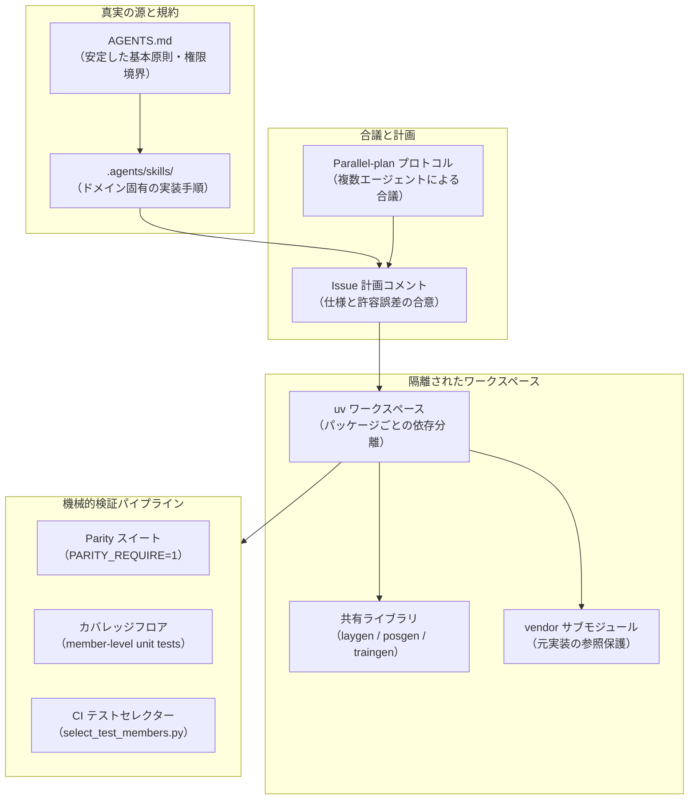
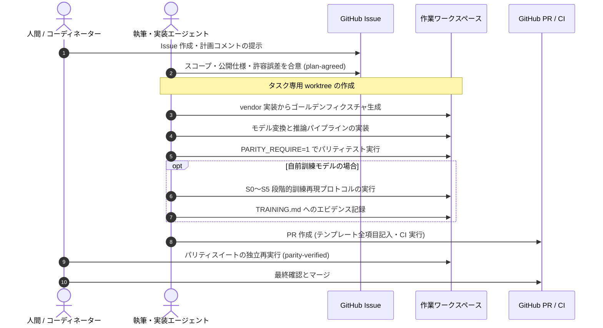
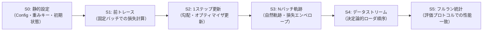

こんにちは [@shunk031](https://twitter.com/shunk031) です。本記事は [法政大学理工学部 Advent Calendar 2026](https://adventar.org/calendars/13106) の 7 日目の記事です。

画像生成やグラフィックデザイン生成の研究開発では、毎月のように新しいレイアウト生成モデルやデザイン生成モデルが発表されます。しかし、公開されている論文実装は深層学習フレームワークやデータセット形式、依存ライブラリのバージョンがそれぞれ異なります。そのため、自分の研究開発環境に組み込んで横断的に比較・検証するだけでも大きな負担がかかります。

この課題を解決するにあたり、私たちはコーディングエージェント（Claude Code や Codex などの自律型 AI エージェント）を活用してきました。主要なレイアウト生成・デザイン生成モデルを共通設計で移植・再現するプロジェクトが、[`design-generators`](https://github.com/creative-graphic-design/design-generators)[^design_generators_repo] です。そして、その中核として機能しているのが、エージェントが高品質な実装と厳格な再現性検証を自律的に進められる開発・検証基盤、すなわち「ハーネス」です。

本記事では、34 個のモデルパッケージ[^dg_metrics] を移植・再現してきた `design-generators` の構成をもとに、エージェントを確実に走らせるハーネスの構成要素を紹介します。さらに、モデルの追加から再現確認までのサイクルを現場でどう回しているのかを解説します。多数のモデル実装や論文再現をエージェントに任せたいと考えている方の参考になれば幸いです。

# design-generators とは

[`design-generators`](https://github.com/creative-graphic-design/design-generators)[^design_generators_repo] は、グラフィックデザインや文書レイアウト、ポスター生成の研究リポジトリを移植・統合するモノレポです。[^dg_readme] 各モデルは [`🤗 Transformers`](https://huggingface.co/docs/transformers/index)[^transformers]、[`🧨 Diffusers`](https://huggingface.co/docs/diffusers/index)[^diffusers]、[`🤖 Pydantic AI`](https://ai.pydantic.dev/)[^pydantic_ai] 向けのフレームワーク別パッケージとして独立して管理されています。

本リポジトリの目的は、各論文の元実装環境を個別に構築することなく、統一された公開スキーマと `from_pretrained` による重みの読み込みによって、数分で推論できる環境を提供することにあります。[^dg_readme] 出力形式もタスクごとに標準化されています。レイアウト生成 API では、[`jaxtyping`](https://docs.kidger.site/jaxtyping/)[^jaxtyping] の形状注釈が付いた正規化中心座標 `xywh`（$[0, 1]$ 空間）の共通スキーマを採用しています。[^dg_conventions] また、`StructureDiffusion` などの画像生成パイプラインは生成画像を直接返す仕様であり、タスクに応じたインターフェースが整えられています。

本リポジトリの規模と実装実績を表す主な数値をまとめます。

| 項目 | 計測値 | 備考 |
| --- | ---: | --- |
| モデルパッケージ数 | 34 | `models/` 配下のディレクトリ数およびルートカタログ行数と一致[^dg_metrics] |
| `REPRODUCING.md` の配置数 | 34 | 全モデルパッケージに再現手順書を完備[^dg_metrics] |
| `TRAINING.md` の配置数 | 14 | 自前で訓練を行うパッケージ向けの手順書[^dg_metrics] |
| テストコードファイル数 | 441 | `tests/` 配下の追跡対象 Python ファイル数[^dg_metrics] |
| Python コード行数 | 133,585 | `tests/` および `vendor/` を除く実装コードの行数[^dg_metrics] |
| マージ済みプルリクエスト数 | 276 | 2026年7月16日の初期コミットから11月21日までの累計[^dg_metrics] |
| 登録 Issue 数 | 250 | open および closed の合計件数[^dg_metrics] |

リポジトリ直下のカタログには、CVPR、ICCV、ECCV、NeurIPS、AAAI、ICLR などの主要な国際会議で発表された 34 種類のモデルが並んでいます。[^dg_readme] 以下は、収録されている代表的なモデルとその概要です。

| モデル名 | 論文名 | 発表先・年 | パリティ検証状況 |
| --- | --- | --- | --- |
| BASNet[^basnet] | BASNet: Boundary-Aware Salient Object Detection | CVPR 2019 | bit-exact |
| CanvasVAE[^canvas_vae] | CanvasVAE: Learning To Generate Vector Graphic Documents | ICCV 2021 | tolerance-verified |
| CGB-DM[^cgb_dm] | CGB-DM: Content and Graphic Balance Layout Generation with Transformer-based Diffusion Model | arXiv 2024 | tolerance-verified |
| Coarse-to-Fine[^coarse_to_fine] | Coarse-to-Fine Generative Modeling for Graphic Layouts | AAAI 2022 | tolerance-verified |
| Collage Diffusion[^collage_diffusion] | Collage Diffusion | WACV 2024 | tolerance-verified |
| DLT[^dlt] | Discrete-Continuous Layout Transformer for Layout Generation | ICCV 2023 | practical-reproduction |
| DS-GAN[^ds_gan] | PosterLayout: A New Benchmark and Approach for Content-Aware Visual-Textual Presentation Layout | CVPR 2023 | bit-exact |
| LACE[^lace] | Towards Aligned Layout Generation via Diffusion Model with Aesthetic Constraints | ICLR 2024 | bit-exact |
| LayoutDM[^layout_dm] | LayoutDM: Discrete Diffusion Model for Controllable Layout Generation | CVPR 2023 | tolerance-verified |
| LayoutFormer++[^layoutformerpp] | LayoutFormer++: Conditional Graphic Layout Generation via Constraint Serialization and Decoding Space Restriction | CVPR 2023 | bit-exact |
| LayoutGAN++[^layoutganpp] | Constrained Graphic Layout Generation via Latent Optimization | ACM MM 2021 | tolerance-verified |
| RALF[^ralf] | Retrieval-Augmented Layout Transformer for Content-Aware Layout Generation | CVPR 2024 | bit-exact |
| TKG-DM[^tkg_dm] | TKG-DM: Training-free Chroma Key Content Generation Diffusion Model | CVPR 2025 | tolerance-verified |

`design-generators` の最大の特徴は、単にコードを再実装するだけでなく、元論文の実装（vendor 実装）と数値的に一致しているかを自動テストで照合する「ベンダーパリティ（vendor parity）」を必須としている点です。[^dg_readme] カタログに並ぶモデルのうち、17 個が元実装とビット完全（bit-exact）に一致し、14 個が許容誤差内の一致（tolerance-verified）を確認済みとなっています。[^dg_metrics]

# ハーネスの全体像

コーディングエージェントに「この論文のコードを `transformers` 風に書き換えて」と自然言語で依頼するだけでは、エージェントは自分勝手な命名や都合の良いモック実装を作り、表面的に動くだけの壊れやすい成果物を出力してしまいがちです。エージェントが自律的に動きながらも設計基準から外れず、確実に元実装と整合するコードを書き上げるためには、エージェントを導き拘束する「ハーネス」が欠かせません。

`design-generators` では、以下の 5 つの要素を組み合わせて強固なハーネスを構築しています。このうち機械的検証パイプラインには 90% のカバレッジ下限[^dg_checklist] が設定されています。

## 1. 単一の真実の源としての指示書（`AGENTS.md`）

リポジトリルートの [`AGENTS.md`](https://github.com/creative-graphic-design/design-generators/blob/cf04fffc83eb7f3720b3b33dbe417f9117d8288a/AGENTS.md)[^dg_agents_md] は、すべてのエージェントが最初に従うべき「真実の源（source of truth）」として定義されています。

ここでは、命名規則、クラス設計原則、ワークスペース操作、Issue やプルリクエスト (Pull Request; PR) の追跡ルールといった普遍的で安定したルールのみを簡潔に定めています。[^dg_agents_md] 手順や判断基準が頻繁に変わるドメイン固有の知識は `AGENTS.md` に直接書き込まず、リポジトリローカルなスキル群へと委任する構造を取っています。[^dg_agents_md]

## 2. リポジトリローカルスキル（`.agents/skills/`）

作業の目的に応じて、リポジトリ固有のスキルが `.agents/skills/` 配下に格納されています。[^dg_agents_md]

- `design-generators-model-conversion`: モデル変換、ベンダーパリティ、承認済みデータソース、公開インターフェース、出力スキーマを規定。[^dg_agents_md]
- `design-generators-documentation`: README やモデルカード、API ドキュメント文字列、再現手順書の記述規約を規定。[^dg_agents_md]
- `design-generators-training-reproduction`: S0 から S5 までの段階的な訓練再現プロトコルとエビデンス記録を規定。[^dg_agents_md]
- `design-generators-parallel-plan-discussion`: 複数エージェントによる横断的な設計合意プロトコルを規定。[^dg_parallel_plan]

特に `parallel-plan` スキルは、2〜6 個の対象に対して提案（proposal）と調停（reconciliation）の厳密な 2 ラウンド制で議論します。[^dg_parallel_plan] 独立した作業ツリー（Herdr worktree）とコーディネーター台帳を用いて合意を形成するプロトコルを備えています。これにより、大規模な設計方針の決定を 1 体のエージェントの偏りに依存せず進められます。

## 3. 隔離されたワークスペースと共有ライブラリ

Python のパッケージ管理には [`uv`](https://docs.astral.sh/uv/)[^uv] ワークスペースを採用しています。[^dg_readme] 各モデルは `models/<slug>/` 配下の独立したワークスペースメンバーとして管理され、個別の `pyproject.toml` を持ちます。[^dg_checklist] 元実装（vendor 実装）の依存関係はパッケージの `vendor` オプショナルエクストラに閉じ込められており、他のパッケージと依存が衝突しません。[^dg_checklist]

同時に、バウンディングボックスの計算やパイプライン基底クラスなどの共通処理は、重複を防ぐために共有ライブラリへと集約されています。具体的には `lib/laygen`、`lib/posgen`、`lib/traingen`、`lib/traingen-parity` が用意されています。[^dg_readme]

## 4. 機械的検証と CI パイプライン

エージェントの作成したコードが基準を満たしているかどうかは、人間の感覚ではなく継続的インテグレーション (Continuous Integration; CI)[^github_actions] によって機械的に判定されます。[^dg_ci]

- PR メタデータ検査: PR 本文が Issue を参照しているか（`scripts/check_pr_issue_reference.py`）、チェックリストの必須項目を満たしているかを機械検査。[^dg_facts]
- カバレッジフロア 90%: 各パッケージのユニットテスト（ベンダーパリティや統合テストを除く軽量テスト）に対して、90% 以上のコード網羅率を強制。[^dg_checklist]
- 依存関係に基づくテスト選択: 変更ファイルや共有ライブラリの依存グラフから、影響を受けるメンバーのみを自動選択してテストを実行（`scripts/select_test_members.py`）。[^dg_ci]

## 5. エビデンスを集約するドキュメント設計

`design-generators` の興味深い特徴として、リポジトリ内にエージェントの作業ログやセッション記録専用のファイル（`*worklog*` や `session` など）をコミットしない運用が挙げられます。[^dg_facts]

エージェントの作業履歴や検証エビデンスは、Issue の計画コメント、PR 本文の Completion Gate、そして各パッケージの `REPRODUCING.md` や `TRAINING.md` という「成果物そのもの」に直接記録されます。[^dg_facts] 外部の専用ログに依存せず、リポジトリを開けば誰でも同じコマンドで数値を再確認できる状態が維持されています。

# モデルを追加する流れ

実際に新しいモデルを `design-generators` に追加し、再現性を確認してマージするまでの一連の流れを見ていきます。

## 1. Issue 起点の設計合意（plan-agreed）

モデルの追加作業は、必ず GitHub の Issue を立てることから始まります。[^dg_agents_md] エージェントは Issue の計画コメント（plan comment）を通じて、対象モデルのスコープ、パイプラインの公開インターフェース、利用するデータセット、そして元実装と比較する許容誤差の基準を明文化します。[^dg_agents_md]

設計方針に変更が生じた場合は、計画コメントを書き換えるのではなく修正コメント（amendment comment）を追記します。最新の修正コメントが過去の記述を上書きする明確なルールがあるため、エージェントは設計の経緯と最新の合意事項を混同せずに把握できます。[^dg_agents_md] 設計が合意されると、Issue のステータスラベルは `plan-agreed` となります。[^dg_agents_md]

## 2. 隔離環境での実装と推論パリティ検証（in-progress）

実装段階に入ると、Issue に `in-progress` ラベルが付与されます。[^dg_agents_md] 実装作業はメインブランチを直接触らず、独立したタスク専用の Git worktree で行われます。[^dg_checklist]

実装の核となるのが、元実装との一致を確認する「ゴールデンフィクスチャ（参照データ）」の生成です。固定シードと単一 GPU の環境下で、`vendor` サブモジュールの元実装を動かして中間テンソルや最終出力をダンプします。[^dg_checklist]

続いて、`lib/laygen` のパイプライン基底クラスを継承して新しいモデルパッケージを実装し、生成したフィクスチャと比較するパリティテストを実行します。このとき、テスト環境には `PARITY_REQUIRE=1`[^dg_training_proto] を指定します。これは必要なアセットが存在しない場合にテストをスキップせず、即座に失敗（fail-closed）として扱うフラグです。これにより、アセット欠落によるテストの意図しない通過を完全に防ぎます。

## 3. 訓練再現の段階的検証（S0〜S5 プロトコル）

公開された学習済み重みが存在せず、リポジトリ自前で重みを学習する必要があるモデル（train-ourselves モデル）では、推論パリティの合格だけでは不十分です。推論コードが一致していても、学習ループに微小な差分があれば意図した性能が再現できないためです。[^dg_training_proto]

`design-generators` では、このようなモデルに対して S0 から S5 までの 6 段階からなる厳格な訓練再現プロトコルを義務づけています。[^dg_training_proto]

1. **S0（静的設定・初期状態）**: ネットワークのパラメータ数、state_dict のキーマッピング、学習率スケジューラ、初期状態が元実装と完全一致することを確認。[^dg_training_proto]
2. **S1（固定バッチ前トレース）**: 同一の乱数シードとバッチ入力に対し、オプティマイザ更新前の出力や損失関数の値が一致することを確認。[^dg_training_proto]
3. **S2（1 ステップ更新）**: 1 回の逆伝播とオプティマイザステップを実行し、計算された勾配や更新後の重みパラメータが一致することを確認。[^dg_training_proto]
4. **S3（N バッチ訓練軌跡）**: 複数ステップにわたる自然な訓練軌跡を追跡し、少なくとも 1,500 更新・3 シード以上の実行で元実装の損失エンベロープ（推移幅）に収まることを確認。[^dg_training_proto]
5. **S4（決定論的データストリーム）**: データローダがサンプルを読み出す順序、データ拡張、マスク処理が元実装と完全に同一であることを確認。[^dg_training_proto]
6. **S5（フルラン統計比較）**: 全エポックの訓練と最終評価を実施し、元の論文が規定する評価プロトコル下で指標が一致することを確認。[^dg_training_proto]

S5 の本格的な学習を開始する前には、打ち上げマニフェスト（launch manifest）と評価経路パリティ（evaluation-path parity）の登録が義務づけられています。[^dg_training_proto] これらは設定ファイルのハッシュ値や実行コマンドを固定した JSON、および推論評価スクリプトの出力一致を確認する記録です。途中のステップを飛ばして S5 の最終結果だけで合格と主張することはプロトコル上禁止されており、すべてのエビデンスがパッケージ内の `TRAINING.md` に記録されます。

## 4. PR 作成と独立した検証（parity-verified）

実装と検証が完了すると、エージェントは PR テンプレートに従って PR を作成します。[^dg_agents_md] テンプレートには変更概要だけでなく、実行した検証コマンド、共有ライブラリへの影響、そして事後チェックリストのチェックボックスが含まれます。[^dg_pr_template]

PR が作成されると、CI で静的解析、型検査、ユニットテスト、ドキュメント整合性検査が走ります。[^dg_ci] さらに重要な関門として、実装を担当したエージェントとは別の人間（またはコーディネーターエージェント）が、独立した環境でパリティテストを再実行します。[^dg_agents_md] この独立再実行が成功して初めて、Issue に `parity-verified` ラベルが付与され、ブランチが `main` にマージされます。[^dg_agents_md]

# software factory として見ると

近年、AI エージェントの実用化に伴い、ソフトウェア開発の現場では「software factory（ソフトウェア工場）」という言葉が使われるようになってきました。

たとえば Vercel は、Issue をトリガーに隔離環境のエージェントが実装・テスト・レビューし、人間がマージするイベント駆動のワークフローを software factory と呼んでいます。[^vercel_factory] Stripe の Minions も、Slack や開発導線から起動したエージェントが決定論的ツールを活用してテスト済み PR を生み出す仕組みを報告しています。[^stripe_minions] また、Uber はコード生成にとどまらず、ソフトウェア開発ライフサイクル全体にわたる検証や保守を担う自律基盤を論じています。[^uber_factory] 学術界でも、共有バックログを巡回してタスクを自律消化するシステムの提案が見られます。[^instant_factories]

これらの議論を踏まえて `design-generators` を見ると、本リポジトリはまさに「論文モデルの実装と再現に特化した software factory」と捉えられます。

ただし、`design-generators` における software factory は「人間が何もしなくても勝手に Issue を拾ってコードを書き続ける完全自動の無人工場」ではありません。事実、`design-generators` ではタスクの着手や設計合意、パリティの最終確認、マージの判断は人間（コーディネーター）が担っており、完全自律のイベント駆動キューが組まれているわけではありません。[^dg_facts]

むしろ本リポジトリが示しているのは、**エージェントがどれほど賢くなっても、周囲の開発環境と検証プロセスが疎かであれば破綻する**という教訓です。

エージェントに高品質なコードを量産させるために本当に必要だったのは、次のような「足場」の設計でした。

- 自由記述を許さない厳格なインターフェース規約と公開スキーマ
- 過去の決定事項を迷わせない Issue の計画コメントと修正（amendment）ルール
- 依存の衝突を防ぐワークスペースの分離
- 表層的な動作確認を許さない `PARITY_REQUIRE=1` によるフェイルクローズなテスト
- 推論一致と学習再現を混同させない S0〜S5 の段階的プロトコル
- 独立した第三者によるパリティ再実行ゲート

これらが揃っているからこそ、エージェントは迷走することなく、人間と協調しながら 34 種類もの難解な研究モデル[^dg_metrics] を正確に実装しきることができました。この「エージェントのための開発プロセスと品質保証をコード化したもの」こそが、私たちがハーネスと呼んでいるものの正体です。

# まとめ

本記事では、34 個のレイアウト生成・デザイン生成モデル[^dg_metrics] を共通設計で移植・再現するリポジトリ `design-generators` と、それを支える開発・検証ハーネスの全体像を紹介しました。

コーディングエージェントの能力を最大限に引き出す鍵は、エージェントへのプロンプトを工夫することだけではありません。エージェントが守るべきインターフェースを定義し、元実装との一致を機械的に検証し、誤魔化しが効かないテストと段階的プロトコルで外枠を固めること、すなわち「優れたハーネスを設計すること」にあります。

多数のモデルを比較検証したい研究開発や、大規模なコードベースをエージェントとともに運用・拡張したい場面は増えています。そうした課題に取り組む際は、プロンプトの調整だけでなく、Issue 運用、パリティテスト、段階的なエビデンス記録といった「ハーネスの仕組み化」に目を向けてみてください。

<!-- textlint-disable -->

[^design_generators_repo]: https://github.com/creative-graphic-design/design-generators
[^transformers]: https://huggingface.co/docs/transformers/index
[^diffusers]: https://huggingface.co/docs/diffusers/index
[^pydantic_ai]: https://ai.pydantic.dev/
[^dg_readme]: [design-generators README.md](https://github.com/creative-graphic-design/design-generators/blob/cf04fffc83eb7f3720b3b33dbe417f9117d8288a/README.md)
[^jaxtyping]: https://docs.kidger.site/jaxtyping/
[^dg_conventions]: [design-generators conventions.md](https://github.com/creative-graphic-design/design-generators/blob/cf04fffc83eb7f3720b3b33dbe417f9117d8288a/docs/conventions.md)
[^dg_metrics]: [design-generators research facts: metrics](https://github.com/creative-graphic-design/design-generators/blob/cf04fffc83eb7f3720b3b33dbe417f9117d8288a/README.md#L23-L62)
[^basnet]: Qin et al., "BASNet", CVPR 2019. [models/basnet/README.md](https://github.com/creative-graphic-design/design-generators/blob/cf04fffc83eb7f3720b3b33dbe417f9117d8288a/models/basnet/README.md)
[^canvas_vae]: Yamaguchi, "CanvasVAE", ICCV 2021. [models/canvas-vae/README.md](https://github.com/creative-graphic-design/design-generators/blob/cf04fffc83eb7f3720b3b33dbe417f9117d8288a/models/canvas-vae/README.md)
[^cgb_dm]: Li et al., "CGB-DM", arXiv 2024. [models/cgb-dm/README.md](https://github.com/creative-graphic-design/design-generators/blob/cf04fffc83eb7f3720b3b33dbe417f9117d8288a/models/cgb-dm/README.md)
[^coarse_to_fine]: Xie et al., "Coarse-to-Fine", AAAI 2022. [models/coarse-to-fine/README.md](https://github.com/creative-graphic-design/design-generators/blob/cf04fffc83eb7f3720b3b33dbe417f9117d8288a/models/coarse-to-fine/README.md)
[^collage_diffusion]: Zhang et al., "Collage Diffusion", WACV 2024. [models/collage-diffusion/README.md](https://github.com/creative-graphic-design/design-generators/blob/cf04fffc83eb7f3720b3b33dbe417f9117d8288a/models/collage-diffusion/README.md)
[^dlt]: Inoue et al., "DLT", ICCV 2023. [models/dlt/README.md](https://github.com/creative-graphic-design/design-generators/blob/cf04fffc83eb7f3720b3b33dbe417f9117d8288a/models/dlt/README.md)
[^ds_gan]: Hsu et al., "PosterLayout (DS-GAN)", CVPR 2023. [models/ds-gan/README.md](https://github.com/creative-graphic-design/design-generators/blob/cf04fffc83eb7f3720b3b33dbe417f9117d8288a/models/ds-gan/README.md)
[^lace]: Cheng et al., "LACE", ICLR 2024. [models/lace/README.md](https://github.com/creative-graphic-design/design-generators/blob/cf04fffc83eb7f3720b3b33dbe417f9117d8288a/models/lace/README.md)
[^layout_dm]: Chai et al., "LayoutDM", CVPR 2023. [models/layout-dm/README.md](https://github.com/creative-graphic-design/design-generators/blob/cf04fffc83eb7f3720b3b33dbe417f9117d8288a/models/layout-dm/README.md)
[^layoutformerpp]: Jiang et al., "LayoutFormer++", CVPR 2023. [models/layoutformerpp/README.md](https://github.com/creative-graphic-design/design-generators/blob/cf04fffc83eb7f3720b3b33dbe417f9117d8288a/models/layoutformerpp/README.md)
[^layoutganpp]: Kikuchi et al., "LayoutGAN++", ACM MM 2021. [models/layoutganpp/README.md](https://github.com/creative-graphic-design/design-generators/blob/cf04fffc83eb7f3720b3b33dbe417f9117d8288a/models/layoutganpp/README.md)
[^ralf]: Zhang et al., "RALF", CVPR 2024. [models/ralf/README.md](https://github.com/creative-graphic-design/design-generators/blob/cf04fffc83eb7f3720b3b33dbe417f9117d8288a/models/ralf/README.md)
[^tkg_dm]: Zhang et al., "TKG-DM", CVPR 2025. [models/tkg-dm/README.md](https://github.com/creative-graphic-design/design-generators/blob/cf04fffc83eb7f3720b3b33dbe417f9117d8288a/models/tkg-dm/README.md)
[^dg_agents_md]: [design-generators AGENTS.md](https://github.com/creative-graphic-design/design-generators/blob/cf04fffc83eb7f3720b3b33dbe417f9117d8288a/AGENTS.md)
[^dg_parallel_plan]: [design-generators parallel-plan SKILL.md](https://github.com/creative-graphic-design/design-generators/blob/cf04fffc83eb7f3720b3b33dbe417f9117d8288a/.agents/skills/design-generators-parallel-plan-discussion/SKILL.md)
[^uv]: https://docs.astral.sh/uv/
[^dg_checklist]: [design-generators implementation-checklist.md](https://github.com/creative-graphic-design/design-generators/blob/cf04fffc83eb7f3720b3b33dbe417f9117d8288a/docs/implementation-checklist.md)
[^github_actions]: https://github.com/features/actions
[^dg_ci]: [design-generators ci.yml](https://github.com/creative-graphic-design/design-generators/blob/cf04fffc83eb7f3720b3b33dbe417f9117d8288a/.github/workflows/ci.yml)
[^dg_facts]: [facts.md](.agents/facts.md)
[^dg_training_proto]: [design-generators training-reproduction.md](https://github.com/creative-graphic-design/design-generators/blob/cf04fffc83eb7f3720b3b33dbe417f9117d8288a/docs/training-reproduction.md)
[^dg_pr_template]: [design-generators PULL_REQUEST_TEMPLATE.md](https://github.com/creative-graphic-design/design-generators/blob/cf04fffc83eb7f3720b3b33dbe417f9117d8288a/.github/PULL_REQUEST_TEMPLATE.md)
[^vercel_factory]: Vercel, "Building a software factory for AI SDK", https://vercel.com/blog/building-a-software-factory-for-ai-sdk
[^stripe_minions]: Stripe, "Minions: Stripe’s one-shot, end-to-end coding agents", https://stripe.dev/blog/minions-stripes-one-shot-end-to-end-coding-agents
[^uber_factory]: Uber, "Building a high-performance AI software factory", https://www.uber.com/blog/efficient-software-factory/
[^instant_factories]: "Instant Software Factories: Scaling Autonomous Coding with Infinite-Context LLMs", https://arxiv.org/abs/2610.36254

<!-- textlint-enable -->
