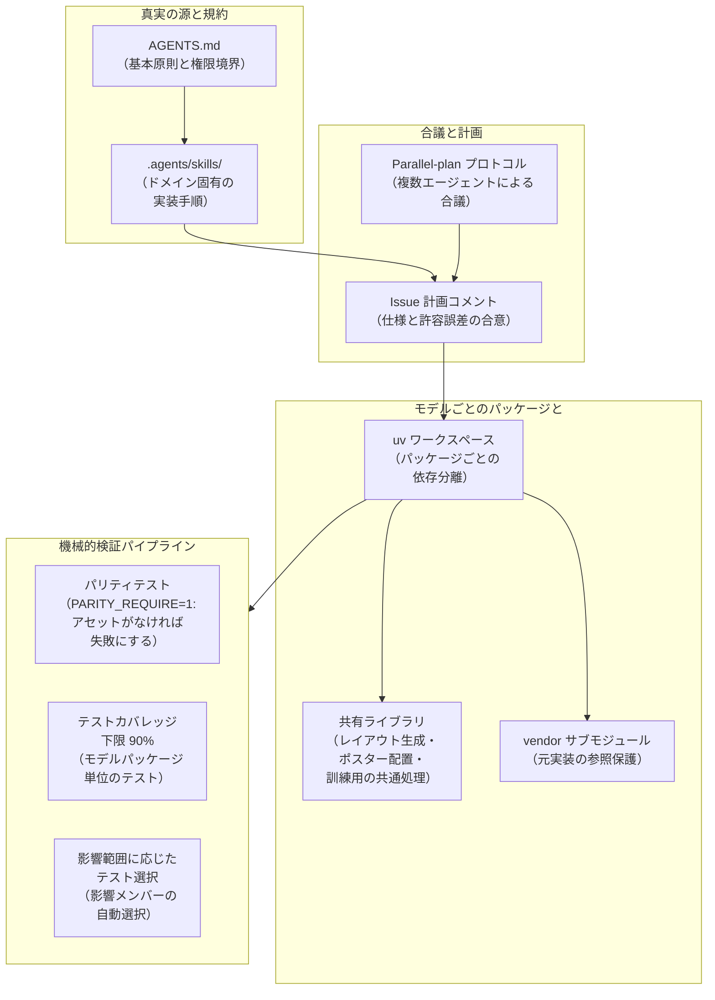
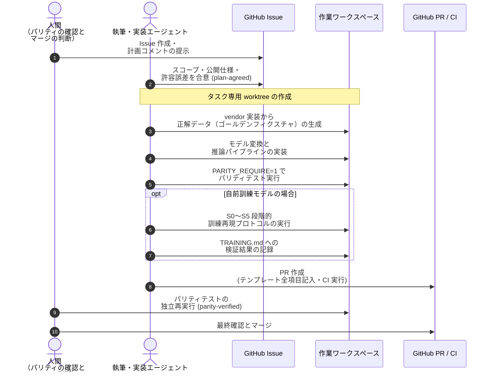
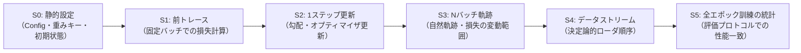

こんにちは [@shunk031](https://twitter.com/shunk031) です。本記事は [法政大学理工学部 Advent Calendar 2026](https://adventar.org/calendars/13106) の 7 日目の記事です。

https://adventar.org/calendars/13106

画像やデザイン生成の研究開発では、毎月のように新しいモデルが発表されます。しかし、公開されている論文実装はフレームワークやデータ形式、依存ライブラリのバージョンがそれぞれ異なります。そのため、自分の研究環境に組み込んで横断的に比較・検証するだけでも大きな負担がかかります。

この課題を解決するため、私はデザイン生成の論文実装を移植・統合するモノレポ [`design-generators`](https://github.com/creative-graphic-design/design-generators)[^design_generators_repo] を、コーディングエージェントを使って進めています。モデルが違っても同じ形の入出力と読み込み方法で扱えるよう、設計をそろえて移植しています。その中核となるのが開発・検証基盤の「ハーネス」で、エージェントが迷わず実装と検証を進められるように規則や検査、手順をまとめた仕組みです。

<!-- 感想: コーディングエージェントによる論文実装の移植について、実際に使ってどうだったか一言 -->

本記事では `design-generators` の構成をもとに、ハーネスの構成要素を紹介します。30 個以上のモデル[^dg_metrics] を移植・再現してきた知見に基づきます。さらに、モデルの追加から再現確認までを実際にどう進めているかも解説します。多数のモデル実装や論文再現をエージェントに任せたいと考えている方の参考になれば幸いです。

# design-generators とは

[`design-generators`](https://github.com/creative-graphic-design/design-generators)[^design_generators_repo] は、デザイン生成の研究を移植・統合するモノレポです。[^dg_readme] 各モデルはフレームワーク別のパッケージとして独立して管理されています。対象は [`🤗 Transformers`](https://huggingface.co/docs/transformers/index)[^transformers] や [`🧨 Diffusers`](https://huggingface.co/docs/diffusers/index)[^diffusers]、[`🤖 Pydantic AI`](https://ai.pydantic.dev/)[^pydantic_ai] です。本リポジトリの目的は、数分で推論できる環境を提供することにあります。[^dg_readme] モデルが違っても同じ形で入力を渡し結果を受け取れる統一された公開スキーマと、変換済みの重みを読み込むメソッド `from_pretrained` により、各論文の環境構築を省きます。

本リポジトリの規模と実装実績を表す主な数値をまとめます。

| 項目 | 計測値 | 備考 |
| --- | ---: | --- |
| モデルパッケージ数 | 34 | `models/` 配下のディレクトリ数およびリポジトリ直下のカタログ行数と一致[^dg_metrics] |
| `REPRODUCING.md` の配置数 | 34 | 全モデルパッケージに再現手順書を完備[^dg_metrics] |
| テストコードファイル数 | 441 | `tests/` 配下の追跡対象 Python ファイル数[^dg_metrics] |
| マージ済みプルリクエスト数 | 276 | 2026年7月16日の初期コミットから11月21日までの累計[^dg_metrics] |

リポジトリ直下のカタログには、30 個以上のモデルが並んでいます。[^dg_readme] CVPR や ICCV、NeurIPS、AAAI といったコンピュータビジョンや機械学習の主要な国際会議で発表されたレイアウト生成や画像生成のモデルです。本リポジトリでは、移植したコードが vendor サブモジュール（= 元の論文実装のリポジトリを Git のサブモジュールとして取り込んだもの）の元実装と数値的に一致するかを確認する方針としています。[^dg_readme] 本記事では、移植したコードの出力が元実装の出力と一致することを「パリティ」と呼びます。単なる再実装にとどまらず、一致確認の自動テスト（パリティテスト）で照合します。カタログ掲載モデルのうち、17 個が元実装とビット完全に一致しています。[^dg_metrics] さらに 14 個が許容誤差内の一致を確認済みです。

# ハーネスの全体像

論文コードの移植を自然言語で依頼するだけでは、失敗しやすくなります。エージェントが都合の良いモックを作り、壊れやすいコードを出力するためです。設計基準を守り、元実装と整合するコードを自律的に書かせるには、エージェントを拘束する「ハーネス」が欠かせません。

`design-generators` では、以下の 5 つの要素を組み合わせてハーネスを構築しています。このうち機械的検証パイプラインには 90% のカバレッジ下限[^dg_checklist] が設定されています。

## 1. 共通規則をまとめる指示書（`AGENTS.md`）

リポジトリルートの [`AGENTS.md`](https://github.com/creative-graphic-design/design-generators/blob/cf04fffc83eb7f3720b3b33dbe417f9117d8288a/AGENTS.md)[^dg_agents_md] では、共通規則を安定かつ簡潔に保ち、実装手順はローカルスキルに置く方針としています。ここでは共通の基本原則のみを定めています。[^dg_agents_md] 命名規則、クラス設計、ワークスペース操作、Issue やプルリクエスト (PR) の追跡ルールが含まれます。頻繁に変わるドメイン固有の知識は、`AGENTS.md` に直接書き込みません。リポジトリローカルなスキル群へと委任する構造を取っています。[^dg_agents_md]

## 2. リポジトリローカルスキル（`.agents/skills/`）

作業の目的に応じて、リポジトリ固有のスキルが `.agents/skills/` 配下に格納されています。[^dg_agents_md]

- `design-generators-model-conversion`: モデル変換、公開インターフェース、出力スキーマなどを規定。[^dg_agents_md]
- `design-generators-documentation`: README やモデルカード、再現手順書の記述規約を規定。[^dg_agents_md]
- `design-generators-training-reproduction`: S0〜S5 の段階的な訓練再現プロトコル（= 設定の確認から全エポックの訓練までの 6 段階）と記録方法を規定。[^dg_agents_md]
- `design-generators-parallel-plan-discussion`: 複数エージェントによる設計合意プロトコルを規定。[^dg_parallel_plan]

特に `parallel-plan` スキルは、複数のエージェントが提案と調停を経て設計を合意します。[^dg_parallel_plan] 複数のコーディングエージェントの作業タブを管理するターミナルツール Herdr（12/1 の記事で紹介したもの）で開いた Git worktree と台帳で合意を形成します。大規模な設計方針の決定を、1 体のエージェントの偏りに依存せず進められます。

## 3. モデルごとのパッケージと共有ライブラリ

Python のパッケージ管理には [`uv`](https://docs.astral.sh/uv/)[^uv] ワークスペースを採用しています。[^dg_readme] 各モデルは `models/<slug>/` 配下の独立メンバーとして管理され、個別の `pyproject.toml` を持ちます。[^dg_checklist] `pyproject.toml` の追加の依存グループ（extra）として `vendor` を分けているため、元実装が必要とするライブラリがほかのモデルの依存と衝突しません。[^dg_checklist]

バウンディングボックスの計算など共通処理は、共有ライブラリへと集約されています。具体的には `lib/laygen` や `lib/posgen`、`lib/traingen` などが用意されています。[^dg_readme]

## 4. 機械的検証と CI パイプライン

コードが基準を満たすかどうかは、人間の感覚で判断せず、継続的インテグレーション (CI)[^github_actions] によって機械的に判定されます。[^dg_ci]

- PR メタデータ検査: PR 本文の Issue 参照やチェックリストの記入を機械検査。[^dg_pr_metadata_check]
- テストのカバレッジ 90% 以上を必須化: パリティテストを除くユニットテストに対し、90% 以上のコード網羅率を強制。[^dg_checklist]
- 依存関係に基づくテスト選択: 依存グラフから、変更の影響を受けるメンバーのみを自動選択してテスト実行。[^dg_ci]

## 5. 検証結果を記録するドキュメント設計

本リポジトリでは、生成したテンソルやチェックポイント、画像などは Git に入れず、再実行に要るメタデータだけをコミットします。[^dg_training_proto] 検証の記録は、モデルの Issue、各パッケージの `TRAINING.md`、PR 本文の検証欄に残します。[^dg_training_proto][^dg_pr_template] 誰でも同じコマンドで数値を確かめ直せるようにするためです。

# モデルを追加する流れ

実際に新しいモデルを `design-generators` に追加し、再現性を確認してマージするまでの一連の流れを見ていきます。

## 1. Issue 起点の設計合意（plan-agreed）

モデルの追加作業は、必ず GitHub の Issue を立てることから始まります。[^dg_agents_md] エージェントは Issue の計画コメントで、対象モデルのスコープや公開インターフェースを明文化します。[^dg_agents_md] 利用データセットや、元実装と比較する許容誤差の基準もここで合意します。

設計方針に変更が生じた場合は、計画コメントを書き換えるのではなく修正コメントを追記します。最新の修正コメントが過去の記述を上書きするルールとしています。そのため、エージェントは設計の経緯と最新の合意事項を混同しません。[^dg_agents_md] 設計が合意されると、Issue のステータスラベルは [`plan-agreed`](https://github.com/creative-graphic-design/design-generators/issues?q=is%3Aissue+state%3Aopen+label%3Aplan-agreed) となります。[^dg_agents_md]

## 2. 専用の worktree での実装と推論パリティ検証（in-progress）

実装段階に入ると、Issue に [`in-progress`](https://github.com/creative-graphic-design/design-generators/issues?q=is%3Aissue+state%3Aopen+label%3Ain-progress) ラベルが付与されます。[^dg_agents_md] 並行して進む作業どうしの変更がぶつからないようにするため、実装作業はメインブランチを直接触らず、独立したタスク専用の Git worktree で行われます。[^dg_checklist]

実装の核となるのが、元実装との一致を確認するゴールデンフィクスチャの準備です。ゴールデンフィクスチャとは、正解の基準として元実装から生成して保存したテスト用データのことです。チェックリストでは、参照生成スクリプトを用い、固定シードと単一 GPU の環境でゴールデンフィクスチャを再生成する運用としています。[^dg_checklist]

続いて、パイプライン基底クラスを継承してモデルパッケージを実装します。生成したゴールデンフィクスチャと比較するパリティテストを実行して整合性を検証します。このとき、テスト環境には `PARITY_REQUIRE=1`[^dg_training_proto] を指定します。必要なアセットがない場合にテストをスキップさせず、確認できないときは失敗として止める設定です。これにより、アセット欠落によるテストの意図しない通過を防ぎます。

## 3. 訓練再現の段階的検証（S0〜S5 プロトコル）

自前で重みを学習する必要があるモデルでは、推論パリティの合格だけでは不十分です。推論コードが一致していても、学習ループに微小な差分があれば性能を再現できないためです。[^dg_training_proto] `design-generators` では、厳格な訓練再現プロトコルを定めており、S0 から S5 までの 6 段階で学習の整合性を検証します。[^dg_training_proto]

| 段階 | 名前 | 確かめること |
| --- | --- | --- |
| S0 | 静的設定と初期状態 | パラメータ数やキー配置、学習率スケジューラが元実装と完全一致することを確認。 |
| S1 | 固定バッチ前トレース | 同一シードとバッチ入力に対し、オプティマイザ更新前の出力と損失の一致を確認。 |
| S2 | 1 ステップ更新 | 1 回の逆伝播と更新を経て、勾配や更新後の重みパラメータの一致を確認。 |
| S3 | 複数バッチ訓練軌跡 | 自然な訓練軌跡を必ず記録し、各ステップが S0〜S2 を満たせば数値の一致とみなし、満たさなければ軌跡を残して同期した診断を足す。 |
| S4 | 決定論的データストリーム | データローダの読み出し順序やデータ拡張、マスク処理が元実装と同一かを確認。 |
| S5 | 全エポック訓練の統計比較 | 全エポックの訓練を実施し、元論文の評価プロトコル下で性能指標が一致することを確認。 |

なお、損失の範囲の確認は S3 とは別の層として扱われます。S5 の前に、元実装とパッケージの条件をそろえた実行を少なくとも 3 回、1,500 更新以上で行います。[^dg_training_proto]

S5 の訓練前には、学習開始前の設定記録（マニフェスト）と評価スクリプトによる出力一致（評価経路のパリティ）の登録を義務づけています。[^dg_training_proto] 設定ハッシュ値や実行コマンドを固定し、評価スクリプトの出力一致を記録します。途中のステップを飛ばして S5 の結果だけで合格と主張することは禁じられています。すべての検証結果は各パッケージの `TRAINING.md` に記録されます。

## 4. PR 作成と独立した検証（parity-verified）

実装と検証が完了すると、エージェントは指定テンプレートに従って PR を作成します。[^dg_agents_md] テンプレートには変更概要や検証コマンド、共有ライブラリへの影響を記入します。[^dg_pr_template]

PR 作成後は、CI による静的解析や型検査、ユニットテストが自動実行されます。[^dg_ci] さらにマージ前の関門として、担当外の人間やコーディネーターが独立環境でパリティテストを再実行します。[^dg_agents_md] コーディネーターとは、担当とは別にパリティテストを独立に再実行して結果を確かめる役割のことです。[^dg_agents_md] この独立再実行に合格して初めて [`parity-verified`](https://github.com/creative-graphic-design/design-generators/issues?q=is%3Aissue+state%3Aopen+label%3Aparity-verified) ラベルが付与され、マージされます。[^dg_agents_md]

# software factory として見ると

AI エージェントの実用化に伴い、エージェントが実装からレビューまでを担う開発の仕組みを指す「software factory」という言葉が注目されています。たとえば Vercel は、エージェントが実装からレビューまで担うワークフローを software factory と呼んでいます。[^vercel_factory] Stripe の Minions も、決定論的ツールを活用してテスト済み PR を生み出す仕組みを報告しています。[^stripe_minions] Uber は、開発ライフサイクル全体にわたる検証や保守を担う自律基盤を論じています。[^uber_factory] 学術界でも、GitHub などの共有掲示板と定常的な目標を持つエージェント群の仕組みが提案されています。[^instant_factories] これらの議論を踏まえると、本リポジトリは論文実装の再現に特化した software factory と捉えられます。

ただし、人間が何もしなくてよい完全自動の無人工場ではありません。パリティの確認はコーディネーターが独立に再実行して行い、マージは人間が判断します。[^dg_agents_md][^dg_checklist] 本リポジトリが示すのは、環境と検証プロセスが疎かであればエージェントは破綻するという教訓です。

エージェントに元実装と整合するコードを書かせるには、次のような「足場」の設計が機能しました。

- 自由記述を許さないインターフェース規約と公開スキーマ
- 過去の決定事項を迷わせない Issue の計画コメントと修正ルール
- 依存の衝突を防ぐワークスペースの分離
- 表層的な動作確認を許さず、確認できないときは失敗として止める `PARITY_REQUIRE=1` によるテスト
- 推論一致と学習再現を混同させない S0〜S5 の段階的プロトコル
- 独立した第三者によるパリティ再実行の関門

これらが揃うことで、エージェントは迷走せず 30 個以上のモデル[^dg_metrics] を実装できました。開発プロセスと品質保証をコード化した仕組みこそが、私がハーネスと呼ぶ基盤の正体です。

# まとめ

本記事では、30 個以上のモデル[^dg_metrics] を移植する `design-generators` のハーネスを紹介しました。共通設計と検証プロセスにより、エージェントを自律的に走らせる構成です。エージェントの能力を引き出す鍵は、プロンプトの工夫だけではありません。インターフェースを定義し、機械検証で外枠を固める「ハーネスの設計」が重要です。

多数のモデルを比較検証したい研究や、大規模コードベースを運用する場面は増えています。そうした課題では、プロンプト調整だけでなく、テストや検証結果を記録する仕組み化に目を向けてみてください。

<!-- 感想: ハーネスを導入したエージェント運用の実感について、実際に使ってどうだったか一言 -->

<!-- textlint-disable -->

[^design_generators_repo]: https://github.com/creative-graphic-design/design-generators
[^transformers]: https://huggingface.co/docs/transformers/index
[^diffusers]: https://huggingface.co/docs/diffusers/index
[^pydantic_ai]: https://ai.pydantic.dev/
[^dg_readme]: [design-generators README.md](https://github.com/creative-graphic-design/design-generators/blob/cf04fffc83eb7f3720b3b33dbe417f9117d8288a/README.md)
[^dg_metrics]: [design-generators research facts: metrics](https://github.com/creative-graphic-design/design-generators/blob/cf04fffc83eb7f3720b3b33dbe417f9117d8288a/README.md#L23-L62)
[^dg_agents_md]: [design-generators AGENTS.md](https://github.com/creative-graphic-design/design-generators/blob/cf04fffc83eb7f3720b3b33dbe417f9117d8288a/AGENTS.md)
[^dg_parallel_plan]: [design-generators parallel-plan SKILL.md](https://github.com/creative-graphic-design/design-generators/blob/cf04fffc83eb7f3720b3b33dbe417f9117d8288a/.agents/skills/design-generators-parallel-plan-discussion/SKILL.md)
[^uv]: https://docs.astral.sh/uv/
[^dg_checklist]: [design-generators implementation-checklist.md](https://github.com/creative-graphic-design/design-generators/blob/cf04fffc83eb7f3720b3b33dbe417f9117d8288a/docs/implementation-checklist.md)
[^github_actions]: https://github.com/features/actions
[^dg_ci]: [design-generators ci.yml](https://github.com/creative-graphic-design/design-generators/blob/cf04fffc83eb7f3720b3b33dbe417f9117d8288a/.github/workflows/ci.yml)
[^dg_pr_metadata_check]: design-generators PR metadata check: [ci.yml](https://github.com/creative-graphic-design/design-generators/blob/cf04fffc83eb7f3720b3b33dbe417f9117d8288a/.github/workflows/ci.yml#L43-L48), [check_pr_issue_reference.py](https://github.com/creative-graphic-design/design-generators/blob/cf04fffc83eb7f3720b3b33dbe417f9117d8288a/scripts/check_pr_issue_reference.py#L319-L355)
[^dg_training_proto]: [design-generators training-reproduction.md](https://github.com/creative-graphic-design/design-generators/blob/cf04fffc83eb7f3720b3b33dbe417f9117d8288a/docs/training-reproduction.md)
[^dg_pr_template]: [design-generators PULL_REQUEST_TEMPLATE.md](https://github.com/creative-graphic-design/design-generators/blob/cf04fffc83eb7f3720b3b33dbe417f9117d8288a/.github/PULL_REQUEST_TEMPLATE.md)
[^vercel_factory]: Vercel, "Building a software factory for AI SDK", https://vercel.com/blog/building-a-software-factory-for-ai-sdk
[^stripe_minions]: Stripe, "Minions: Stripe’s one-shot, end-to-end coding agents", https://stripe.dev/blog/minions-stripes-one-shot-end-to-end-coding-agents
[^uber_factory]: Uber, "Building a high-performance AI software factory", https://www.uber.com/blog/efficient-software-factory/
[^instant_factories]: "Instant Software Factories: Scaling Autonomous Coding with Infinite-Context LLMs", https://arxiv.org/abs/2610.36254

<!-- textlint-enable -->
