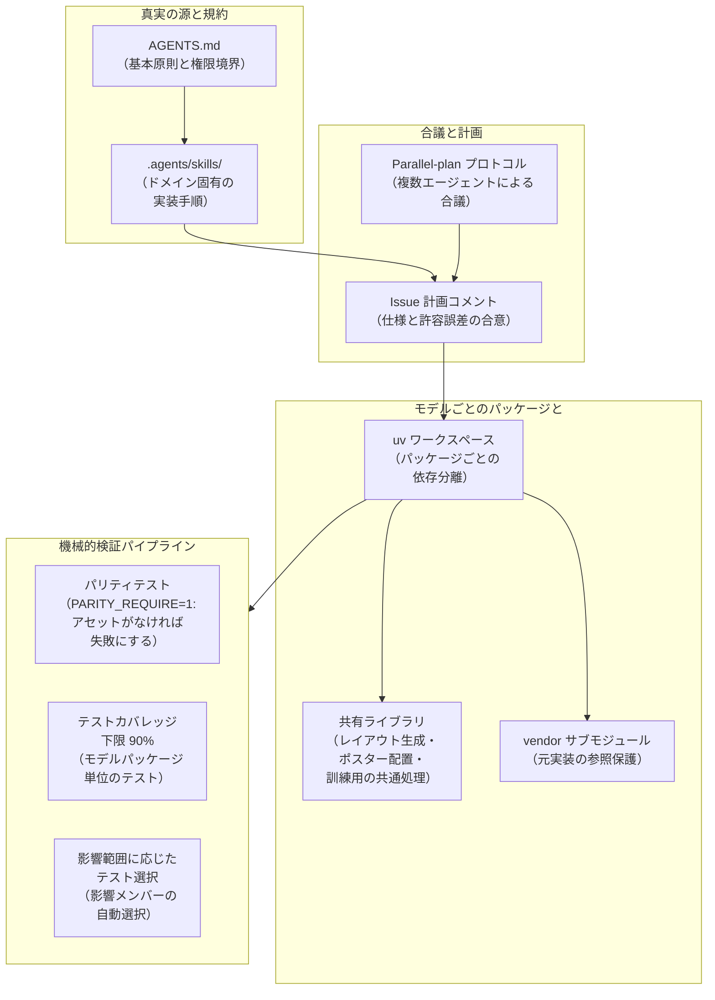
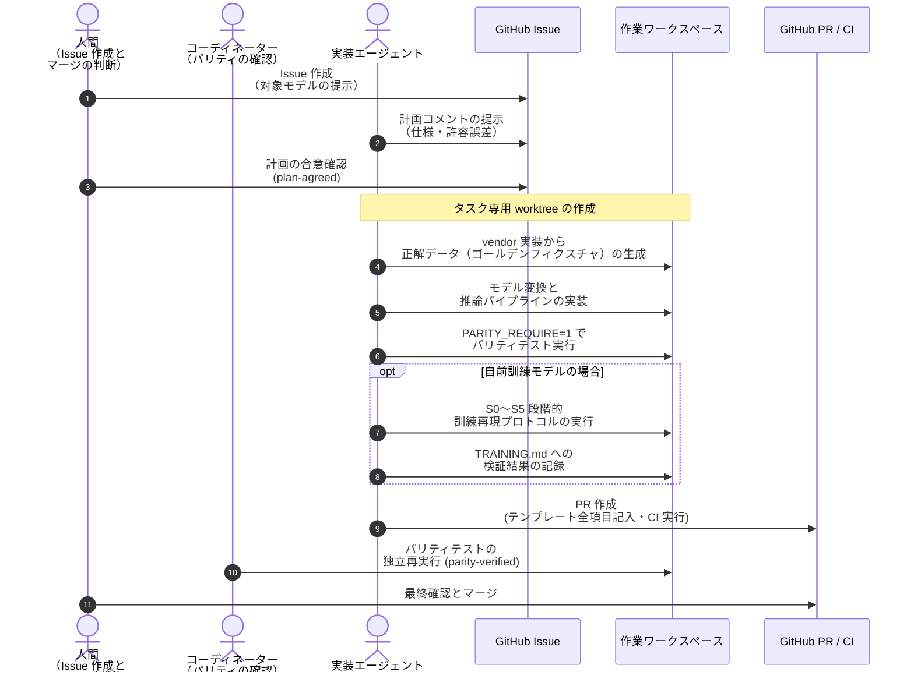
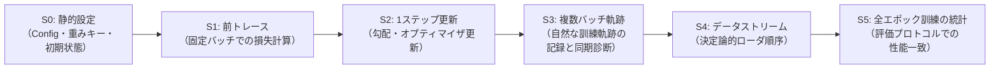

こんにちは [@shunk031](https://twitter.com/shunk031) です。本記事は [法政大学理工学部 Advent Calendar 2026](https://adventar.org/calendars/13106) の 7 日目の記事です。

https://adventar.org/calendars/13106

画像やデザイン生成の研究開発では、毎月のように新しいモデルが発表されます。しかし、公開されている論文実装はフレームワークやデータ形式、依存ライブラリのバージョンがそれぞれ異なります。そのため、自分の研究環境に組み込んで横断的に比較・検証するだけでも大きな負担がかかります。

この課題を解決するため、私はデザイン生成の論文実装を移植・統合するモノレポ [`design-generators`](https://github.com/creative-graphic-design/design-generators) を、コーディングエージェントを使って進めています。本リポジトリではすでに 17 個のモデルが元実装とビット完全一致し、さらに 14 個が許容誤差内の一致を確認済みです。[^dg_metrics] モデルが違っても同じ形の入出力と読み込み方法で扱えるよう、設計をそろえて移植しています。その中核となるのが開発・検証基盤の「ハーネス」で、エージェントが迷わず実装と検証を進められるように規則や検査、手順をまとめた仕組みです。

https://github.com/creative-graphic-design/design-generators

<!-- 感想: コーディングエージェントによる論文実装の移植について、実際に使ってどうだったか一言 -->

本記事では `design-generators` の構成をもとに、ハーネスの構成要素を紹介します。30 個以上のモデル[^dg_metrics] を移植・再現してきた知見に基づきます。さらに、モデルの追加から再現確認までを実際にどう進めているかも解説します。多数のモデル実装や論文再現をエージェントに任せたいと考えている方の参考になれば幸いです。

# design-generators とは

[`design-generators`](https://github.com/creative-graphic-design/design-generators)[^design_generators_repo] は、デザイン生成の研究を移植・統合するモノレポです。[^dg_readme] 各モデルはフレームワーク別のパッケージとして独立して管理されています。対象は [`🤗 Transformers`](https://huggingface.co/docs/transformers/index)[^transformers] や [`🧨 Diffusers`](https://huggingface.co/docs/diffusers/index)[^diffusers]、[`🤖 Pydantic AI`](https://ai.pydantic.dev/)[^pydantic_ai] です。本リポジトリの目的は、数分で推論できる環境を提供することにあります。[^dg_readme] モデルが違っても同じ形で入力を渡し結果を受け取れる統一された公開スキーマと、変換済みの重みを読み込むメソッド `from_pretrained` により、各論文の環境構築を省きます。

本リポジトリの規模と実装実績を表す主な数値をまとめます。

| 項目                       | 計測値 | 備考                                                                                |
| -------------------------- | -----: | ----------------------------------------------------------------------------------- |
| モデルパッケージ数         |     34 | `models/` 配下のディレクトリ数およびリポジトリ直下のカタログ行数と一致[^dg_metrics] |
| `REPRODUCING.md` の配置数  |     34 | 全モデルパッケージに推論再現手順書を完備[^dg_metrics]                               |
| テストコードファイル数     |    441 | `tests/` 配下の追跡対象 Python ファイル数[^dg_metrics]                              |
| マージ済みプルリクエスト数 |    276 | 2026 年 7 月 16 日の初期コミットから 11 月 21 日までの累計[^dg_metrics]             |

リポジトリ直下のカタログには、30 個以上のモデルが並んでいます。[^dg_readme] CVPR や ICCV、NeurIPS、AAAI といったコンピュータビジョンや機械学習の主要な国際会議で発表されたレイアウト生成や画像生成のモデルです。本リポジトリでは、移植したコードが vendor サブモジュール（= 元の論文実装のリポジトリを Git のサブモジュールとして取り込んだもの）の元実装と数値的に一致するかを確認する方針としています。[^dg_readme] 本記事では、移植したコードの出力が元実装の出力と一致することを「パリティ」と呼びます。単なる再実装にとどまらず、一致確認の自動テスト（パリティテスト）で照合します。カタログ掲載モデルのうち、17 個が元実装とビット完全に一致しています。[^dg_metrics] さらに 14 個が許容誤差内の一致を確認済みです。

# ハーネスの全体像

論文コードの移植を自然言語で依頼するだけでは、失敗しやすくなります。エージェントが都合の良いモックを作り、壊れやすいコードを出力するためです。設計基準を守り、元実装と整合するコードを自律的に書かせるには、エージェントを拘束する「ハーネス」が欠かせません。

`design-generators` では、以下の 5 つの要素を組み合わせてハーネスを構築しています。このうち機械的検証パイプラインには 90% のカバレッジ下限[^dg_checklist] が設定されています。

## 1. 共通規則をまとめる指示書（`AGENTS.md`）

指示を小さく保てばルール違反や迷走を減らしやすくなるため、全モデル共通の基本原則だけを守らせる方針としています。リポジトリルートの [`AGENTS.md`](https://github.com/creative-graphic-design/design-generators/blob/cf04fffc83eb7f3720b3b33dbe417f9117d8288a/AGENTS.md)[^dg_agents_md] では、命名規則やクラス設計、ワークスペース操作、Issue やプルリクエスト (PR) の追跡ルールのみを定めています。ドメイン固有の手順を直接書き込まずローカルスキルへと委任することで、共通規則を簡潔に保っています。[^dg_agents_md]

## 2. リポジトリローカルスキル（`.agents/skills/`）

作業ごとに必要な専門手順だけをエージェントへ読み込ませ、文脈の圧迫を抑えて作業精度を高める狙いがあります。リポジトリ固有の手順は `.agents/skills/` 配下のスキルにまとめています。[^dg_agents_md]

- `design-generators-model-conversion`: モデル変換、公開インターフェース、出力スキーマなどを規定。[^dg_agents_md]
- `design-generators-documentation`: README やモデルカード、再現手順書の記述規約を規定。[^dg_agents_md]
- `design-generators-training-reproduction`: S0〜S5 の段階的な訓練再現プロトコル（= 設定の確認から全エポックの訓練までの 6 段階）と記録方法を規定。[^dg_agents_md]
- `design-generators-parallel-plan-discussion`: 複数エージェントによる設計合意プロトコル（= parallel-plan スキル）を規定。[^dg_parallel_plan]

特に `parallel-plan` スキルは、複数のエージェントが提案と調停を経て設計を合意します。[^dg_parallel_plan] 複数のエージェントの作業タブを管理するターミナルツール Herdr（12/1 の記事で紹介したもの）で開いた作業環境（Git worktree）上の合意記録ファイルを用いて合意を形成します。大規模な設計方針の決定で、1 体のエージェントの偏りに依存するリスクを減らせます。

## 3. モデルごとのパッケージと共有ライブラリ

多数の論文実装を 1 つのリポジトリへ統合しても、ライブラリのバージョン衝突を避けやすくなります。Python のパッケージ管理には [`uv`](https://docs.astral.sh/uv/)[^uv] ワークスペースを採用しています。[^dg_readme] 各モデルを `models/<slug>/` 配下の独立メンバーとして管理し、個別の `pyproject.toml` を持たせています。[^dg_checklist] 元実装が必要とする依存は追加グループ（extra）の `vendor` に分けることで、モデル間の衝突を防いでいます。[^dg_checklist]

バウンディングボックス計算などの共通処理は共有ライブラリ（`lib/laygen` や `lib/posgen`、`lib/traingen`）へ集約し、車輪の再発明を防いでいます。[^dg_readme]

## 4. 機械的検証と CI パイプライン

エージェントが書いたコードの品質を人間が毎回細かく見張らなくても、機械的な関門で水準を保ちやすくする狙いがあります。継続的インテグレーション (CI)[^github_actions] により、品質基準を満たしているかを機械的に判定します。[^dg_ci]

- PR メタデータ検査: PR 本文の Issue 参照やチェックリストの記入を機械検査。[^dg_pr_metadata_check]
- テストのカバレッジ 90% 以上を必須化: パリティテストを除くユニットテストに対し、90% 以上のコード網羅率を強制。[^dg_checklist]
- 依存関係に基づくテスト選択: 依存グラフから、変更の影響を受けるメンバーのみを自動選択してテスト実行。[^dg_ci]

## 5. 検証結果を記録するドキュメント設計

不要な生成物によるリポジトリの肥大化を抑え、同じコマンドで数値を確かめ直せる再現性を高めやすくなります。推論や環境構築の手順は `REPRODUCING.md`、学習の検証記録は `TRAINING.md` に分けて管理します。巨大なテンソルや画像は Git に含めず、再現に要るメタデータのみを Issue や PR 本文、各パッケージのドキュメントに残す設計としています。[^dg_training_proto][^dg_pr_template]

# モデルを追加する流れ

実際に新しいモデルを `design-generators` に追加し、再現性を確認してマージするまでの一連の流れを見ていきます。

## 1. Issue 起点の設計合意（plan-agreed）

モデルの追加作業は、必ず GitHub の Issue を立てることから始まります。[^dg_agents_md] エージェントは Issue の計画コメントで、対象モデルのスコープや公開インターフェースを明文化します。[^dg_agents_md] 利用データセットや、元実装と比較する許容誤差の基準もここで合意します。

設計方針に変更が生じた場合は、計画コメントを書き換えるのではなく修正コメントを追記します。最新の修正コメントが過去の記述を上書きするルールとしています。この運用により、エージェントが設計の経緯と最新の合意事項を混同するリスクを減らせます。[^dg_agents_md] 設計が合意されると、Issue のステータスラベルは [`plan-agreed`](https://github.com/creative-graphic-design/design-generators/issues?q=is%3Aissue+state%3Aopen+label%3Aplan-agreed) となります。[^dg_agents_md]

## 2. 専用の worktree での実装と推論パリティ検証（in-progress）

実装段階に入ると、Issue に [`in-progress`](https://github.com/creative-graphic-design/design-generators/issues?q=is%3Aissue+state%3Aopen+label%3Ain-progress) ラベルが付与されます。[^dg_agents_md] 並行して進む作業どうしの変更がぶつからないようにするため、実装作業はメインブランチを直接触らず、独立したタスク専用の Git worktree で行われます。[^dg_checklist]

実装の核となるのが、元実装との一致を確認するゴールデンフィクスチャの準備です。ゴールデンフィクスチャとは、正解の基準として元実装から生成して保存したテスト用データのことです。チェックリストでは、参照生成スクリプトを用い、固定シードと単一 GPU の環境でゴールデンフィクスチャを再生成する運用としています。[^dg_checklist]

続いて、パイプライン基底クラスを継承してモデルパッケージを実装します。生成したゴールデンフィクスチャと比較するパリティテストを実行して整合性を検証します。このとき、テスト環境には `PARITY_REQUIRE=1`[^dg_training_proto] を指定し、アセット欠落によるテストの意図しない通過を防ぎます。

## 3. 訓練再現の段階的検証（S0〜S5 プロトコル）

自前で重みを学習する必要があるモデルでは、推論パリティの合格だけでは不十分です。推論コードが一致していても、学習ループに微小な差分があれば性能を再現できないためです。[^dg_training_proto] `design-generators` では、厳格な訓練再現プロトコルを定めており、S0 から S5 までの 6 段階で学習の整合性を検証します。[^dg_training_proto]

| 段階 | 名前                     | 確かめること                                                                                                                 |
| ---- | ------------------------ | ---------------------------------------------------------------------------------------------------------------------------- |
| S0   | 静的設定と初期状態       | パラメータ数やキー配置、学習率スケジューラが元実装と完全一致することを確認。                                                 |
| S1   | 固定バッチ前トレース     | 同一シードとバッチ入力に対し、オプティマイザ更新前の出力と損失の一致を確認。                                                 |
| S2   | 1 ステップ更新           | 1 回の逆伝播と更新を経て、勾配や更新後の重みパラメータの一致を確認。                                                         |
| S3   | 複数バッチ訓練軌跡       | 自然な訓練軌跡を必ず記録し、各ステップが S0〜S2 を満たせば数値の一致とみなし、満たさなければ軌跡を残して同期した診断を足す。 |
| S4   | 決定論的データストリーム | データローダの読み出し順序やデータ拡張、マスク処理が元実装と同一かを確認。                                                   |
| S5   | 全エポック訓練の統計比較 | 全エポックの訓練を実施し、元論文の評価プロトコル下で性能指標が一致することを確認。                                           |

なお、損失の範囲の確認は S3 とは別の層として扱われます。S5 の前に、元実装とパッケージの条件をそろえた実行を少なくとも 3 回、1,500 更新以上で行います。[^dg_training_proto]

S5 の訓練前には、学習開始前の設定記録（マニフェスト）と評価スクリプトによる出力一致（評価経路のパリティ）の登録を義務づけています。[^dg_training_proto] 設定ハッシュ値や実行コマンドを固定し、評価スクリプトの出力一致を記録します。途中のステップを飛ばして S5 の結果だけで合格と主張することは禁じられています。すべての検証結果は各パッケージの `TRAINING.md` に記録されます。

## 4. PR 作成と独立した検証（parity-verified）

実装と検証が完了すると、エージェントは指定テンプレートに従って PR を作成します。[^dg_agents_md] テンプレートには変更概要や検証コマンド、共有ライブラリへの影響を記入します。[^dg_pr_template]

PR 作成後は、CI による静的解析や型検査、ユニットテストが自動実行されます。[^dg_ci] さらにマージ前の関門として、コーディネーターが独立環境でパリティテストを再実行します。[^dg_agents_md] コーディネーターとは、実装担当とは別にパリティテストを独立に再実行して結果を確かめる役割のことです。[^dg_agents_md] この独立再実行に合格して初めて [`parity-verified`](https://github.com/creative-graphic-design/design-generators/issues?q=is%3Aissue+state%3Aopen+label%3Aparity-verified) ラベルが付与され、マージされます。[^dg_agents_md]

# まとめ

AI エージェントが実装から検証までを自律的に進める開発基盤は、近年「software factory」として議論されています。たとえば Vercel の自律開発ワークフロー[^vercel_factory] や、Stripe が報告する決定論的ツールによるテスト済み PR 生成[^stripe_minions]、Uber の自律検証基盤[^uber_factory]、共有掲示板を介した複数エージェント協調[^instant_factories] などです。本リポジトリのハーネスも、論文実装の再現に特化した software factory と捉えられます。

ただし、人間が関与しない無人工場ではありません。パリティの確認はコーディネーターが独立に再実行して行い、マージは人間が判断します。[^dg_agents_md][^dg_checklist] 本リポジトリが示すのは、インターフェースを定義し、機械検証で外枠を固める「ハーネスの設計」があって初めてエージェントが自律的に走れるということです。30 個以上のモデル[^dg_metrics] を移植できたのも、`uv` による依存分離やアセット欠落を許さない `PARITY_REQUIRE=1`、S0〜S5 プロトコルといった足場をコード化した結果です。

多数のモデルを比較検証したい研究や、大規模コードベースを自律的に保守する場面において、プロンプト調整だけでなく、テストや検証結果を記録する仕組み化の参考になれば幸いです。

<!-- 感想: ハーネスを導入したエージェント運用の実感について、実際に使ってどうだったか一言 -->

[^design_generators_repo]: https://github.com/creative-graphic-design/design-generators
[^transformers]: https://huggingface.co/docs/transformers/index
[^diffusers]: https://huggingface.co/docs/diffusers/index
[^pydantic_ai]: https://ai.pydantic.dev/
[^dg_readme]: [design-generators README.md](https://github.com/creative-graphic-design/design-generators/blob/cf04fffc83eb7f3720b3b33dbe417f9117d8288a/README.md)
[^dg_metrics]: [design-generators research facts: metrics](https://github.com/creative-graphic-design/design-generators/blob/cf04fffc83eb7f3720b3b33dbe417f9117d8288a/README.md#L23-L62)
[^dg_agents_md]: [design-generators AGENTS.md](https://github.com/creative-graphic-design/design-generators/blob/cf04fffc83eb7f3720b3b33dbe417f9117d8288a/AGENTS.md)
[^dg_parallel_plan]: [design-generators parallel-plan SKILL.md](https://github.com/creative-graphic-design/design-generators/blob/cf04fffc83eb7f3720b3b33dbe417f9117d8288a/.agents/skills/design-generators-parallel-plan-discussion/SKILL.md)
[^uv]: https://docs.astral.sh/uv/
[^dg_checklist]: [design-generators implementation-checklist.md](https://github.com/creative-graphic-design/design-generators/blob/cf04fffc83eb7f3720b3b33dbe417f9117d8288a/docs/implementation-checklist.md)
[^github_actions]: https://github.com/features/actions
[^dg_ci]: [design-generators ci.yml](https://github.com/creative-graphic-design/design-generators/blob/cf04fffc83eb7f3720b3b33dbe417f9117d8288a/.github/workflows/ci.yml)
[^dg_pr_metadata_check]: design-generators PR metadata check: [ci.yml](https://github.com/creative-graphic-design/design-generators/blob/cf04fffc83eb7f3720b3b33dbe417f9117d8288a/.github/workflows/ci.yml#L43-L48), [check_pr_issue_reference.py](https://github.com/creative-graphic-design/design-generators/blob/cf04fffc83eb7f3720b3b33dbe417f9117d8288a/scripts/check_pr_issue_reference.py#L319-L355)
[^dg_training_proto]: [design-generators training-reproduction.md](https://github.com/creative-graphic-design/design-generators/blob/cf04fffc83eb7f3720b3b33dbe417f9117d8288a/docs/training-reproduction.md)
[^dg_pr_template]: [design-generators PULL_REQUEST_TEMPLATE.md](https://github.com/creative-graphic-design/design-generators/blob/cf04fffc83eb7f3720b3b33dbe417f9117d8288a/.github/PULL_REQUEST_TEMPLATE.md)
[^vercel_factory]: Vercel, "Building a software factory for AI SDK", https://vercel.com/blog/building-a-software-factory-for-ai-sdk
[^stripe_minions]: Stripe, "Minions: Stripe’s one-shot, end-to-end coding agents", https://stripe.dev/blog/minions-stripes-one-shot-end-to-end-coding-agents
[^uber_factory]: Uber, "Building a high-performance AI software factory", https://www.uber.com/blog/efficient-software-factory/
[^instant_factories]: "Instant Software Factories: Scaling Autonomous Coding with Infinite-Context LLMs", https://arxiv.org/abs/2610.36254
