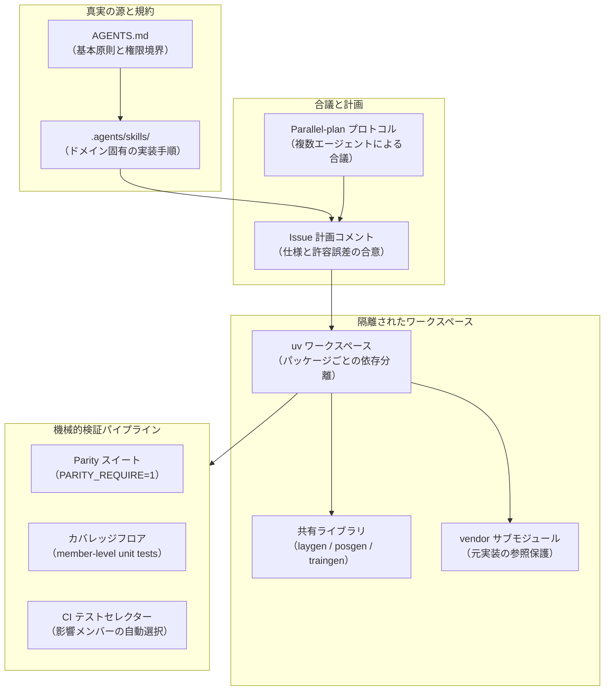
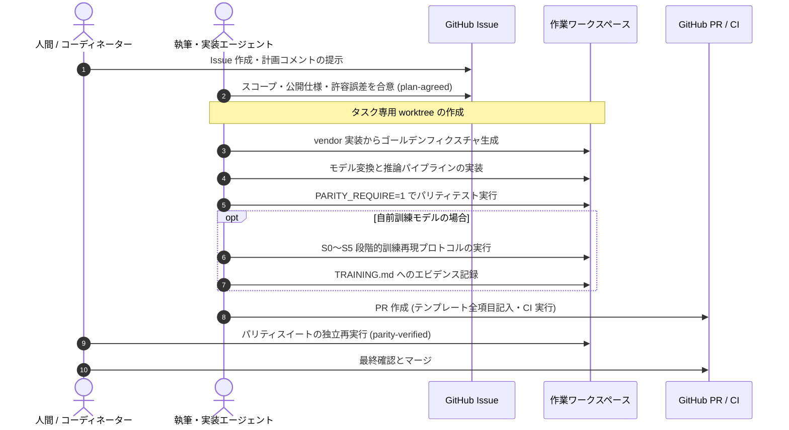
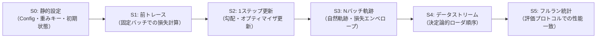

こんにちは [@shunk031](https://twitter.com/shunk031) です。本記事は [法政大学理工学部 Advent Calendar 2026](https://adventar.org/calendars/13106) の 7 日目の記事です。

https://adventar.org/calendars/13106

画像やデザイン生成の研究開発では、毎月のように新しいモデルが発表されます。しかし、公開されている論文実装はフレームワークやデータ形式、依存ライブラリのバージョンがそれぞれ異なります。そのため、自分の研究環境に組み込んで横断的に比較・検証するだけでも大きな負担がかかります。

この課題を解決するため、私たちはコーディングエージェントを活用してきました。主要なモデルを共通設計で移植・再現するプロジェクトが、[`design-generators`](https://github.com/creative-graphic-design/design-generators)[^design_generators_repo] です。その中核となるのが開発・検証基盤の「ハーネス」です。エージェントによるコード実装と再現性検証を自律的に進める役割を担います。

<!-- 感想: コーディングエージェントによる論文実装の移植について、実際に使ってどうだったか一言 -->

本記事では `design-generators` の構成をもとに、ハーネスの構成要素を紹介します。34 個のモデルパッケージ[^dg_metrics] を移植・再現してきた知見に基づきます。さらに、モデルの追加から再現確認までのサイクルを現場でどう回しているのかを解説します。多数のモデル実装や論文再現をエージェントに任せたいと考えている方の参考になれば幸いです。

# design-generators とは

[`design-generators`](https://github.com/creative-graphic-design/design-generators)[^design_generators_repo] は、デザイン生成の研究を移植・統合するモノレポです。[^dg_readme] 各モデルはフレームワーク別のパッケージとして独立して管理されています。対象は [`🤗 Transformers`](https://huggingface.co/docs/transformers/index)[^transformers] や [`🧨 Diffusers`](https://huggingface.co/docs/diffusers/index)[^diffusers]、[`🤖 Pydantic AI`](https://ai.pydantic.dev/)[^pydantic_ai] です。

本リポジトリの目的は、数分で推論できる環境を提供することにあります。[^dg_readme] 統一された公開スキーマと `from_pretrained` により、各論文の環境構築を省きます。出力形式もタスクごとに標準化されています。レイアウト生成 API では、正規化した中心座標 `xywh` の共通スキーマを採用しています。[^dg_conventions] 座標値は $[0, 1]$ 空間とし、[`jaxtyping`](https://docs.kidger.site/jaxtyping/)[^jaxtyping] で形状注釈を付与しています。画像生成の `StructureDiffusion` は生成画像を直接返します。このように、タスクごとに明確なインターフェースを整えています。

本リポジトリの規模と実装実績を表す主な数値をまとめます。

| 項目 | 計測値 | 備考 |
| --- | ---: | --- |
| モデルパッケージ数 | 34 | `models/` 配下のディレクトリ数およびルートカタログ行数と一致[^dg_metrics] |
| `REPRODUCING.md` の配置数 | 34 | 全モデルパッケージに再現手順書を完備[^dg_metrics] |
| `TRAINING.md` の配置数 | 14 | 自前で訓練を行うパッケージ向けの手順書[^dg_metrics] |
| テストコードファイル数 | 441 | `tests/` 配下の追跡対象 Python ファイル数[^dg_metrics] |
| Python コード行数 | 133,585 | `tests/` および `vendor/` を除く実装コードの行数[^dg_metrics] |
| マージ済みプルリクエスト数 | 276 | 2026年7月16日の初期コミットから11月21日までの累計[^dg_metrics] |
| 登録 Issue 数 | 250 | open および closed の合計件数[^dg_metrics] |

リポジトリ直下のカタログには、34 種類のモデルが並んでいます。[^dg_readme] CVPR や ICCV、NeurIPS、AAAI など主要な国際会議で発表された研究です。以下は、収録されている代表的なモデルとその概要です。

| モデル名 | 論文名 | 発表先・年 | パリティ検証状況 |
| --- | --- | --- | --- |
| BASNet[^basnet] | BASNet: Boundary-Aware Salient Object Detection | CVPR 2019 | bit-exact |
| CanvasVAE[^canvas_vae] | CanvasVAE: Learning To Generate Vector Graphic Documents | ICCV 2021 | tolerance-verified |
| CGB-DM[^cgb_dm] | CGB-DM: Content and Graphic Balance Layout Generation with Transformer-based Diffusion Model | arXiv 2024 | tolerance-verified |
| Coarse-to-Fine[^coarse_to_fine] | Coarse-to-Fine Generative Modeling for Graphic Layouts | AAAI 2022 | tolerance-verified |
| Collage Diffusion[^collage_diffusion] | Collage Diffusion | WACV 2024 | tolerance-verified |
| DLT[^dlt] | Discrete-Continuous Layout Transformer for Layout Generation | ICCV 2023 | practical-reproduction |
| DS-GAN[^ds_gan] | PosterLayout: A New Benchmark and Approach for Content-Aware Visual-Textual Presentation Layout | CVPR 2023 | bit-exact |
| LACE[^lace] | Towards Aligned Layout Generation via Diffusion Model with Aesthetic Constraints | ICLR 2024 | bit-exact |
| LayoutDM[^layout_dm] | LayoutDM: Discrete Diffusion Model for Controllable Layout Generation | CVPR 2023 | tolerance-verified |
| LayoutFormer++[^layoutformerpp] | LayoutFormer++: Conditional Graphic Layout Generation via Constraint Serialization and Decoding Space Restriction | CVPR 2023 | bit-exact |
| LayoutGAN++[^layoutganpp] | Constrained Graphic Layout Generation via Latent Optimization | ACM MM 2021 | tolerance-verified |
| RALF[^ralf] | Retrieval-Augmented Layout Transformer for Content-Aware Layout Generation | CVPR 2024 | bit-exact |
| TKG-DM[^tkg_dm] | TKG-DM: Training-free Chroma Key Content Generation Diffusion Model | CVPR 2025 | tolerance-verified |

本リポジトリでは、移植したコードが vendor サブモジュールの元実装と数値的に一致するかを確認する方針としています。[^dg_readme] 単なる再実装にとどまらず、一致確認の自動テストで照合します。カタログ掲載モデルのうち、17 個が元実装とビット完全に一致しています。[^dg_metrics] さらに 14 個が許容誤差内の一致を確認済みです。

# ハーネスの全体像

論文コードの移植を自然言語で依頼するだけでは、失敗しやすくなります。エージェントが都合の良いモックを作り、壊れやすいコードを出力するためです。設計基準を守り、元実装と整合するコードを自律的に書かせるには、エージェントを拘束する「ハーネス」が欠かせません。

`design-generators` では、以下の 5 つの要素を組み合わせてハーネスを構築しています。このうち機械的検証パイプラインには 90% のカバレッジ下限[^dg_checklist] が設定されています。

## 1. 共通規則をまとめる指示書（`AGENTS.md`）

リポジトリルートの [`AGENTS.md`](https://github.com/creative-graphic-design/design-generators/blob/cf04fffc83eb7f3720b3b33dbe417f9117d8288a/AGENTS.md)[^dg_agents_md] では、共通規則を安定かつ簡潔に保ち、実装手順はローカルスキルに置く方針としています。

ここでは共通の基本原則のみを定めています。[^dg_agents_md] 命名規則、クラス設計、ワークスペース操作、Issue やプルリクエスト (Pull Request; PR) の追跡ルールが含まれます。頻繁に変わるドメイン固有の知識は、`AGENTS.md` に直接書き込みません。リポジトリローカルなスキル群へと委任する構造を取っています。[^dg_agents_md]

## 2. リポジトリローカルスキル（`.agents/skills/`）

作業の目的に応じて、リポジトリ固有のスキルが `.agents/skills/` 配下に格納されています。[^dg_agents_md]

- `design-generators-model-conversion`: モデル変換、公開インターフェース、出力スキーマなどを規定。[^dg_agents_md]
- `design-generators-documentation`: README やモデルカード、再現手順書の記述規約を規定。[^dg_agents_md]
- `design-generators-training-reproduction`: S0〜S5 の段階的な訓練再現プロトコルと記録方法を規定。[^dg_agents_md]
- `design-generators-parallel-plan-discussion`: 複数エージェントによる設計合意プロトコルを規定。[^dg_parallel_plan]

特に `parallel-plan` スキルは、2〜6 個の対象を 2 ラウンド制で議論します。[^dg_parallel_plan] 提案と調停の手順を踏み、Herdr の独立作業ツリーと台帳で合意を形成します。大規模な設計方針の決定を、1 体のエージェントの偏りに依存せず進められます。

## 3. 隔離されたワークスペースと共有ライブラリ

Python のパッケージ管理には [`uv`](https://docs.astral.sh/uv/)[^uv] ワークスペースを採用しています。[^dg_readme] 各モデルは `models/<slug>/` 配下の独立メンバーとして管理され、個別の `pyproject.toml` を持ちます。[^dg_checklist] 元実装の依存関係は `vendor` エクストラに閉じ込められ、他パッケージと依存が衝突しません。[^dg_checklist]

バウンディングボックスの計算など共通処理は、共有ライブラリへと集約されています。具体的には `lib/laygen` や `lib/posgen`、`lib/traingen` などが用意されています。[^dg_readme]

## 4. 機械的検証と CI パイプライン

コードが基準を満たすかどうかは、人間の感覚で判断しません。継続的インテグレーション (Continuous Integration; CI)[^github_actions] によって機械的に判定されます。[^dg_ci]

- PR メタデータ検査: PR 本文の Issue 参照やチェックリストの記入を機械検査。[^dg_facts]
- カバレッジフロア 90%: パリティ検証を除くユニットテストに対し、90% 以上のコード網羅率を強制。[^dg_checklist]
- 依存関係に基づくテスト選択: 依存グラフから、変更の影響を受けるメンバーのみを自動選択してテスト実行。[^dg_ci]

## 5. エビデンスを集約するドキュメント設計

本リポジトリでは、作業ログ専用のファイルをコミットしない運用を徹底しています。[^dg_facts]

作業履歴や検証エビデンスは、Issue や PR 本文、各パッケージの再現手順書に記録されます。[^dg_facts] 成果物そのものに情報を集約することで、誰でも同じコマンドで数値を再確認できます。

# モデルを追加する流れ

実際に新しいモデルを `design-generators` に追加し、再現性を確認してマージするまでの一連の流れを見ていきます。

## 1. Issue 起点の設計合意（plan-agreed）

モデルの追加作業は、必ず GitHub の Issue を立てることから始まります。[^dg_agents_md] エージェントは Issue の計画コメントで、対象モデルのスコープや公開インターフェースを明文化します。[^dg_agents_md] 利用データセットや、元実装と比較する許容誤差の基準もここで合意します。

設計方針に変更が生じた場合は、計画コメントを書き換えるのではなく修正コメントを追記します。最新の修正コメントが過去の記述を上書きするルールとしています。そのため、エージェントは設計の経緯と最新の合意事項を混同しません。[^dg_agents_md] 設計が合意されると、Issue のステータスラベルは `plan-agreed` となります。[^dg_agents_md]

## 2. 隔離環境での実装と推論パリティ検証（in-progress）

実装段階に入ると、Issue に `in-progress` ラベルが付与されます。[^dg_agents_md] 実装作業はメインブランチを直接触らず、独立したタスク専用の Git worktree で行われます。[^dg_checklist]

実装の核となるのが、元実装との一致を確認するゴールデンフィクスチャの準備です。チェックリストでは、参照生成スクリプトを用い、固定シードと単一 GPU の環境でゴールデンフィクスチャを再生成する運用としています。[^dg_checklist]

続いて、パイプライン基底クラスを継承してモデルパッケージを実装します。生成したフィクスチャと比較するパリティテストを実行して整合性を検証します。このとき、テスト環境には `PARITY_REQUIRE=1`[^dg_training_proto] を指定します。必要なアセットがない場合にテストをスキップさせない、フェイルクローズな設定です。これにより、アセット欠落によるテストの意図しない通過を防ぎます。

## 3. 訓練再現の段階的検証（S0〜S5 プロトコル）

自前で重みを学習する必要があるモデルでは、推論パリティの合格だけでは不十分です。推論コードが一致していても、学習ループに微小な差分があれば性能を再現できないためです。[^dg_training_proto]

`design-generators` では、厳格な訓練再現プロトコルを定めています。S0 から S5 までの 6 段階で学習の整合性を検証します。[^dg_training_proto]

1. **S0: 静的設定と初期状態**: パラメータ数やキー配置、学習率スケジューラが元実装と完全一致することを確認。[^dg_training_proto]
2. **S1: 固定バッチ前トレース**: 同一シードとバッチ入力に対し、オプティマイザ更新前の出力と損失の一致を確認。[^dg_training_proto]
3. **S2: 1 ステップ更新**: 1 回の逆伝播と更新を経て、勾配や更新後の重みパラメータの一致を確認。[^dg_training_proto]
4. **S3: 複数バッチ訓練軌跡**: 1,500 更新以上の自然な訓練軌跡を追跡し、損失の推移が元実装の範囲に収まることを確認。[^dg_training_proto]
5. **S4: 決定論的データストリーム**: データローダの読み出し順序やデータ拡張、マスク処理が元実装と同一かを確認。[^dg_training_proto]
6. **S5: フルラン統計比較**: 全エポックの訓練を実施し、元論文の評価プロトコル下で性能指標が一致することを確認。[^dg_training_proto]

S5 の訓練前には、打ち上げマニフェストと評価経路パリティの登録を義務づけています。[^dg_training_proto] 設定ハッシュ値や実行コマンドを固定し、評価スクリプトの出力一致を記録します。途中のステップを飛ばして S5 の結果だけで合格と主張することは禁じられています。すべてのエビデンスは各パッケージの `TRAINING.md` に記録されます。

## 4. PR 作成と独立した検証（parity-verified）

実装と検証が完了すると、エージェントは指定テンプレートに従って PR を作成します。[^dg_agents_md] テンプレートには変更概要や検証コマンド、共有ライブラリへの影響を記入します。[^dg_pr_template]

PR 作成後は、CI による静的解析や型検査、ユニットテストが自動実行されます。[^dg_ci] さらにマージ前の関門として、担当外の人間やコーディネーターが独立環境でパリティテストを再実行します。[^dg_agents_md] この独立再実行に合格して初めて `parity-verified` ラベルが付与され、マージされます。[^dg_agents_md]

# software factory として見ると

AI エージェントの実用化に伴い、「software factory」という言葉が注目されています。

たとえば Vercel は、エージェントが実装からレビューまで担うワークフローを software factory と呼んでいます。[^vercel_factory] Stripe の Minions も、決定論的ツールを活用してテスト済み PR を生み出す仕組みを報告しています。[^stripe_minions] Uber は、開発ライフサイクル全体にわたる検証や保守を担う自律基盤を論じています。[^uber_factory] 学術界でも、GitHub などの共有コミュニケーションボードと定常的な目標を持つエージェント群の仕組みが提案されています。[^instant_factories]

これらの議論を踏まえると、本リポジトリは論文実装の再現に特化した software factory と捉えられます。

ただし、人間が何もしなくてよい完全自動の無人工場ではありません。タスクの着手や設計合意、パリティ確認やマージ判断はコーディネーターが担っています。[^dg_facts]

本リポジトリが示すのは、環境と検証プロセスが疎かであればエージェントは破綻するという教訓です。

エージェントに元実装と整合するコードを書かせるには、次のような「足場」の設計が機能しました。

- 自由記述を許さないインターフェース規約と公開スキーマ
- 過去の決定事項を迷わせない Issue の計画コメントと修正ルール
- 依存の衝突を防ぐワークスペースの分離
- 表層的な動作確認を許さない `PARITY_REQUIRE=1` によるフェイルクローズなテスト
- 推論一致と学習再現を混同させない S0〜S5 の段階的プロトコル
- 独立した第三者によるパリティ再実行ゲート

これらが揃うことで、エージェントは迷走せず 34 種類ものモデル[^dg_metrics] を実装できました。開発プロセスと品質保証をコード化した仕組みこそが、私たちがハーネスと呼ぶ基盤の正体です。

# まとめ

本記事では、34 個のモデル[^dg_metrics] を移植する `design-generators` のハーネスを紹介しました。共通設計と検証プロセスにより、エージェントを自律的に走らせる構成です。

エージェントの能力を引き出す鍵は、プロンプトの工夫だけではありません。インターフェースを定義し、機械検証で外枠を固める「ハーネスの設計」が重要です。

多数のモデルを比較検証したい研究や、大規模コードベースを運用する場面は増えています。そうした課題では、プロンプト調整だけでなく、テストやエビデンス記録の仕組み化に目を向けてみてください。

<!-- 感想: ハーネスを導入したエージェント運用の実感について、実際に使ってどうだったか一言 -->

<!-- textlint-disable -->

[^design_generators_repo]: https://github.com/creative-graphic-design/design-generators
[^transformers]: https://huggingface.co/docs/transformers/index
[^diffusers]: https://huggingface.co/docs/diffusers/index
[^pydantic_ai]: https://ai.pydantic.dev/
[^dg_readme]: [design-generators README.md](https://github.com/creative-graphic-design/design-generators/blob/cf04fffc83eb7f3720b3b33dbe417f9117d8288a/README.md)
[^jaxtyping]: https://docs.kidger.site/jaxtyping/
[^dg_conventions]: [design-generators conventions.md](https://github.com/creative-graphic-design/design-generators/blob/cf04fffc83eb7f3720b3b33dbe417f9117d8288a/docs/conventions.md)
[^dg_metrics]: [design-generators research facts: metrics](https://github.com/creative-graphic-design/design-generators/blob/cf04fffc83eb7f3720b3b33dbe417f9117d8288a/README.md#L23-L62)
[^basnet]: Qin et al., "BASNet", CVPR 2019. [models/basnet/README.md](https://github.com/creative-graphic-design/design-generators/blob/cf04fffc83eb7f3720b3b33dbe417f9117d8288a/models/basnet/README.md)
[^canvas_vae]: Yamaguchi, "CanvasVAE", ICCV 2021. [models/canvas-vae/README.md](https://github.com/creative-graphic-design/design-generators/blob/cf04fffc83eb7f3720b3b33dbe417f9117d8288a/models/canvas-vae/README.md)
[^cgb_dm]: Li et al., "CGB-DM", arXiv 2024. [models/cgb-dm/README.md](https://github.com/creative-graphic-design/design-generators/blob/cf04fffc83eb7f3720b3b33dbe417f9117d8288a/models/cgb-dm/README.md)
[^coarse_to_fine]: Xie et al., "Coarse-to-Fine", AAAI 2022. [models/coarse-to-fine/README.md](https://github.com/creative-graphic-design/design-generators/blob/cf04fffc83eb7f3720b3b33dbe417f9117d8288a/models/coarse-to-fine/README.md)
[^collage_diffusion]: Zhang et al., "Collage Diffusion", WACV 2024. [models/collage-diffusion/README.md](https://github.com/creative-graphic-design/design-generators/blob/cf04fffc83eb7f3720b3b33dbe417f9117d8288a/models/collage-diffusion/README.md)
[^dlt]: Inoue et al., "DLT", ICCV 2023. [models/dlt/README.md](https://github.com/creative-graphic-design/design-generators/blob/cf04fffc83eb7f3720b3b33dbe417f9117d8288a/models/dlt/README.md)
[^ds_gan]: Hsu et al., "PosterLayout (DS-GAN)", CVPR 2023. [models/ds-gan/README.md](https://github.com/creative-graphic-design/design-generators/blob/cf04fffc83eb7f3720b3b33dbe417f9117d8288a/models/ds-gan/README.md)
[^lace]: Cheng et al., "LACE", ICLR 2024. [models/lace/README.md](https://github.com/creative-graphic-design/design-generators/blob/cf04fffc83eb7f3720b3b33dbe417f9117d8288a/models/lace/README.md)
[^layout_dm]: Chai et al., "LayoutDM", CVPR 2023. [models/layout-dm/README.md](https://github.com/creative-graphic-design/design-generators/blob/cf04fffc83eb7f3720b3b33dbe417f9117d8288a/models/layout-dm/README.md)
[^layoutformerpp]: Jiang et al., "LayoutFormer++", CVPR 2023. [models/layoutformerpp/README.md](https://github.com/creative-graphic-design/design-generators/blob/cf04fffc83eb7f3720b3b33dbe417f9117d8288a/models/layoutformerpp/README.md)
[^layoutganpp]: Kikuchi et al., "LayoutGAN++", ACM MM 2021. [models/layoutganpp/README.md](https://github.com/creative-graphic-design/design-generators/blob/cf04fffc83eb7f3720b3b33dbe417f9117d8288a/models/layoutganpp/README.md)
[^ralf]: Zhang et al., "RALF", CVPR 2024. [models/ralf/README.md](https://github.com/creative-graphic-design/design-generators/blob/cf04fffc83eb7f3720b3b33dbe417f9117d8288a/models/ralf/README.md)
[^tkg_dm]: Zhang et al., "TKG-DM", CVPR 2025. [models/tkg-dm/README.md](https://github.com/creative-graphic-design/design-generators/blob/cf04fffc83eb7f3720b3b33dbe417f9117d8288a/models/tkg-dm/README.md)
[^dg_agents_md]: [design-generators AGENTS.md](https://github.com/creative-graphic-design/design-generators/blob/cf04fffc83eb7f3720b3b33dbe417f9117d8288a/AGENTS.md)
[^dg_parallel_plan]: [design-generators parallel-plan SKILL.md](https://github.com/creative-graphic-design/design-generators/blob/cf04fffc83eb7f3720b3b33dbe417f9117d8288a/.agents/skills/design-generators-parallel-plan-discussion/SKILL.md)
[^uv]: https://docs.astral.sh/uv/
[^dg_checklist]: [design-generators implementation-checklist.md](https://github.com/creative-graphic-design/design-generators/blob/cf04fffc83eb7f3720b3b33dbe417f9117d8288a/docs/implementation-checklist.md)
[^github_actions]: https://github.com/features/actions
[^dg_ci]: [design-generators ci.yml](https://github.com/creative-graphic-design/design-generators/blob/cf04fffc83eb7f3720b3b33dbe417f9117d8288a/.github/workflows/ci.yml)
[^dg_facts]: [facts.md](.agents/facts.md)
[^dg_training_proto]: [design-generators training-reproduction.md](https://github.com/creative-graphic-design/design-generators/blob/cf04fffc83eb7f3720b3b33dbe417f9117d8288a/docs/training-reproduction.md)
[^dg_pr_template]: [design-generators PULL_REQUEST_TEMPLATE.md](https://github.com/creative-graphic-design/design-generators/blob/cf04fffc83eb7f3720b3b33dbe417f9117d8288a/.github/PULL_REQUEST_TEMPLATE.md)
[^vercel_factory]: Vercel, "Building a software factory for AI SDK", https://vercel.com/blog/building-a-software-factory-for-ai-sdk
[^stripe_minions]: Stripe, "Minions: Stripe’s one-shot, end-to-end coding agents", https://stripe.dev/blog/minions-stripes-one-shot-end-to-end-coding-agents
[^uber_factory]: Uber, "Building a high-performance AI software factory", https://www.uber.com/blog/efficient-software-factory/
[^instant_factories]: "Instant Software Factories: Scaling Autonomous Coding with Infinite-Context LLMs", https://arxiv.org/abs/2610.36254

<!-- textlint-enable -->
