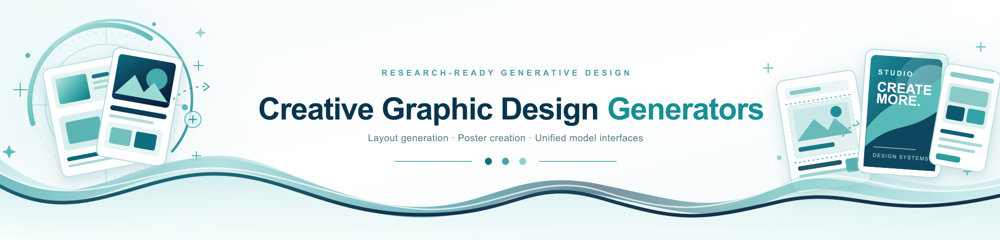
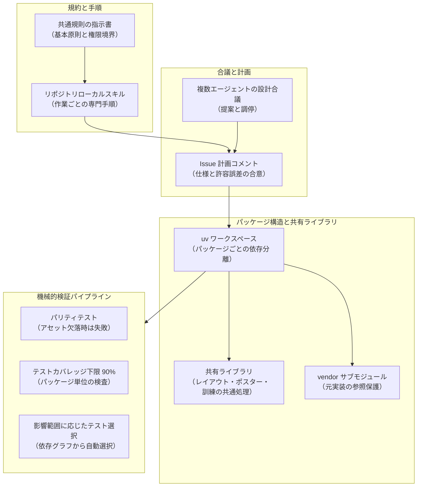
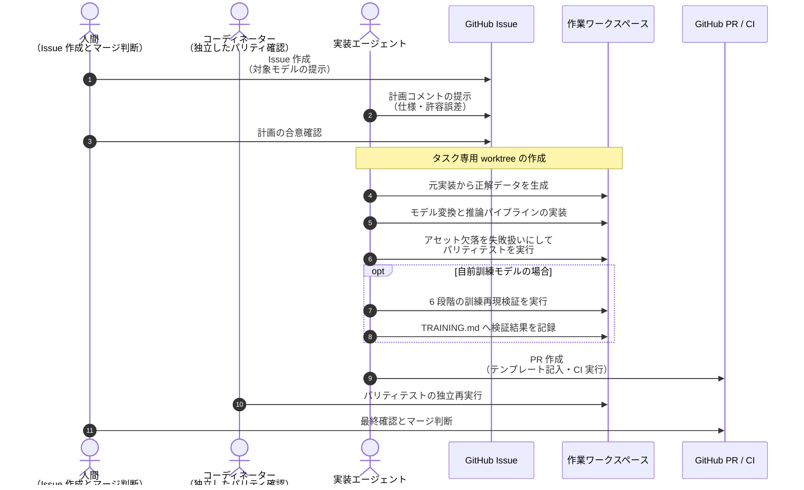

こんにちは [@shunk031](https://twitter.com/shunk031) です。本記事は [法政大学理工学部 Advent Calendar 2026](https://adventar.org/calendars/13106) の 7 日目の記事です。

https://adventar.org/calendars/13106

画像やデザイン生成の研究開発では、毎月のように新しいモデルが発表されます。しかし、公開されている論文実装はフレームワークやデータ形式、依存ライブラリのバージョンがそれぞれ異なります。そのため、自分の研究環境に組み込んで横断的に比較・検証するだけでも大きな負担がかかります。

この課題を解決するため、私はデザイン生成の論文実装を移植・統合するモノレポ [`design-generators`](https://github.com/creative-graphic-design/design-generators) の開発を、コーディングエージェントを使って進めています。モデルが違っても同じ形の入出力と読み込み方法で扱えるよう、設計をそろえて移植しています。その中核となるのが開発・検証基盤の「ハーネス」で、エージェントが規則に沿って実装と検証を進められるように規約や検査、手順をまとめた仕組みです。

https://github.com/creative-graphic-design/design-generators

<!-- 感想: コーディングエージェントによる論文実装の移植について、実際に使ってどうだったか一言 -->

本記事では `design-generators` の構成をもとに、ハーネスの 5 つの要素と、モデル追加から再現確認までの 4 段階の流れを紹介します。多数の論文実装をエージェントに移植・検証させたいと考えている方の参考になれば幸いです。

# design-generators とは

`design-generators` は、レイアウト生成やポスター生成などデザイン生成の研究実装を移植・統合するモノレポです。[^dg_readme] 各モデルはモデルの種類に応じたフレームワーク別のパッケージとして独立に管理しています。Transformer ベースのモデルには [Transformers](https://huggingface.co/docs/transformers/index)、拡散モデルなどの画像生成モデルには [Diffusers](https://huggingface.co/docs/diffusers/index)、LLM の API を呼び出す最近のモデルには [Pydantic AI](https://ai.pydantic.dev/) を採用しています。

本リポジトリは、各論文の環境構築を省き、数分で推論できる環境を提供することを目的としています。統一された公開スキーマにより、モデルが変わっても同じ形で入力を渡し、結果を受け取れます。学習済みの重みを持つモデルでは `from_pretrained` で変換済みの重みを読み込みます。API 経由の Pydantic AI モデルでは変換済みの重みは不要で、代わりにプロバイダー設定を用います。

移植したコードは、元の論文実装を取り込んだ `vendor/` 配下のコードと数値的に一致するかを自動テストで照合します。本記事では、移植したコードの出力が元実装の出力と一致することを「パリティ」、その一致を確かめる自動テストを「パリティテスト」と呼びます。多くのモデルで元実装とビット完全一致を確認しており、それ以外の多くのモデルもあらかじめ合意した許容誤差内で一致しています。

# ハーネスの全体像

論文コードの移植を自然言語で依頼するだけでは、エージェントが都合のよいモックを作ったり、元実装と噛み合わないコードを書いたりして失敗しやすくなります。設計基準を守りつつ元実装と整合するコードを書かせるには、エージェントの判断材料と検査基準をリポジトリ側に用意しておく必要があります。

`design-generators` では、規約・スキル・パッケージ構造・機械的検証・記録の 5 つの要素を組み合わせてハーネスを構成しています。エージェントの実装と検証を支える要素間の関係を示します。

## 1. 共通規則をまとめる指示書

エージェントに渡す共通指示が長大になると、守るべき原則が埋もれてルール違反が起きやすくなります。そこで、全モデル共通の基本原則は、命名規則やクラス設計、ワークスペース操作、Issue やプルリクエスト (PR) の追跡ルールだけに絞り、リポジトリルートの `AGENTS.md` へ記載しています。[^dg_agents_md] 作業ごとの詳しい手順はローカルスキルへ分離し、共通指示を簡潔に保っています。

## 2. リポジトリローカルスキル

作業の種類ごとに必要な専門手順だけをエージェントに読み込ませるため、リポジトリ固有の手順を `.agents/skills/` 配下のスキルに分けています。[^dg_agents_md] 関係のない手順でコンテキストを圧迫しないようにする狙いがあります。各スキルが定義する範囲を次の表にまとめます。

| スキル名                                   | 定義している内容                                               |
| ------------------------------------------ | -------------------------------------------------------------- |
| `design-generators-model-conversion`       | モデル変換、パリティ検証、データソース、公開スキーマの規約     |
| `design-generators-documentation`          | README、モデルカード、API ドキュメント、再現手順書の記述規約   |
| `design-generators-training-reproduction`  | 6 段階の訓練再現手順と検証結果の記録方法                       |
| `design-generators-parallel-plan-discussion` | 複数エージェントによる設計合意の手順                         |

このうち `design-generators-parallel-plan-discussion` では、複数エージェントが独立に設計案を出し、議論と調停を経て共通インターフェースを合意します。[^dg_parallel_plan] 複数エージェントの作業タブを管理するツール [Herdr](https://zenn.dev/shunk031/articles/herdr-orchestrate-workers-skill) 上で各エージェントに専用の Git worktree とタブを割り当て、共有の下書きファイルを通じて合意をまとめます。大きな設計判断で 1 体のエージェントの偏りに依存するリスクを減らす目的で使っています。

## 3. モデルごとのパッケージと共有ライブラリ

多数の論文実装を 1 つのリポジトリに統合すると、依存ライブラリのバージョン衝突が問題になります。パッケージ管理には [uv](https://docs.astral.sh/uv/) のワークスペースを使い、各モデルを `models/<slug>/` 配下の独立したメンバーとして管理しています。[^dg_checklist] 各パッケージに個別の `pyproject.toml` を持たせ、元実装の実行にだけ必要な依存はオプションの `vendor` グループに分離して衝突を抑えています。

バウンディングボックス計算やポスター配置、訓練用の共通処理は、共有ライブラリ（`lib/laygen`、`lib/posgen`、`lib/traingen`）に集約しています。[^dg_readme] モデルごとの重複実装を減らし、公開インターフェースをそろえやすくする構成です。

## 4. 機械的検証と CI パイプライン

エージェントが生成したコードを人間が毎回細部まで目視で確認しなくても一定の水準を保てるよう、GitHub Actions による CI で品質基準を機械的に判定しています。[^dg_ci] 主な検査項目は次の 3 点です。

- PR メタデータ検査: PR 本文の Issue 参照やチェックリスト、共有ライブラリ変更時の理由記入を自動検査する。[^dg_pr_metadata_check]
- テストカバレッジの下限設定: パリティテストを除くユニットテストについて、パッケージごとに 90% 以上のカバレッジを必須とする。[^dg_checklist]
- 依存関係に基づくテスト選択: ワークスペースの依存グラフから、変更の影響を受けるパッケージだけを自動選択してテストを実行する。

## 5. 検証結果を記録するドキュメント設計

巨大なテンソルやチェックポイント、画像を Git に含めるとリポジトリが肥大化します。そのため、生成物自体はコミットせず、再現に必要なシード値や設定ハッシュ、実行コマンドなどのメタデータだけを Issue や PR 本文、各パッケージのドキュメントに残す方針としています。[^dg_training_proto] 推論や環境構築の手順は `REPRODUCING.md`、自前訓練の検証記録は `TRAINING.md` に分け、後から同じコマンドで数値を確かめ直せるようにしています。[^dg_readme]

# モデルを追加する流れ

新しいモデルを `design-generators` に追加し、再現性を確認してマージするまでを 4 つの段階で進めます。人間、コーディネーター（実装担当とは別にパリティテストを独立に再実行する役割）、実装エージェントのやり取りは次の流れになります。

## 1. Issue 起点の設計合意

モデルの追加作業は、GitHub の Issue を立てることから始めます。[^dg_agents_md] 実装エージェントは Issue の計画コメントに、対象モデルのスコープ、公開インターフェース、利用データセット、元実装と比較する許容誤差の基準を明文化します。

途中で設計方針が変わった場合は、最初の計画コメントを書き換えず、修正コメントを追記します。最新の修正コメントが過去の記述を上書きする運用にすることで、エージェントが過去の経緯と最新の合意を取り違えにくくしています。設計に合意したら Issue の状態を合意済みに進め、実装に移ります。

## 2. 専用の worktree での実装と推論パリティ検証

実装に入ったら、Issue の状態を実装中に更新し、メインブランチを直接触らずタスク専用の Git worktree を切って作業します。[^dg_checklist] 複数のモデル移植を並行して進めても変更がぶつからないようにするためです。

実装の軸になるのが、元実装から生成する正解データの準備です。参照生成スクリプトを使い、固定シードと単一 GPU の環境で元実装の出力を生成します。続いて共通の基底クラスを継承してモデルパッケージを実装し、正解データと比較するパリティテストで数値の一致を確認します。テスト実行時は、必要なアセットが欠けていればスキップせず失敗となる設定を有効化し、検証漏れを抑えています。[^dg_training_proto]

## 3. 訓練再現の段階的検証

公開済みの重みがなく自前で学習し直す必要があるモデルでは、推論パリティの確認だけでは足りません。推論コードが一致していても、学習ループに微小な差分があれば論文の性能を再現できないためです。[^dg_training_proto] そのため、設定の確認から全エポック訓練までを 6 段階に分けて順に検証します。

各段階で確かめる内容を次の表にまとめます。

| 段階 | 名前                     | 確かめること                                                                                                                 |
| ---- | ------------------------ | ---------------------------------------------------------------------------------------------------------------------------- |
| 1    | 静的設定と初期状態       | パラメータ数や重みキーの対応、学習率スケジューラが元実装と一致することを確認する。                                           |
| 2    | 固定バッチ前トレース     | 同一シードとバッチ入力に対し、オプティマイザ更新前の出力と損失が一致することを確認する。                                     |
| 3    | 1 ステップ更新           | 1 回の逆伝播と更新を経て、勾配や更新後の重みパラメータが一致することを確認する。                                             |
| 4    | 複数バッチ訓練軌跡       | 自然な訓練軌跡を記録し、各ステップが前の段階の基準を満たすかを確かめ、外れた場合は同期診断を足す。                           |
| 5    | 決定論的データストリーム | データローダの読み出し順序やデータ拡張、マスク処理が元実装と同一かを確認する。                                               |
| 6    | 全エポック訓練の統計比較 | 全エポックの訓練を実施し、元論文の評価プロトコル下で性能指標が一致することを確認する。                                       |

全エポック訓練に入る前には、元実装とパッケージの条件をそろえて複数回実行し、損失の範囲を確認します。また、学習開始前の設定記録と、評価スクリプトの出力一致の記録を必須としています。途中の段階を飛ばして最終結果だけで合格と主張することは禁止しており、検証結果はすべて各パッケージの `TRAINING.md` に残します。

## 4. PR 作成と独立した検証

実装と検証が終わったら、エージェントはリポジトリのテンプレートに従って PR を作成します。[^dg_agents_md] テンプレートには変更概要、検証コマンドと結果、共有ライブラリへの影響、チェックリストを記入します。[^dg_pr_template]

PR を作成すると、CI による静的解析、型検査、ユニットテストが自動で走ります。[^dg_ci] さらにマージ前の関門として、実装担当とは別のコーディネーターが独立環境でパリティテストを再実行し、結果を確かめます。独立再実行に通ったうえで、最終的なマージは人間が判断します。[^dg_checklist]

# まとめ

AI エージェントが実装から検証までを自律的に進める開発基盤は、近年「software factory」として議論されています。たとえば [Vercel](https://vercel.com/blog/building-a-software-factory-for-ai-sdk) の自律開発ワークフロー、[Stripe](https://stripe.dev/blog/minions-stripes-one-shot-end-to-end-coding-agents) の決定論的ツールによるテスト済み PR 生成、[Uber](https://www.uber.com/us/en/blog/efficient-software-factory/) の自律検証基盤、[共有掲示板を介した複数エージェント協調の論文](https://arxiv.org/abs/2610.36254) などがあります。`design-generators` のハーネスも、論文実装の再現に特化した software factory の一例と捉えられます。

もっとも、すべてをエージェント任せにしているわけではありません。パリティの確認はコーディネーターが独立に再実行し、マージは人間が判断します。[^dg_agents_md] 共通インターフェースを定め、uv による依存分離やアセット欠落を許さないパリティテスト、6 段階の訓練再現検証といった仕組みをリポジトリ側に組み込んでおくことは、エージェントが自律的に作業を進めるための有用な土台になると考えています。

多数のモデルを比較検証したい研究や、大きなコードベースをエージェントと継続的に保守する場面において、プロンプトの工夫だけでなく、テストや検証記録まで含めた仕組み化の参考になれば幸いです。

<!-- 感想: ハーネスを導入したエージェント運用の実感について、実際に使ってどうだったか一言 -->

[^dg_readme]: [design-generators README.md](https://github.com/creative-graphic-design/design-generators/blob/cf04fffc83eb7f3720b3b33dbe417f9117d8288a/README.md)
[^dg_agents_md]: [design-generators AGENTS.md](https://github.com/creative-graphic-design/design-generators/blob/cf04fffc83eb7f3720b3b33dbe417f9117d8288a/AGENTS.md)
[^dg_parallel_plan]: [design-generators parallel-plan SKILL.md](https://github.com/creative-graphic-design/design-generators/blob/cf04fffc83eb7f3720b3b33dbe417f9117d8288a/.agents/skills/design-generators-parallel-plan-discussion/SKILL.md)
[^dg_checklist]: [design-generators implementation-checklist.md](https://github.com/creative-graphic-design/design-generators/blob/cf04fffc83eb7f3720b3b33dbe417f9117d8288a/docs/implementation-checklist.md)
[^dg_ci]: [design-generators ci.yml](https://github.com/creative-graphic-design/design-generators/blob/cf04fffc83eb7f3720b3b33dbe417f9117d8288a/.github/workflows/ci.yml)
[^dg_pr_metadata_check]: design-generators PR metadata check: [ci.yml](https://github.com/creative-graphic-design/design-generators/blob/cf04fffc83eb7f3720b3b33dbe417f9117d8288a/.github/workflows/ci.yml#L43-L48), [check_pr_issue_reference.py](https://github.com/creative-graphic-design/design-generators/blob/cf04fffc83eb7f3720b3b33dbe417f9117d8288a/scripts/check_pr_issue_reference.py#L319-L355)
[^dg_training_proto]: [design-generators training-reproduction.md](https://github.com/creative-graphic-design/design-generators/blob/cf04fffc83eb7f3720b3b33dbe417f9117d8288a/docs/training-reproduction.md)
[^dg_pr_template]: [design-generators PULL_REQUEST_TEMPLATE.md](https://github.com/creative-graphic-design/design-generators/blob/cf04fffc83eb7f3720b3b33dbe417f9117d8288a/.github/PULL_REQUEST_TEMPLATE.md)
