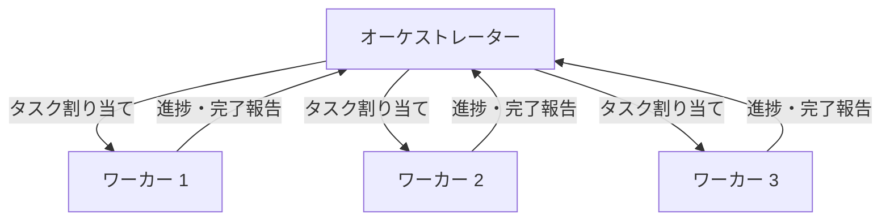
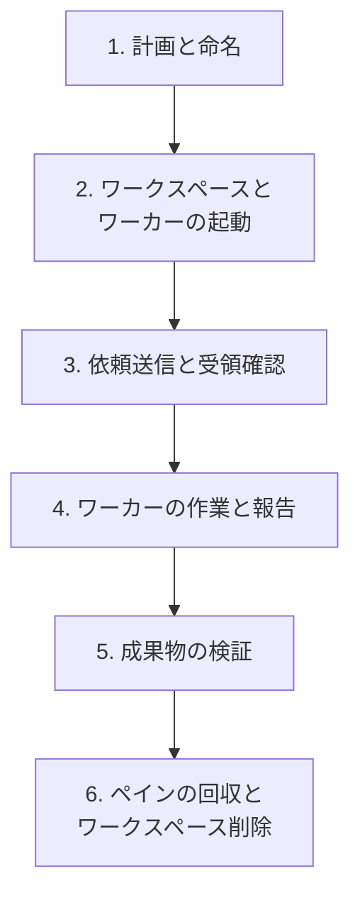

こんにちは [@shunk031](https://twitter.com/shunk031) です。本記事は [法政大学理工学部 Advent Calendar 2026](https://adventar.org/calendars/13106) の 1 日目の記事です。

https://adventar.org/calendars/13106

このアドベントカレンダーでは、12/1 から 12/3 まで 3 日連続で記事を投稿します。コーディングエージェントの運用に関する続き物です。全体の予定は次の通りです。

- 12/1: [Herdr で複数のエージェントを対話させるシンプルなスキルの紹介](https://zenn.dev/shunk031/articles/herdr-orchestrate-workers-skill)（本記事）
- 12/2: [AI 臭い日本語を agy gemini スキルで一掃するゾォ〜](https://zenn.dev/shunk031/articles/agy-gemini-japanese-skill)
- 12/3: [Marp でいい感じに論文紹介スライドを作るぜ](https://zenn.dev/shunk031/articles/marp-paper-reading-slides)

普段の開発で Claude Code や Codex などの AI コーディングエージェントを使っていると、複数の課題を同時に進めたい場面が増えてきます。調査と実装を切り分けて進めたい場面もあります。しかし、1 つのセッションに作業を任せすぎると、コンテキストウィンドウ[^context-window] を早く消費して判断の精度が落ちます。同じ作業ディレクトリ内で変更が競合する問題も起きます。

作業ごとに複数のエージェントを並べて動かせば、この問題は防げそうです。しかし、手作業で複数のターミナルを開いて進捗を監視するのは手間がかかります。出力を別のエージェントに手でコピーして渡すのも負担です。

<!-- 感想: 1 つのエージェントに任せきりにしたときのコンテキスト肥大化や、手作業でのターミナル管理で困っていた点について、実際に使ってどうだったか一言 -->

そこで本記事では、私が普段愛用しているコーディングエージェントを動かすためのランタイムである [Herdr](https://herdr.dev/tui/docs/) を使ったマルチエージェント運用を取り上げます。紹介するのは `shunk031-herdr-orchestrate-workers` スキルです。親であるオーケストレーターが Herdr の上で複数の Claude Code や Codex を立ち上げ、相手のエージェントへ直接プロンプトを打ち込んで指示を出し、子であるワーカーも同じようにプロンプトで結果を報告して作業を進めます。

https://github.com/shunk031/skills/tree/main/skills/herdr/shunk031-herdr-orchestrate-workers

# Herdr とは

Herdr は、ターミナル上で AI コーディングエージェントの作業スペースを管理するツールです。公式リポジトリの README では「the runtime your coding agents live on」と説明されています。[^herdr-doc]

https://herdr.dev/tui/docs/

Herdr では、Git worktree[^git-worktree] ごとにターミナルのタブやワークスペースを分離できます。それぞれのタブで動くエージェントの起動や終了は、CLI から操作します。エージェントの状態取得も含めて一元管理できます。

`shunk031-herdr-orchestrate-workers` スキルは、この Herdr を基盤として動作します。親エージェントが複数のワーカーを立ち上げてタスクを割り当てます。作業の完了や進捗報告を受け取り、検証して調整する一連の手順とスクリプトを提供します。



# スキルの全体像

親であるオーケストレーターは、タスク分解やワーカーの起動、依頼送信と受領確認を受け持ちます。成果物の検証や外部レビュー、プルリクエスト (PR) のマージ判断も行います。子であるワーカーは割り当てられた 1 つの独立タスクに専念し、調査や設計、コード実装、テスト、PR 作成などの実作業を進めます。

一連のライフサイクルは、次の 6 つの段階で進みます。



1. 計画と命名: オーケストレーター自身に `orch` などの名前を付ける。ワーカーにも `orch-impl` のように接頭辞付きの名前を割り当てる。
2. ワークスペースとワーカーの起動: 独立したタスクごとに Git worktree とタブを用意し、ワーカーを起動する。
3. 依頼送信と受領確認: 入力途中の内容と混ざらないよう、ワーカーの入力欄が空であることを確認してからプロンプトを送信する。ワーカーが依頼を受け取ったことを確かめる。
4. ワーカーの作業と報告: ワーカーは割り当てられた worktree 内で作業する。進捗や結果はオーケストレーター宛てにプレーンテキストで報告する。
5. 成果物の検証: ワーカーの報告だけで済ませず、実際のライフサイクル状態やファイル差分、テスト結果、トランスクリプト（= 画面に残ったワーカーの作業記録）を直接確認する。
6. ペインの回収とワークスペース削除: 検証完了後にワーカーのペイン（= Herdr の画面を分割した 1 つのターミナル）やタブを回収する。PR マージ後、未コミットの変更がなくローカルブランチの先頭が PR の最終コミットと同じかその祖先である worktree のみ削除する。

# エージェント同士の対話の仕組み

本記事のタイトルに「シンプル」とある理由の 1 つは、通信の仕組みを最小限に設計している点にあります。メッセージを中継する専用のサーバーは使いません。Herdr の標準 CLI である `herdr agent prompt` を使い、相手エージェントにプレーンテキストを送信するだけで対話が成立します。

筆者は以前、エージェント同士のメッセージ送受信に [agmsg](https://github.com/fujibee/agmsg) を使っていました。agmsg は、名前付きのエージェントセッション間でメッセージを送り合う仕組みです。送信されたメッセージは手元の SQLite データベースに蓄積され、受信側が受信箱から取り出して読みます。

一方の Herdr は、ワークスペースの作成からプロンプト送信まで、すべての操作を CLI で完結できます。そこで今回は、Herdr 上でエージェントごとのタブを開き、CLI コマンドで相手の入力欄へ直接プロンプトを打ち込む構成にしました。メッセージを蓄積する専用ストアを挟まず、ターミナル操作だけで対話を成立させています。

## 入力欄が空のときだけ送るガード

Herdr では、CLI から相手エージェントへプレーンテキストを直接送信します。しかし、相手がコマンドを実行中だったり、入力欄に未送信の文字が残っていたりすると問題が起きます。その状態でプロンプトを流し込むと、入力中の内容と混ざったり破棄されたりするためです。

そのため、送信前に入力欄の状態を判定するヘルパースクリプト `herdr-agent-prompt-if-input-empty.sh` を介して送信します。このスクリプトは、ターミナルの ANSI 表示状態（= 端末に表示された文字や色などの表示情報）を awk スクリプトの `herdr-visible-input-state.awk` で解析します。プロンプト記号の後ろが空であると判定されたときだけ、`herdr agent prompt` を呼び出します。記号は `❯` や `›`、Google のコーディングエージェントの CLI である Antigravity CLI (`agy`) の `>` を対象に判定します。

実際の送信判定処理は次のようになっています。

```bash
if [[ "$input_state" == empty ]]; then
    herdr agent prompt "$target" "$message"
    exit $?
fi
```

送信スクリプトは最初に 1 回確認し、入力欄が空でなければ 30 秒おきに最大 5 回まで再確認します。合計で最大 6 回確認しても空にならなければ、メッセージを送らずに処理を中断します。相手の作業を不用意に妨げることなく、安全に対話を進められます。

## プレーンテキストで送信元を識別する報告プロトコル

`herdr agent prompt` は対象のペインに入力文字列を直接注入します。そのため、送信元のメタデータが付与されません。ワーカー側からの報告フォーマットには、先頭に自分自身のワーカー名を添える規約を設けています。

ワーカーがオーケストレーターへ送る報告は、用途に応じて次の 3 種類の形式を使います。

```text
DONE <worker-name>: <一言サマリ>
BLOCKED <worker-name>: <進行不能な理由や確認事項>
STATUS <worker-name>: <現在の進捗段階>
```

先頭にワーカー名を明記することで、受信したテキストがどのワーカーの発言かを機械的に判別できます。

# 報告を鵜呑みにしない検証と独立レビュー

マルチエージェント運用で最も警戒すべきなのは、ワーカーの自己申告を信じてそのままマージすることです。エージェントがテスト失敗を見落とすケースは珍しくありません。要件を満たしていないのに完了と報告してしまうこともあります。

このスキルの中心原則には "Evidence over reports"（報告より証拠）が定められています。オーケストレーターは、ワーカーから `DONE` 報告が届いてもそれだけで完了とは判断しません。`herdr agent wait` によるライフサイクルの完了状態や実行トランスクリプトを直接検証します。git diff や生成された成果物ファイル、テストの成否といった客観的な証拠も合わせて確かめます。

さらに、成果物の品質を担保するため、作業を担当したワーカーとは別の独立したエージェントを立ち上げます。本スキルに同梱されたレビュー用スクリプト `review_pr.py` を使い、GitHub プルリクエストのレビューパケット（= 受け入れ基準、検証結果、PR の情報、差分、継続的インテグレーション (CI) の状態）を構築します。レビュアーがレビュー対象を書き換えないようにするため、読み取り専用で Codex レビュアーを実行します。ワーカー自身による自己レビューを排し、第三者の視点で受け入れ基準を検査することで、不完全な変更のすり抜けを防ぎます。

# 使ってみる

本スキルを利用するには、前提として Herdr がターミナル環境に導入されている必要があります。公式のインストール手順に従って導入してください。

https://herdr.dev/tui/docs/install/

Herdr の準備ができたら、`shunk031-herdr-orchestrate-workers` スキルを導入します。本スキルは筆者の GitHub リポジトリ `shunk031/skills` で公開しています。

https://github.com/shunk031/skills

Vercel Labs の `skills` CLI を使うと、Claude Code や Codex へ一括導入できます。[^skills-cli] リポジトリ内の全スキルを導入するコマンドは次の通りです。主なオプションとして、`--skill '*'` で全スキル、`--agent` で導入先のエージェント、`--global` でユーザー全体への導入を指定し、`--yes` で確認を省きます。

```bash
npx skills add shunk031/skills --skill '*' --agent claude-code --agent codex --global --yes
```

導入前に利用可能なスキルの一覧を確認したい場合は、`--list` オプションを実行します。

```bash
npx skills add shunk031/skills --list
```

本スキルには、オーケストレーターが所有するワーカーの起動や回収、監査するスクリプト `herdr-worker-lifecycle.sh` が同梱されています。ワーカーを起動して記録するには、`launch` を使って次のように実行します。

```bash
~/.agents/skills/shunk031-herdr-orchestrate-workers/scripts/herdr-worker-lifecycle.sh launch <worker-name> \
  --kind codex --workspace <workspace-id> --cwd <worktree-path> \
  --label "<tab-label>" --task <task-key> -- <agent-args>
```

`--kind` で起動するエージェントの種類（ここでは Codex）を選びます。作業場所のワークスペースとディレクトリ、タブの名前、タスク名は必須で、`--` の後ろにはエージェントに渡す引数を書きます。

ワーカーの実装と検証が終わったら、`collect` を使って記録したワーカーを回収し、ペインを閉じます。

```bash
~/.agents/skills/shunk031-herdr-orchestrate-workers/scripts/herdr-worker-lifecycle.sh collect <worker-name>
```

# まとめと次回予告

本記事では、Herdr 上で複数のエージェントを協調させるスキル `shunk031-herdr-orchestrate-workers` を紹介しました。専用のメッセージサーバーを使わずに、CLI 入力だけで対話する構成にしています。相手の入力欄が空のときだけプロンプトを送り、実行中の作業を邪魔しないようにします。ワーカーの報告文を鵜呑みにせず、ライフサイクル状態やファイル成果物を直接確かめ、別の独立したエージェントでレビューします。

<!-- 感想: 専用サーバーを立てずに CLI だけでエージェントを対話させる運用感や、独立レビューを挟む効果について、実際に使ってどうだったか一言 -->

明日（12/2）のカレンダー 2 日目では、この基盤上で Google の Antigravity CLI (agy) を動かす応用例を紹介します。記事タイトルは [AI 臭い日本語を agy gemini スキルで一掃するゾォ〜](https://zenn.dev/shunk031/articles/agy-gemini-japanese-skill) です。AI 特有の不自然な日本語表現を一掃する執筆・推敲スキル `shunk031-writing-gemini-japanese` を取り上げます。オーケストレーターと執筆ワーカー、確認役の連携フローを解説しますので、ぜひ続けてご覧ください。

<!-- textlint-disable -->

[^context-window]: モデルが一度に読める会話や資料の量。
[^herdr-doc]: the runtime your coding agents live on - herdrdev/herdr https://github.com/herdrdev/herdr
[^git-worktree]: 同じリポジトリから作る、ブランチごとの別の作業ディレクトリ。
[^skills-cli]: skills - Vercel Labs https://github.com/vercel-labs/skills

<!-- textlint-enable -->
