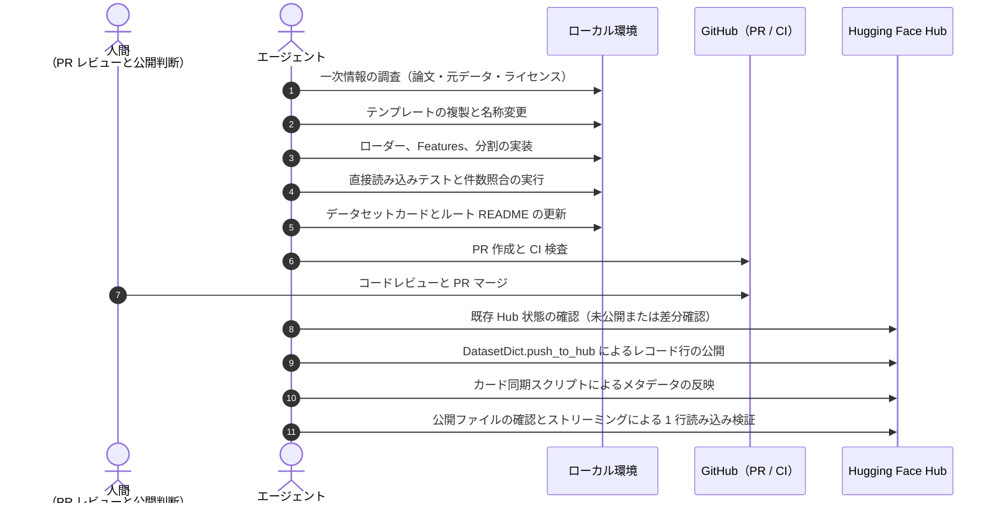

こんにちは [@shunk031](https://twitter.com/shunk031) です。本記事は [法政大学理工学部 Advent Calendar 2026](https://adventar.org/calendars/13106) の 8 日目の記事です。

https://adventar.org/calendars/13106

画像やデザイン生成の研究開発では、モデルの学習や性能評価に多様なデータセットが必要です。しかし、公開されているデータは論文ごとに配布形式、アノテーション構造、読み込み方法が異なります。新しいモデルを検証して既存モデルと比較するたび、データセットの前処理や読み込みコードを個別に書く負担が生じます。

12/7 の記事では、モデル側のインターフェースを揃えて移植を進めるモノレポ [`design-generators`](https://github.com/creative-graphic-design/design-generators) と、その開発・検証基盤であるハーネスを紹介しました。

https://zenn.dev/shunk031/articles/design-generators-harness

モデル側のインターフェースを共通化しても、入力となるデータセットの準備が手作業のままでは、実験を素早く再現できません。学習や評価に使うデータセットも、決まったパッケージの形、共通の読み込み口、記述が揃ったデータセットカード、そして検証テストで揃える必要があります。

そこで私は、デザイン生成やレイアウト理解のデータセットローダーとカードを集約するリポジトリ [`creative-graphic-design/huggingface-datasets`](https://github.com/creative-graphic-design/huggingface-datasets) を、コーディングエージェントを使って運用しています。


https://github.com/creative-graphic-design/huggingface-datasets

本記事では、このリポジトリの構成と、エージェントが新しいデータセットの調査から Hugging Face Hub への公開までを決まった手順で進めるためのハーネスを紹介します。前半で共通化の設計と検査の仕組みを説明し、後半でパッケージ作成から公開までの流れと `design-generators` とのつながりを示します。

# creative-graphic-design/huggingface-datasets の役割

[`creative-graphic-design/huggingface-datasets`](https://github.com/creative-graphic-design/huggingface-datasets/commit/f1018f6d41416c71954efb88b2292983b3064560) は、デザイン生成やレイアウト理解を扱う Python のモノレポです。Hugging Face が提供する `datasets` ライブラリ本体ではなく、その仕組みの上でタイポグラフィ、画像編集、審美性評価などのデータセットローダーとデータセットカードを集約して管理するリポジトリです。

このリポジトリでは、モバイルのユーザーインターフェース (User Interface; UI) を扱う Rico や、文書レイアウトを扱う PubLayNet などのデータセットを集めています。[収録データセットの一覧](https://github.com/creative-graphic-design/huggingface-datasets/blob/f1018f6d41416c71954efb88b2292983b3064560/README.md#L11-L153)には、各データセットの内容、入力と出力の概要、上流の元データや論文への参照をまとめています。各データセットは独立したパッケージとして管理しつつ、リポジトリ全体で統一された構造を持たせています。

# 揃えている形とデータセットごとの違い

複数のデータセットを共通の基盤で扱うには、揃える部分と元データに合わせて残す部分を明確に切り分ける必要があります。このリポジトリでは、パッケージのディレクトリ構成、ローダークラスの読み込み口、データセットカードの記述形式、検証テストを揃えています。一方、レコードを構成するフィールド構造は、各データセットの元データに合わせて個別に定義します。

各データセットは `datasets/<dataset_name>/` 配下に独立したディレクトリを持ち、Python ローダー、Hub のカード兼用となる `README.md`、`pyproject.toml`、`tests/` を配置します。この構成は[共通のテンプレート](https://github.com/creative-graphic-design/huggingface-datasets/blob/f1018f6d41416c71954efb88b2292983b3064560/.agents/skills/create-dataset/SKILL.md#L14-L30)に基づいており、[カード検査テスト](https://github.com/creative-graphic-design/huggingface-datasets/blob/f1018f6d41416c71954efb88b2292983b3064560/tests/test_dataset_cards.py#L316-L328)で必須と定めています。パッケージ管理には [`uv`](https://docs.astral.sh/uv/) のワークスペースを使っており、`datasets/*` をメンバーとして登録しています。[ルートの `pyproject.toml`](https://github.com/creative-graphic-design/huggingface-datasets/blob/f1018f6d41416c71954efb88b2292983b3064560/pyproject.toml#L1-L37) では、ワークスペースと開発用の依存関係グループを定義しています。各データセットパッケージの `pyproject.toml` にはパッケージ固有の依存関係を宣言しており、たとえば `CGLDataset` や `Rico` では `datasets[vision]` を含めています。

ローダークラスの設計も揃えています。各データセットのローダークラスは、Hugging Face の `datasets` ライブラリが提供する基底クラス `datasets.GeneratorBasedBuilder` を継承し、[公式のビルダーパターン](https://huggingface.co/docs/datasets/v3.6.0/en/package_reference/builder_classes)に従います。[新規データセット作成の設計規約](https://github.com/creative-graphic-design/huggingface-datasets/blob/f1018f6d41416c71954efb88b2292983b3064560/.agents/skills/create-dataset/SKILL.md#L436-L512)に沿って、メタデータを定義する `_info`、分割やダウンロードを定義する `_split_generators`、レコードを逐次生成する `_generate_examples` の各メソッドを実装します。

レコードが持つ具体的なフィールド構成はデータセットごとに異なります。元データの意味構造を保つため、各ローダーが自身の `datasets.Features` を定義します。たとえば [Rico ローダー](https://github.com/creative-graphic-design/huggingface-datasets/blob/f1018f6d41416c71954efb88b2292983b3064560/datasets/Rico/Rico.py#L730-L810) は複数の設定を持ち、UI のスクリーンショット画像やビュー階層データを扱います。一方で [PubLayNet ローダー](https://github.com/creative-graphic-design/huggingface-datasets/blob/f1018f6d41416c71954efb88b2292983b3064560/datasets/PubLayNet/PubLayNet.py#L280-L334) は、文書画像とバウンディングボックス座標、カテゴリ ID、セグメンテーション情報を含む階層的なアノテーション構造を返します。

利用者は [Hugging Face の `datasets` ライブラリ公式ドキュメント](https://huggingface.co/docs/datasets/v3.6.0/en/loading)が示す標準的なインターフェースでデータセットを読み込めます。

```python
import datasets

# 公開済みの Rico データセットから 1 行目をストリーミングで取得する例
dataset = datasets.load_dataset(
    "creative-graphic-design/Rico",
    name="ui-screenshots-and-hierarchies-with-semantic-annotations",
    split="train",
    streaming=True,
)
row = next(iter(dataset))
print(list(row.keys()))
# 出力: ['ancestors', 'klass', 'bounds', 'clickable', 'children', 'screenshot']
```

Hub 上のデータセットは Parquet 形式で保存されているため、`trust_remote_code=True` を指定せずに標準のインターフェースで読み込めます。ストリーミングで先頭の 1 行を取得すると、UI 要素の階層構造や画像を含む上記の各キーが得られます。

# 出典と検査を支える仕組み

パッケージの形と読み込み口を揃えても、エージェントへ実装を任せると、出所が不確かな情報や誤ったスキーマでコードを生成するおそれがあります。

そのため、エージェントの行動を規定する指示書と機械的な検査手順を整備しています。[エージェントの運用ルール](https://github.com/creative-graphic-design/huggingface-datasets/blob/f1018f6d41416c71954efb88b2292983b3064560/AGENTS.md#L27-L36)では、新しいデータセットを追加する際に[新規データセット作成の手順書](https://github.com/creative-graphic-design/huggingface-datasets/blob/f1018f6d41416c71954efb88b2292983b3064560/.agents/skills/create-dataset/SKILL.md)に従うことを定めています。また、[運用方針](https://github.com/creative-graphic-design/huggingface-datasets/blob/f1018f6d41416c71954efb88b2292983b3064560/README.md#L154-L168)に基づき、作業時には使用したスキル名と情報源のリンクを明記します。

実装へ入る前には、[一次情報の確認手順](https://github.com/creative-graphic-design/huggingface-datasets/blob/f1018f6d41416c71954efb88b2292983b3064560/.agents/skills/create-dataset/SKILL.md#L42-L65)に従って論文、公式プロジェクトページ、上流の README、公開データ、前処理スクリプト、ライセンス表示を精査します。情報が確認できない場合は推測で補わず、取得不可であることを記録します。

実装後の検証では、補助関数の単体テストだけに頼らず、[`datasets.load_dataset` による直接の読み込みテスト](https://github.com/creative-graphic-design/huggingface-datasets/blob/f1018f6d41416c71954efb88b2292983b3064560/.agents/skills/create-dataset/SKILL.md#L914-L939)を必須としています。[テスト設計規約](https://github.com/creative-graphic-design/huggingface-datasets/blob/f1018f6d41416c71954efb88b2292983b3064560/.agents/skills/create-dataset/SKILL.md#L568-L608)に基づき、実測したレコード件数が元データで報告された件数と一致するか、設定や分割ごとの境界が正しいか、ベンチマーク用の分割名が揃っているかを確認します。

データセットの説明を担うデータセットカード（各ディレクトリの `README.md`）も、[カード運用の規約](https://github.com/creative-graphic-design/huggingface-datasets/blob/f1018f6d41416c71954efb88b2292983b3064560/docs/dataset-card-maintenance.md#L19-L36)に従って検査します。[カードテンプレート](https://github.com/creative-graphic-design/huggingface-datasets/blob/f1018f6d41416c71954efb88b2292983b3064560/.agents/skills/create-dataset/templates/MyHFDataset/README.md#L58-L250)には Hub 用の YAML フロントマター、概要、構造、分割、出典、制限事項、引用の各節を定義しています。リポジトリ全体で実行するカードテストにより、必須ファイルの有無、メタデータや公開 ID の整合性、引用や同期設定を機械的に検査します。[^hfd_card_tests]

継続的インテグレーション (Continuous Integration; CI) では、プルリクエスト (Pull Request; PR) やプッシュを契機に [CI ワークフロー](https://github.com/creative-graphic-design/huggingface-datasets/blob/f1018f6d41416c71954efb88b2292983b3064560/.github/workflows/ci.yml#L3-L36)が動きます。このワークフローで、カードテストを含む [pre-commit の検査](https://github.com/creative-graphic-design/huggingface-datasets/blob/f1018f6d41416c71954efb88b2292983b3064560/.pre-commit-config.yaml#L1-L34)を実行します。一方、個別のデータセット読み込みテストはローカル環境で実行します。

# 新しいパッケージから Hub まで

エージェントによる新規データセットの追加から Hugging Face Hub への公開までは、GitHub でのレビューを挟んだ段階的な手順で進めます。



ローカル環境でテンプレートの複製、ローダー実装、読み込みテスト、カード作成を終えたら、GitHub 上で PR を作成して CI 検査と人間によるコードレビューを受けます。レビュー前のコードを Hub へ公開することは[カード運用の規約](https://github.com/creative-graphic-design/huggingface-datasets/blob/f1018f6d41416c71954efb88b2292983b3064560/docs/dataset-card-maintenance.md#L19-L36)で禁止しており、マージを経てから[公開手順書](https://github.com/creative-graphic-design/huggingface-datasets/blob/f1018f6d41416c71954efb88b2292983b3064560/.agents/skills/publish-dataset/SKILL.md#L8-L53)に沿って公開作業へ進みます。

Hub への公開では、[公開手順書の分離規約](https://github.com/creative-graphic-design/huggingface-datasets/blob/f1018f6d41416c71954efb88b2292983b3064560/.agents/skills/publish-dataset/SKILL.md#L104-L109)に従い、データ本体の行データとカードメタデータのアップロード経路を分けています。生成されたレコード行は、[公開手順書](https://github.com/creative-graphic-design/huggingface-datasets/blob/f1018f6d41416c71954efb88b2292983b3064560/.agents/skills/publish-dataset/SKILL.md#L57-L108)に従い、`DatasetDict.push_to_hub()` で Parquet 形式としてアップロードします。

一方、データセットカードの `README.md` は専用のカード同期スクリプトで Hub へ反映します。[^hfd_sync_details] まずドライランで差分を確認してから反映する手順になっています。

アップロード完了後は、Hub 上に必要なファイルや設定が存在するかを確認し、ストリーミング機能で先頭の 1 行を読み込めることを確かめて公開作業を終えます。データ公開では Parquet 形式のレコード行とカードメタデータだけを独立して送信し、ソースディレクトリ全体は送信しません。

# design-generators とのつながり

データセットの整備を進めても、モデル開発側のリポジトリから実際に読み込めなければ実験の再現にはつながりません。12/7 の記事で紹介した [`design-generators`](https://github.com/creative-graphic-design/design-generators) では、レイアウト生成モデルの `layout-dm` と `layout-diffusion` を扱っています。両モデルは、`creative-graphic-design/huggingface-datasets` から公開した Rico と PubLayNet を Hub から直接読み込みます。[^dg_model_loaders]

https://huggingface.co/datasets/creative-graphic-design/Rico

Hub から取得したデータは、各モデルのデータローダー内でバウンディングボックスの離散化や前処理を経て学習テンソルに変換します。[^dg_tensor_preps]

# まとめ

12/7 に紹介したモデル側のハーネスと、今回紹介したデータセット側のハーネスを組み合わせると、モデルとデータの両方を同じ手順で管理できます。モデルの実装インターフェースだけでなく、学習や評価に使うデータセットのパッケージ構造、読み込み口、検証テスト、メタデータまでを統一できます。

ポイントは、すべてのデータセットを単一の固定スキーマへ押し込めないことです。パッケージの配置、ローダークラスの基底型、テストとカードの記述形式を揃えつつ、レコードのデータ構造は元のデータセットの特性に合わせて個別に定義します。

自身の研究やプロジェクトで複数のデータセットを扱う場合は、まず 1 つのデータセットを選び、一次情報の確認からビルダーパターンの実装、読み込みテスト、データセットカードの作成までを決まった手順で進めてみてください。具体的な作業手順は、`creative-graphic-design/huggingface-datasets` の[新規データセット作成の手順書](https://github.com/creative-graphic-design/huggingface-datasets/blob/f1018f6d41416c71954efb88b2292983b3064560/.agents/skills/create-dataset/SKILL.md)で確認できます。

[^hfd_card_tests]: [ファイルとフロントマターの検査](https://github.com/creative-graphic-design/huggingface-datasets/blob/f1018f6d41416c71954efb88b2292983b3064560/tests/test_dataset_cards.py#L302-L336)、[メタデータと公開 ID の検査](https://github.com/creative-graphic-design/huggingface-datasets/blob/f1018f6d41416c71954efb88b2292983b3064560/tests/test_dataset_cards.py#L419-L529)、[引用と同期設定の検査](https://github.com/creative-graphic-design/huggingface-datasets/blob/f1018f6d41416c71954efb88b2292983b3064560/tests/test_dataset_cards.py#L562-L662)
[^hfd_sync_details]: [カード同期スクリプトの概要](https://github.com/creative-graphic-design/huggingface-datasets/blob/f1018f6d41416c71954efb88b2292983b3064560/scripts/sync_dataset_cards_to_hub.py#L13-L41)、[事前確認と公開ガード](https://github.com/creative-graphic-design/huggingface-datasets/blob/f1018f6d41416c71954efb88b2292983b3064560/scripts/sync_dataset_cards_to_hub.py#L115-L174)
[^dg_model_loaders]: [LayoutDM のデータローダー](https://github.com/creative-graphic-design/design-generators/blob/0275181d890609f70463b02593603e8ab478477f/models/layout-dm/src/layout_dm/training/dataset.py#L48-L52)、[LayoutDiffusion のデータローダー](https://github.com/creative-graphic-design/design-generators/blob/0275181d890609f70463b02593603e8ab478477f/models/layout-diffusion/src/layout_diffusion/training/dataset.py#L37-L41)
[^dg_tensor_preps]: [LayoutDM のテンソル前処理](https://github.com/creative-graphic-design/design-generators/blob/0275181d890609f70463b02593603e8ab478477f/models/layout-dm/src/layout_dm/training/dataset.py#L103-L123)、[LayoutDiffusion のテンソル前処理](https://github.com/creative-graphic-design/design-generators/blob/0275181d890609f70463b02593603e8ab478477f/models/layout-diffusion/src/layout_diffusion/training/dataset.py#L86-L115)
