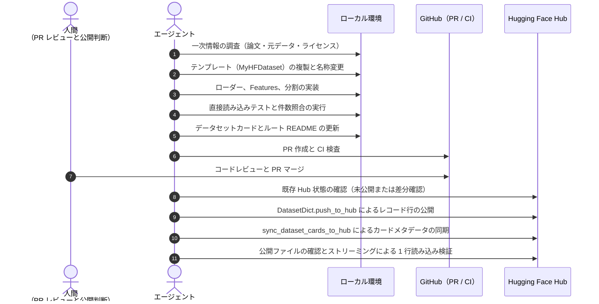

こんにちは [@shunk031](https://twitter.com/shunk031) です。本記事は [法政大学理工学部 Advent Calendar 2026](https://adventar.org/calendars/13106) の 8 日目の記事です。

https://adventar.org/calendars/13106

画像やデザイン生成の研究開発では、モデルの学習や性能評価に多様なデータセットが必要です。しかし、公開されているデータは論文ごとに配布形式、アノテーション構造、読み込み方法がそれぞれ異なります。そのため、新しいモデルを検証し、既存モデルと比較するたび、データセットの前処理や読み込みコードを個別に書く負担が生じます。

12/7 の記事では、モデル側のインターフェースをそろえて移植を進めるモノレポ [`design-generators`](https://github.com/creative-graphic-design/design-generators) とその開発・検証基盤（ハーネス）を紹介しました。

https://zenn.dev/shunk031/articles/design-generators-harness

モデルのインターフェースが共通化されても、入力となるデータセットの準備が手作業のままでは、実験を素早く再現できません。モデル側と同様、学習や評価で用いるデータセットも決まったパッケージの形、共通の読み込み口、記述が揃ったデータセットカード、そして検証テストで揃える必要があります。

そこで私は、デザイン生成やレイアウト理解のデータセットローダーとカードを集約するリポジトリ [`creative-graphic-design/huggingface-datasets`](https://github.com/creative-graphic-design/huggingface-datasets) を、エージェントを使って運用しています。


https://github.com/creative-graphic-design/huggingface-datasets

本記事では、このリポジトリの構成を踏まえ、エージェントが新しいデータセットの調査から Hugging Face Hub への公開までを安全に進めるためのハーネスを紹介します。前半で共通化の設計を整理したあと、後半ではエージェントが決まった手順でデータセットを足して Hub へ公開する具体的な流れを示します。

# huggingface-datasets とは

[`creative-graphic-design/huggingface-datasets` (コミット f1018f6d)](https://github.com/creative-graphic-design/huggingface-datasets/commit/f1018f6d41416c71954efb88b2292983b3064560) は、デザイン生成やレイアウト理解を扱う Python のモノレポです。タイポグラフィ、画像編集、審美性評価のデータセットローダーとカードを集約しています。リポジトリ直下の [README](https://github.com/creative-graphic-design/huggingface-datasets/blob/f1018f6d41416c71954efb88b2292983b3064560/README.md#L1-L11) に一覧があり、各データセットの内容、入力と出力の概要、上流の元データや論文への参照が整理されています。

https://github.com/creative-graphic-design/huggingface-datasets/blob/f1018f6d41416c71954efb88b2292983b3064560/README.md#L11-L153

多様なドメインのデータが集約されています。たとえばモバイルのユーザーインターフェース (User Interface; UI) を扱う Rico や、文書レイアウトを扱う PubLayNet などが含まれます。

本リポジトリの規模を表す主な数値をまとめます。

| 項目 | 計測値 | 備考 |
| :--- | ---: | :--- |
| データセットパッケージ数 | 28 | [README のカタログ行数](https://github.com/creative-graphic-design/huggingface-datasets/blob/f1018f6d41416c71954efb88b2292983b3064560/README.md#L11-L153)（`datasets/` 配下のディレクトリ数） |
| データセットテストモジュール数 | 28 | [`datasets/*/tests/*_test.py` に一致するテストファイル数](https://github.com/creative-graphic-design/huggingface-datasets/blob/f1018f6d41416c71954efb88b2292983b3064560/.agents/skills/create-dataset/SKILL.md#L542-L608) |
| テスト関数数 | 153 | コードベース内の `test_*` 関数の静的定義数（実行結果ではない） |
| CI ワークフロー数 | 1 | [`.github/workflows/ci.yml`（pre-commit ジョブ 1 つ）](https://github.com/creative-graphic-design/huggingface-datasets/blob/f1018f6d41416c71954efb88b2292983b3064560/.github/workflows/ci.yml#L3-L36) |

すべてのデータセットは独立したパッケージとして管理されつつ、リポジトリ全体で統一された構造を持ちます。

# 揃えている形とデータセットごとの違い

データセットを共通の基盤で扱うにあたり、何を揃えて何を揃えないかを明確に切り分ける必要があります。

本リポジトリで共通化している対象は、パッケージのディレクトリ構成とローダークラスの読み込み口です。レコードを構成するフィールド構造は、各データセットの元データに即して個別定義とします。

各データセットは `datasets/<dataset_name>/` 配下に独立したディレクトリを持ちます。各ディレクトリには Python ローダー、README（Hub のカード兼用）、`pyproject.toml`、`tests/` が配置されます。この構成は [MyHFDataset テンプレート](https://github.com/creative-graphic-design/huggingface-datasets/blob/f1018f6d41416c71954efb88b2292983b3064560/.agents/skills/create-dataset/SKILL.md#L14-L30) に基づき、[カード検査テスト](https://github.com/creative-graphic-design/huggingface-datasets/blob/f1018f6d41416c71954efb88b2292983b3064560/tests/test_dataset_cards.py#L316-L328) で必須と規定されています。リポジトリルートの Python パッケージ管理ツール [`uv`](https://docs.astral.sh/uv/) のワークスペースは `datasets/*` をメンバーとして含みます。Python 3.11 以上や画像処理を含む共通依存（`datasets[vision]`）を共有しながら、パッケージごとの個別設定を [ルートの `pyproject.toml`](https://github.com/creative-graphic-design/huggingface-datasets/blob/f1018f6d41416c71954efb88b2292983b3064560/pyproject.toml#L1-L37) で保持します。

https://docs.astral.sh/uv/

ローダークラスの設計も揃えています。リポジトリ内の全 28 個のデータセットローダークラスは、Hugging Face の基底クラス `datasets.GeneratorBasedBuilder` を継承しています。各ローダーは [公式のビルダーパターン](https://huggingface.co/docs/datasets/v3.6.0/en/package_reference/builder_classes) に従います。実装対象は、メタデータを定義する `_info`、分割やダウンロードを定義する `_split_generators`、そして実際のレコードを逐次生成する `_generate_examples` の各メソッドです。これらを [`create-dataset` スキルの設計規約](https://github.com/creative-graphic-design/huggingface-datasets/blob/f1018f6d41416c71954efb88b2292983b3064560/.agents/skills/create-dataset/SKILL.md#L436-L512) に沿って実装します。

レコードが持つ具体的なフィールド構成はデータセットごとに異なります。それぞれの元データが持つ意味構造を尊重するため、各ローダーが自身の `datasets.Features` を定義します。たとえば [Rico ローダー](https://github.com/creative-graphic-design/huggingface-datasets/blob/f1018f6d41416c71954efb88b2292983b3064560/datasets/Rico/Rico.py#L730-L810) は複数の設定（configuration）を持ち、UI のスクリーンショット画像やビュー階層データを扱います。一方で [PubLayNet ローダー](https://github.com/creative-graphic-design/huggingface-datasets/blob/f1018f6d41416c71954efb88b2292983b3064560/datasets/PubLayNet/PubLayNet.py#L280-L334) は、文書画像とバウンディングボックス座標、カテゴリ ID、セグメンテーション情報を含む階層的なアノテーション構造を返します。

利用者は [Hugging Face 公式ドキュメント](https://huggingface.co/docs/datasets/v3.6.0/en/loading) が示す標準的なインターフェースを通じてデータセットを読み込めます。

```python
import datasets

# 公開済みの Rico データセットから 1 行目をストリーミングで取得する例
dataset = datasets.load_dataset(
    "creative-graphic-design/Rico",
    name="ui-screenshots-and-hierarchies-with-semantic-annotations",
    split="train",
    streaming=True,
)
row = next(iter(dataset))
print(list(row.keys()))
# 出力: ['ancestors', 'klass', 'bounds', 'clickable', 'children', 'screenshot']
```

Hub 上のデータセットは Parquet 形式で保存されているため、`trust_remote_code=True` を指定することなく標準のインターフェースで読み込めます。実際にストリーミングで先頭の 1 行を取得すると、UI 要素の階層構造や画像を含む上記の各キーが得られます。

共通のパッケージ形式と読み込み口を保つことで、利用側は同じ作法でデータを呼び出せます。同時に、データ自体の構造は元データの表現力を損なわずに保持されます。

# 出典と検査を支える仕組み

前節で触れた共通パッケージ形式や読み込み口を揃える際、エージェントへデータセットの実装を任せると、出所が不確かな情報や誤ったスキーマでコードを生成する危険が生じます。

そのため本リポジトリでは、エージェントの行動を規定する指示書と、機械的な検査プロトコルを整備しています。エージェント向けの設定ファイルであるリポジトリルートの [`AGENTS.md`](https://github.com/creative-graphic-design/huggingface-datasets/blob/f1018f6d41416c71954efb88b2292983b3064560/AGENTS.md#L27-L36) は、新しいデータセットを追加する際は作業手順書である [`create-dataset` スキル](https://github.com/creative-graphic-design/huggingface-datasets/blob/f1018f6d41416c71954efb88b2292983b3064560/.agents/skills/create-dataset/SKILL.md) に従うよう指示しています。[README の運用方針](https://github.com/creative-graphic-design/huggingface-datasets/blob/f1018f6d41416c71954efb88b2292983b3064560/README.md#L154-L168) に基づき、エージェントが作業する際は使用するスキル名と情報源のリンクを明記する運用としています。

作業手順書である [`create-dataset` スキルの一次情報確認手順](https://github.com/creative-graphic-design/huggingface-datasets/blob/f1018f6d41416c71954efb88b2292983b3064560/.agents/skills/create-dataset/SKILL.md#L42-L65) では、実装へ入る前に一次情報や準一次情報の精査を義務づけています。対象となる情報は、論文、公式プロジェクトページ、上流の README、公開データ、前処理スクリプト、ライセンス表示です。情報が確認できない場合は推測で補わず、取得不可であることを記録します。

実装後の検証では、テストによる整合性の確認を徹底しています。軽量な補助関数の検査だけではスキーマ定義の不備を見落とす危険があるため、[`datasets.load_dataset` による直接の読み込みテスト](https://github.com/creative-graphic-design/huggingface-datasets/blob/f1018f6d41416c71954efb88b2292983b3064560/.agents/skills/create-dataset/SKILL.md#L914-L939) を必須としています。テストでは、実測したレコード件数が元データで報告された件数と一致するか、設定や分割（split）ごとの境界が正しいか、ベンチマーク用の分割名が揃っているかを [テスト設計規約](https://github.com/creative-graphic-design/huggingface-datasets/blob/f1018f6d41416c71954efb88b2292983b3064560/.agents/skills/create-dataset/SKILL.md#L568-L608) に基づいて確認します。

データセットの説明を担うデータセットカード（各ディレクトリの `README.md`）も、[運用規約](https://github.com/creative-graphic-design/huggingface-datasets/blob/f1018f6d41416c71954efb88b2292983b3064560/docs/dataset-card-maintenance.md#L19-L36) に基づく厳格な検査対象です。[カードテンプレート](https://github.com/creative-graphic-design/huggingface-datasets/blob/f1018f6d41416c71954efb88b2292983b3064560/.agents/skills/create-dataset/templates/MyHFDataset/README.md#L58-L250) には Hub 用の YAML フロントマター、概要、構造、分割、出典、制限事項、引用の各節が定義されています。リポジトリ全体で実行されるカードテスト（[`test_dataset_cards.py`](https://github.com/creative-graphic-design/huggingface-datasets/blob/f1018f6d41416c71954efb88b2292983b3064560/tests/test_dataset_cards.py)）により、必須ファイルの有無、メタデータや公開 ID の整合性、引用や同期設定が機械的に検査されます。[^hfd_card_tests]

継続的インテグレーション (Continuous Integration; CI) では、プルリクエスト (Pull Request; PR) やプッシュの契機で [CI ワークフロー](https://github.com/creative-graphic-design/huggingface-datasets/blob/f1018f6d41416c71954efb88b2292983b3064560/.github/workflows/ci.yml#L3-L36) の pre-commit ジョブを実行します。このジョブには、コード整形や構文検査（Ruff）、`uv.lock` の整合性検査、中央のカードテスト、特定データセットのテストフックが [`.pre-commit-config.yaml`](https://github.com/creative-graphic-design/huggingface-datasets/blob/f1018f6d41416c71954efb88b2292983b3064560/.pre-commit-config.yaml#L1-L34) で定義されています。全 28 個のデータセットのテストを CI 上ですべて実行する構成とはしていないため、個別のデータ読み込みテストはローカル環境で確実に実行して確認します。

# 新しいパッケージから Hub まで

エージェントによる新規データセットの追加から Hugging Face Hub への公開までは、GitHub でのレビューを挟んだ明確な段階設計としています。



ローカル環境でテンプレートの複製からローダー実装、読み込みテスト、カード作成までを終えたコードは、GitHub 上で PR を作成して CI 検査と人間によるコードレビューを受けます。レビュー前のコードを Hub へ公開することは [カード管理方針](https://github.com/creative-graphic-design/huggingface-datasets/blob/f1018f6d41416c71954efb88b2292983b3064560/docs/dataset-card-maintenance.md#L19-L36) で禁止されており、マージを経てから [公開作業（`publish-dataset` スキル）](https://github.com/creative-graphic-design/huggingface-datasets/blob/f1018f6d41416c71954efb88b2292983b3064560/.agents/skills/publish-dataset/SKILL.md#L8-L53) に進みます。

Hub への公開では、[`publish-dataset` スキルの分離規約](https://github.com/creative-graphic-design/huggingface-datasets/blob/f1018f6d41416c71954efb88b2292983b3064560/.agents/skills/publish-dataset/SKILL.md#L104-L109) を踏まえ、データ本体の行データとカードメタデータのアップロード経路を明確に分離しています。生成されたレコード行の公開は、[`publish-dataset` スキルの検証規則](https://github.com/creative-graphic-design/huggingface-datasets/blob/f1018f6d41416c71954efb88b2292983b3064560/.agents/skills/publish-dataset/SKILL.md#L57-L108) に従います。書き込み権限で保護されたテスト環境を通じ、`DatasetDict.push_to_hub()` により Hub 標準の列指向データ形式である Parquet 形式でアップロードされます。

データセットカードの `README.md` は、専用の同期スクリプト [`sync_dataset_cards_to_hub.py`](https://github.com/creative-graphic-design/huggingface-datasets/blob/f1018f6d41416c71954efb88b2292983b3064560/scripts/sync_dataset_cards_to_hub.py#L13-L41) を用いて反映します。このスクリプトは、Hub 側で自動生成される設定情報（`dataset_info` や `configs`）を保持します。その上でローカルのカード内容とマージし、Hugging Face 公式クライアント API の `HfApi.upload_file()` で送信します。[^hfd_sync_details] 誤った上書きを防ぐため、事前の動作確認（dry-run）を備え、実際の反映では `--yes` オプションと `HF_TOKEN` 環境変数を要求する設計としています。

アップロード完了後は、Hub 上に必要なファイルや設定が存在するかを確認し、ストリーミング機能で先頭の 1 行を読み込めることを確認して公開作業を完了します。データ公開では、Parquet 形式のレコード行とカードメタデータのみを独立して送信し、ソースディレクトリ全体は送信対象としません。

# design-generators とのつながり

データセットの整備が進んでも、モデル開発側のリポジトリで実際に活用されていなければ意味がありません。

12/7 の記事で取り上げた `design-generators` と本リポジトリの関係を、ソースコードの [検証対象コミット (0275181d)](https://github.com/creative-graphic-design/design-generators/commit/0275181d890609f70463b02593603e8ab478477f) に基づいて確認します。

`design-generators` のモデル実装では、実際に本リポジトリのデータセットが読み込まれています。具体的には、レイアウト生成モデルである `layout-dm` と `layout-diffusion` のデータローダーで利用されています。データセット名 `rico25` と `publaynet` をそれぞれ `creative-graphic-design/Rico` および `creative-graphic-design/PubLayNet` にマッピングしています。[^dg_model_loaders] コード内では `datasets.load_dataset(path, name, split, streaming=False)` を直接呼び出してデータを取得しています。

https://huggingface.co/datasets/creative-graphic-design/Rico

ただし、本リポジトリの全 28 個のデータセットが `design-generators` で網羅的に使われているわけではありません。現時点で実行時のコードから読み込みが確認できたのは、上記の Rico と PubLayNet の 2 つです。Hub から読み込まれたデータは、各モデルのデータローダー内でバウンディングボックスの離散化や前処理を経てから学習テンソルに変換されます。[^dg_tensor_preps]

`design-generators` の [データソース一覧ドキュメント](https://github.com/creative-graphic-design/design-generators/blob/0275181d890609f70463b02593603e8ab478477f/docs/data-sources.md#L13-L37) には、`CGL-Dataset`、`CGL-Dataset-v2`、`Magazine`、`PKU-PosterLayout` など複数の公開 ID を記録しています。また、別のモデル（RADM）の [訓練手順書](https://github.com/creative-graphic-design/design-generators/blob/0275181d890609f70463b02593603e8ab478477f/models/radm/TRAINING.md#L41) からも本リポジトリの `CGLDatasetV2` を参照しています。ただし、私がコード上で実行時の直接読み込みまで確認したのは上記の Rico と PubLayNet の 2 つです。それ以外のデータセットは、現時点ではドキュメント上の記録や手順書での参照にとどまり、実行コードでの直接読み込みまでは確認していません。

# まとめ

12/7 に紹介したモデル側のハーネスと、今回紹介したデータセット側のハーネスは、車の両輪として機能します。モデルの実装インターフェースを共通化するだけでなく、学習や評価に用いるデータセットのパッケージ構造、読み込み口、検証テスト、メタデータを統一することで、研究開発の再現性が高まります。

重要なのは、すべてのデータセットを単一の固定スキーマへ無理に押し込めない点です。パッケージの配置、ローダークラスの基底型、テストとカードの記述形式という外枠（ハーネス）を揃え、中身のデータ構造は元のデータセットの特性を残します。

自身の研究やプロジェクトで複数のデータセットを扱う場合は、まず 1 つのデータセットを取り上げ、一次情報の確認からビルダーパターンの実装、読み込みテスト、データセットカードの作成までを決まった手順で進めてみてください。作業の具体的な入口となる手順は、本リポジトリの [`create-dataset` スキルの作業手順書](https://github.com/creative-graphic-design/huggingface-datasets/blob/f1018f6d41416c71954efb88b2292983b3064560/.agents/skills/create-dataset/SKILL.md) で確認できます。

[^hfd_card_tests]: [File and front matter tests lines 302-336](https://github.com/creative-graphic-design/huggingface-datasets/blob/f1018f6d41416c71954efb88b2292983b3064560/tests/test_dataset_cards.py#L302-L336), [Metadata and ID tests lines 419-529](https://github.com/creative-graphic-design/huggingface-datasets/blob/f1018f6d41416c71954efb88b2292983b3064560/tests/test_dataset_cards.py#L419-L529), [Citation and sync tests lines 562-662](https://github.com/creative-graphic-design/huggingface-datasets/blob/f1018f6d41416c71954efb88b2292983b3064560/tests/test_dataset_cards.py#L562-L662)
[^hfd_sync_details]: [Merge behavior lines 76-96](https://github.com/creative-graphic-design/huggingface-datasets/blob/f1018f6d41416c71954efb88b2292983b3064560/scripts/sync_dataset_cards_to_hub.py#L76-L96), [Dry-run and upload gating lines 115-174](https://github.com/creative-graphic-design/huggingface-datasets/blob/f1018f6d41416c71954efb88b2292983b3064560/scripts/sync_dataset_cards_to_hub.py#L115-L174)
[^dg_model_loaders]: [LayoutDM dataset loader lines 48-52, 103-108](https://github.com/creative-graphic-design/design-generators/blob/0275181d890609f70463b02593603e8ab478477f/models/layout-dm/src/layout_dm/training/dataset.py#L48-L52), [LayoutDiffusion dataset loader lines 37-41, 86-91](https://github.com/creative-graphic-design/design-generators/blob/0275181d890609f70463b02593603e8ab478477f/models/layout-diffusion/src/layout_diffusion/training/dataset.py#L37-L41)
[^dg_tensor_preps]: [LayoutDM dataset loader lines 103-123](https://github.com/creative-graphic-design/design-generators/blob/0275181d890609f70463b02593603e8ab478477f/models/layout-dm/src/layout_dm/training/dataset.py#L103-L123), [LayoutDiffusion dataset loader lines 86-115](https://github.com/creative-graphic-design/design-generators/blob/0275181d890609f70463b02593603e8ab478477f/models/layout-diffusion/src/layout_diffusion/training/dataset.py#L86-L115)
