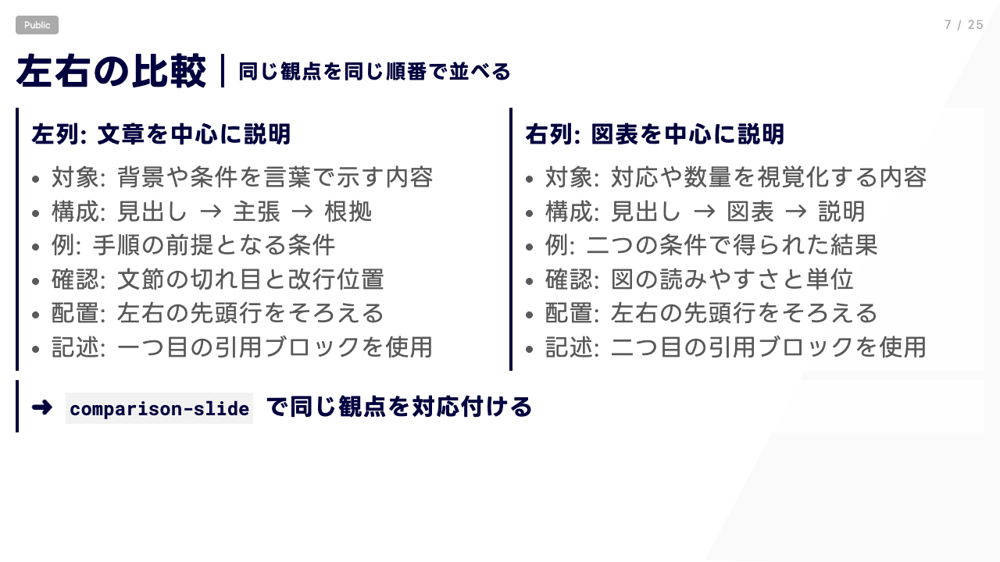
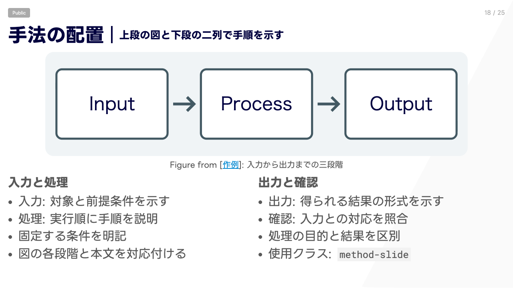

こんにちは [@shunk031](https://twitter.com/shunk031) です。本記事は [法政大学理工学部 Advent Calendar 2026](https://adventar.org/calendars/13106) の 3 日目の記事です。

https://adventar.org/calendars/13106

12/1 の記事では、親（オーケストレーター）が Herdr（= 複数のコーディングエージェントの作業タブを管理するツール）の上で Claude Code や Codex などのコーディングエージェントを複数起動するスキルを取り上げました。このスキルでは `herdr agent prompt` で相手のエージェントに直接プロンプトを送り、子（ワーカー）も同じ方法で親に結果を報告しながら作業を進めます。続く 12/2 の記事では、`agy`（= Google の Antigravity CLI）と Gemini を組み合わせて自然な日本語へ整える推敲環境を取り上げました。これらの記事では、コーディングエージェントが協調して作業を進めるための環境づくりに焦点を当ててきました。12/3 の今回は、その具体的な成果物の 1 つとして「論文紹介スライド」を取り上げます。研究や輪講、勉強会で使うスライドを Marp で作成する仕組みを解説します。

PowerPoint や Keynote などの GUI ツールでは、フォントや余白、数式の配置を手作業で調整する手間が発生します。一方で Marp は、原稿がテキストなので一括で修正でき、CSS でスタイルを調整できます。HTML で出力すれば、CSS のアニメーションも宣言的に書ける点も気に入っています。筆者のスライド用リポジトリ [shunk031/slides](https://github.com/shunk031/slides) では、Marp を基盤に据えて運用しています。専用の CSS テーマ、数式注釈の記法ルール、Headless Chrome（= 画面を表示せずに動かす Chrome）によるレイアウト自動検査を整えています。本記事では、このリポジトリの構成と、論文紹介スライドを見やすく仕上げるための工夫を解説します。

https://github.com/shunk031/slides

<!-- 感想: GUI ツールから Marp でのスライド作成へ移行した動機や実感について、実際に使ってどうだったか一言 -->

## Marp の概要

Marp は、Markdown ファイルからスライドを生成するオープンソースのツール群です。[^marp_app]

https://marp.app/

スライドの原稿は、次のようにフロントマターと Markdown で記述します。

```markdown
---
marp: true
size: 16:9
---

# 1 枚目のスライド

本文を Markdown で書きます。

---

# 2 枚目のスライド

- 箇条書きも使えます
```

ページは `---` で区切られ、`size` では組み込みテーマの 16:9（既定）と 4:3 を指定できます。作成した原稿は Marp CLI により、HTML（既定）、PDF、PowerPoint、画像に変換できます。

Marp は CSS によるテーマ拡張機構を備えています。独自のクラスや変数を定義して、スライド全体の配色や配置を制御できます。さらに数式表示エンジンとして KaTeX や MathJax を利用できるため、数式を含む学術的な発表資料の作成にも適しています。原稿はプレーンテキストとして完結します。そのため、Git による差分管理やプルリクエストでのレビューが容易に行えます。

## スライドリポジトリの構成

筆者のリポジトリ [shunk031/slides](https://github.com/shunk031/slides) では、ツールの導入とタスク管理に [mise](https://mise.jdx.dev/getting-started.html)[^mise_doc] を採用しています。`package.json` や Makefile は配置せず、すべての依存バージョンとタスク定義を `mise.toml` に集約しています。

リポジトリのディレクトリ構成は次のとおりです。

```text
.
├── slides/
│   └── <発表名>/
│       ├── slides.md   # 各スライドデッキの原稿
│       └── assets/     # そのデッキで参照する図版
├── themes/             # スライド用の独自テーマ
├── scripts/            # Marp のプラグインと検査スクリプト
├── docs/               # 執筆ガイドや検査・CI の説明
├── .marprc.cjs         # Marp CLI の設定（テーマ読み込みとプラグイン登録）
└── mise.toml           # 依存ツールと実行タスクの定義
```

スライドのプレビューは `mise run preview` コマンドで起動します。このタスクは `marp --server .` を実行し、ローカルサーバーを立ち上げます。ブラウザでプレビュー用の URL を開くと、ローカルサーバー経由でスライドが表示されます。Markdown ファイルを保存すると表示が自動更新されます。Visual Studio Code (VS Code) の拡張機能である「Marp for VS Code」も利用できます。ただし、リポジトリ独自のプラグインは VS Code の内蔵プレビューでは動作しません。正確な見た目と検証結果を確認するためには、ブラウザプレビューを使用します。

PDF 出力は `mise run pdf` コマンドで実行します。このタスクは、スライドの文字のはみ出しや重なりを検査するレイアウト検査タスク `check-layout` の通過を前提条件としています。内部では Marp CLI で全資料を一括変換し、`dist/<発表名>/slides.pdf` に出力します。指定している `--allow-local-files` は、手元の画像などのファイルを読み込むのを許可するオプションです。なお、`dist/` ディレクトリは Git の管理対象外です。

```toml
[tasks.pdf]
description = "すべての資料を dist/ に PDF 出力"
depends = ["check-layout"]
run = "marp --pdf --allow-local-files --input-dir slides --output dist"

[tasks.preview]
description = "ブラウザでスライドをプレビュー"
run = "marp --server ."
```

スライドの継続的インテグレーション (CI) には GitHub Actions を採用しています。ワークフローは `.github/workflows/slides.yml` で定義しており、push すると GitHub Actions で検査と PDF の生成が自動で走ります。

## 論文紹介スライドを見やすくする工夫

独自テーマには論文紹介向けに、論文の表紙、課題、手法、結果に対応するレイアウトを用意しています。スライドごとに `_class` を指定してレイアウトを切り替えます。

### 主題と説明を分ける見出し記法

スライド本文の見出しでは `## 主題 **|** _説明_` という記法を採用しています。この記法を用いると、Marp の CSS により `**|**` が縦線の区切り記号になります。主題が大きく、補足説明が控えめな文字サイズで 1 行に並んで描画されます。筆者がこの見た目を好んで使っています。検査スクリプトでも、見出しと説明がそれぞれ 1 行に収まっているかを検証します。

### 図の直下に出典を配置する記法

論文紹介スライドでは、図版がどの論文から引用されたものかを明確に示す必要があります。リポジトリの執筆ガイドでは、図の直下に出典と説明を配置するルールを定めています。

```markdown
> 
>
> Figure from [[Huang+ ECCV’26](https://arxiv.org/html/2608.26716v1#S3.F2)]: 画像・メタデータ・質問・回答の対応
```

角括弧 `[[Huang+ ...](URL)]` をリンクの外側に配置します。これにより、表示上の角括弧を維持しながらリンクとして機能させています。

### 数式の注釈と mathclap による幅の抑制

論文の数式解説では、各項の役割を説明するために下括弧 `\underbrace` を使う場面が多くあります。しかし、通常の LaTeX 記法では注釈テキストの幅に応じて数式全体の横幅が広がります。その結果、数式がスライド幅からはみ出す原因になります。この問題を解決するため、注釈部分を `\mathclap`（= 注釈の幅を 0 として扱い、式の横幅が広がらないようにする命令）で包む記法を必須としています。

```latex
$$
\underbrace{m\vphantom{y}}_{\mathclap{\text{平均}}} = \bigl(\underbrace{x\vphantom{y}}_{\mathclap{\text{条件 A}}}\;+\;\underbrace{y}_{\mathclap{\text{条件 B}}}\bigr)/2
$$
```

数式例の `\vphantom{y}` は、高さをそろえるための見えない文字です。Marp プラグイン `scripts/check-math.cjs` が数式トークンを走査します。`\underbrace` に `\mathclap` が適用されていない場合は、エラーを発生させてビルドを停止します。

### Headless Chrome によるレイアウト検査

スライド作成では、文字のはみ出しや意図しない改行、図とテキストの重なりなど、目視で見落としやすい崩れが発生します。`mise run check-layout` を実行すると、`scripts/check-layout.cjs` が Headless Chrome 上で全スライドを描画します。フォントや画像の読み込み完了後、各要素の配置をピクセル単位で検査します。

主な検査項目として以下のような項目が定義されています。

- 画面外へのはみ出し
- テキスト同士の重なり
- 極端に短い行の発生
- スライド下部の不自然な大きな空白
- 図の出典形式の不備
- 数式注釈の衝突やはみ出し

検査完了後、各ページの原寸画像や空白測定画像、エラー一覧の `review.md` が出力されます。どのスライドのどの要素で検査が失敗したかを画像と Markdown で確認できます。

## 代表的な作例

### レイアウト見本デッキ

リポジトリにはレイアウト見本デッキとして `slides/example/slides.md` が用意されています。このデッキには、テーマに含まれる各種レイアウトの実例が含まれています。新しいスライドを作成する際は、この見本デッキを `slides/<発表名>/slides.md` に複製して原稿を作成します。

見本デッキを Marp で描画したスライドは次のとおりです。


*論文の表紙のレイアウト*


*左右の比較（同じ観点を同じ順番で並べる）*


*数式の注釈（下括弧で記号の意味を式の近くに示す）*


*手法の配置（上に図、下に 2 列で手順）*

### 実際の論文紹介スライド

実践的な論文紹介スライドとして、コンピュータビジョンの国際会議である ECCV 2026 採択論文を解説したスライドデッキが格納されています。対象論文は「Beyond Atomic Layouts: Compositional Design Understanding with Vision-Language Models」です。ファイルパスは `slides/2026-10-19-beyond-atomic-layouts/slides.md` です。表紙では `paper-title` レイアウトを採用しています。論文題目、著者、所属、リンク、発表者情報、注記、ロゴをグリッド状に配置しています。本文では背景や課題、定性比較などの専用レイアウトを順序立てて活用しています。データセットやモデル構成を含め、複雑なマルチモーダル研究の論点を整理しています。

### 研究室向けテーマの作例

現在、電気通信大学の研究室向けテーマ `uec-haralab` の追加を進めており、[shunk031/slides#3](https://github.com/shunk031/slides/pull/3) で作業を進めています。まだ main ブランチには取り込まれていませんが、作成中のスライド例は次のとおりです。


*表紙*


*研究の概要（背景と課題、提案手法、検証結果）*

## コーディングエージェントとの協調運用

本リポジトリは手作業での編集だけでなく、コーディングエージェントによる執筆も想定しています。Claude Code や OpenAI Codex を使ったスライド作成に対応しています。エージェントがスライドを編集する際の規範として、ルートディレクトリに `AGENTS.md` を配置しています。`CLAUDE.md` はこのファイルへのシンボリックリンクです。

`AGENTS.md` では、スライド本文の執筆や改稿において指定のスキル群を適用することを定めています。具体的には `shunk031-writing-technical-slides` や `natural-japanese` などのスキルを指定しています。これにより、スライド用文体や簡潔な箇条書きのルールを適用します。また、レイアウトに収める目的で具体的な対象や条件を省いたキャッチコピーへ改変しないこととしています。箇条書きの言い換えで階層が崩れた場合は具体例を子項目へ戻すことと書かれています。さらに、空のボックスや無意味な装飾を追加して `sparse-body` 検査（= 本文の下に大きな空白が残っていないかを見る検査）を回避しないことなども定めています。

この運用には、12/1 の Herdr 連携や 12/2 の日本語スキルと共通する思想が反映されています。執筆ガイドラインである `AGENTS.md` と自動検査の `check-layout` を組み合わせています。これにより、エージェントの自律作業と品質担保を両立させています。

## まとめ

Marp を活用した論文紹介スライドの作成構成と、見やすく仕上げるための工夫を紹介しました。Markdown による原稿管理、専用 CSS テーマ、Headless Chrome による自動検査を組み合わせています。これにより、手作業の調整負担を抑えながらレイアウト崩れを防いでスライドを作成できます。コーディングエージェントと協調する上でも、ルール定義と自動検査が重要になります。これらを用意することで、手戻りを防ぎ品質を保つ土台となります。これから論文紹介スライドや技術発表資料を作成する読者にとって、本記事の環境が参考になれば幸いです。

<!-- 感想: Marp とレイアウト自動検査によるスライド作成環境を運用してみた総括について、実際に使ってどうだったか一言 -->

<!-- textlint-disable -->

[^marp_app]: Marp: Markdown Presentation Ecosystem https://marp.app/
[^mise_doc]: Getting Started - mise-en-place https://mise.jdx.dev/getting-started.html

<!-- textlint-enable -->
