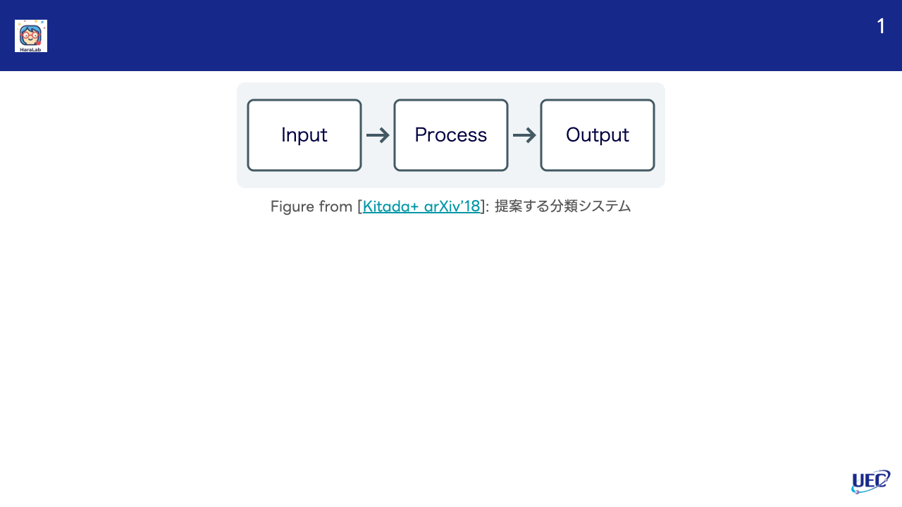
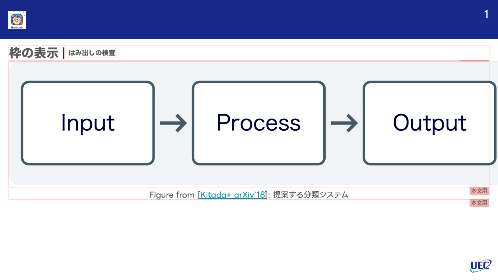

こんにちは [@shunk031](https://twitter.com/shunk031) です。本記事は [法政大学理工学部 Advent Calendar 2026](https://adventar.org/calendars/13106) の 3 日目の記事です。

https://adventar.org/calendars/13106

このアドベントカレンダーでは、最近流行りのコーディングエージェントに関する内容を 12/1 から 12/3 まで 3 日連続で投稿します。全体の予定は次の通りです。

- 12/1: [Herdr で複数のエージェントを対話させるシンプルなスキルの紹介](https://zenn.dev/shunk031/articles/herdr-orchestrate-workers-skill)
- 12/2: [AI 臭い日本語を agy gemini スキルで一掃するゾォ〜](https://zenn.dev/shunk031/articles/agy-gemini-japanese-skill)
- 12/3: [コーディングエージェントと Marp でいい感じに論文紹介スライドを作るぜ](https://zenn.dev/shunk031/articles/marp-paper-reading-slides)（本記事）

12/1 では、親（オーケストレーター）が Herdr（= 複数のコーディングエージェントの作業タブを管理するツール）の上で Claude Code や Codex などのコーディングエージェントを複数起動するスキルを取り上げました。このスキルでは `herdr agent prompt` で相手のエージェントに直接プロンプトを送り、子（ワーカー）も同じ方法で親に結果を報告しながら作業を進めます。続く 12/2 では、`agy`（= Google の Antigravity CLI）と Gemini を組み合わせて自然な日本語へ整える推敲環境を取り上げました。3 日目となる今回は、これまでの協調環境で作成する具体的な成果物として「論文紹介スライド」を扱います。

PowerPoint や Keynote などの GUI ツールでは、フォントや余白、数式の配置を手作業で調整する手間が発生します。一方で Marp は、原稿がテキストなのでコーディングエージェントでも扱いやすく、CSS でスタイルを一括調整できます。HTML で出力すれば、CSS のアニメーションも宣言的に書ける点も気に入っています。

筆者のスライド用リポジトリ [shunk031/slides](https://github.com/shunk031/slides) では、この Marp を基盤に据え、コーディングエージェントがスライドの原稿を主に執筆し、人間が微調整する運用を整えています。専用の CSS テーマと Headless Chrome によるレイアウト自動検査を備え、文字のはみ出しやテキスト同士の重なり、単語の途中改行などが見つかったスライドの PDF 出力を自動で止めます。本記事では、このリポジトリの構成と、エージェントと協調して論文紹介スライドを見やすく仕上げる工夫を解説します。

https://github.com/shunk031/slides

<!-- 感想: GUI ツールから Marp でのスライド作成へ移行した動機や実感について、実際に使ってどうだったか一言 -->

## Marp の概要

Marp は、Markdown ファイルからスライドを生成するオープンソースのツール群です。[^marp_app]

https://marp.app/

スライドの原稿は、次のようにファイル冒頭の `---` で囲んだ設定と、本文の Markdown で記述します。

```markdown
---
marp: true
size: 16:9
---

# 1 枚目のスライド

本文を Markdown で書きます。

---

# 2 枚目のスライド

- 箇条書きも使えます
```

ページは `---` で区切られ、`size` では組み込みテーマの 16:9（既定）と 4:3 を指定できます。作成した原稿は Marp CLI により、HTML（既定）、PDF、PowerPoint、画像に変換できます。

Marp は CSS によるテーマ拡張機構を備えています。独自のクラスや変数を定義して、スライド全体の配色や配置を制御できます。さらに数式表示エンジンとして KaTeX や MathJax を利用できるため、数式を含む学術的な発表資料の作成にも適しています。原稿はプレーンテキストとして完結します。そのため、Git による差分管理やプルリクエストでのレビューが容易に行えます。

## スライドリポジトリの構成

本節では、筆者のスライド用リポジトリ [shunk031/slides](https://github.com/shunk031/slides) に含まれるファイル群の役割と、原稿の執筆から PDF 出力までを動かす手順を説明します。

このスライドプロジェクトは複数のツールに依存するため、それらをまとめて手軽に管理できるよう [mise](https://mise.jdx.dev/getting-started.html)[^mise_doc] を採用しています。ツールのバージョン固定や、プレビューや PDF 出力といったタスク定義をすべて `mise.toml` に集約しています。

リポジトリのディレクトリ構成は次のとおりです。

```text
.
├── slides/
│   └── <発表名>/
│       ├── slides.md   # 各スライドデッキの原稿
│       └── assets/     # そのデッキで参照する図版
├── themes/             # スライド用の独自テーマ
├── scripts/            # Marp のプラグインと検査スクリプト
├── docs/               # 執筆ガイドや検査・CI の説明
├── .marprc.cjs         # Marp CLI の設定（テーマ読み込みとプラグイン登録）
└── mise.toml           # 依存ツールと実行タスクの定義
```

スライドのプレビューは `mise run preview` コマンドで起動します。ローカルサーバーが立ち上がり、ブラウザで指定の URL を開くとスライドが表示されます。Markdown ファイルを保存すると表示が自動更新されます。

PDF 出力は `mise run pdf` コマンドで実行します。このタスクは、スライドの文字のはみ出しや重なりを検査するレイアウト検査タスク `check-layout` の通過を前提条件としています。

```toml
[tasks.pdf]
description = "すべての資料を dist/ に PDF 出力"
depends = ["check-layout"]
run = "marp --pdf --allow-local-files --input-dir slides --output dist"

[tasks.preview]
description = "ブラウザでスライドをプレビュー"
run = "marp --server ."
```

スライドの継続的インテグレーション (CI) には GitHub Actions を採用しています。ワークフローは `.github/workflows/slides.yml` で定義しており、push すると GitHub Actions で検査と PDF の生成が自動で走ります。

## 論文紹介スライドを見やすくする工夫

独自テーマには論文紹介向けに、論文の表紙、課題、手法、結果に対応するレイアウトを用意しています。スライドごとに `_class`（= そのスライドへ適用する CSS クラスの指定）を指定してレイアウトを切り替えます。

### 主題と説明を分ける見出し記法

スライド本文の見出しでは `## 主題 **|** _説明_` という記法を採用しています。この記法を用いると、Marp の CSS により `**|**` が縦線の区切り記号になります。主題が大きく、補足説明が控えめな文字サイズで 1 行に並んで描画されます。筆者がこの見た目を好んで使っています。検査スクリプトでも、見出しと説明がそれぞれ 1 行に収まっているかを検証します。

スライドの原稿を次のように書くと、主題と説明が並んで表示されます。

```markdown
---
marp: true
theme: uec-haralab
size: 16:9
lang: ja
paginate: true
---

## 主題 **|** _説明_

- 内容の例
```


### 図の直下に出典を配置する記法

論文紹介スライドでは、図版がどの論文から引用されたものかを明確に示す必要があります。リポジトリの執筆ガイドでは、図の直下に出典と説明を配置するルールを定めています。

```markdown
> 
>
> Figure from [[Kitada+ arXiv’18](https://arxiv.org/abs/1809.02568)]: 提案する分類システム
```

スライドの原稿を次のように書くと、図の直後へ出典と説明が配置されます。

```markdown
---
marp: true
theme: uec-haralab
size: 16:9
lang: ja
paginate: true
---

> 
>
> Figure from [[Kitada+ arXiv’18](https://arxiv.org/abs/1809.02568)]: 提案する分類システム
```



### Headless Chrome によるレイアウト検査

スライド作成では、文字のはみ出しやテキスト同士の重なり、単語の途中改行など、目視で見落としやすい崩れが発生します。`mise run check-layout` を実行すると、`scripts/check-layout.cjs` が Headless Chrome 上で全スライドを描画します。フォントや画像の読み込み完了後、各要素の配置をピクセル単位で検査します。

主な検査項目として以下のような項目が定義されています。

- 画面外へのはみ出し
- テキスト同士の重なり
- 極端に短い行の発生
- スライド下部の不自然な大きな空白
- 図の出典形式の不備
- 数式注釈の衝突やはみ出し

検査完了後、各ページの原寸画像や空白測定画像、エラー一覧の `review.md` が出力されます。どのスライドのどの要素で検査が失敗したかを画像と Markdown で確認できます。

スライドのファイル冒頭の `---` で囲んだ設定の `class` に `debug-layout` を加えると、検査が使う枠（タイトル用、本文用など）が色付きで重ねて表示されます。この例では図の枠が右端からはみ出しており、レイアウト検査は「box-overflow: Figure 1: 枠の右端がスライド外へ出る」というエラーを 1 件出して止まります。

スライドの原稿を次のように書くと、枠線が重ねて表示されます。

```markdown
---
marp: true
theme: uec-haralab
class: debug-layout
size: 16:9
lang: ja
paginate: true
---

<style>
section.debug-layout > blockquote img { width: 1284px; max-width: none; }
</style>

## 枠の表示 **|** _はみ出しの検査_

> 
>
> Figure from [[Kitada+ arXiv’18](https://arxiv.org/abs/1809.02568)]: 提案する分類システム
```



## 代表的な作例

本節では、本リポジトリで作成・管理しているスライドの作例を紹介します。レイアウト見本デッキ、実際の国際会議論文の紹介スライドを順に取り上げます。

### レイアウト見本デッキ

リポジトリにはレイアウト見本デッキとして [slides/example/slides.md](https://github.com/shunk031/slides/blob/aed6a32210d645a9b13f0f3b46eff96df0200dac/slides/example/slides.md) が用意されています。このデッキには、テーマに含まれる各種レイアウトの実例が含まれています。新しいスライドを作成する際は、この見本デッキを複製して原稿を作成します。

### 実際の論文紹介スライド

実践的な作例として、コンピュータビジョンの国際会議 ECCV 2026 採択論文の解説スライドを管理しています。対象論文は「Beyond Atomic Layouts: Compositional Design Understanding with Vision-Language Models」で、[論文紹介スライド](https://github.com/shunk031/slides/blob/aed6a32210d645a9b13f0f3b46eff96df0200dac/slides/2026-10-19-beyond-atomic-layouts/slides.md) として格納されています。表紙のメタデータ配置から背景や課題、定性比較まで専用レイアウトを活用し、マルチモーダル研究の論点を整理したスライドです。

## コーディングエージェントとの協調運用

本リポジトリでは、スライドの原稿作成をコーディングエージェントに主に任せ、人間はレビューと細部の調整を受け持つ運用を想定しています。本記事で紹介した Beyond Atomic Layouts の 21 ページのスライドも、[shunk031/slides#1](https://github.com/shunk031/slides/pull/1) で Claude Code と Codex を使って作成しました。Claude Code や Codex がスライドを編集する際の規範として、ルートディレクトリに `AGENTS.md` を配置しています。`CLAUDE.md` はこのファイルへのシンボリックリンクです。

`AGENTS.md` では、スライド本文の執筆や改稿において指定のスキル群を適用することを定めています。具体的には、技術スライドの構成や文体を整えるスキル `shunk031-writing-technical-slides` や、自然な日本語表現へ整えるスキル `natural-japanese` を指定しています。これらにより、スライド用文体や簡潔な箇条書きのルールを適用します。また、レイアウトに収める目的で具体的な対象や条件を省いたキャッチコピーへ改変しないこととしています。箇条書きの言い換えで階層が崩れた場合は具体例を子項目へ戻すことと書かれています。さらに、空のボックスや無意味な装飾を追加して `sparse-body` 検査（= 本文の下に大きな空白が残っていないかを見る検査）を回避しないことなども定めています。

この運用には、[12/1 の Herdr 連携](https://zenn.dev/shunk031/articles/herdr-orchestrate-workers-skill) や [12/2 の推敲環境](https://zenn.dev/shunk031/articles/agy-gemini-japanese-skill) と同様に、書く役と確かめる役を分離し、機械で検証できる項目は機械に任せるという方針が一貫しています。執筆ガイドラインである `AGENTS.md` でエージェントの記述規則を定め、はみ出しや余白の崩れを自動検査の `check-layout` に任せて弾くことで、レイアウト調整の手戻りを減らしやすくなりました。

## まとめ

Marp を活用した論文紹介スライドの作成構成と、見やすく仕上げるための工夫を紹介しました。Markdown による原稿管理、専用 CSS テーマ、Headless Chrome による自動検査を組み合わせることで、レイアウト崩れを防ぎながらスライドを作成できます。コーディングエージェントに執筆を任せる場合でも、明確なルール定義と機械による自動検査を整えることで、手作業での調整や手戻りを減らしやすくなりました。これから論文紹介スライドや技術発表資料を作成する読者にとって、本記事の環境が参考になれば幸いです。 <!-- textlint-disable -->

<!-- 感想: Marp とレイアウト自動検査によるスライド作成環境を運用してみた総括について、実際に使ってどうだったか一言 -->

[^marp_app]: Marp: Markdown Presentation Ecosystem https://marp.app/
[^mise_doc]: Getting Started - mise-en-place https://mise.jdx.dev/getting-started.html
