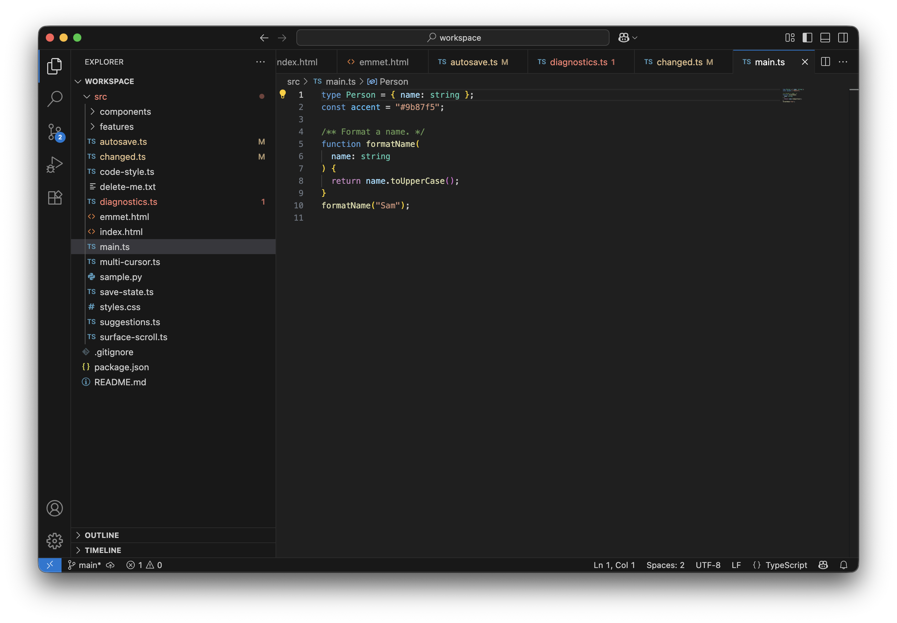

本書は、Igor Babko 氏の動画「VS Code Setup | Beautiful minimal look」に基づき、VS Code の外観を極限までシンプルかつ美しく整える設定手順を解説したガイドブックです。

## 本書の対象読者

元となる動画を視聴した方はもちろん、動画を見ていない方でも、VS Code の設定を 1 つずつ順番に再現したい読者を対象としています。各設定の目的や既定値との差分を確認しながら環境を構築できます。

## 参考リンク

解説の根拠となる元動画および公式設定リポジトリは以下のとおりです。

- 動画: [🎨 VS Code Setup | Beautiful minimal look](https://www.youtube.com/watch?v=VmFOsK7IhI4)
- リポジトリ: [igorbabko/vscode-setup（2025 ブランチ）](https://github.com/igorbabko/vscode-setup/tree/2025)

## 設定の進め方と構成

本書で掲載している `settings.json` のコードスニペットは、前の章の設定を残したまま新しい設定を足していく積み上げ式になっています。各章にはそのコミットで追加・変更された差分のみを記載しています。

設定ファイル全体の完成形を確認したい場合は、最終章のコミット [`da275c0`](https://github.com/igorbabko/vscode-setup/commit/da275c09488fec3b53f2541ad8d482dca51b499b) にある [`.vscode/settings.json`](https://github.com/igorbabko/vscode-setup/blob/da275c09488fec3b53f2541ad8d482dca51b499b/.vscode/settings.json) を参照して全体を見比べられます。

本書に掲載している各章の画像は、手元で同じ手順に沿って撮り直せるよう撮影用のキットを用意しています。ユーザー拡張機能が一切入っていない初期プロファイルで、サンプルプロジェクトを開いた状態の画面です。

各章は以下の流れで構成されています。

- **設定（settings.json）**: その章で追加する設定のスニペットである。
- **解説**: 各設定の意図や反映される画面の様子を説明する。
- **設定項目の一覧**: 変更する設定の既定値と役割を表形式でまとめる。
- **注意点**: UI の非表示化に伴う操作方法や副作用を記載する。
