カラーテーマを適用し、アクティビティバーやステータスバー、ミニマップなどの周辺 UI を非表示にして画面を整理します。対応する動画のチャプターは [Color theme and UI (00:00)](https://www.youtube.com/watch?v=VmFOsK7IhI4&t=0s) です。


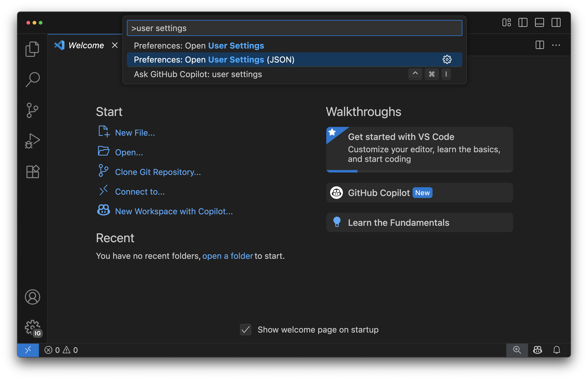

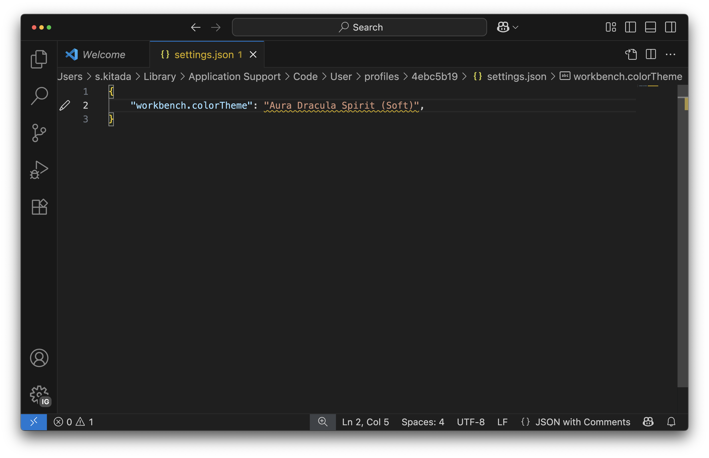
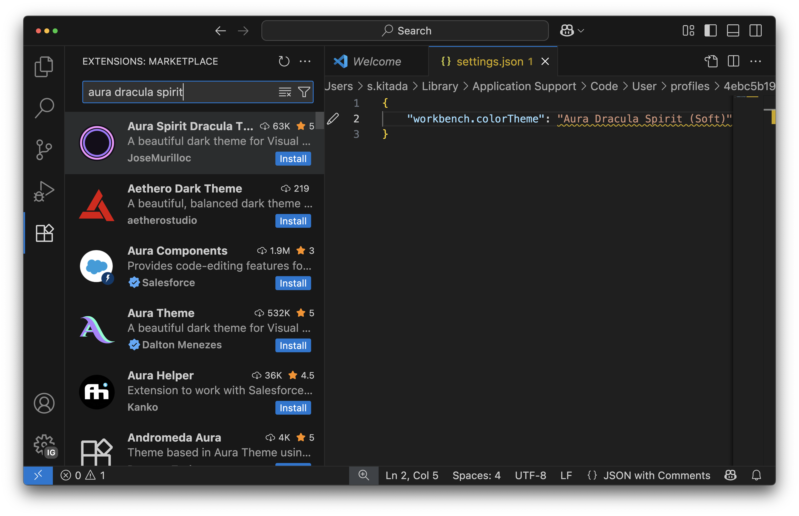


| Before                                             | After                                              |
| -------------------------------------------------- | -------------------------------------------------- |
| 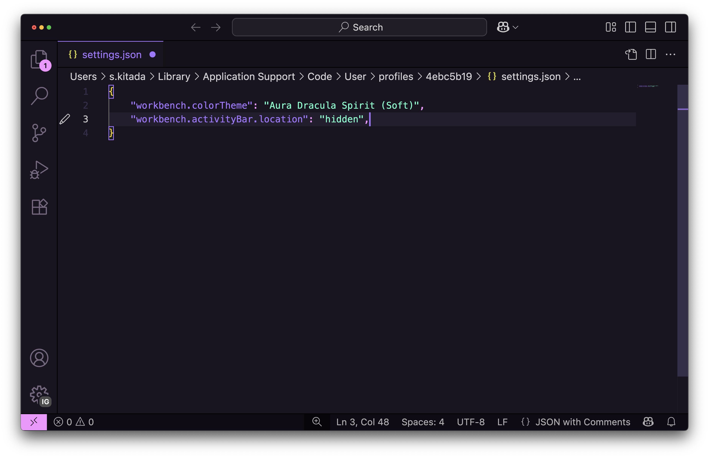 | 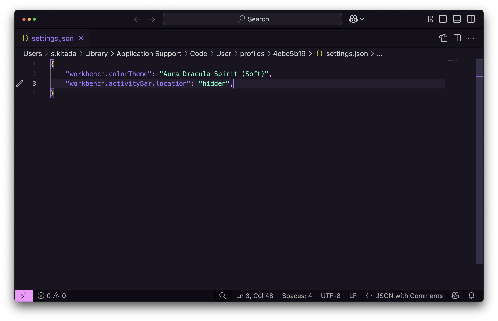 |

| Before                                             | After                                              |
| -------------------------------------------------- | -------------------------------------------------- |
| 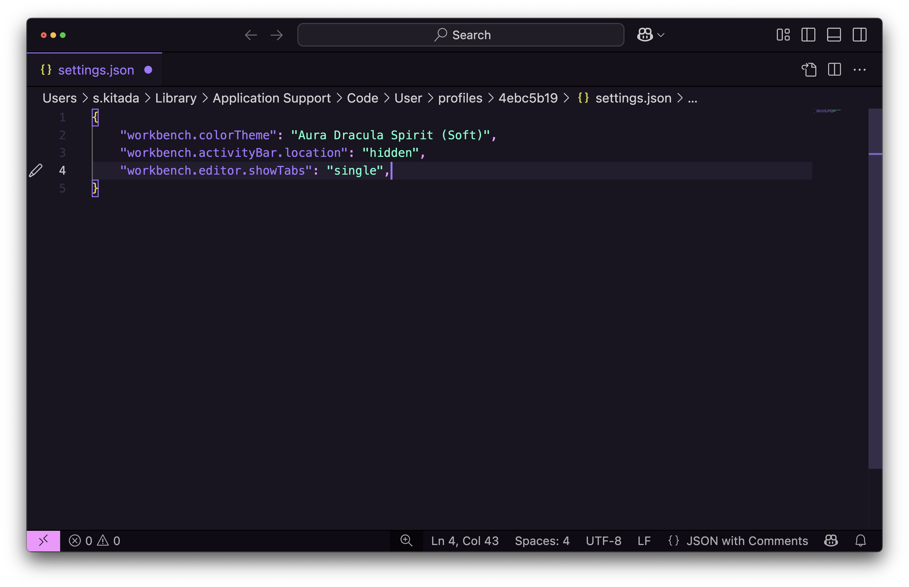 |  |

| Before                                             | After                                              |
| -------------------------------------------------- | -------------------------------------------------- |
| 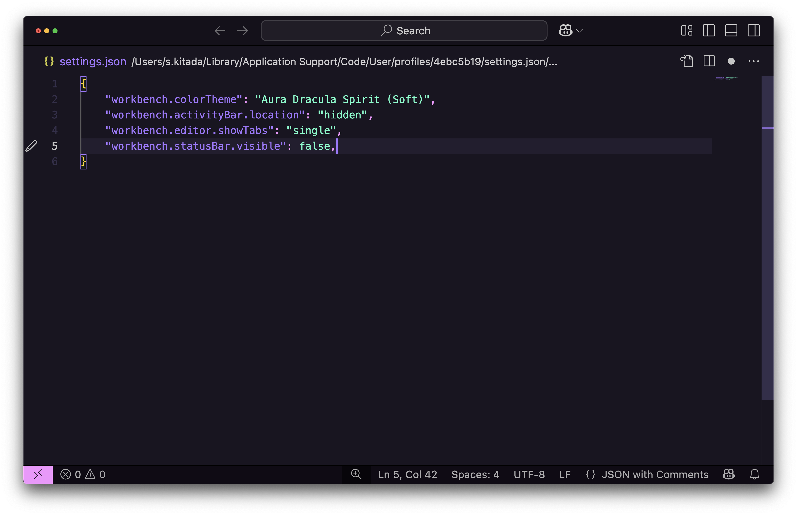 |  |

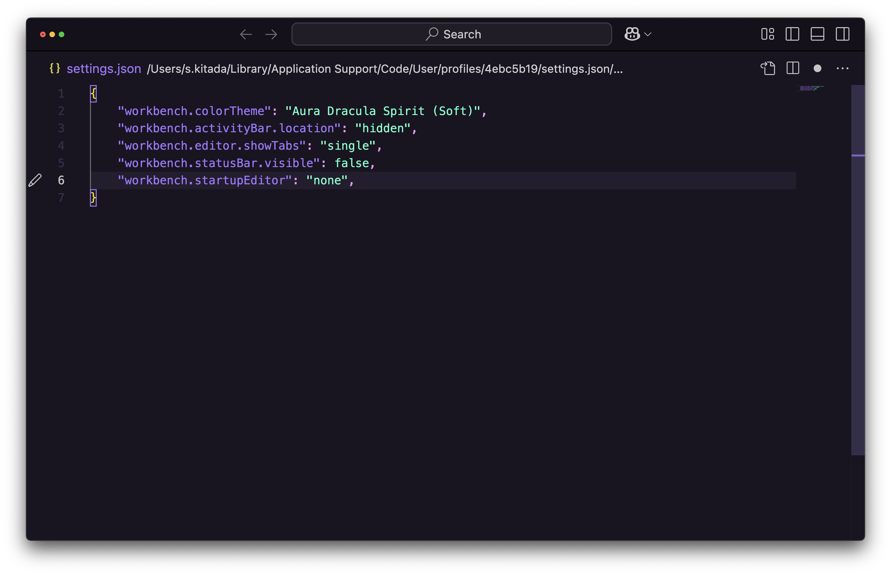

| Before                                             | After                                              |
| -------------------------------------------------- | -------------------------------------------------- |
|  |  |

| Before                                             | After                                              |
| -------------------------------------------------- | -------------------------------------------------- |
| 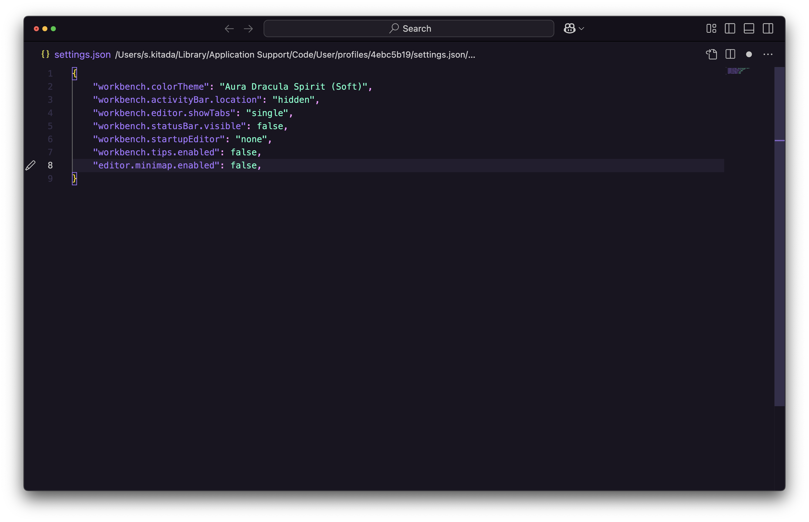 | 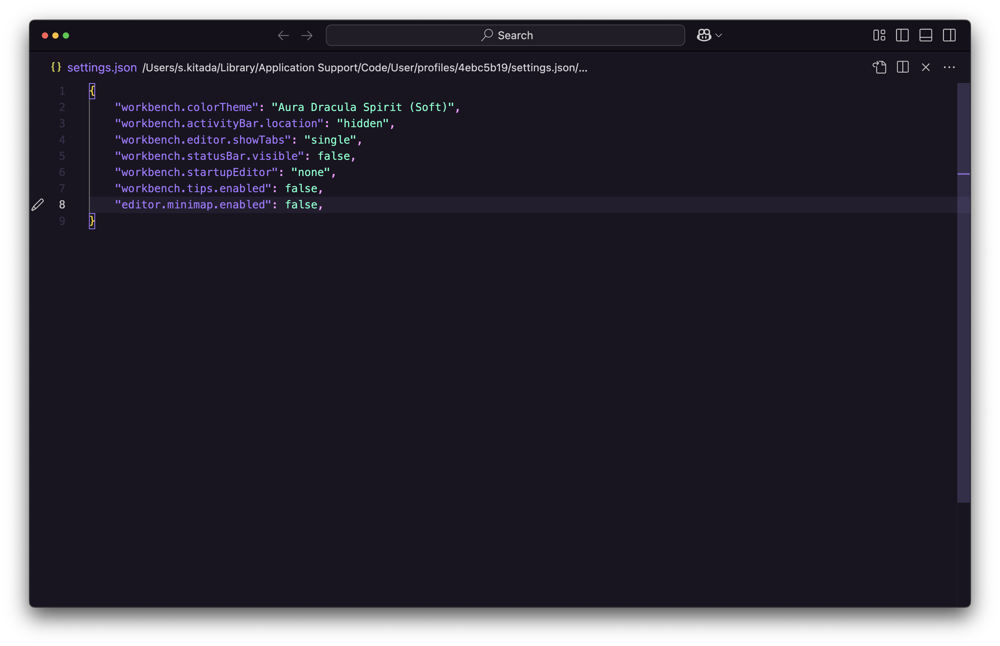 |

| Before                                             | After                                              |
| -------------------------------------------------- | -------------------------------------------------- |
|  | 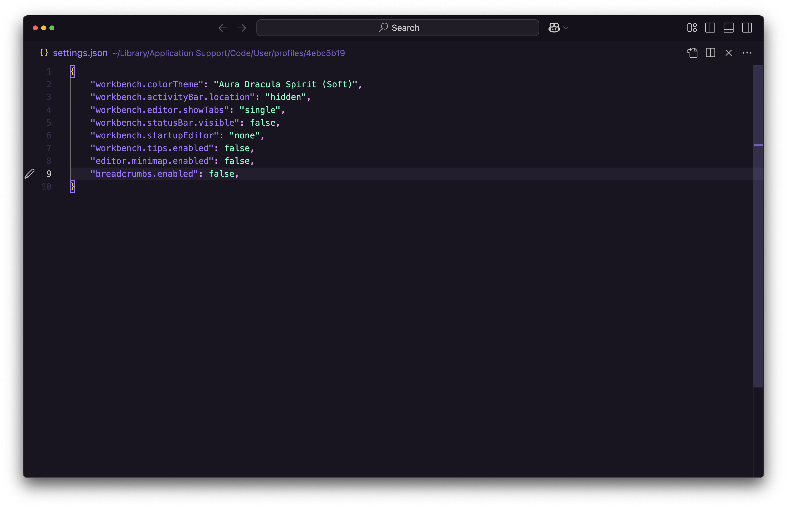 |

## 設定（settings.json）

```json
{
  "workbench.colorTheme": "Aura Dracula Spirit (Soft)",
  "workbench.activityBar.location": "hidden",
  "workbench.editor.showTabs": "single",
  "workbench.statusBar.visible": false,
  "workbench.startupEditor": "none",
  "workbench.tips.enabled": false,
  "editor.minimap.enabled": false,
  "breadcrumbs.enabled": false
}
```

## 設定項目の説明

| 設定 | 説明 |
| --- | --- |
| `workbench.colorTheme` | ワークベンチとエディタのアクティブなカラーテーマを選択します。 |
| `workbench.activityBar.location` | アクティビティバーの表示位置を制御します。`hidden` で非表示にします。 |
| `workbench.editor.showTabs` | エディタタブの表示方法を制御します。`single` で単一のタブを表示します。 |
| `workbench.statusBar.visible` | ステータスバーの表示・非表示を切り替えます。 |
| `workbench.startupEditor` | 起動時に開くエディタを設定します。`none` で起動ページを表示しません。 |
| `workbench.tips.enabled` | 「ようこそ」ページのヒント表示の有効・無効を切り替えます。 |
| `editor.minimap.enabled` | エディタのミニマップの表示・非表示を切り替えます。 |
| `breadcrumbs.enabled` | エディタのパンくずリスト（ブレッドクラムナビゲーション）の表示・非表示を切り替えます。 |

## 追加する拡張機能

- [Aura Spirit Dracula](https://marketplace.visualstudio.com/items?itemName=josemurilloc.aura-spirit-dracula) (`josemurilloc.aura-spirit-dracula`): カラーテーマ拡張機能

## 変更コミット

- [`02b14b5`](https://github.com/igorbabko/vscode-setup/commit/02b14b5421552f337e2d87110412e19050ab6904)
