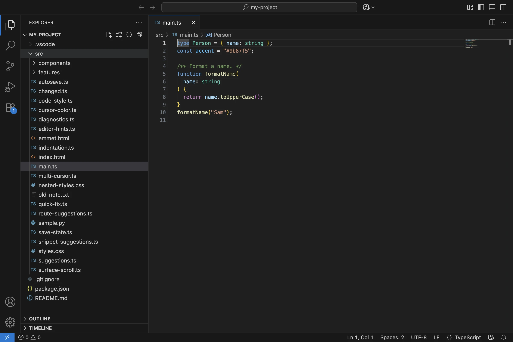
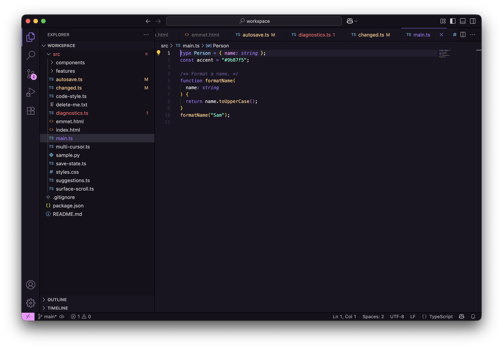
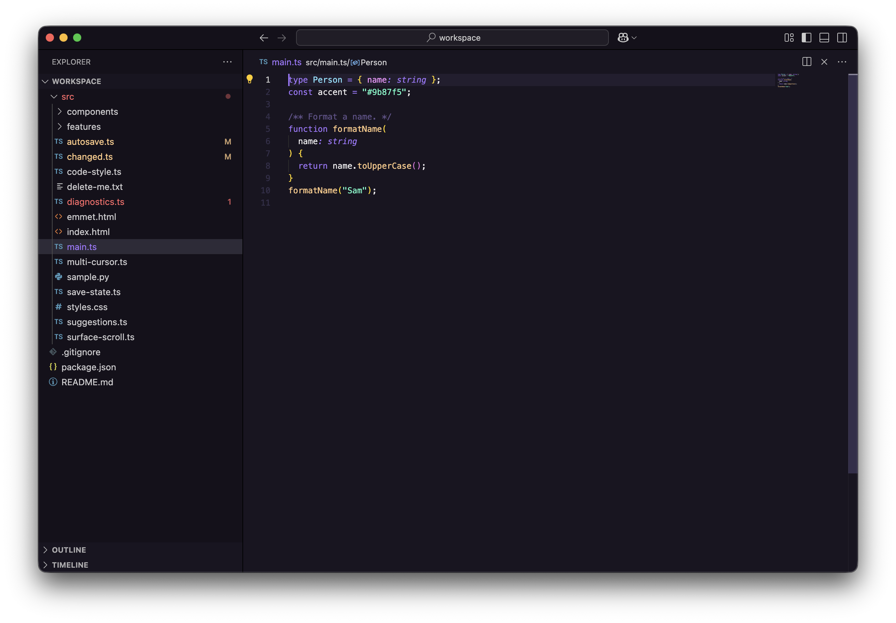
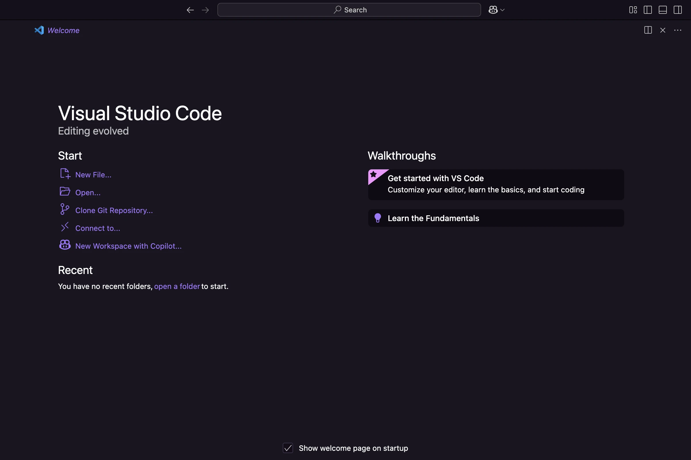
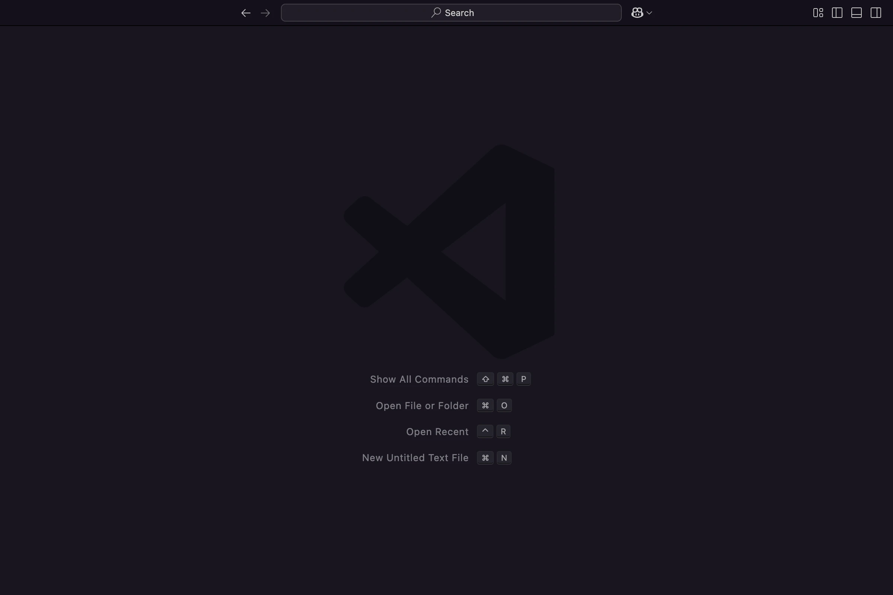
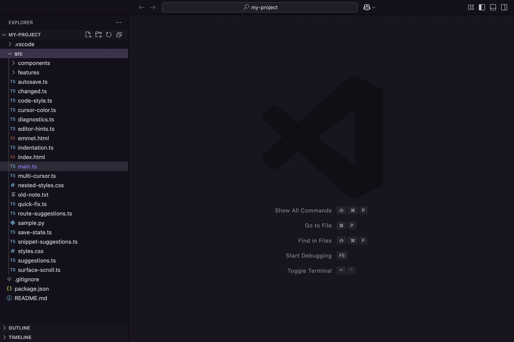
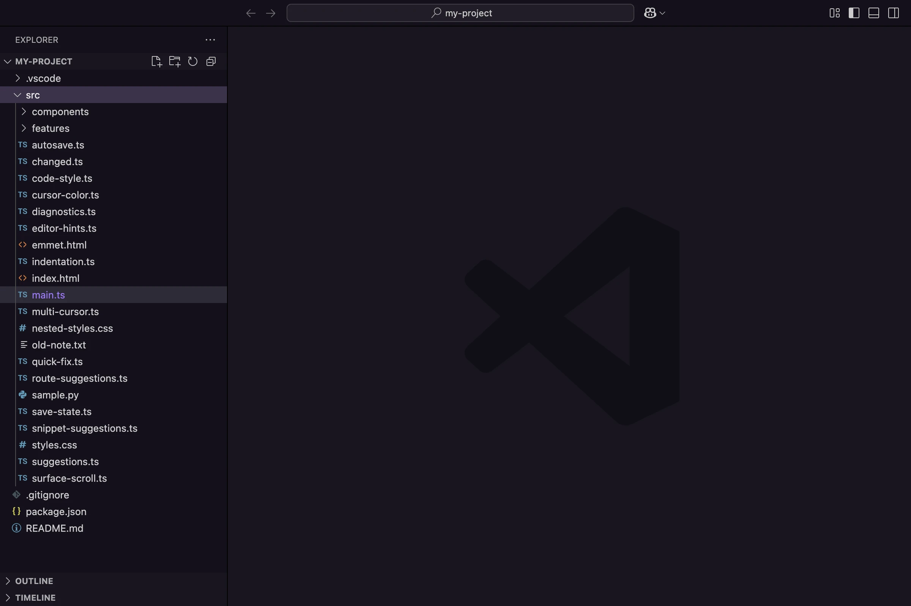
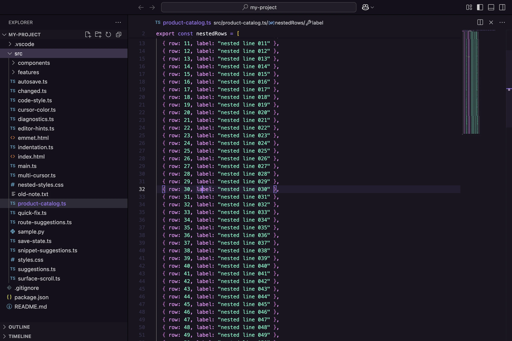
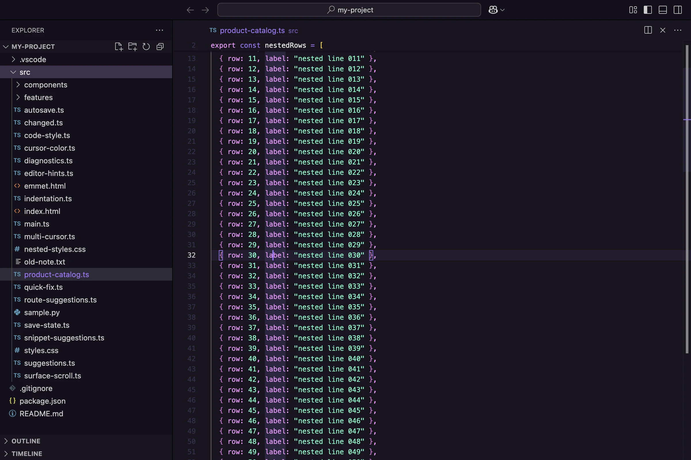

カラーテーマを適用し、アクティビティバーやステータスバー、ミニマップなどの周辺 UI を非表示にして画面を整理します。キーボードショートカット主体の操作を前提に、コードのみに集中できる最小限（= ミニマル）な作業環境を整えることが目的です。対応する動画のチャプターは [Color theme and UI (00:00)](https://www.youtube.com/watch?v=VmFOsK7IhI4&t=0s) です。

https://www.youtube.com/watch?v=VmFOsK7IhI4&t=0s

## 設定（settings.json）

```json
{
  "workbench.colorTheme": "Aura Dracula Spirit (Soft)",
  "workbench.activityBar.location": "hidden",
  "workbench.editor.showTabs": "single",
  "workbench.statusBar.visible": false,
  "workbench.startupEditor": "none",
  "workbench.tips.enabled": false,
  "editor.minimap.enabled": false,
  "breadcrumbs.enabled": false
}
```

## 解説

### カラーテーマの選択
カラーテーマには Aura Dracula Spirit の Soft バリアント（`Aura Dracula Spirit (Soft)`）を選択します。既定値の `Default Dark Modern` から変更し、落ち着いたトーンの配色を適用します。設定の編集はコマンドパレット（macOS では `⌘⇧P`、Windows では `Ctrl+Shift+P`）から User Settings (JSON) を開いて行います。編集した設定はファイルを保存することでエディタに反映されます。

| Before | After |
| --- | --- |
|  |  |

同じ TypeScript ファイルと Seti アイコンのまま、左の `Default Dark Modern` から右の `Aura Dracula Spirit (Soft)` へ配色が切り替わります。背景色とシンタックスハイライトのトーンの変化を確認できます。

### ワークベンチ UI の最小化
キーボードショートカットによる画面操作を前提とし、不要なナビゲーション UI を非表示にします。アクティビティバーは `workbench.activityBar.location: "hidden"`（既定値 `"default"`）で画面から取り除きます。エディタタブは `workbench.editor.showTabs: "single"`（既定値 `"multiple"`）を指定し、単一タブ表示に切り替えます。画面下部のステータスバーも `workbench.statusBar.visible: false`（既定値 `true`）で非表示にします。

| Before | After |
| --- | --- |
|  |  |

左では複数のタブに加えて左端のアクティビティバーと下部のステータスバーが表示されていますが、右では単一のタイトル行だけが残り両方のバーが消えます。画面外周の UI が取り除かれてエディタ領域が広がる点を確認できます。

### 起動画面とエディタ補助機能の整理
ファイルを開いていないときの画面表示をシンプルにします。起動時の画面は `workbench.startupEditor: "none"`（既定値 `"welcomePage"`）に設定し、「ようこそ」画面を表示しないようにします。また、空画面に表示されるショートカット案内などのヒントも `workbench.tips.enabled: false`（既定値 `true`）で非表示にします。さらに、エディタ右側のコード縮小表示であるミニマップ（`editor.minimap.enabled: false`、既定値 `true`）を非表示にします。上部のパンくずリスト（`breadcrumbs.enabled: false`、既定値 `true`）も非表示にして、作業領域を広く確保します。

| Before | After |
| --- | --- |
|  |  |

左では起動直後に Welcome エディタが開きますが、右ではタブのない空のワークベンチが表示されます。

| Before | After |
| --- | --- |
|  |  |

左の空画面に並んでいたショートカットのヒントが、右では非表示になります。汎用的な Open File の案内だけが残る点を確認できます。

| Before | After |
| --- | --- |
|  |  |

同じ長いファイルを開いた状態で、左にあった右端のミニマップと上部のパンくずリスト行が、右ではどちらも消えます。

## 設定項目の一覧

| 設定 | 既定値 | 説明 |
| --- | --- | --- |
| `workbench.colorTheme` | `"Default Dark Modern"` | ワークベンチとエディタのアクティブなカラーテーマを選択します。 |
| `workbench.activityBar.location` | `"default"` | アクティビティバーの表示位置を制御します。`hidden` で非表示にします。 |
| `workbench.editor.showTabs` | `"multiple"` | エディタタブの表示方法を制御します。`single` で単一のタブを表示します。 |
| `workbench.statusBar.visible` | `true` | ステータスバーの表示・非表示を切り替えます。`false` で非表示にします。 |
| `workbench.startupEditor` | `"welcomePage"` | 起動時に開くエディタを設定します。`none` で「ようこそ」画面を表示しません。 |
| `workbench.tips.enabled` | `true` | 空の起動画面に表示されるショートカット案内などのヒント表示を切り替えます。`false` で非表示にします。 |
| `editor.minimap.enabled` | `true` | エディタのミニマップ（コード縮小表示）の表示・非表示を切り替えます。`false` で非表示にします。 |
| `breadcrumbs.enabled` | `true` | エディタ上部のパンくずリスト（ファイルやシンボルの階層表示）の表示・非表示を切り替えます。`false` で非表示にします。 |

## 注意点

ステータスバーを非表示にすると、現在の Git ブランチ名やワークスペースの状態情報などが常時確認できなくなります。ステータスバーを再度表示したい場合は、設定値を `true` に戻すか、メニューバーの「View（表示）」>「Appearance（外観）」>「Status Bar（ステータスバー）」から切り替えます。

settings.json の編集内容は、ファイルを保存した時点でエディタに反映されます。

## 追加する拡張機能

- [Aura Spirit Dracula](https://marketplace.visualstudio.com/items?itemName=josemurilloc.aura-spirit-dracula) (`josemurilloc.aura-spirit-dracula`): カラーテーマ拡張機能

## 変更コミット

- [`02b14b5`](https://github.com/igorbabko/vscode-setup/commit/02b14b5421552f337e2d87110412e19050ab6904)
