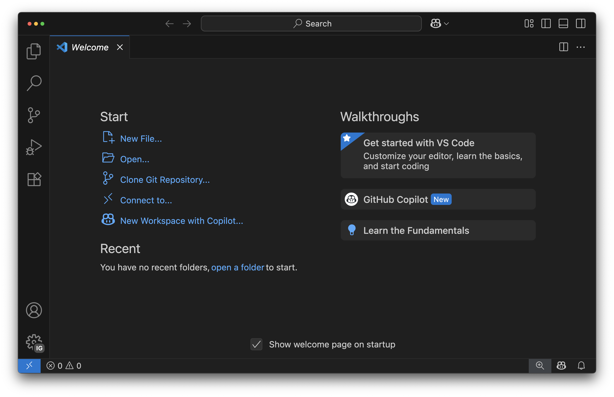
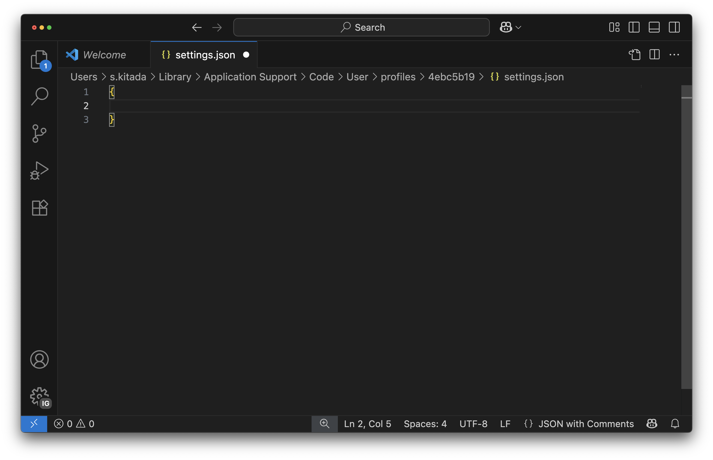
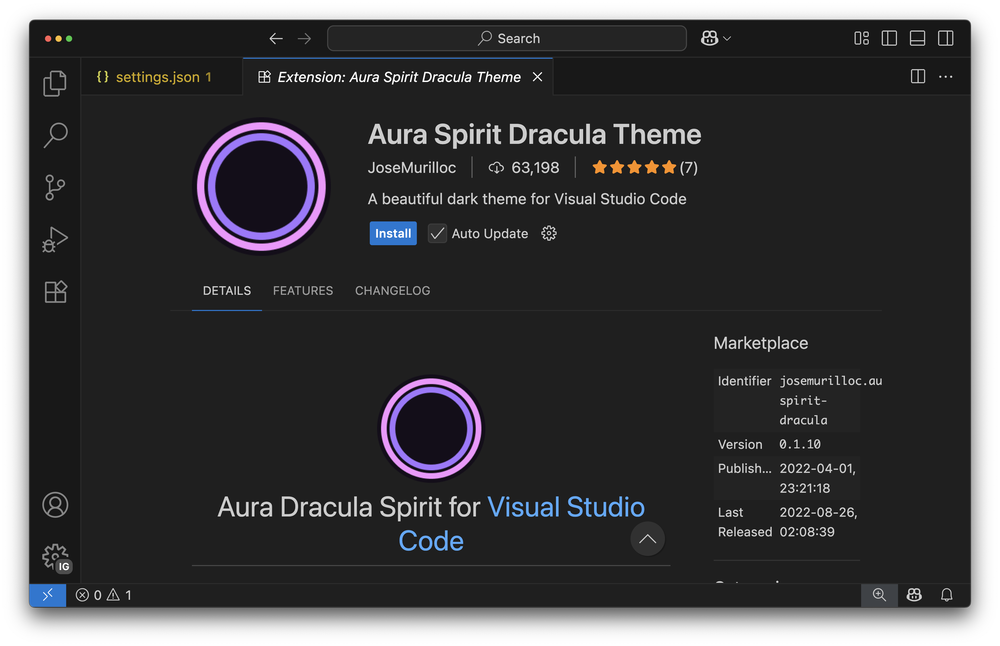
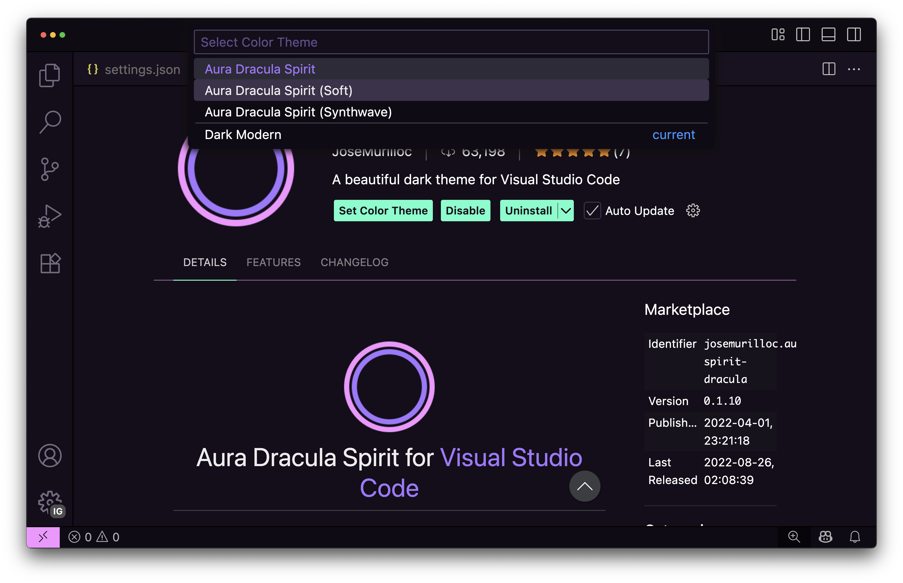
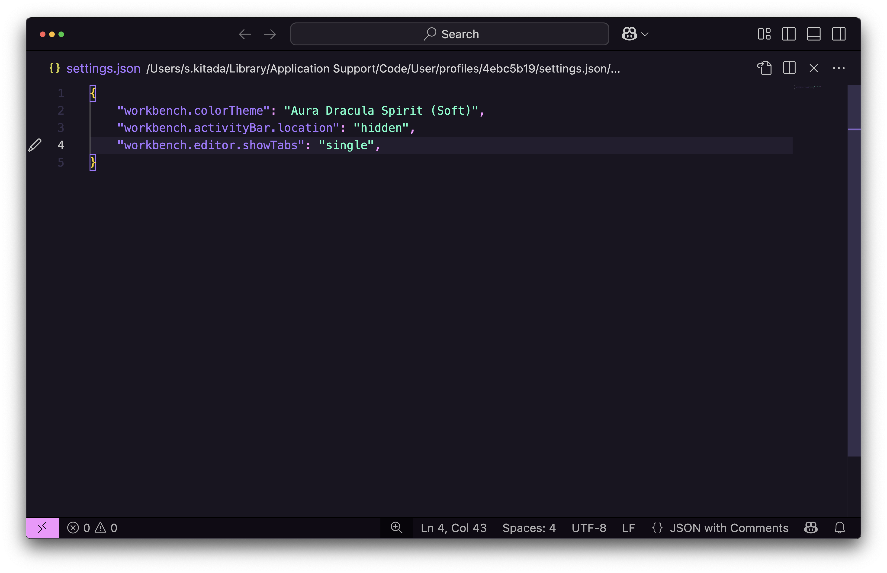
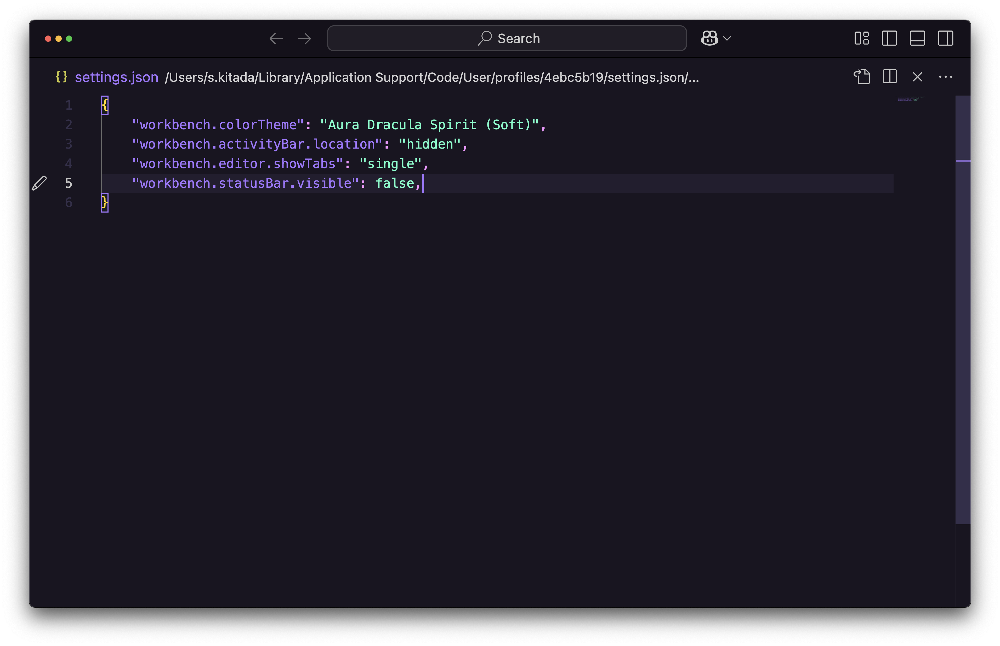
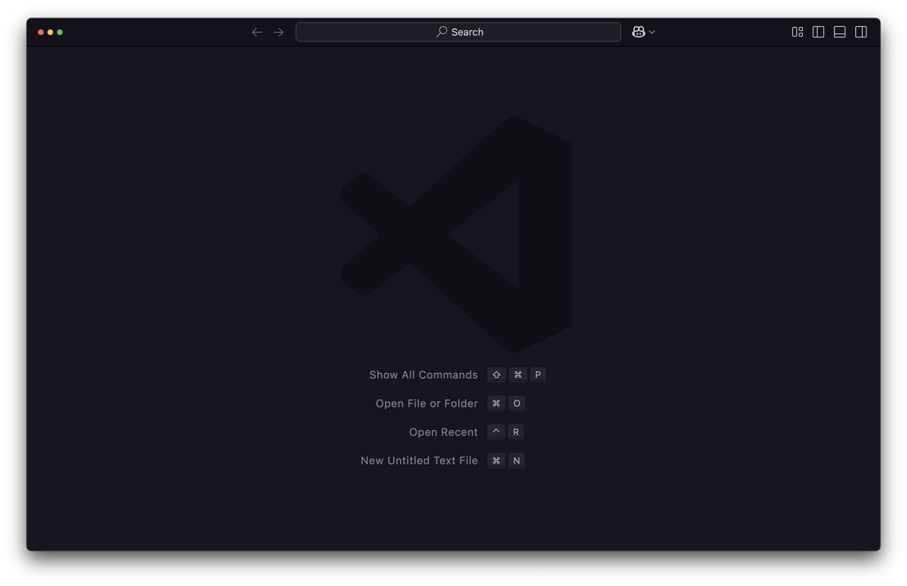
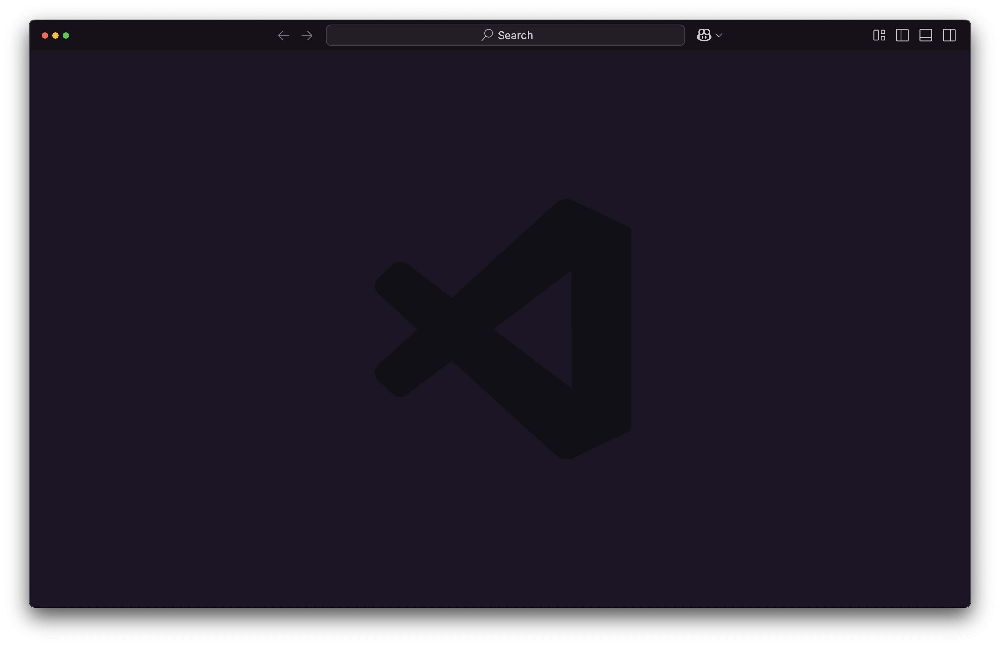
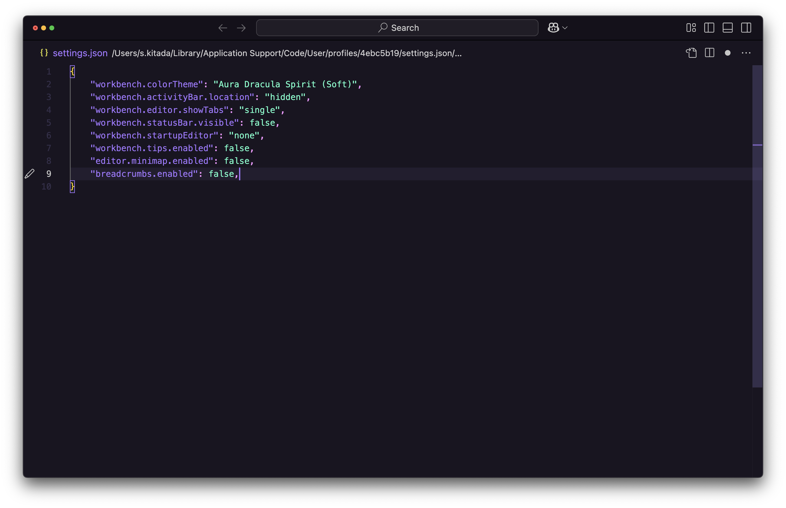

カラーテーマを適用し、アクティビティバーやステータスバー、ミニマップなどの周辺 UI を非表示にして画面を整理します。キーボードショートカット主体の操作を前提に、コードのみに集中できる最小限（= ミニマル）な作業環境を整えることが目的です。対応する動画のチャプターは [Color theme and UI (00:00)](https://www.youtube.com/watch?v=VmFOsK7IhI4&t=0s) です。

## 設定（settings.json）

```json
{
  "workbench.colorTheme": "Aura Dracula Spirit (Soft)",
  "workbench.activityBar.location": "hidden",
  "workbench.editor.showTabs": "single",
  "workbench.statusBar.visible": false,
  "workbench.startupEditor": "none",
  "workbench.tips.enabled": false,
  "editor.minimap.enabled": false,
  "breadcrumbs.enabled": false
}
```

## 解説

### カラーテーマの選択
カラーテーマには Aura Dracula Spirit の Soft バリアント（`Aura Dracula Spirit (Soft)`）を選択します。既定値の `Default Dark Modern` から変更し、落ち着いたトーンの配色を適用します。設定の編集はコマンドパレット（macOS では `⌘⇧P`、Windows では `Ctrl+Shift+P`）から User Settings (JSON) を開いて行います。編集した設定はファイルを保存することでエディタに反映されます。

変更前の初期状態の画面です。Welcome 画面が表示され、左端にアクティビティバー、下部にステータスバーが並んでいます。


コマンドパレットを開き、「Preferences: Open User Settings (JSON)」を選択して設定ファイルを開きます。


初期状態の `settings.json` です。波括弧 `{}` のみが入っており、まだ独自の設定は追加されていません。


`workbench.colorTheme` に `"Aura Dracula Spirit (Soft)"` を記述した直後です。この時点ではまだテーマが反映されておらず、既定のダークテーマの外観を保っています。


Extensions（拡張機能）ビューで「aura dracula spirit」を検索し、拡張機能をインストールします。


Aura Spirit Dracula 拡張機能の詳細ページを開き、インストールを実行します。


カラーテーマ選択メニューで「Aura Dracula Spirit (Soft)」を選択した画面です。エディタ全体が紫基調の配色に切り替わります。


### ワークベンチ UI の最小化
キーボードショートカットによる画面操作を前提とし、不要なナビゲーション UI を非表示にします。アクティビティバーは `workbench.activityBar.location: "hidden"`（既定値 `"default"`）で画面から取り除きます。

アクティビティバーの表示状態の比較です。設定の適用によって左端のアクティビティバーアイコンが消えています。

| Before                                             | After                                              |
| -------------------------------------------------- | -------------------------------------------------- |
|  |  |

エディタタブは `workbench.editor.showTabs: "single"`（既定値 `"multiple"`）を指定し、複数タブではなく単一タブ表示に切り替えます。

`workbench.editor.showTabs: "single"` を設定に追加した前後の比較です。開いているタブが 1 つだけのため、単一タブ表示による外観の変化は確認できません。

| Before                                             | After                                              |
| -------------------------------------------------- | -------------------------------------------------- |
|  |  |

画面下部のステータスバーも `workbench.statusBar.visible: false`（既定値 `true`）で非表示にします。

`workbench.statusBar.visible: false` を追加した前後の比較です。設定行は追加されていますが、このキャプチャの下端ではステータスバーの明確な消失の差分は見られません。

| Before                                             | After                                              |
| -------------------------------------------------- | -------------------------------------------------- |
|  |  |

### 起動画面とエディタ補助機能の整理
ファイルを開いていないときの画面表示をシンプルにします。起動時の画面は `workbench.startupEditor: "none"`（既定値 `"welcomePage"`）に設定し、「ようこそ」画面を表示しないようにします。

起動画面を `none` に設定し、ファイルを開いていないときの画面です。中央に VS Code のロゴのみが表示されています。


また、空画面に表示されるショートカット案内などのヒントも `workbench.tips.enabled: false`（既定値 `true`）で非表示にします。

ショートカット案内のヒント表示の比較です。設定の適用によってロゴの下に表示されていた操作案内が消えています。

| Before                                             | After                                              |
| -------------------------------------------------- | -------------------------------------------------- |
|  |  |

さらに、エディタ右側のコード縮小表示であるミニマップ（`editor.minimap.enabled: false`、既定値 `true`）を非表示にします。

`editor.minimap.enabled: false` を設定に追加した前後の比較です。キャプチャ右端の表示領域が狭いため、ミニマップ消失の視覚的な変化は明確には確認できません。

| Before                                             | After                                              |
| -------------------------------------------------- | -------------------------------------------------- |
|  |  |

上部の階層ナビゲーションであるパンくずリスト（`breadcrumbs.enabled: false`、既定値 `true`）も非表示にして作業領域を広く確保します。

パンくずリストの表示比較です。設定の適用により、ファイル見出し横のパス階層表示が消えています。

| Before                                             | After                                              |
| -------------------------------------------------- | -------------------------------------------------- |
|  |  |

## 設定項目の一覧

| 設定 | 既定値 | 説明 |
| --- | --- | --- |
| `workbench.colorTheme` | `"Default Dark Modern"` | ワークベンチとエディタのアクティブなカラーテーマを選択します。 |
| `workbench.activityBar.location` | `"default"` | アクティビティバーの表示位置を制御します。`hidden` で非表示にします。 |
| `workbench.editor.showTabs` | `"multiple"` | エディタタブの表示方法を制御します。`single` で単一のタブを表示します。 |
| `workbench.statusBar.visible` | `true` | ステータスバーの表示・非表示を切り替えます。`false` で非表示にします。 |
| `workbench.startupEditor` | `"welcomePage"` | 起動時に開くエディタを設定します。`none` で「ようこそ」画面を表示しません。 |
| `workbench.tips.enabled` | `true` | 空の起動画面に表示されるショートカット案内などのヒント表示を切り替えます。`false` で非表示にします。 |
| `editor.minimap.enabled` | `true` | エディタのミニマップ（コード縮小表示）の表示・非表示を切り替えます。`false` で非表示にします。 |
| `breadcrumbs.enabled` | `true` | エディタ上部のパンくずリスト（ファイルやシンボルの階層表示）の表示・非表示を切り替えます。`false` で非表示にします。 |

## 注意点

ステータスバーを非表示にすると、現在の Git ブランチ名やワークスペースの状態情報などが常時確認できなくなります。ステータスバーを再度表示したい場合は、設定値を `true` に戻すか、メニューバーの「View（表示）」>「Appearance（外観）」>「Status Bar（ステータスバー）」から切り替えます。

settings.json の編集内容は、ファイルを保存した時点でエディタに反映されます。

## 追加する拡張機能

- [Aura Spirit Dracula](https://marketplace.visualstudio.com/items?itemName=josemurilloc.aura-spirit-dracula) (`josemurilloc.aura-spirit-dracula`): カラーテーマ拡張機能

## 変更コミット

- [`02b14b5`](https://github.com/igorbabko/vscode-setup/commit/02b14b5421552f337e2d87110412e19050ab6904)
