サイドバーを画面右側に配置し、フォルダー構造の視認性を高めつつ、不要な確認ダイアログや視覚的ノイズを排除してエクスプローラーを整理します。コード編集エリアの視線移動を安定させ、直感的なファイル操作を可能にする環境を作ります。対応する動画のチャプターは [Sidebar and file explorer (03:29)](https://www.youtube.com/watch?v=VmFOsK7IhI4&t=209s) です。

## 設定（settings.json）

```json
{
  "workbench.sideBar.location": "right",
  "workbench.iconTheme": "material-icon-theme",
  "material-icon-theme.hidesExplorerArrows": true,
  "workbench.tree.enableStickyScroll": false,
  "workbench.tree.renderIndentGuides": "none",
  "workbench.tree.indent": 8,
  "explorer.compactFolders": false,
  "explorer.confirmDragAndDrop": false,
  "explorer.confirmDelete": false,
  "explorer.decorations.badges": false,
  "git.decorations.enabled": false
}
```

## 解説

### サイドバーの配置とアイコンテーマ
プライマリサイドバーの配置を既定の左側から右側（`workbench.sideBar.location: "right"`、既定値 `"left"`）へ移動します。

`workbench.sideBar.location: "right"` を設定に記述した直後の画面です。このキャプチャでは設定の反映前であり、エクスプローラーはまだ左側に表示されています。
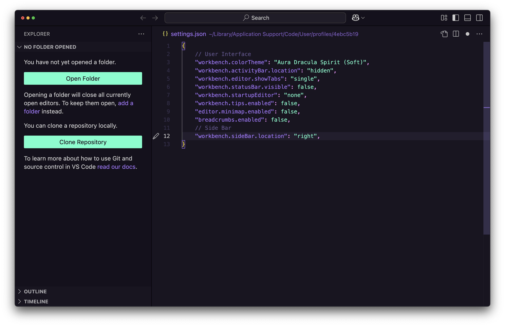

設定が反映され、サイドバーが画面右側に移動した状態です。
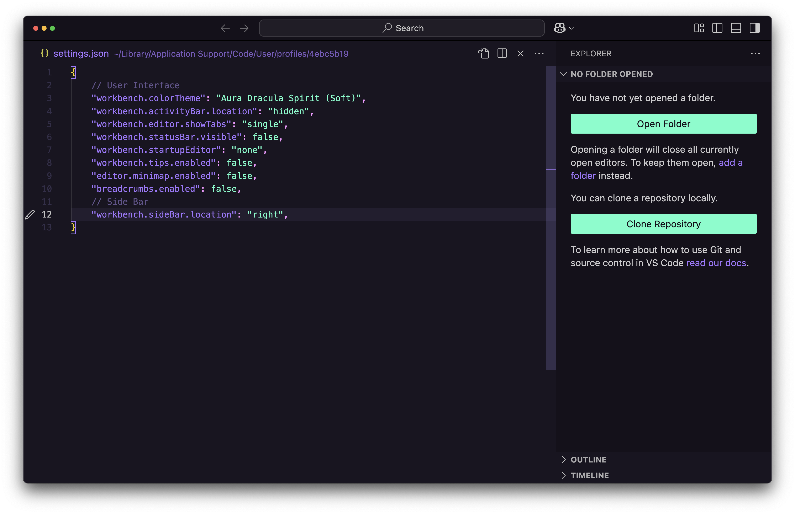

アイコンテーマには「Material Icon Theme」（`workbench.iconTheme: "material-icon-theme"`、既定値 `"vs-seti"`）を適用します。

プロジェクトを開き、Material Icon Theme を適用した画面です。ファイルやフォルダーに色付きのアイコンが表示されています。
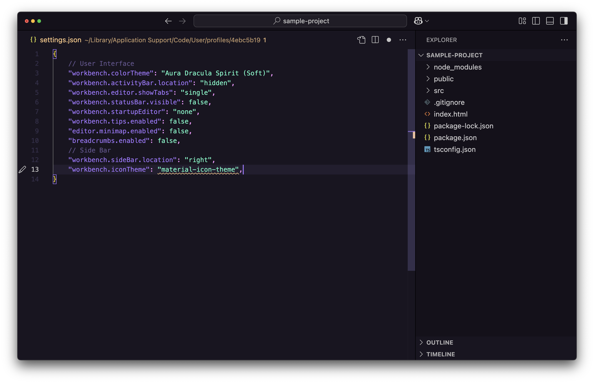

Extensions ビューで「material icon theme」を検索した画面です。
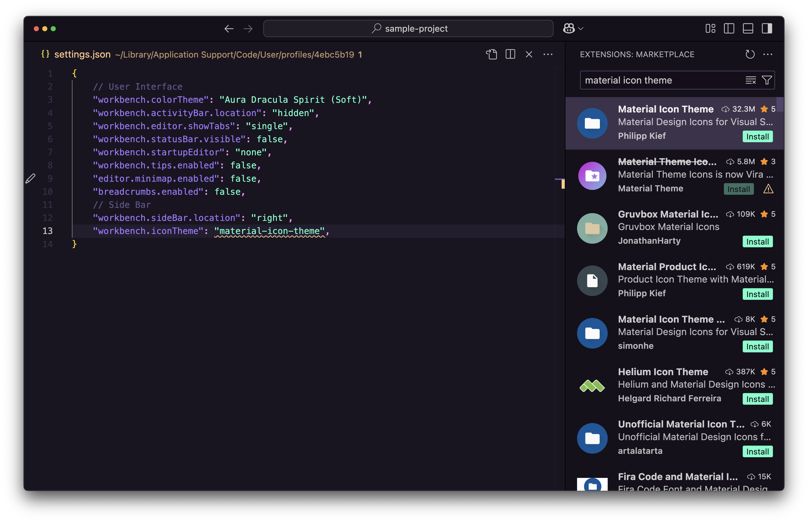

Material Icon Theme 拡張機能の詳細ページを開いた画面です。
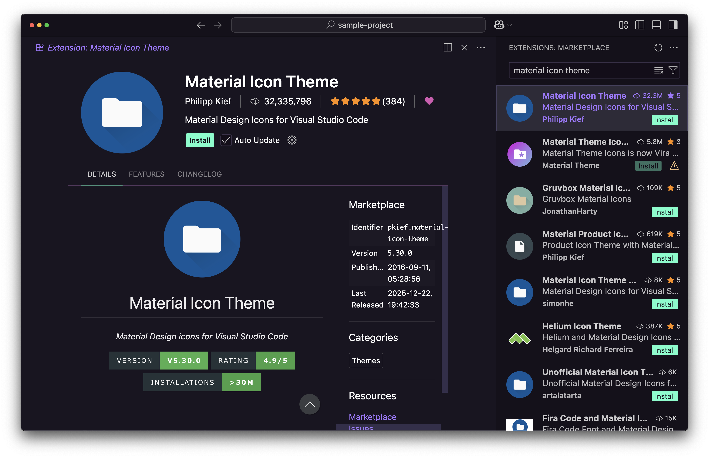

拡張機能のインストール時に、発行元の信頼を確認するダイアログが表示された画面です。


ファイルアイコンテーマの選択メニューで Material Icon Theme を指定した画面です。
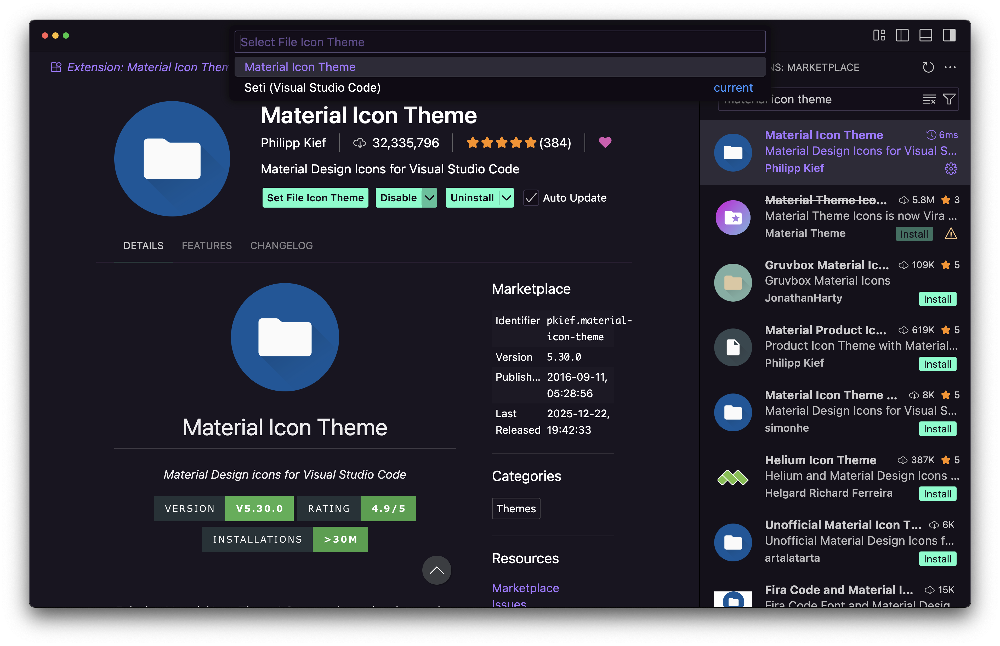

フォルダー横の展開矢印は、`material-icon-theme.hidesExplorerArrows: true`（既定値 `false`）で非表示にしてすっきりとした見た目にします。

設定に `material-icon-theme.hidesExplorerArrows: true` を記述中の画面です。この時点ではまだ矢印の非表示は反映されておらず、フォルダー横に矢印が残っています。


設定が反映され、フォルダー横の展開矢印が非表示になった画面です。
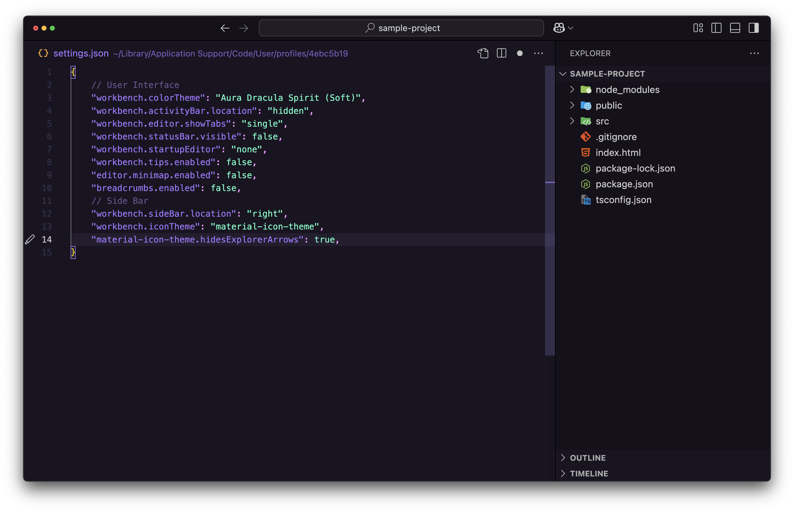

展開矢印が非表示の状態で、フォルダー構造をすっきりと表示している継続画面です。
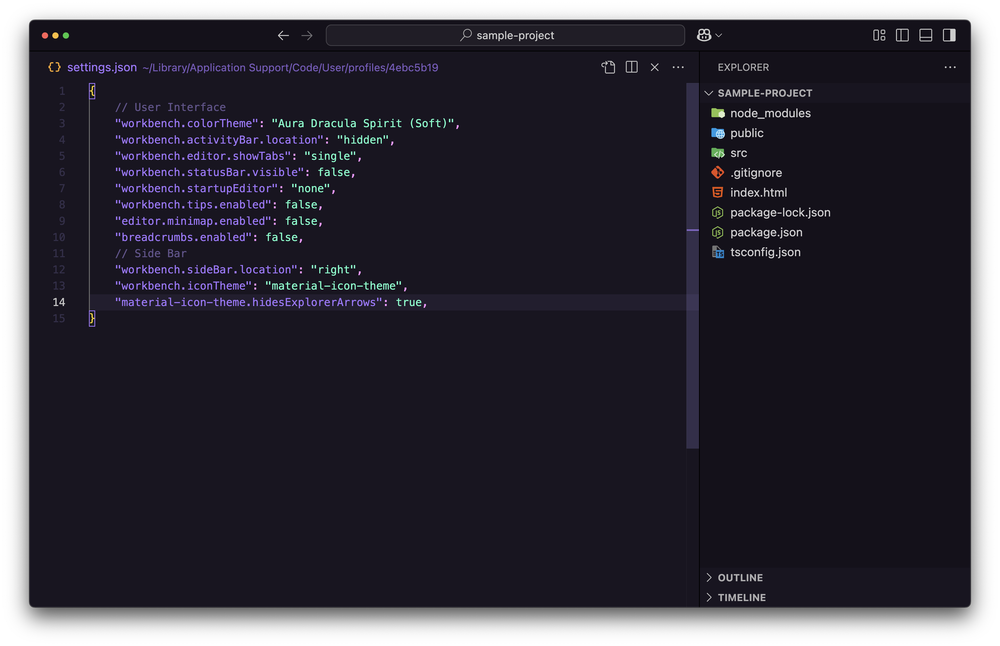

### ツリー表示とフォルダー構造の整理
ツリーをスクロールする際に親フォルダー名が上部に固定されるスティッキースクロールを `workbench.tree.enableStickyScroll: false`（既定値 `true`）で無効化します。ツリー内の垂直インデントガイドも `workbench.tree.renderIndentGuides: "none"`（既定値 `"onHover"`）で非表示にします。

設定に `workbench.tree.renderIndentGuides: "none"` を追加した画面です。ツリーが最上位層のみで折りたたまれているため、ガイド線の非表示効果は確認できません。


`public` フォルダーを展開した画面です。インデントガイド線は見られませんが、設定前の比較画像はない状態です。


ツリーのインデント幅 `workbench.tree.indent` には既定値と同じ `8`（単位: ピクセル）を指定しています（動画内では階層を強調するため一時的に 16 を試した後に 8 へ戻しています）。

インデント幅を `workbench.tree.indent: 8` に設定した画面です。ツリーが折りたたまれているため、余白の視覚的な変化は確認できません。


検証のためインデント幅の設定値を 16 に変更した画面です。ツリーが折りたたまれたままであるため、画面上から幅の変化は判別できません。
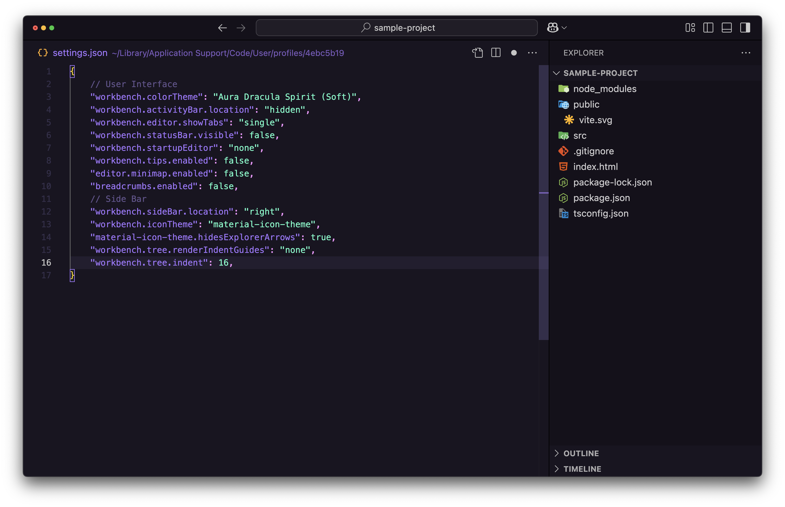

インデント幅 16 の設定で `public` フォルダーを展開し、配下にある `vite.svg` の字下げ幅を確認している画面です。
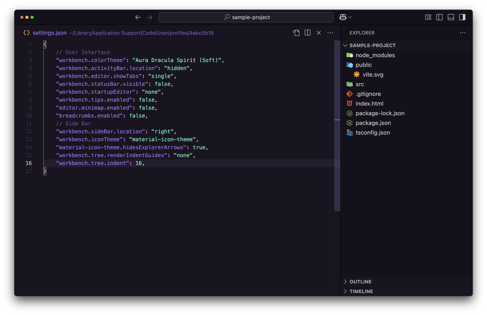

また、子フォルダーが 1 つだけの場合に 1 行へまとめるコンパクト表示を `explorer.compactFolders: false`（既定値 `true`）で解除し、すべてのフォルダーを個別の行として展開します。

コンパクト表示の解除前の画面です。単一の子フォルダーを持つ `hoge/fuga` が 1 行に結合して表示されています。


`explorer.compactFolders: false` を追加した画面です。`hoge` と `fuga` が別々の階層として展開されています。


### 操作確認ダイアログと装飾の抑制
エクスプローラー内でのドラッグ＆ドロップ移動時の確認ダイアログ（`explorer.confirmDragAndDrop: false`、既定値 `true`）を非表示にします。あわせて、アイテム削除時の確認ダイアログ（`explorer.confirmDelete: false`、既定値 `true`）も非表示にします。確認の手間をなくし、素早いファイル操作を可能にします。

ファイル移動に伴う import パス更新の確認ダイアログが表示されている画面です（エクスプローラー自体の移動確認ダイアログではありません）。


さらに、エラー件数などを示すバッジ（`explorer.decorations.badges: false`、既定値 `true`）を非表示にします。変更ファイルの Git ステータス装飾（`git.decorations.enabled: false`、既定値 `true`）も非表示にし、ファイル一覧の視覚的なノイズを最小化します。

設定前のエクスプローラーの表示です。`poyo.ts` のエラーに伴い、フォルダーやファイルに赤色ラベルやバッジ「1」が表示されています。


確認ダイアログおよび装飾を非表示にする 4 項目（`confirmDragAndDrop`, `confirmDelete`, `badges`, `git.decorations.enabled`）を設定に記述した画面です。


`explorer.decorations.badges: false` を選択中の画面です。エクスプローラーにはまだ赤色のラベルやバッジが残って見えています。
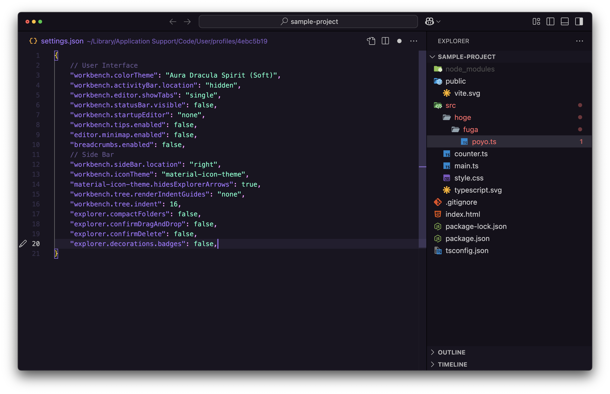

バッジ無効化設定の入力画面です。引き続き赤色ラベルやバッジが表示されており、即時反映の有無は画面上からは未確定です。


`git.decorations.enabled: false` を選択中の画面です。赤いドットや数字のバッジは見られなくなっていますが、一部でファイル名の色付けが残っています。
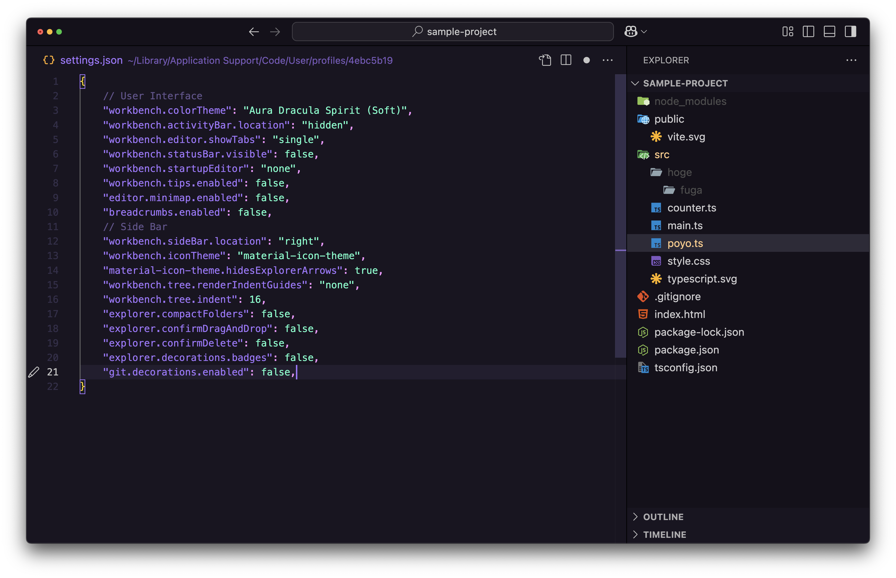

Git 装飾無効化の設定後の画面です。いくつかのラベルに色が残っており、装飾の完全な消去は画面上からは判断しにくい状態です。


## 設定項目の一覧

| 設定 | 既定値 | 説明 |
| --- | --- | --- |
| `workbench.sideBar.location` | `"left"` | プライマリサイドバーの配置位置を制御します。`right` で右側に配置します。 |
| `workbench.iconTheme` | `"vs-seti"` | ファイルやフォルダーに使用するアイコンテーマを選択します。 |
| `material-icon-theme.hidesExplorerArrows` | `false` | エクスプローラーのフォルダー横にある展開矢印を非表示にします。 |
| `workbench.tree.enableStickyScroll` | `true` | ツリービューでのスティッキースクロール（スクロール時の親階層の固定表示）の有効・無効を切り替えます。`false` で無効化します。 |
| `workbench.tree.renderIndentGuides` | `"onHover"` | ツリービュー内のインデントガイドの表示を制御します。`none` で非表示にします。 |
| `workbench.tree.indent` | `8` | ツリービューの階層間のインデント幅をピクセル単位で設定します。 |
| `explorer.compactFolders` | `true` | 単一の子フォルダーを持つフォルダーのコンパクト表示を制御します。`false` で各フォルダーを個別の行に展開します。 |
| `explorer.confirmDragAndDrop` | `true` | エクスプローラー内でドラッグ＆ドロップ移動する際の確認ダイアログを制御します。`false` で確認ダイアログを非表示にします。 |
| `explorer.confirmDelete` | `true` | エクスプローラー内でアイテムを削除する際の確認ダイアログを制御します。`false` で確認ダイアログを非表示にします。 |
| `explorer.decorations.badges` | `true` | エクスプローラー内のアイテムに表示されるエラー数などのバッジ表示を制御します。`false` で非表示にします。 |
| `git.decorations.enabled` | `true` | エクスプローラー内のファイルに対する Git ステータス（変更・追跡状態）の色装飾を制御します。`false` で非表示にします。 |

## 注意点

削除やドラッグ＆ドロップの確認ダイアログを無効化すると、誤操作による意図しないファイルの移動や削除が警告なしで即座に実行されます。誤って削除したファイルはゴミ箱などを確認する必要があります。

Git 装飾を無効化すると、エクスプローラー上でどのファイルが変更されたかが色で識別できなくなります。

## 追加する拡張機能

- [Material Icon Theme](https://marketplace.visualstudio.com/items?itemName=PKief.material-icon-theme) (`pkief.material-icon-theme`): ファイルおよびフォルダー用の Material Design アイコンテーマ

## 変更コミット

- [`3c3ed6b`](https://github.com/igorbabko/vscode-setup/commit/3c3ed6b068b71373066e1b8a1630b8a17cc060d1)
