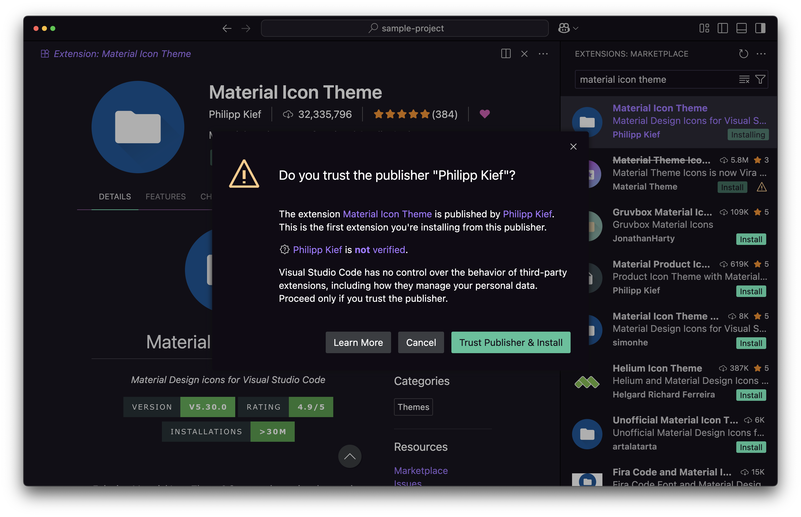
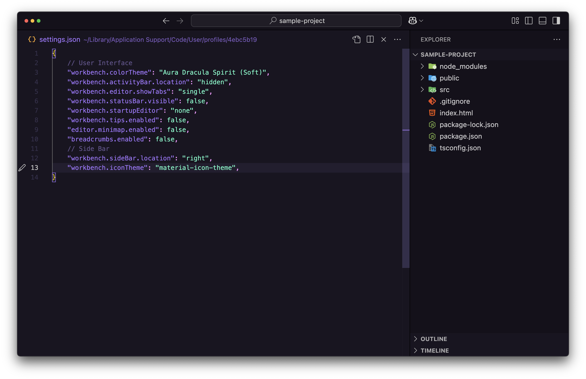
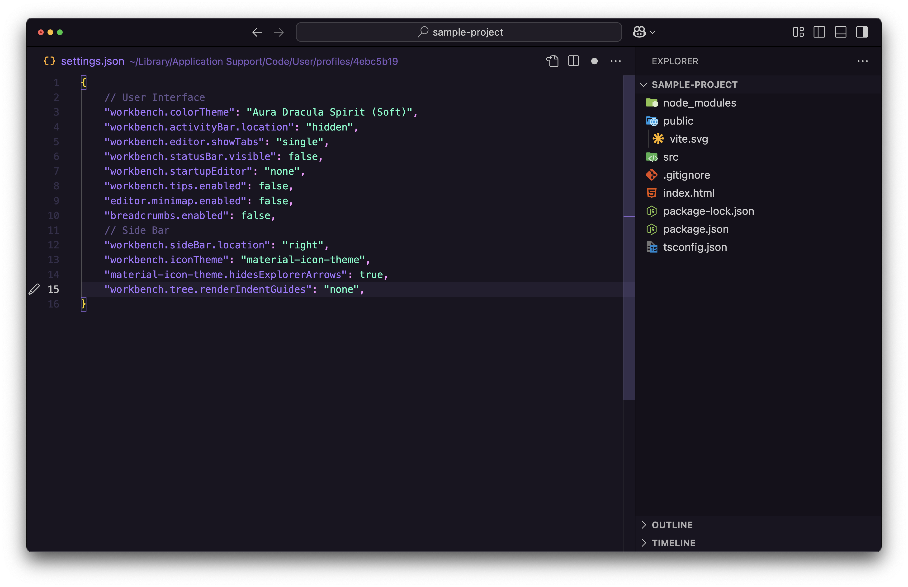
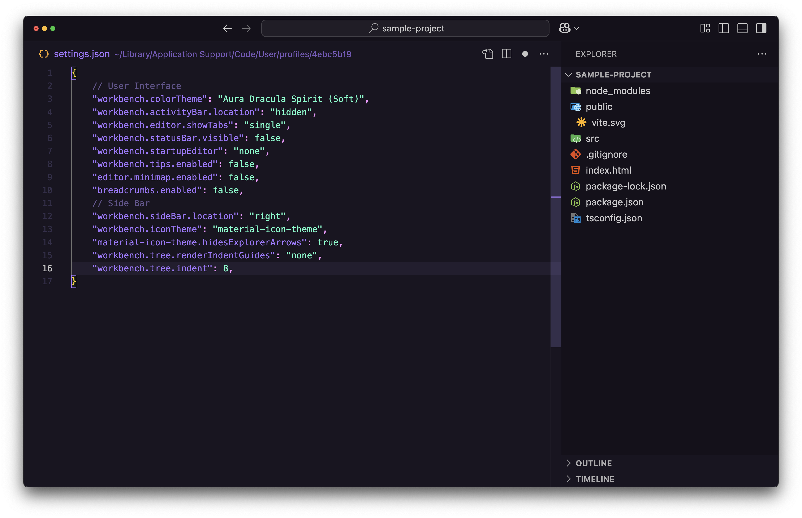
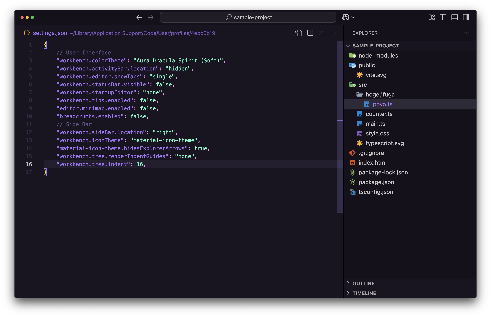
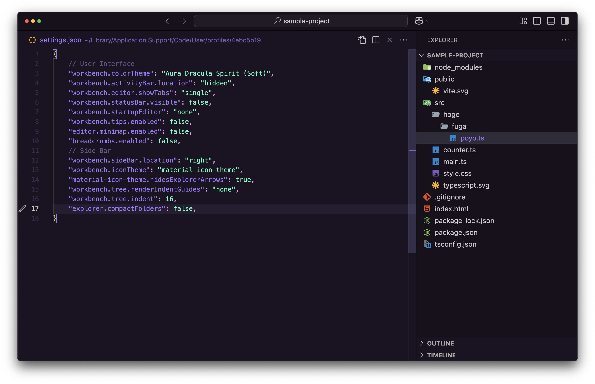
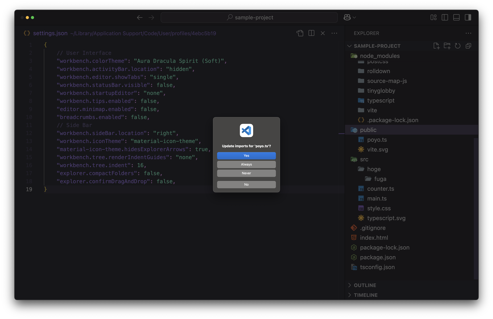
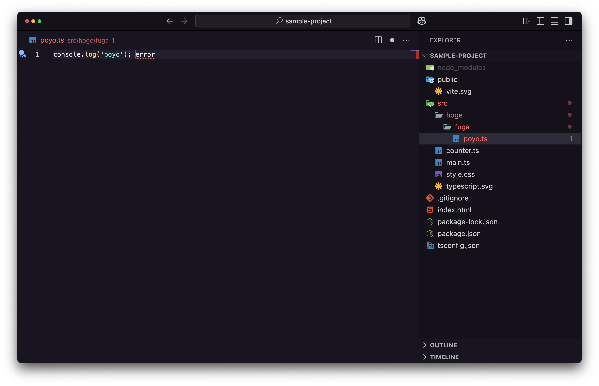
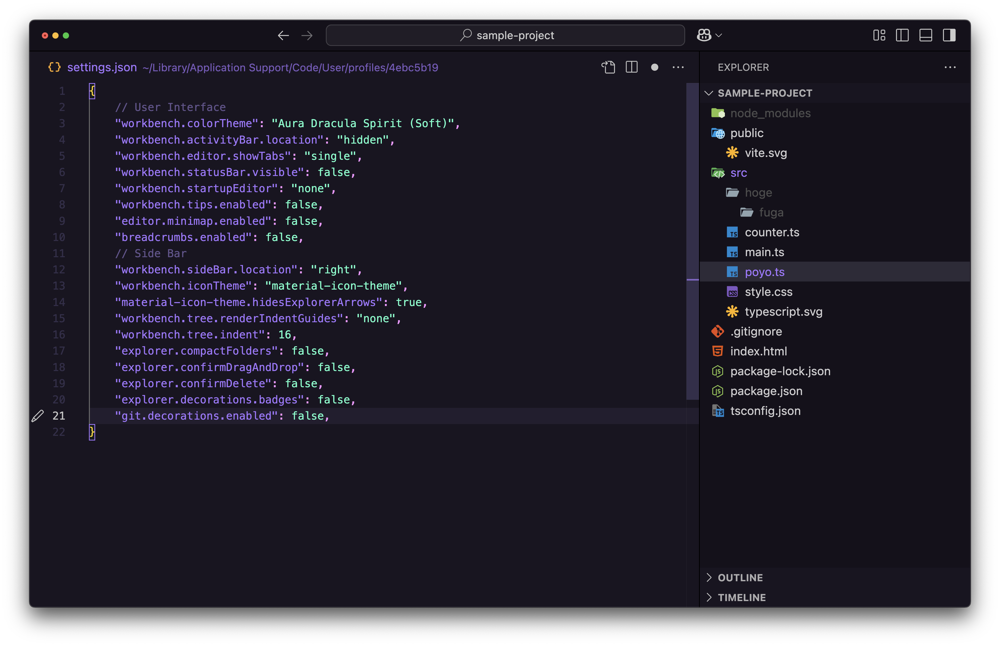
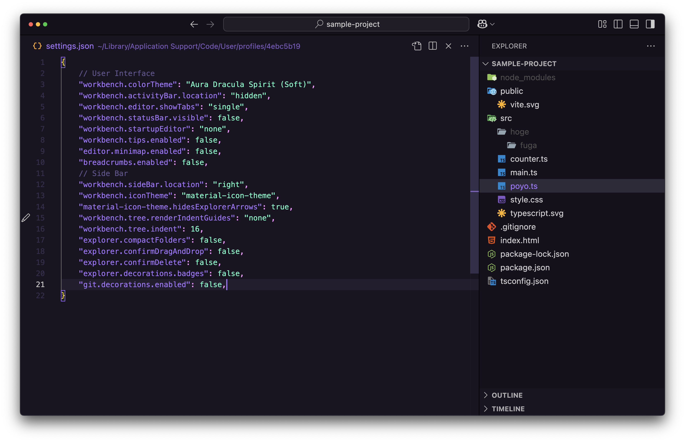

サイドバーを右側に配置し、インデント幅やアイコンテーマ、確認ダイアログなどを設定してエクスプローラーの表示を整理します。対応する動画のチャプターは [Sidebar and file explorer (03:29)](https://www.youtube.com/watch?v=VmFOsK7IhI4&t=209s) です。





















## 設定（settings.json）

```json
{
  "workbench.sideBar.location": "right",
  "workbench.iconTheme": "material-icon-theme",
  "material-icon-theme.hidesExplorerArrows": true,
  "workbench.tree.enableStickyScroll": false,
  "workbench.tree.renderIndentGuides": "none",
  "workbench.tree.indent": 8,
  "explorer.compactFolders": false,
  "explorer.confirmDragAndDrop": false,
  "explorer.confirmDelete": false,
  "explorer.decorations.badges": false,
  "git.decorations.enabled": false
}
```

## 設定項目の説明

| 設定 | 説明 |
| --- | --- |
| `workbench.sideBar.location` | プライマリサイドバーの配置位置を左右で制御します。`right` で右側に配置します。 |
| `workbench.iconTheme` | ファイルやフォルダーに使用するアイコンテーマを選択します。 |
| `material-icon-theme.hidesExplorerArrows` | エクスプローラーのフォルダー横にある展開矢印を非表示にします。 |
| `workbench.tree.enableStickyScroll` | ツリービューでのスティッキースクロールの有効・無効を切り替えます（※現在の公式ドキュメントでは説明未確認）。 |
| `workbench.tree.renderIndentGuides` | ツリービュー内のインデントガイドの表示を制御します。`none` で非表示にします。 |
| `workbench.tree.indent` | ツリービューの階層間のインデント幅を設定します。 |
| `explorer.compactFolders` | 単一の子フォルダーを持つフォルダーのコンパクト表示を制御します。`false` で各フォルダーを個別に展開します。 |
| `explorer.confirmDragAndDrop` | エクスプローラー内でドラッグ＆ドロップによってアイテムを移動する際の確認ダイアログを制御します。 |
| `explorer.confirmDelete` | エクスプローラー内でアイテムを削除する際の確認ダイアログを制御します。 |
| `explorer.decorations.badges` | エクスプローラー内のアイテムに表示されるバッジの表示・非表示を切り替えます。 |
| `git.decorations.enabled` | エクスプローラー内のファイルに対する Git ステータス装飾の表示・非表示を切り替えます。 |

## 追加する拡張機能

- [Material Icon Theme](https://marketplace.visualstudio.com/items?itemName=PKief.material-icon-theme) (`pkief.material-icon-theme`): ファイルおよびフォルダー用の Material Design アイコンテーマ

## 変更コミット

- [`3c3ed6b`](https://github.com/igorbabko/vscode-setup/commit/3c3ed6b068b71373066e1b8a1630b8a17cc060d1)
