サイドバーを画面右側に配置し、フォルダー構造の視認性を高めつつ、不要な確認ダイアログや視覚的ノイズを排除してエクスプローラーを整理します。コード編集エリアの視線移動を安定させ、直感的なファイル操作を可能にする環境を作ります。対応する動画のチャプターは [Sidebar and file explorer (03:29)](https://www.youtube.com/watch?v=VmFOsK7IhI4&t=209s) です。

https://www.youtube.com/watch?v=VmFOsK7IhI4&t=209s

## 設定（settings.json）

```json
{
  "workbench.sideBar.location": "right",
  "workbench.iconTheme": "material-icon-theme",
  "material-icon-theme.hidesExplorerArrows": true,
  "workbench.tree.enableStickyScroll": false,
  "workbench.tree.renderIndentGuides": "none",
  "workbench.tree.indent": 8,
  "explorer.compactFolders": false,
  "explorer.confirmDragAndDrop": false,
  "explorer.confirmDelete": false,
  "explorer.decorations.badges": false,
  "git.decorations.enabled": false
}
```

## 解説

### サイドバーの配置とアイコンテーマ
プライマリサイドバーの配置を右側に変更します。

| 設定 | 値 | 既定値 | 効果 |
| --- | --- | --- | --- |
| `workbench.sideBar.location` | `"right"` | `"left"` | プライマリサイドバーを右側へ移動する |

| Before | After |
| --- | --- |
| 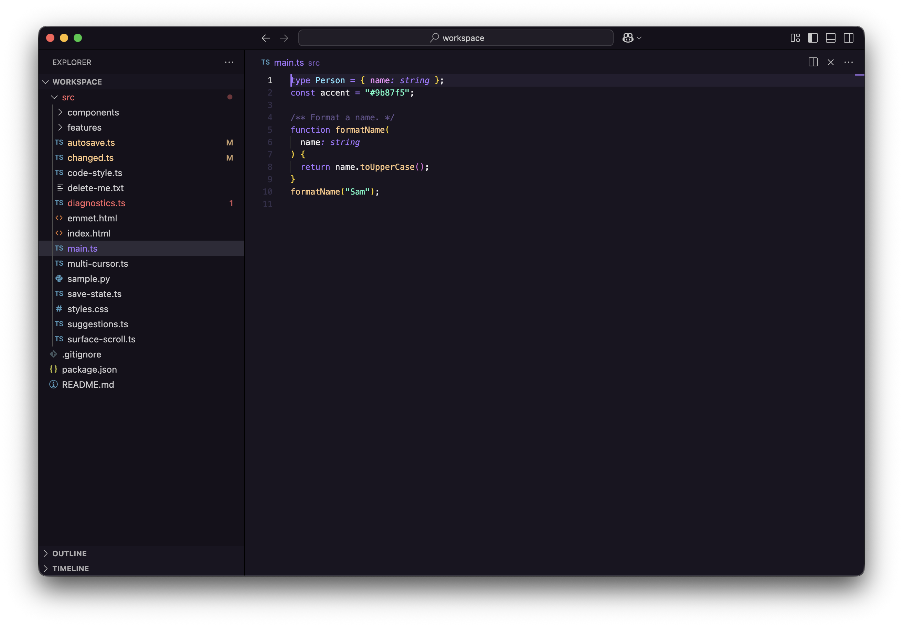 | 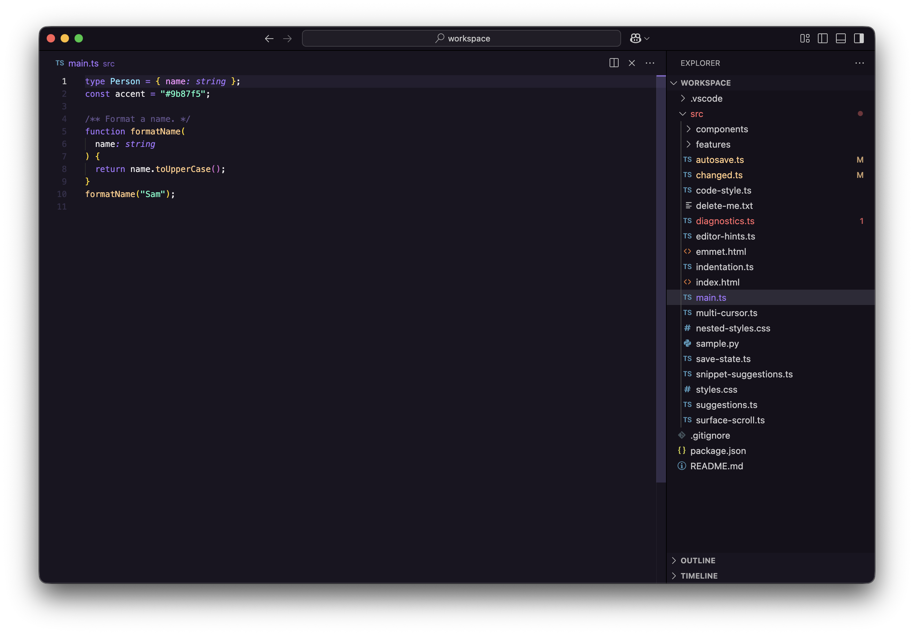 |

左では画面の左端に展開されていたエクスプローラーが、右では右端へ移動します。

アイコンテーマを変更し、すっきりとした見た目にします。

| 設定 | 値 | 既定値 | 効果 |
| --- | --- | --- | --- |
| `workbench.iconTheme` | `"material-icon-theme"` | `"vs-seti"` | アイコンテーマに [Material Icon Theme](https://marketplace.visualstudio.com/items?itemName=PKief.material-icon-theme) を適用する |
| `material-icon-theme.hidesExplorerArrows` | `true` | `false` | フォルダー横の展開矢印を非表示にする |

| Before | After |
| --- | --- |
| 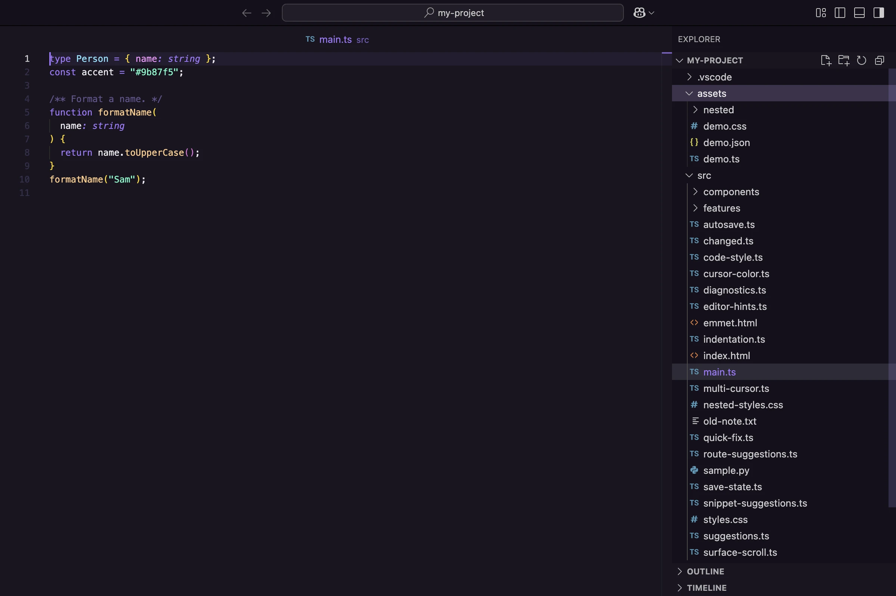 | 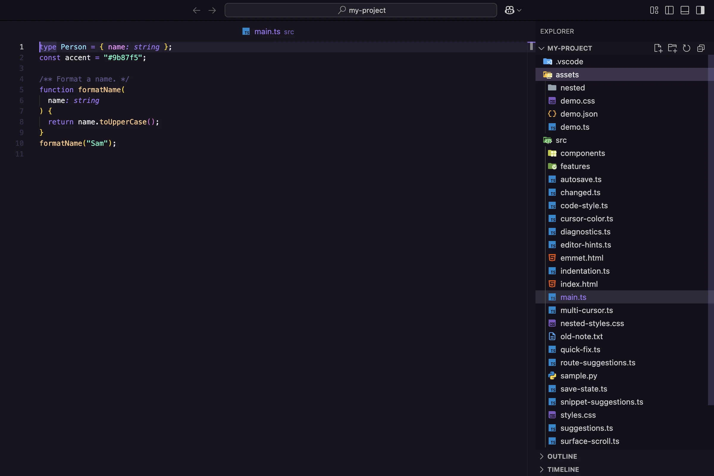 |

Aura のカラーテーマを保ったまま、左の Seti アイコンと展開矢印が、右では展開矢印のない Material アイコンへ切り替わります。

### ツリー表示とフォルダー構造の整理
ツリーの補助表示を整理し、すべてのフォルダーを個別の行として展開します。

| 設定 | 値 | 既定値 | 効果 |
| --- | --- | --- | --- |
| `workbench.tree.enableStickyScroll` | `false` | `true` | スクロール時に親フォルダー名を上部に固定するスティッキースクロールを無効化する |
| `workbench.tree.renderIndentGuides` | `"none"` | `"onHover"` | ツリー内の垂直インデントガイドを非表示にする |
| `workbench.tree.indent` | `8` | `8` | ツリービューの階層間のインデント幅をピクセル単位で設定する（既定値と同じため見た目の変化はない） |
| `explorer.compactFolders` | `false` | `true` | 子フォルダーが 1 つだけの場合のコンパクト表示を解除する |

| Before | After |
| --- | --- |
| 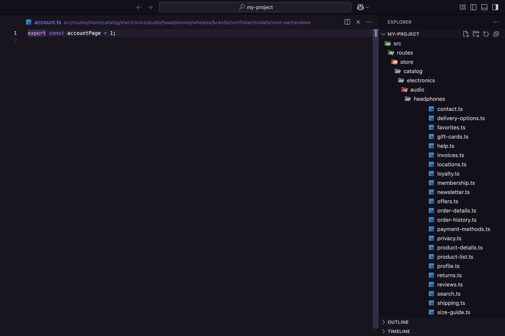 | 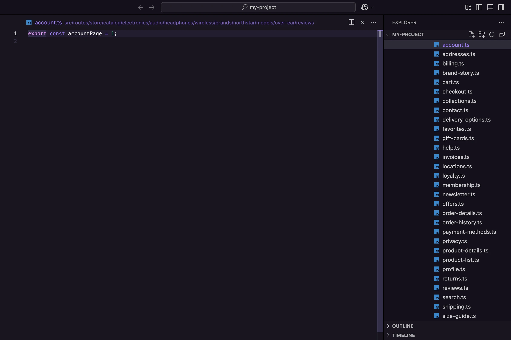 |

深いツリーを下へスクロールしたとき、左では親フォルダーが上部に固定表示されますが、右では固定表示が出ません。

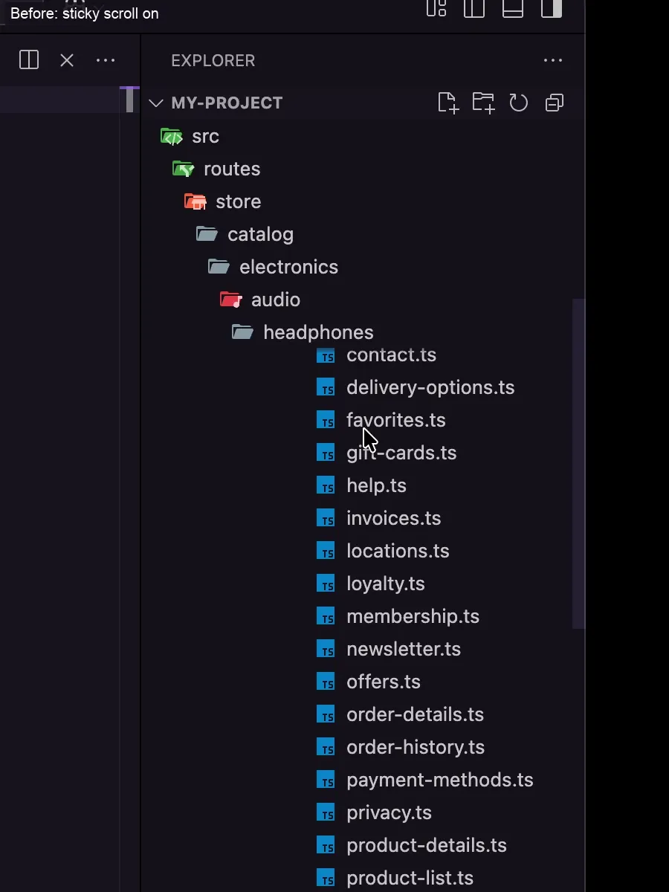

同じ深いツリーをスクロールすると、有効側の領域にだけ親フォルダーが固定され、無効側では通常のリストのままスクロールします。

| Before | After |
| --- | --- |
| 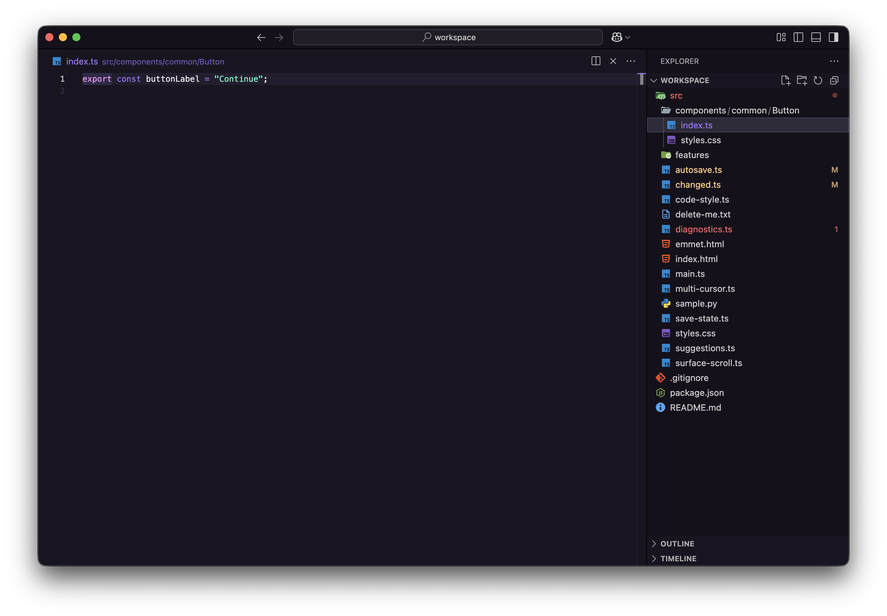 |  |

同じホバー中のツリー行を拡大して比較しています。左にあったホバー時のインデントガイドが右では消え、1 行にまとまっていた単一子フォルダーも別々の行に分かれます。

### 操作確認ダイアログと装飾の抑制
エクスプローラー内でのファイル操作時の確認ダイアログを非表示にします。

| 設定 | 値 | 既定値 | 効果 |
| --- | --- | --- | --- |
| `explorer.confirmDragAndDrop` | `false` | `true` | ドラッグ＆ドロップ移動時の確認ダイアログを非表示にする |
| `explorer.confirmDelete` | `false` | `true` | アイテム削除時の確認ダイアログを非表示にする |

| Before | After |
| --- | --- |
| 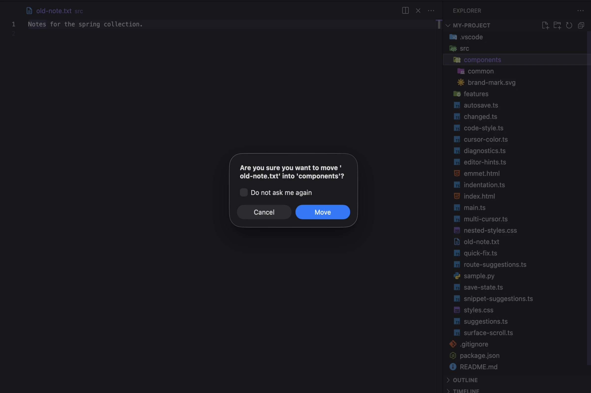 | 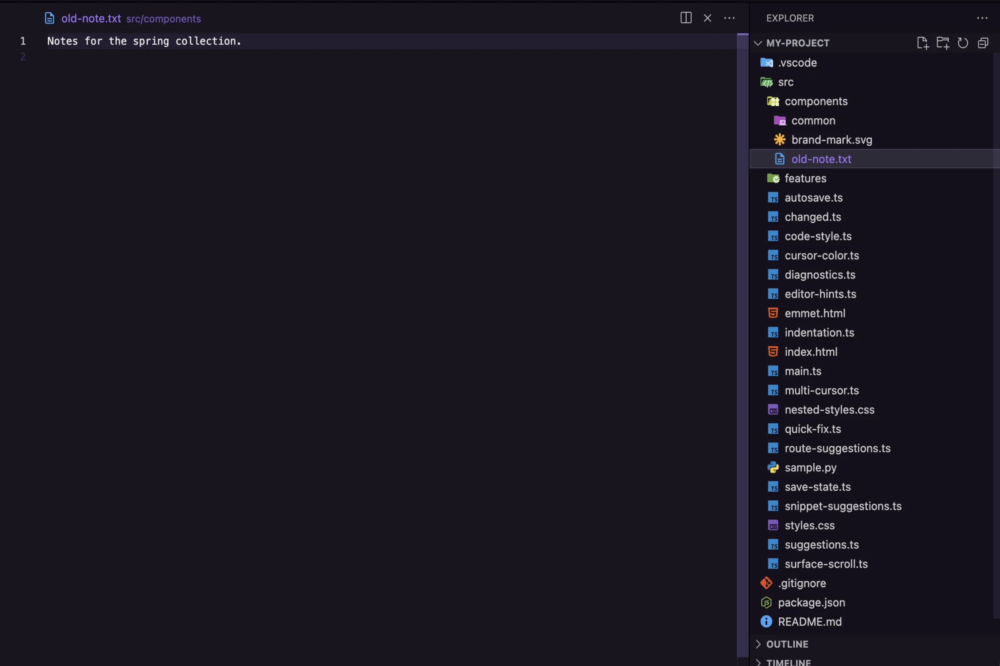 |

左ではドラッグ操作でネイティブの移動確認ダイアログが開きますが、右では確認なしでファイルが `components` フォルダー内へ移動します。

| Before | After |
| --- | --- |
| 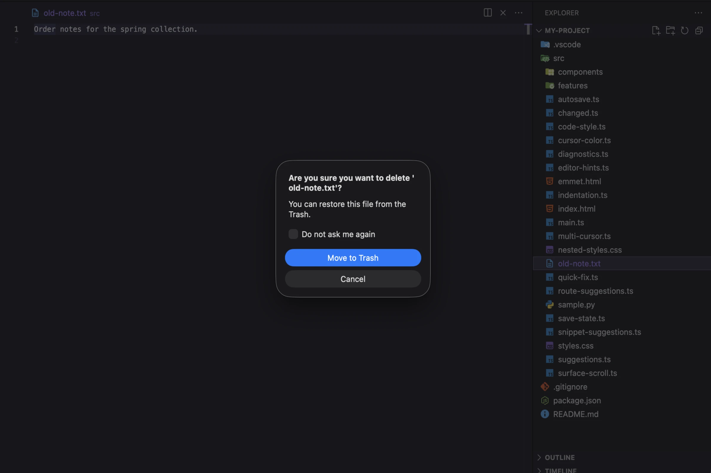 | 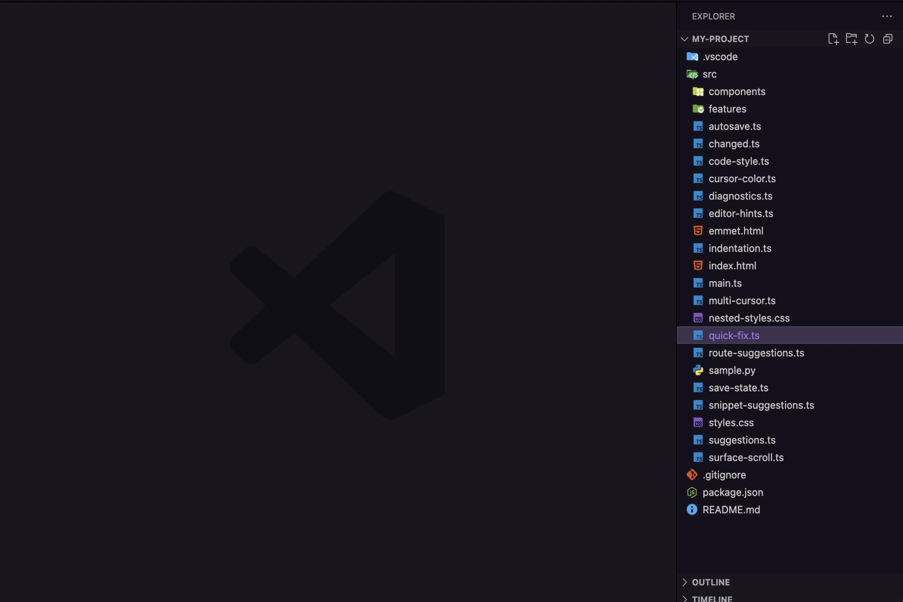 |

左では削除時にネイティブの確認ダイアログが表示されますが、右ではダイアログが出ず、選択していたファイルがそのままツリーから消えます。

さらに、ファイル一覧の視覚的なノイズを最小化します。

| 設定 | 値 | 既定値 | 効果 |
| --- | --- | --- | --- |
| `explorer.decorations.badges` | `false` | `true` | エラー件数のバッジを非表示にする |
| `git.decorations.enabled` | `false` | `true` | 変更ファイルの Git ステータス装飾を非表示にする |

| Before | After |
| --- | --- |
|  | 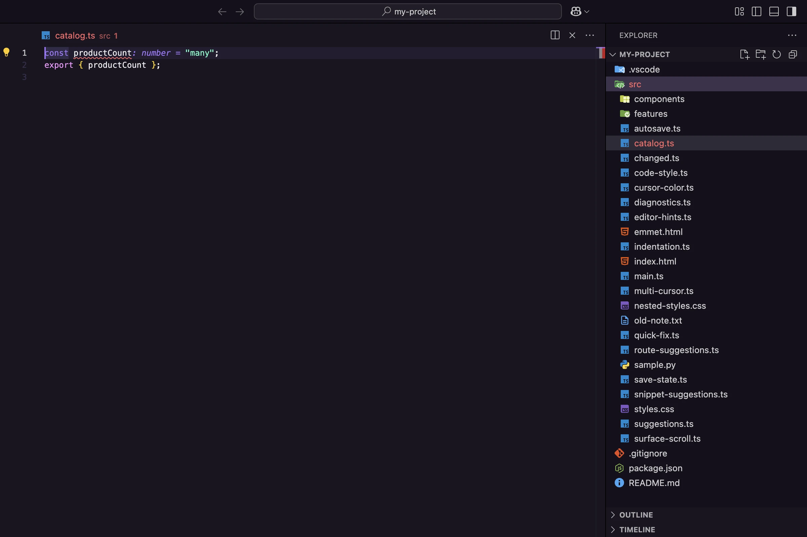 |

左で変更ファイルに付いていた M バッジと Git の色装飾が、右ではどちらも消えます。一方で TypeScript の診断表示はそのまま残る点を確認できます。

## 設定項目の一覧

| 設定 | 既定値 | 説明 |
| --- | --- | --- |
| `workbench.sideBar.location` | `"left"` | プライマリサイドバーの配置位置を制御します。`right` で右側に配置します。 |
| `workbench.iconTheme` | `"vs-seti"` | ファイルやフォルダーに使用するアイコンテーマを選択します。 |
| `material-icon-theme.hidesExplorerArrows` | `false` | エクスプローラーのフォルダー横にある展開矢印を非表示にします。 |
| `workbench.tree.enableStickyScroll` | `true` | ツリービューでのスティッキースクロール（スクロール時の親階層の固定表示）の有効・無効を切り替えます。`false` で無効化します。 |
| `workbench.tree.renderIndentGuides` | `"onHover"` | ツリービュー内のインデントガイドの表示を制御します。`none` で非表示にします。 |
| `workbench.tree.indent` | `8` | ツリービューの階層間のインデント幅をピクセル単位で設定します。 |
| `explorer.compactFolders` | `true` | 単一の子フォルダーを持つフォルダーのコンパクト表示を制御します。`false` で各フォルダーを個別の行に展開します。 |
| `explorer.confirmDragAndDrop` | `true` | エクスプローラー内でドラッグ＆ドロップ移動する際の確認ダイアログを制御します。`false` で確認ダイアログを非表示にします。 |
| `explorer.confirmDelete` | `true` | エクスプローラー内でアイテムを削除する際の確認ダイアログを制御します。`false` で確認ダイアログを非表示にします。 |
| `explorer.decorations.badges` | `true` | エクスプローラー内のアイテムに表示されるエラー数などのバッジ表示を制御します。`false` で非表示にします。 |
| `git.decorations.enabled` | `true` | エクスプローラー内のファイルに対する Git ステータス（変更・追跡状態）の色装飾を制御します。`false` で非表示にします。 |

## 注意点

削除やドラッグ＆ドロップの確認ダイアログを無効化すると、誤操作による意図しないファイルの移動や削除が警告なしで即座に実行されます。誤って削除したファイルはゴミ箱などを確認する必要があります。

Git 装飾を無効化すると、エクスプローラー上でどのファイルが変更されたかが色で識別できなくなります。

## 追加する拡張機能

- [Material Icon Theme](https://marketplace.visualstudio.com/items?itemName=PKief.material-icon-theme) (`pkief.material-icon-theme`): ファイルおよびフォルダー用の Material Design アイコンテーマ

## 変更コミット

- [`3c3ed6b`](https://github.com/igorbabko/vscode-setup/commit/3c3ed6b068b71373066e1b8a1630b8a17cc060d1)
