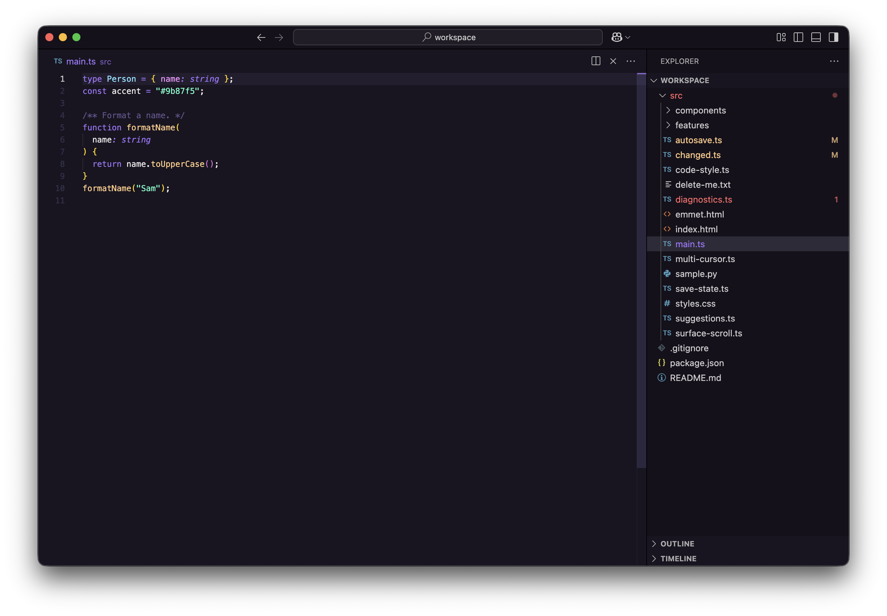
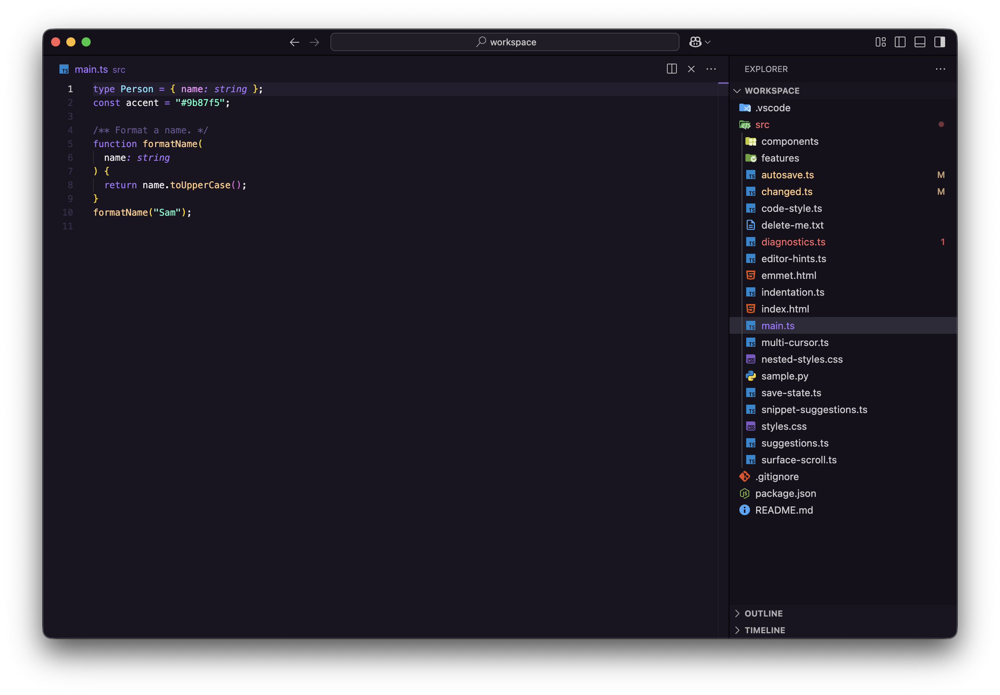
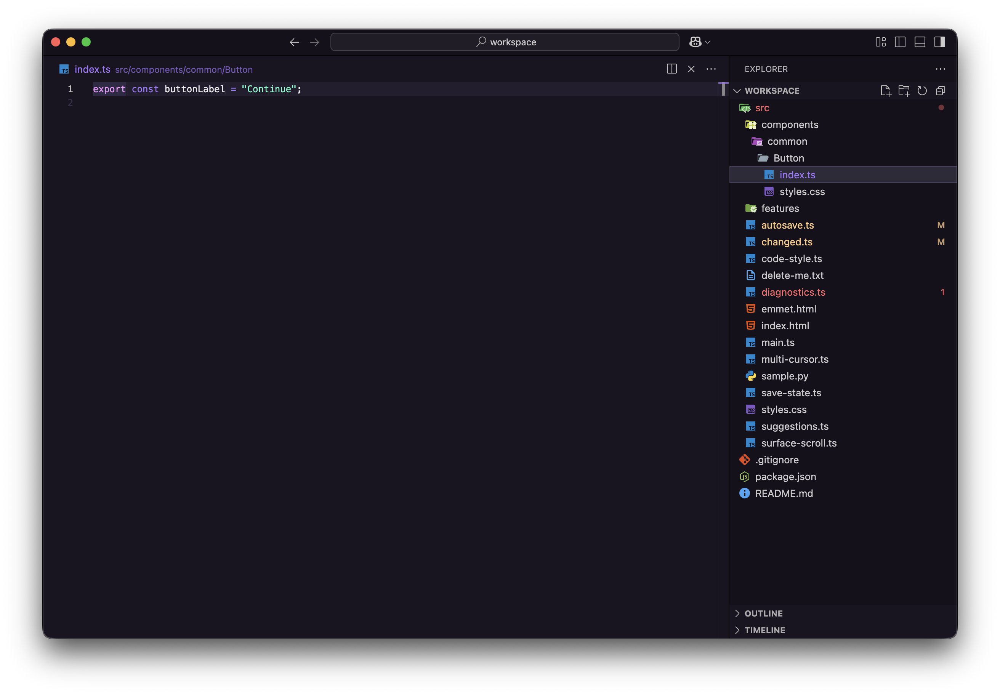
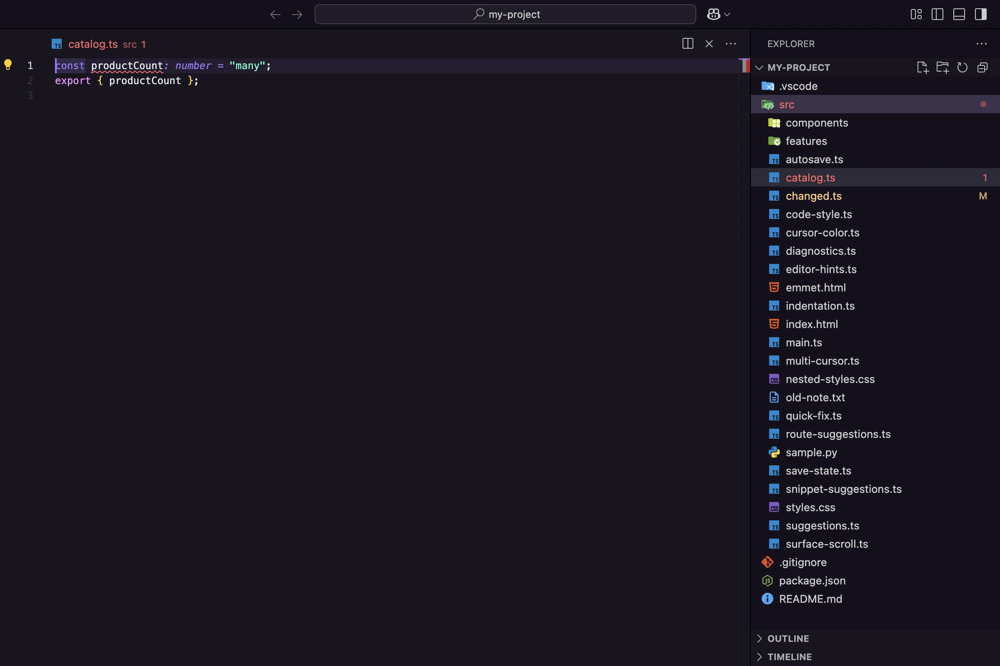
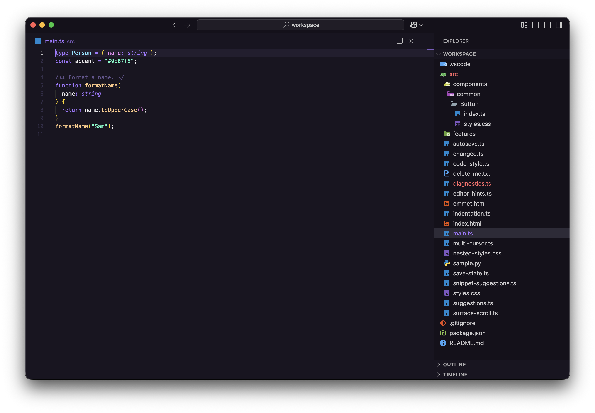

サイドバーを画面右側に配置し、フォルダー構造の視認性を高めつつ、不要な確認ダイアログや視覚的ノイズを排除してエクスプローラーを整理します。コード編集エリアの視線移動を安定させ、直感的なファイル操作を可能にする環境を作ります。対応する動画のチャプターは [Sidebar and file explorer (03:29)](https://www.youtube.com/watch?v=VmFOsK7IhI4&t=209s) です。

## 設定（settings.json）

```json
{
  "workbench.sideBar.location": "right",
  "workbench.iconTheme": "material-icon-theme",
  "material-icon-theme.hidesExplorerArrows": true,
  "workbench.tree.enableStickyScroll": false,
  "workbench.tree.renderIndentGuides": "none",
  "workbench.tree.indent": 8,
  "explorer.compactFolders": false,
  "explorer.confirmDragAndDrop": false,
  "explorer.confirmDelete": false,
  "explorer.decorations.badges": false,
  "git.decorations.enabled": false
}
```

## 解説

### サイドバーの配置とアイコンテーマ
プライマリサイドバーの配置を既定の左側から右側（`workbench.sideBar.location: "right"`、既定値 `"left"`）へ移動します。

| Before | After |
| --- | --- |
|  |  |

左の設定前に対し、右の設定後ではエクスプローラーがワークベンチの左端から右端へ移動します。

アイコンテーマには「Material Icon Theme」（`workbench.iconTheme: "material-icon-theme"`、既定値 `"vs-seti"`）を適用します。フォルダー横の展開矢印は、`material-icon-theme.hidesExplorerArrows: true`（既定値 `false`）で非表示にしてすっきりとした見た目にします。

| Before | After |
| --- | --- |
|  |  |

左の設定前に対し、右の設定後では標準アイコンが Material アイコンに切り替わり、フォルダー横の展開矢印が非表示になります。

### ツリー表示とフォルダー構造の整理
ツリーをスクロールする際に親フォルダー名が上部に固定されるスティッキースクロールを `workbench.tree.enableStickyScroll: false`（既定値 `true`）で無効化します。ツリー内の垂直インデントガイドも `workbench.tree.renderIndentGuides: "none"`（既定値 `"onHover"`）で非表示にします。ツリーのインデント幅 `workbench.tree.indent` には `8`（単位: ピクセル）を指定します。また、子フォルダーが 1 つだけの場合に 1 行へまとめるコンパクト表示を `explorer.compactFolders: false`（既定値 `true`）で解除し、すべてのフォルダーを個別の行として展開します。

| Before | After |
| --- | --- |
|  |  |

左の設定前に対し、右の設定後ではコンパクト表示されていた階層が個別行に展開されます（インデントガイド線の有無や 8px 幅の差分は画像から直接判別できません）。

### 操作確認ダイアログと装飾の抑制
エクスプローラー内でのドラッグ＆ドロップ移動時の確認ダイアログ（`explorer.confirmDragAndDrop: false`、既定値 `true`）を非表示にします。アイテム削除時の確認ダイアログ（`explorer.confirmDelete: false`、既定値 `true`）も非表示にします。VS Code 1.101.1 においてエクスプローラー上のドラッグ操作で移動確認が発生しないため、これら確認ダイアログの比較画像は省略しています。

さらに、エラー件数のバッジ（`explorer.decorations.badges: false`、既定値 `true`）を非表示にします。変更ファイルの Git ステータス装飾（`git.decorations.enabled: false`、既定値 `true`）も非表示にして、ファイル一覧の視覚的なノイズを最小化します。

| Before | After |
| --- | --- |
|  |  |

左の設定前に対し、右の設定後ではオレンジ色の Git 変更色と M マーカーが消去されます（diagnostics.ts の赤文字と数字バッジ 1 は残ります）。

## 設定項目の一覧

| 設定 | 既定値 | 説明 |
| --- | --- | --- |
| `workbench.sideBar.location` | `"left"` | プライマリサイドバーの配置位置を制御します。`right` で右側に配置します。 |
| `workbench.iconTheme` | `"vs-seti"` | ファイルやフォルダーに使用するアイコンテーマを選択します。 |
| `material-icon-theme.hidesExplorerArrows` | `false` | エクスプローラーのフォルダー横にある展開矢印を非表示にします。 |
| `workbench.tree.enableStickyScroll` | `true` | ツリービューでのスティッキースクロール（スクロール時の親階層の固定表示）の有効・無効を切り替えます。`false` で無効化します。 |
| `workbench.tree.renderIndentGuides` | `"onHover"` | ツリービュー内のインデントガイドの表示を制御します。`none` で非表示にします。 |
| `workbench.tree.indent` | `8` | ツリービューの階層間のインデント幅をピクセル単位で設定します。 |
| `explorer.compactFolders` | `true` | 単一の子フォルダーを持つフォルダーのコンパクト表示を制御します。`false` で各フォルダーを個別の行に展開します。 |
| `explorer.confirmDragAndDrop` | `true` | エクスプローラー内でドラッグ＆ドロップ移動する際の確認ダイアログを制御します。`false` で確認ダイアログを非表示にします。 |
| `explorer.confirmDelete` | `true` | エクスプローラー内でアイテムを削除する際の確認ダイアログを制御します。`false` で確認ダイアログを非表示にします。 |
| `explorer.decorations.badges` | `true` | エクスプローラー内のアイテムに表示されるエラー数などのバッジ表示を制御します。`false` で非表示にします。 |
| `git.decorations.enabled` | `true` | エクスプローラー内のファイルに対する Git ステータス（変更・追跡状態）の色装飾を制御します。`false` で非表示にします。 |

## 注意点

削除やドラッグ＆ドロップの確認ダイアログを無効化すると、誤操作による意図しないファイルの移動や削除が警告なしで即座に実行されます。誤って削除したファイルはゴミ箱などを確認する必要があります。

Git 装飾を無効化すると、エクスプローラー上でどのファイルが変更されたかが色で識別できなくなります。

## 追加する拡張機能

- [Material Icon Theme](https://marketplace.visualstudio.com/items?itemName=PKief.material-icon-theme) (`pkief.material-icon-theme`): ファイルおよびフォルダー用の Material Design アイコンテーマ

## 変更コミット

- [`3c3ed6b`](https://github.com/igorbabko/vscode-setup/commit/3c3ed6b068b71373066e1b8a1630b8a17cc060d1)

## 本章完了時の状態

本章の設定をすべて反映した完成状態の画面です。


