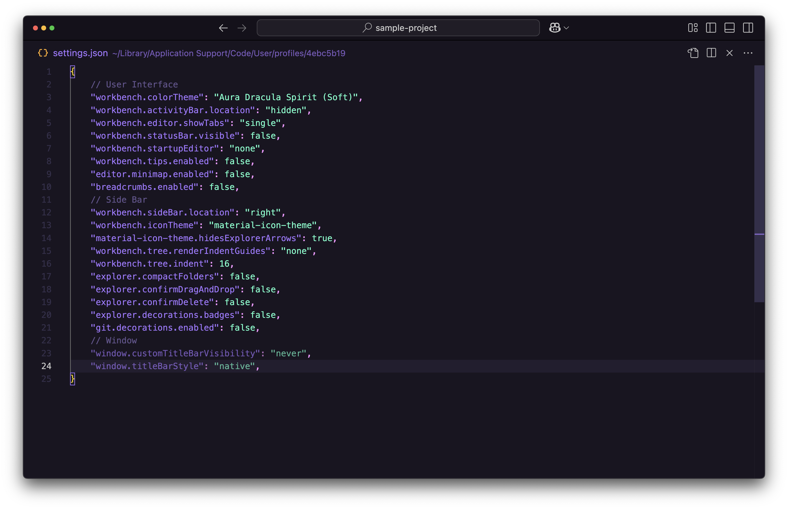
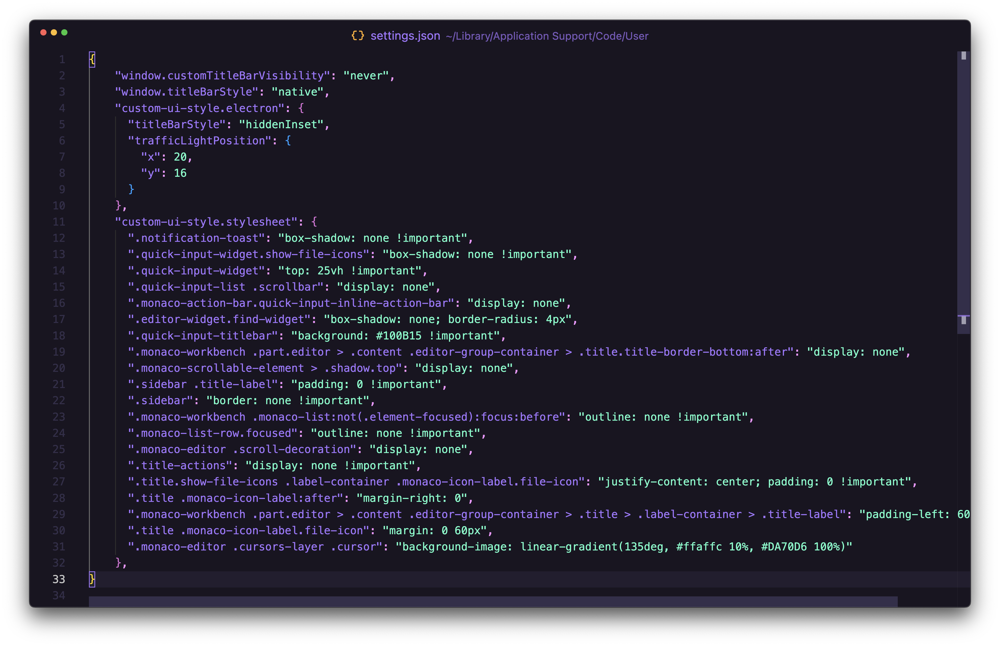

ウィンドウのズーム倍率やタイトルバーの表示スタイルを設定し、Custom UI Style 拡張機能でウィンドウコントロールの位置とタイトルラベルの余白を調整します。対応する動画のチャプターは [Custom UI Style extension (07:58)](https://www.youtube.com/watch?v=VmFOsK7IhI4&t=478s) です。






## 設定（settings.json）

```json
{
  "window.zoomLevel": 3,
  "window.customTitleBarVisibility": "never",
  "window.titleBarStyle": "native",
  "custom-ui-style.electron": {
    "titleBarStyle": "hiddenInset",
    "trafficLightPosition": {
      "x": 20,
      "y": 16
    }
  },
  "custom-ui-style.stylesheet": {
    ".monaco-workbench .part.editor > .content .editor-group-container > .title > .label-container > .title-label": "padding-left: 60px"
  },
  "custom-ui-style.font.sansSerif": "Dank Mono"
}
```

## 設定項目の説明

| 設定 | 説明 |
| --- | --- |
| `window.zoomLevel` | UI 全体のズーム倍率を調整します。 |
| `window.customTitleBarVisibility` | サポートされているプラットフォームでカスタムタイトルバーの表示を制御します。 |
| `window.titleBarStyle` | サポートされている環境でネイティブまたはカスタムのタイトルバースタイルを選択します。 |
| `custom-ui-style.electron.titleBarStyle` | 拡張機能における Electron ウィンドウのタイトルバースタイルを設定します。 |
| `custom-ui-style.electron.trafficLightPosition.x` | macOS のトラフィックライト（ウィンドウ操作ボタン）の水平位置を設定します。 |
| `custom-ui-style.electron.trafficLightPosition.y` | macOS のトラフィックライト（ウィンドウ操作ボタン）の垂直位置を設定します。 |
| `custom-ui-style.stylesheet[".monaco-workbench ... .title-label"]` | エディタグループのタイトルラベルに 60px の左パディングを追加します。 |
| `custom-ui-style.font.sansSerif` | 拡張機能全体のサンセリフフォントファミリーを設定します。 |

## 追加する拡張機能

- [Custom UI Style](https://marketplace.visualstudio.com/items?itemName=subframe7536.custom-ui-style) (`subframe7536.custom-ui-style`): ウィンドウや UI スタイルをカスタマイズする拡張機能

## 変更コミット

- [`e690ea7`](https://github.com/igorbabko/vscode-setup/commit/e690ea74b3ff47f9050c879e050e82d2c4f7dbb7)
