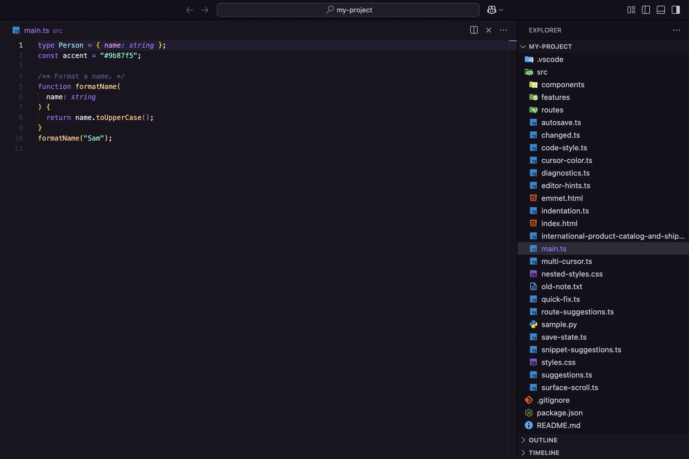
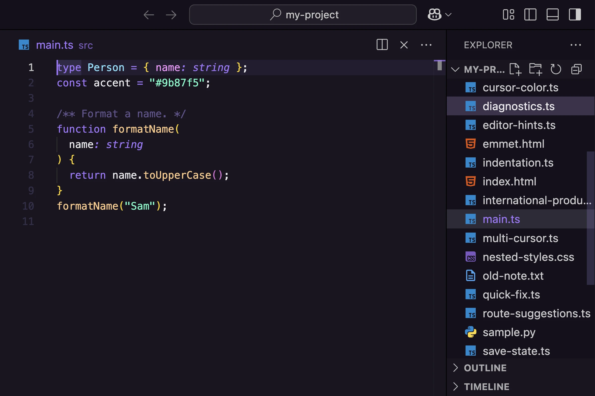
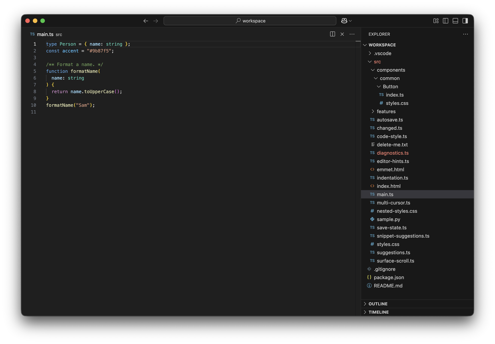
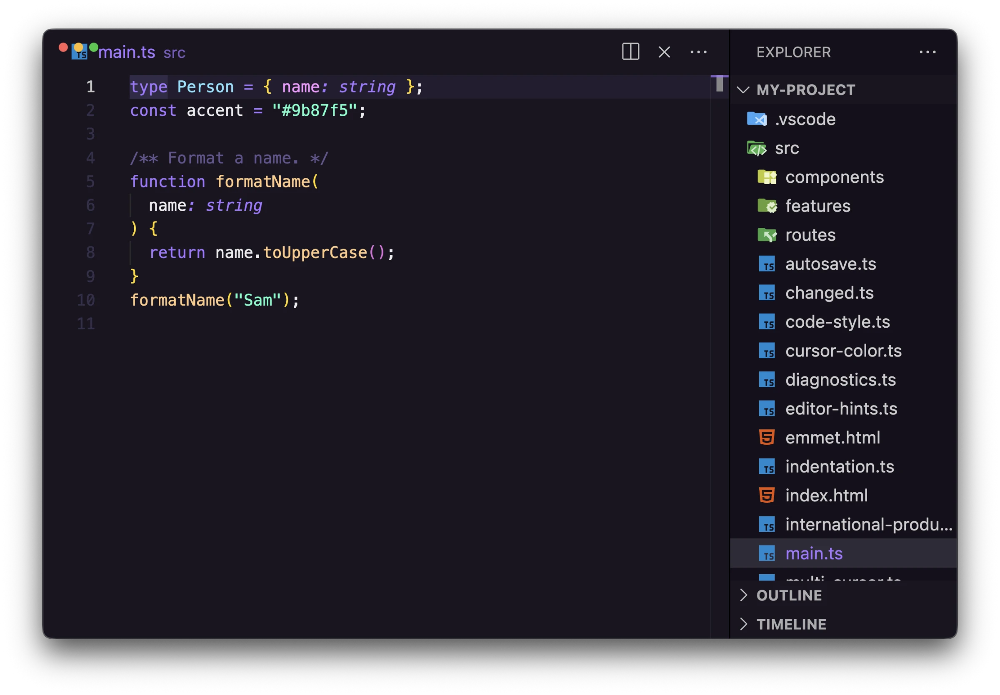

ウィンドウ全体のズーム倍率を調整し、[Custom UI Style](https://marketplace.visualstudio.com/items?itemName=subframe7536.custom-ui-style) 拡張機能を使ってタイトルバーや macOS のウィンドウ操作ボタンの位置をカスタマイズします。エディタ上部の表示領域をコンパクトにまとめ、無駄のないすっきりとした外観を実現します。対応する動画のチャプターは [Custom UI Style extension (07:58)](https://www.youtube.com/watch?v=VmFOsK7IhI4&t=478s) です。

https://www.youtube.com/watch?v=VmFOsK7IhI4&t=478s

## 設定（settings.json）

```json
{
  "window.zoomLevel": 3,
  "window.customTitleBarVisibility": "never",
  "window.titleBarStyle": "native",
  "custom-ui-style.electron": {
    "titleBarStyle": "hiddenInset",
    "trafficLightPosition": {
      "x": 20,
      "y": 16
    }
  },
  "custom-ui-style.stylesheet": {
    ".monaco-workbench .part.editor > .content .editor-group-container > .title > .label-container > .title-label": "padding-left: 60px"
  },
  "custom-ui-style.font.sansSerif": "Dank Mono"
}
```

## 解説

### ウィンドウズームとタイトルバーの構成
画面全体のズーム倍率を調整し、ネイティブスタイルのタイトルバーとウィンドウ操作ボタンの位置を整えます。

- `window.zoomLevel: 3`（既定値 `0`）: 画面全体のズーム倍率を上げる（動画では画面収録で見やすくするために設定）
- `window.customTitleBarVisibility: "never"`（既定値 `"auto"`）: カスタムタイトルバーを非表示にする
- `window.titleBarStyle: "native"`（既定値 `"custom"`）: ネイティブスタイルのタイトルバーを使用する
- `custom-ui-style.electron.titleBarStyle: "hiddenInset"`: [Electron](https://www.electronjs.org/docs/latest/) のタイトルバースタイルを `hiddenInset` にする
- `custom-ui-style.electron.trafficLightPosition`（`x: 20`, `y: 16`）: macOS のウィンドウ操作ボタン位置を移動する

| Before | After |
| --- | --- |
|  |  |

同じコードとワークベンチのまま、左のズーム倍率 0 から右のズーム倍率 3 へ画面全体が拡大されます。文字サイズだけでなくサイドバーやタイトル行も含めて拡大される点を確認できます。

| Before | After |
| --- | --- |
|  |  |

左では独立したタイトルバーと検索バーが上部に並んでいますが、右ではそれらが一体のヘッダーへ統合され、ウィンドウ操作ボタンがエディタ上部に収まります。

### Custom UI Style によるウィンドウ操作ボタンと余白の調整
ボタン位置の移動に伴うファイル名との重なりを防ぎ、UI 全体のフォントを統一します。

- `custom-ui-style.stylesheet`（エディタタイトルラベルに `padding-left: 60px`）: ウィンドウ操作ボタンと重ならないよう余白を確保する
- `custom-ui-style.font.sansSerif: "Dank Mono"`（既定値 `""`）: 拡張機能全体のサンセリフフォントを指定する

[Dank Mono](https://philpl.gumroad.com/l/dank-mono) は有料フォントであり、作者の公式販売ページからライセンスを購入して入手できます。

Dank Mono は有料フォントのため、本節ではスクリーンショットを省略しています。

## 設定項目の一覧

| 設定 | 既定値 | 説明 |
| --- | --- | --- |
| `window.zoomLevel` | `0` | UI 全体のズーム倍率を設定します。 |
| `window.customTitleBarVisibility` | `"auto"` | カスタムタイトルバーの表示を制御します。`never` で表示しません。 |
| `window.titleBarStyle` | `"custom"` | タイトルバーのスタイルを選択します。`native` でネイティブタイトルバーを使用します。 |
| `custom-ui-style.electron.titleBarStyle` | 親オブジェクト `{}` | Electron ウィンドウのタイトルバースタイルを設定します（`hiddenInset` を指定）。 |
| `custom-ui-style.electron.trafficLightPosition.x` | 親オブジェクト `{}` | macOS のトラフィックライト（ウィンドウ操作ボタン）の水平位置（ピクセル）を設定します。 |
| `custom-ui-style.electron.trafficLightPosition.y` | 親オブジェクト `{}` | macOS のトラフィックライト（ウィンドウ操作ボタン）の垂直位置（ピクセル）を設定します。 |
| `custom-ui-style.stylesheet[".monaco-workbench ... .title-label"]` | 親オブジェクト `{}` | エディタグループのタイトルラベルに左パディング 60px を追加し、ウィンドウボタンとの重なりを防ぎます。 |
| `custom-ui-style.font.sansSerif` | `""` | 拡張機能全体で使用するサンセリフフォントを設定します。 |

## 注意点

Custom UI Style 拡張機能は、VS Code 本体の内部ファイル（CSS や JavaScript）を直接書き換えてスタイルを適用します。設定変更を反映するには VS Code の再起動、またはコマンドパレットから `Custom UI Style: Reload` を実行する必要があります。

指定したフォント（Dank Mono）があらかじめ OS にインストールされていない場合、フォント設定は正しく反映されません。

スタイルシートのセレクターを変更・検証したい場合は、Developer Tools（macOS では `⌥⌘I`、またはコマンドパレットの `Toggle Developer Tools`）を開いて要素を検証できます。

## 追加する拡張機能

- [Custom UI Style](https://marketplace.visualstudio.com/items?itemName=subframe7536.custom-ui-style) (`subframe7536.custom-ui-style`): ウィンドウや UI スタイルをカスタマイズする拡張機能

## 変更コミット

- [`e690ea7`](https://github.com/igorbabko/vscode-setup/commit/e690ea74b3ff47f9050c879e050e82d2c4f7dbb7)
