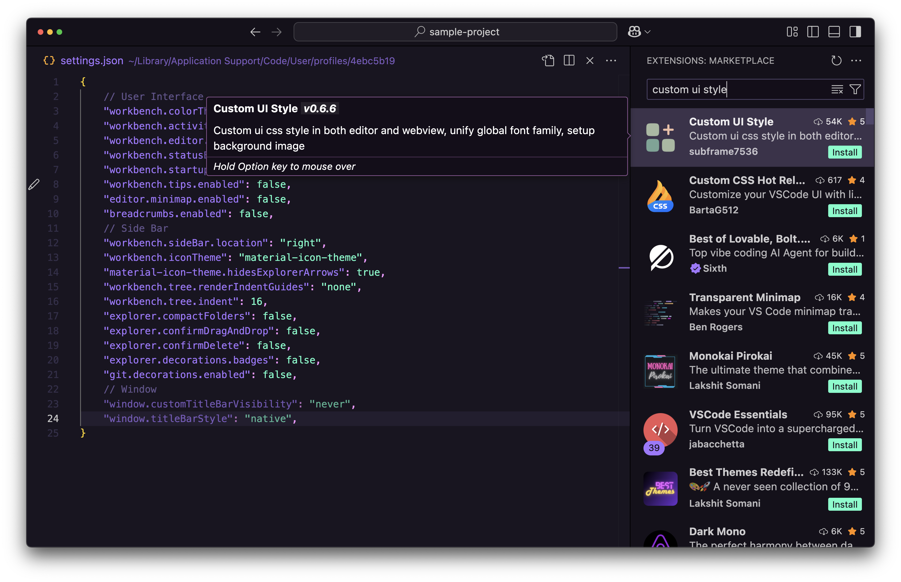
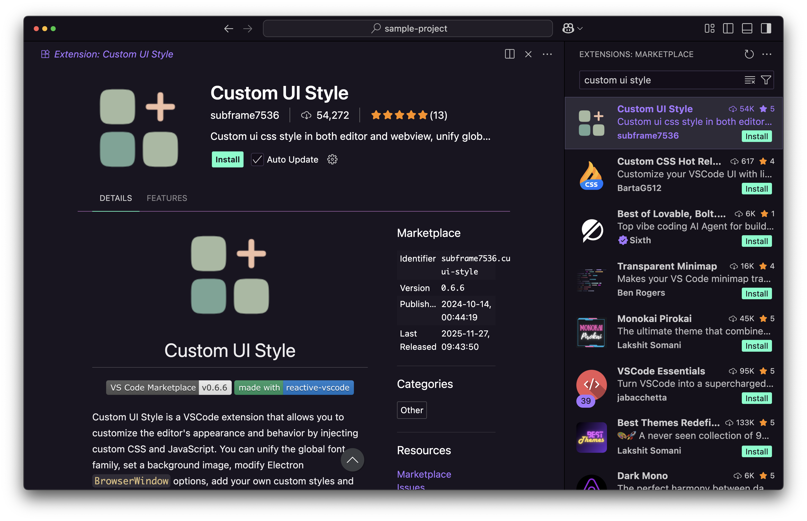
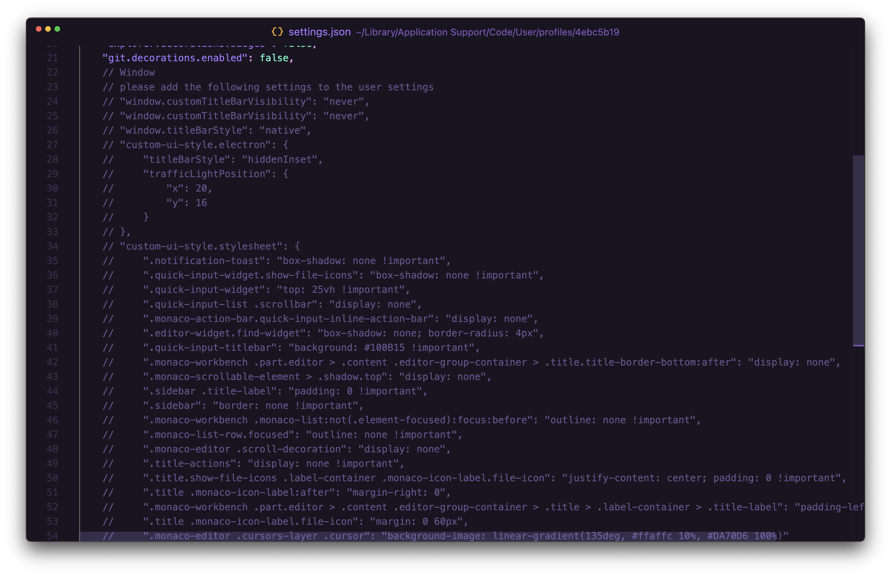

ウィンドウ全体のズーム倍率を調整し、Custom UI Style 拡張機能を使ってタイトルバーや macOS のウィンドウ操作ボタンの位置をカスタマイズします。エディタ上部の表示領域をコンパクトにまとめ、無駄のないすっきりとした外観を実現します。対応する動画のチャプターは [Custom UI Style extension (07:58)](https://www.youtube.com/watch?v=VmFOsK7IhI4&t=478s) です。

## 設定（settings.json）

```json
{
  "window.zoomLevel": 3,
  "window.customTitleBarVisibility": "never",
  "window.titleBarStyle": "native",
  "custom-ui-style.electron": {
    "titleBarStyle": "hiddenInset",
    "trafficLightPosition": {
      "x": 20,
      "y": 16
    }
  },
  "custom-ui-style.stylesheet": {
    ".monaco-workbench .part.editor > .content .editor-group-container > .title > .label-container > .title-label": "padding-left: 60px"
  },
  "custom-ui-style.font.sansSerif": "Dank Mono"
}
```

## 解説

### ウィンドウズームとタイトルバーの構成
画面全体のズーム倍率を `window.zoomLevel: 3`（既定値 `0`）に設定します（動画では画面収録で見やすくするために倍率を上げています）。タイトルバーはカスタム表示ではなくネイティブスタイルを使用します。そのため、`window.customTitleBarVisibility: "never"`（既定値 `"auto"`）および `window.titleBarStyle: "native"`（既定値 `"custom"`）を指定します。

設定に `window.customTitleBarVisibility: "never"` と `window.titleBarStyle: "native"` を追加した画面です。ウィンドウ左上に macOS ネイティブの操作ボタン（赤・黄・緑）が表示されています（ズーム倍率 3 の効果はこの画像単体では判別できません）。


### Custom UI Style によるウィンドウ操作ボタンと余白の調整
Custom UI Style 拡張機能を通じて Electron のウィンドウ設定を変更し、タイトルバースタイルを `custom-ui-style.electron.titleBarStyle: "hiddenInset"` に設定します。さらに macOS のトラフィックライト（赤・黄・緑のウィンドウ操作ボタン）の位置を `custom-ui-style.electron.trafficLightPosition` で `x: 20`, `y: 16` に移動させます。

Extensions ビューで「custom ui style」を検索した画面です。


Custom UI Style 拡張機能の詳細ページを開いた画面です。


`settings.json` 内に、Custom UI Style の設定例や CSS セレクターのサンプルがコメントとして記載されている画面です。


ボタンの位置を移動した結果、ファイル名とボタンが重なってしまいます。そこでスタイルシート設定 `custom-ui-style.stylesheet` を使い、エディタタイトルラベルに `padding-left: 60px` を追加して余白を確保します。また、拡張機能全体のサンセリフフォントとして `custom-ui-style.font.sansSerif: "Dank Mono"`（既定値 `""`）を指定し、UI 全体のフォントを統一します。

Electron の設定やトラフィックライト位置（`x: 20`, `y: 16`）、タイトルラベルの余白設定（`padding-left: 60px`）などを実際に記述した画面です。


## 設定項目の一覧

| 設定 | 既定値 | 説明 |
| --- | --- | --- |
| `window.zoomLevel` | `0` | UI 全体のズーム倍率を設定します。 |
| `window.customTitleBarVisibility` | `"auto"` | カスタムタイトルバーの表示を制御します。`never` で表示しません。 |
| `window.titleBarStyle` | `"custom"` | タイトルバーのスタイルを選択します。`native` でネイティブタイトルバーを使用します。 |
| `custom-ui-style.electron.titleBarStyle` | 親オブジェクト `{}` | Electron ウィンドウのタイトルバースタイルを設定します（`hiddenInset` を指定）。 |
| `custom-ui-style.electron.trafficLightPosition.x` | 親オブジェクト `{}` | macOS のトラフィックライト（ウィンドウ操作ボタン）の水平位置（ピクセル）を設定します。 |
| `custom-ui-style.electron.trafficLightPosition.y` | 親オブジェクト `{}` | macOS のトラフィックライト（ウィンドウ操作ボタン）の垂直位置（ピクセル）を設定します。 |
| `custom-ui-style.stylesheet[".monaco-workbench ... .title-label"]` | 親オブジェクト `{}` | エディタグループのタイトルラベルに左パディング 60px を追加し、ウィンドウボタンとの重なりを防ぎます。 |
| `custom-ui-style.font.sansSerif` | `""` | 拡張機能全体で使用するサンセリフフォントを設定します。 |

## 注意点

Custom UI Style 拡張機能は、VS Code 本体の内部ファイル（CSS や JavaScript）を直接書き換えてスタイルを適用します。設定変更を反映するには VS Code の再起動、またはコマンドパレットから `Custom UI Style: Reload` を実行する必要があります。

指定したフォント（Dank Mono）があらかじめ OS にインストールされていない場合、フォント設定は正しく反映されません。

スタイルシートのセレクターを変更・検証したい場合は、Developer Tools（macOS では `⌥⌘I`、またはコマンドパレットの `Toggle Developer Tools`）を開いて要素を検証できます。

## 追加する拡張機能

- [Custom UI Style](https://marketplace.visualstudio.com/items?itemName=subframe7536.custom-ui-style) (`subframe7536.custom-ui-style`): ウィンドウや UI スタイルをカスタマイズする拡張機能

## 変更コミット

- [`e690ea7`](https://github.com/igorbabko/vscode-setup/commit/e690ea74b3ff47f9050c879e050e82d2c4f7dbb7)
