Custom UI Style 拡張機能のスタイルシート設定を活用し、影や境界線、余分なパディングなどの装飾をまとめて削除します。エディタ全体の余計な境界をなくしてフラットでシームレスな外観に整えます。対応する動画のチャプターは [Styling with Custom UI Style extension (12:19)](https://www.youtube.com/watch?v=VmFOsK7IhI4&t=739s) です。

https://www.youtube.com/watch?v=VmFOsK7IhI4&t=739s

## 設定（settings.json）

```json
{
  "custom-ui-style.stylesheet": {
    ".notification-toast": "box-shadow: none !important",
    ".quick-input-widget.show-file-icons": "box-shadow: none !important",
    ".quick-input-widget": "top: 25vh !important",
    ".quick-input-list .scrollbar": "display: none",
    ".monaco-action-bar.quick-input-inline-action-bar": "display: none",
    ".editor-widget.find-widget": "box-shadow: none; border-radius: 4px",
    ".quick-input-titlebar": "background: #100B15 !important",
    ".monaco-workbench .part.editor > .content .editor-group-container > .title.title-border-bottom:after": "display: none",
    ".monaco-scrollable-element > .shadow.top": "display: none",
    ".sidebar .title-label": "padding: 0 !important",
    ".sidebar": "border: none !important",
    ".monaco-workbench .monaco-list:not(.element-focused):focus:before": "outline: none !important",
    ".monaco-list-row.focused": "outline: none !important",
    ".monaco-editor .scroll-decoration": "display: none",
    ".title-actions": "display: none !important",
    ".title.show-file-icons .label-container .monaco-icon-label.file-icon": "justify-content: center; padding: 0 !important",
    ".title .monaco-icon-label:after": "margin-right: 0"
  }
}
```

## 解説

### スタイル適用の一括反映
一度の再起動で CSS のオーバーライド設定をまとめて反映させます。

- `custom-ui-style.stylesheet`（既定値 `{}`）: CSS のオーバーライド設定を一括して記述する

Custom UI Style のスタイル設定は変更のたびに再読み込みが必要になるため、個別に変更すると何度も再起動が必要になります。本章で追加するセレクター群は、第 03 章で作成した `custom-ui-style.stylesheet` オブジェクトの中に追記します。第 03 章のエディタタイトルの余白設定を残したまま、本章の各プロパティを並列に追加します。

### ポップアップとウィジェットの装飾整理
通知トーストやコマンドパレット、検索ウィジェットなどの影や不要な装飾を取り除きます。

- `.notification-toast`: `box-shadow: none !important` で通知トーストの影を非表示にする
- `.quick-input-widget.show-file-icons`: `box-shadow: none !important` でクイック入力・コマンドパレットの影を非表示にする
- `.quick-input-widget`: `top: 25vh !important` でコマンドパレットを画面上部から少し下げた位置に移動する
- `.quick-input-list .scrollbar`: `display: none` でパレット内のスクロールバーを非表示にする
- `.monaco-action-bar.quick-input-inline-action-bar`: `display: none` で不要なアクションバーを非表示にする
- `.editor-widget.find-widget`: `box-shadow: none; border-radius: 4px` で検索ウィジェットの影を消し角丸を 4px に整える
- `.quick-input-titlebar`: `background: #100B15 !important` でタイトルバーの背景色を設定する

`.quick-input-titlebar` の設定は、[VSCode Neovim](https://marketplace.visualstudio.com/items?itemName=asvetliakov.vscode-neovim) 拡張機能の `/` 検索バーを開いた際の見た目を整えるためのものです。

| Before | After |
| --- | --- |
| 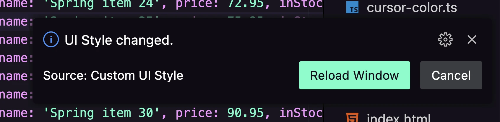 | 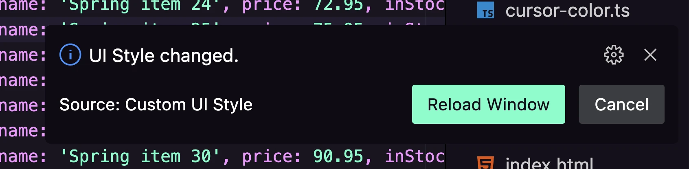 |

コード上に表示された同じ通知トーストを比べると、左で見えていた外周の影が右では消えます。

| Before | After |
| --- | --- |
| 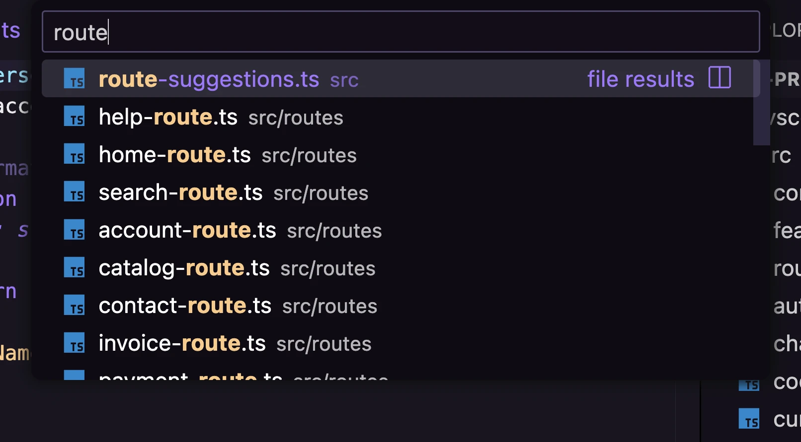 | 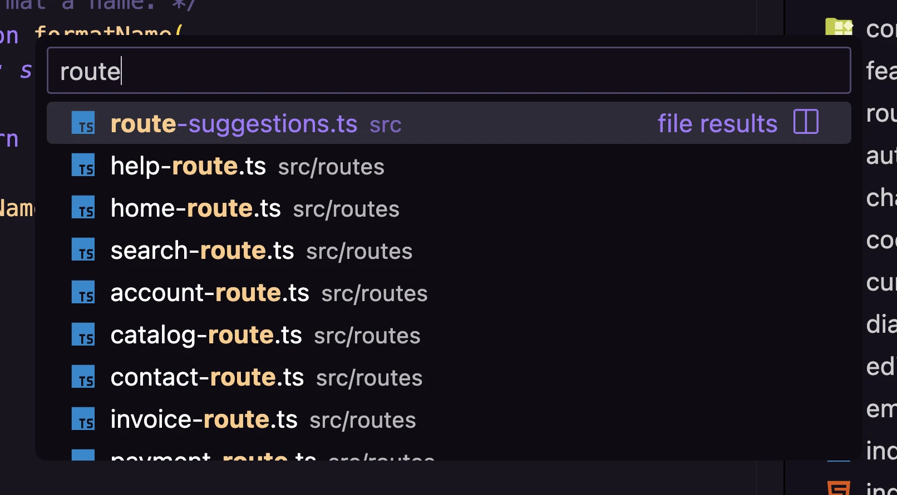 |

Quick Open の表示位置が下がり、外周の影と右端のスクロールバーが消えます。

| Before | After |
| --- | --- |
| 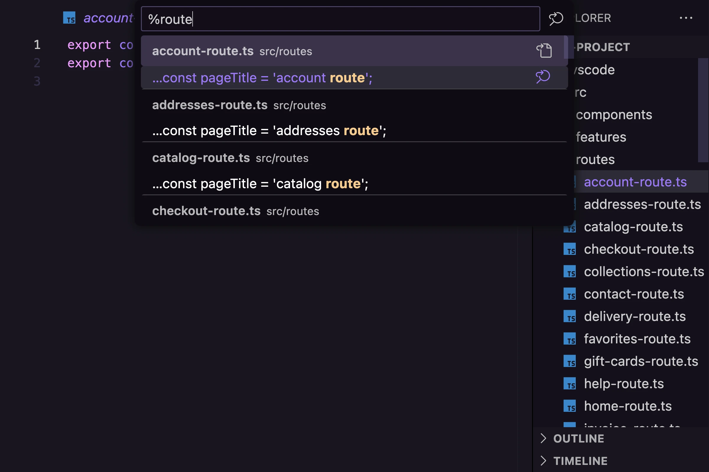 | 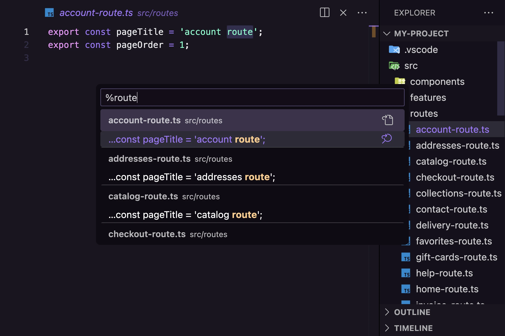 |

Quick Search ビューの行に表示されていたインラインアクションが、左から右で非表示になります。

| Before | After |
| --- | --- |
| 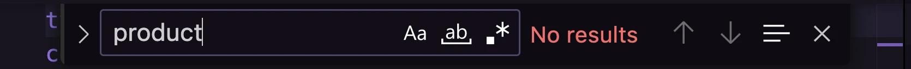 | 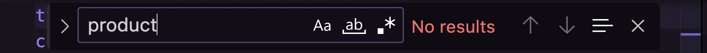 |

コード上に開いた同じ検索ウィジェットで、左にあった影が右では消え、四隅に 4px の角丸が付きます。

| Before | After |
| --- | --- |
| 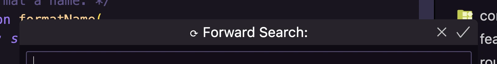 | 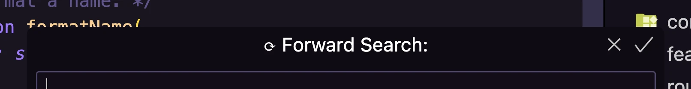 |

Neovim の Forward Search タイトルバーが、左の Aura テーマ色から右の指定した暗い背景色へ切り替わります。

### サイドバーとエディタ境界のフラット化
スクロールシャドウや境界線、フォーカス枠線を取り除き、サイドバーとエディタ周りをフラットに整えます。

- `.monaco-workbench .part.editor > .content .editor-group-container > .title.title-border-bottom:after`: `display: none`。エディタグループ下部のタイトルボーダー装飾を非表示にする（本書で使うテーマではこの枠線が表示されないため見た目の変化はない）
- `.monaco-scrollable-element > .shadow.top`: `display: none` で上部のスクロールシャドウを非表示にする
- `.monaco-editor .scroll-decoration`: `display: none` でエディタ内のスクロール装飾を非表示にする
- `.sidebar`: `border: none !important` でサイドバーの境界線を非表示にする
- `.sidebar .title-label`: `padding: 0 !important` でサイドバーのタイトルラベルのパディングをなくす
- `.monaco-workbench .monaco-list:not(.element-focused):focus:before`: `outline: none !important` でリストのフォーカス枠線を非表示にする
- `.monaco-list-row.focused`: `outline: none !important` でフォーカスされたリスト行の枠線を非表示にする
- `.title-actions`: `display: none !important` でエディタ上部のタブアクションボタンを非表示にする
- `.title.show-file-icons .label-container .monaco-icon-label.file-icon`: `justify-content: center; padding: 0 !important`。タイトルラベルを中央揃えにしパディングをなくす
- `.title .monaco-icon-label:after`: `margin-right: 0` でアイコンラベル後の末尾余白を詰める

| Before | After |
| --- | --- |
| 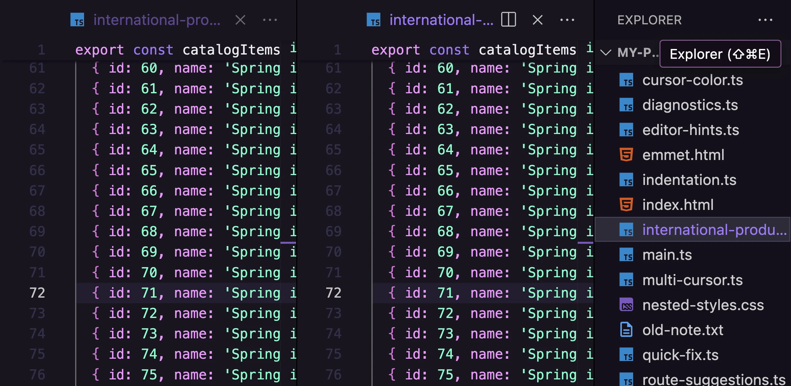 | 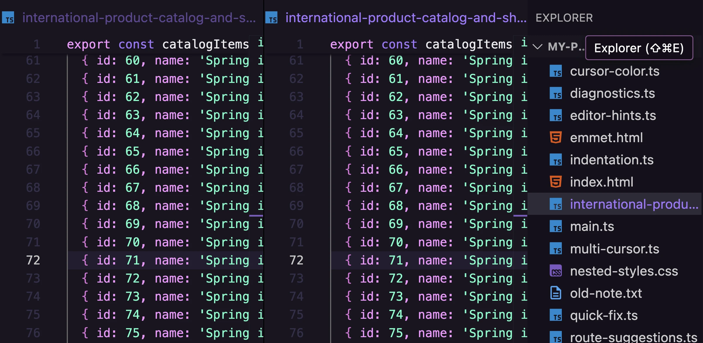 |

同じスクロール済みのエディタと長いファイル名で、左にあった上部スクロール影やタイトルアクションが右では消え、タイトル余白とアイコン・タイトルの配置が変わります。

| Before | After |
| --- | --- |
| 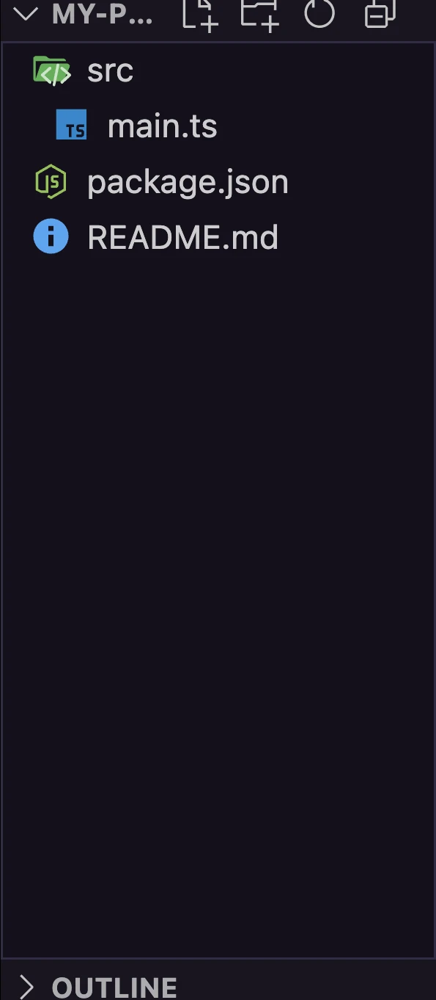 |  |

子要素にフォーカスがない状態でエクスプローラーリスト自体へフォーカスを当てたとき、左で見えていた外周のフォーカス枠線が右では消えます。

| Before | After |
| --- | --- |
| 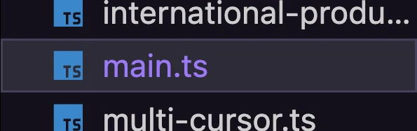 | 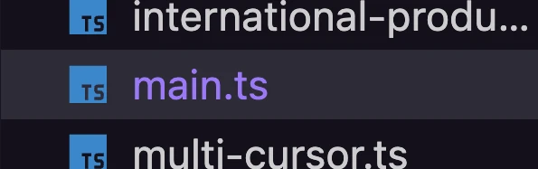 |

`main.ts` にキーボードフォーカスと選択を置いたまま、左にあった行のフォーカス枠線だけが右で消え、選択時の背景塗りは残ります。

## 設定項目の一覧

| セレクター | 既定値 | 説明 |
| --- | --- | --- |
| `.notification-toast` | なし（親 `{}`） | 通知トーストの影を非表示にします。 |
| `.quick-input-widget.show-file-icons` | なし（親 `{}`） | ファイルアイコン付きクイック入力ポップアップの影を非表示にします。 |
| `.quick-input-widget` | なし（親 `{}`） | クイック入力ポップアップをビューポート上部から 25vh の位置に配置します。 |
| `.quick-input-list .scrollbar` | なし（親 `{}`） | クイック入力リストのスクロールバーを非表示にします。 |
| `.monaco-action-bar.quick-input-inline-action-bar` | なし（親 `{}`） | クイック入力リスト内のインラインアクションボタンを非表示にします。 |
| `.editor-widget.find-widget` | なし（親 `{}`） | 検索ウィジェットの影を非表示にし、角丸を 4px に設定します。 |
| `.quick-input-titlebar` | なし（親 `{}`） | クイック入力のタイトルバーの背景色を `#100B15` に設定します。 |
| `.monaco-workbench ... .title.title-border-bottom:after` | なし（親 `{}`） | エディタグループ下部のタイトルボーダー装飾を非表示にします。 |
| `.monaco-scrollable-element > .shadow.top` | なし（親 `{}`） | 上部エッジのスクロールシャドウを非表示にします。 |
| `.sidebar .title-label` | なし（親 `{}`） | サイドバーのタイトルラベルの余白（パディング）をなくします。 |
| `.sidebar` | なし（親 `{}`） | サイドバーの境界線を非表示にします。 |
| `.monaco-workbench .monaco-list:not(.element-focused):focus:before` | なし（親 `{}`） | フォーカスされたリストの前に描画される枠線を非表示にします。 |
| `.monaco-list-row.focused` | なし（親 `{}`） | フォーカスされたリスト行の枠線を非表示にします。 |
| `.monaco-editor .scroll-decoration` | なし（親 `{}`） | エディタのスクロール装飾シャドウを非表示にします。 |
| `.title-actions` | なし（親 `{}`） | タイトルアクションボタンを非表示にします。 |
| `.title.show-file-icons .label-container .monaco-icon-label.file-icon` | なし（親 `{}`） | ファイルアイコンラベルを中央揃えにし、余白（パディング）をなくします。 |
| `.title .monaco-icon-label:after` | なし（親 `{}`） | アイコンラベル後の末尾マージンをなくします。 |

## 注意点

本章のスタイルは Custom UI Style 拡張機能が内部 CSS を上書きすることで実現しています。VS Code のアップデートによって内部の HTML 構造や CSS クラス名が変更された場合、スタイルが効かなくなったり崩れたりする可能性があります。

`.quick-input-titlebar` の背景色指定は、VSCode Neovim 拡張機能の `/` 検索機能を利用する際の見た目を想定したものです。該当の拡張機能を使っていない場合は検索バー自体の表示に影響しません。

## 追加する拡張機能

本章のコミット（`.vscode/extensions.json`）での新規追加はありません。

## 変更コミット

- [`df3b12c`](https://github.com/igorbabko/vscode-setup/commit/df3b12c33dde40400e17404ebb08c5d7e6908ad4)
