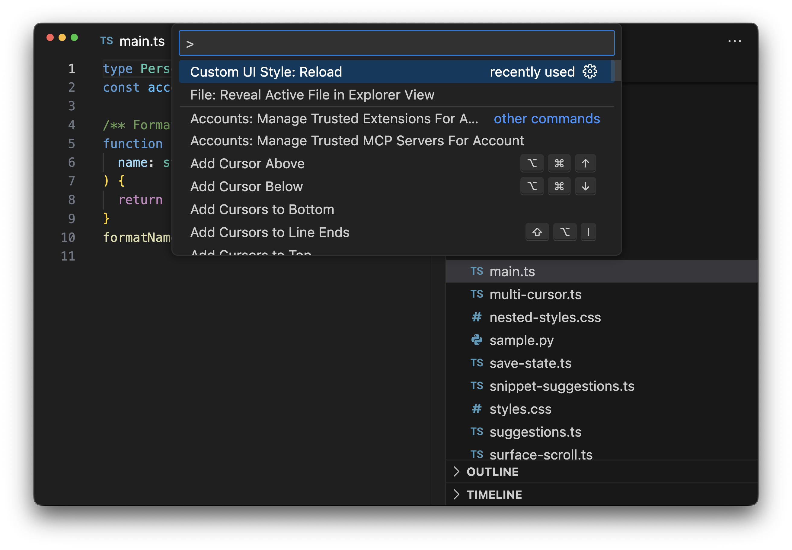
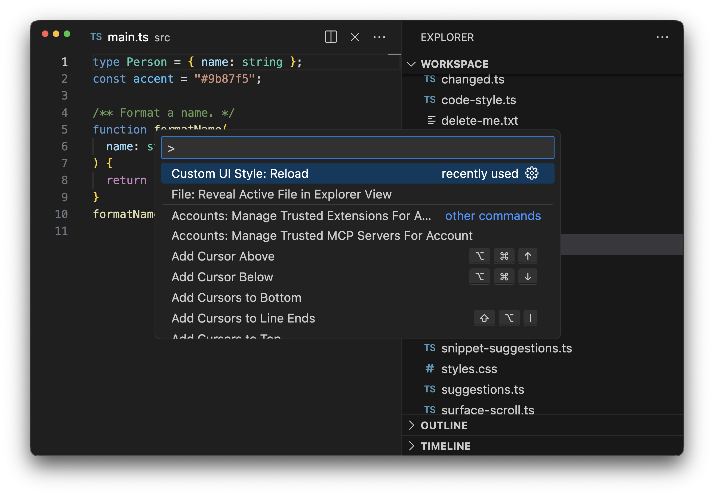
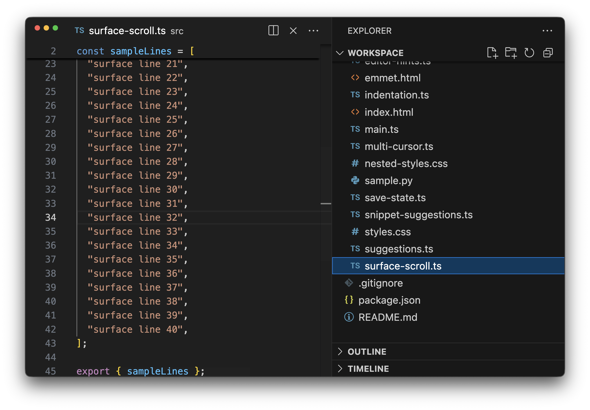
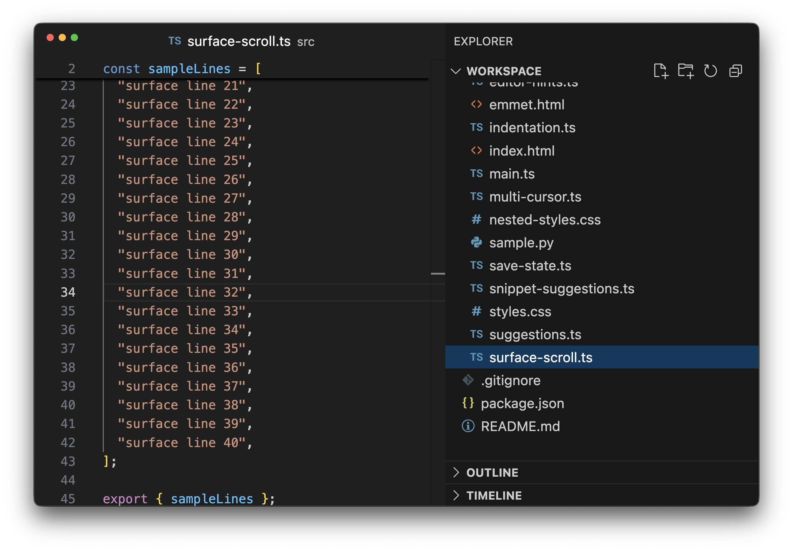
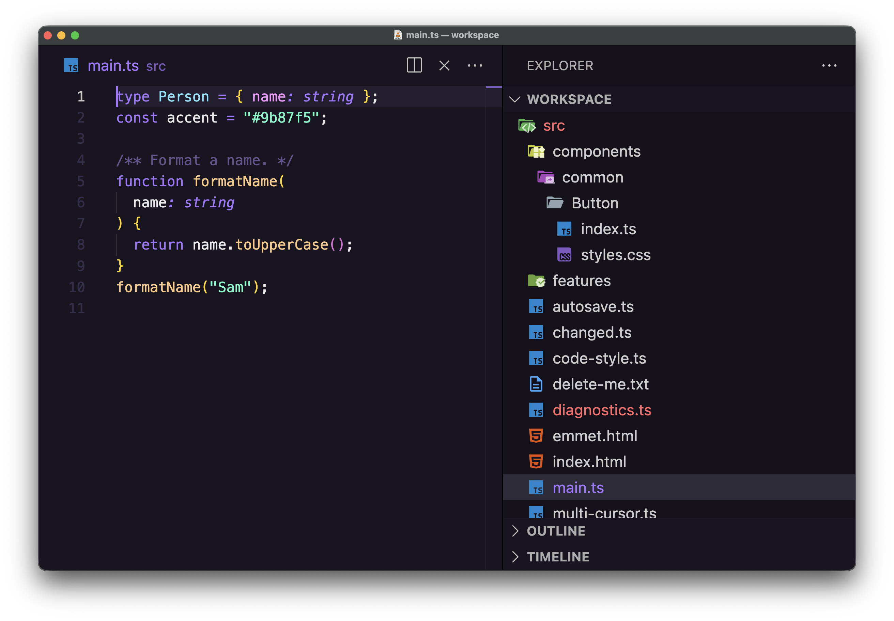

Custom UI Style 拡張機能のスタイルシート設定を活用し、影や境界線、余分なパディングなどの装飾をまとめて削除します。エディタ全体の余計な境界をなくしてフラットでシームレスな外観に整えます。対応する動画のチャプターは [Styling with Custom UI Style extension (12:19)](https://www.youtube.com/watch?v=VmFOsK7IhI4&t=739s) です。

## 設定（settings.json）

```json
{
  "custom-ui-style.stylesheet": {
    ".notification-toast": "box-shadow: none !important",
    ".quick-input-widget.show-file-icons": "box-shadow: none !important",
    ".quick-input-widget": "top: 25vh !important",
    ".quick-input-list .scrollbar": "display: none",
    ".monaco-action-bar.quick-input-inline-action-bar": "display: none",
    ".editor-widget.find-widget": "box-shadow: none; border-radius: 4px",
    ".quick-input-titlebar": "background: #100B15 !important",
    ".monaco-workbench .part.editor > .content .editor-group-container > .title.title-border-bottom:after": "display: none",
    ".monaco-scrollable-element > .shadow.top": "display: none",
    ".sidebar .title-label": "padding: 0 !important",
    ".sidebar": "border: none !important",
    ".monaco-workbench .monaco-list:not(.element-focused):focus:before": "outline: none !important",
    ".monaco-list-row.focused": "outline: none !important",
    ".monaco-editor .scroll-decoration": "display: none",
    ".title-actions": "display: none !important",
    ".title.show-file-icons .label-container .monaco-icon-label.file-icon": "justify-content: center; padding: 0 !important",
    ".title .monaco-icon-label:after": "margin-right: 0"
  }
}
```

## 解説

### スタイル適用の一括反映
Custom UI Style のスタイル設定は、設定を変更するたびに再読み込みが必要になります。設定を個別に変更すると何度も再起動が必要になります。そのため、CSS のオーバーライド設定を `custom-ui-style.stylesheet`（既定値 `{}`）へ一括して記述し、一度の再起動でまとめて反映させています。本章で追加するセレクター群は、第 3 章で作成した `custom-ui-style.stylesheet` オブジェクトの中に追記します。第 3 章のエディタタイトルの余白設定を残したまま、本章の各プロパティを並列に追加します。

### ポップアップとウィジェットの装飾整理
通知トーストの影（`.notification-toast`）を `box-shadow: none !important` で非表示にします。クイック入力・コマンドパレットの影（`.quick-input-widget.show-file-icons`）も同様に非表示にします。コマンドパレット（`.quick-input-widget`）は画面上部から少し下げた `top: 25vh !important` の位置に移動します。パレット内のスクロールバー（`.quick-input-list .scrollbar`）や不要なアクションバー（`.monaco-action-bar.quick-input-inline-action-bar`）も非表示にします。検索ウィジェット（`.editor-widget.find-widget`）も影を消して角丸を 4px に整えます。また、`.quick-input-titlebar` の背景色を `#100B15` に設定していますが、これは VSCode Neovim 拡張機能の `/` 検索バーを開いた際の見た目を整えるための設定です。

| Before | After |
| --- | --- |
|  |  |

両画像でコマンドパレットを開いており、右の設定後ではパレットの表示位置が下がり、影も表示されます。

### サイドバーとエディタ境界のフラット化
エディタタイトル下部の境界線（`title.title-border-bottom:after`）や上部のスクロールシャドウ（`.monaco-scrollable-element > .shadow.top`）を非表示にします。エディタ内のスクロール装飾（`.monaco-editor .scroll-decoration`）も非表示にします。サイドバーの境界線（`.sidebar`）を非表示にし、パディング（`.sidebar .title-label`）をなくします。さらにリストのフォーカス枠線（`.monaco-list:not(.element-focused):focus:before`、`.monaco-list-row.focused`）も非表示にしてフラットにします。エディタ上部のタブアクションボタン（`.title-actions`）を非表示にし、タイトルラベル（`.title.show-file-icons ...`）を中央揃えにして末尾余白を詰めます。

| Before | After |
| --- | --- |
|  |  |

左の設定前と比べて、右の設定後では選択されたエクスプローラー行の青いフォーカス枠線が消え、エディタタイトルが左揃えから中央揃えに移動します。

## 設定項目の一覧

| セレクター | 既定値 | 説明 |
| --- | --- | --- |
| `.notification-toast` | なし（親 `{}`） | 通知トーストの影を非表示にします。 |
| `.quick-input-widget.show-file-icons` | なし（親 `{}`） | ファイルアイコン付きクイック入力ポップアップの影を非表示にします。 |
| `.quick-input-widget` | なし（親 `{}`） | クイック入力ポップアップをビューポート上部から 25vh の位置に配置します。 |
| `.quick-input-list .scrollbar` | なし（親 `{}`） | クイック入力リストのスクロールバーを非表示にします。 |
| `.monaco-action-bar.quick-input-inline-action-bar` | なし（親 `{}`） | クイック入力リスト内のインラインアクションボタンを非表示にします。 |
| `.editor-widget.find-widget` | なし（親 `{}`） | 検索ウィジェットの影を非表示にし、角丸を 4px に設定します。 |
| `.quick-input-titlebar` | なし（親 `{}`） | クイック入力のタイトルバーの背景色を `#100B15` に設定します。 |
| `.monaco-workbench ... .title.title-border-bottom:after` | なし（親 `{}`） | エディタグループ下部のタイトルボーダー装飾を非表示にします。 |
| `.monaco-scrollable-element > .shadow.top` | なし（親 `{}`） | 上部エッジのスクロールシャドウを非表示にします。 |
| `.sidebar .title-label` | なし（親 `{}`） | サイドバーのタイトルラベルの余白（パディング）をなくします。 |
| `.sidebar` | なし（親 `{}`） | サイドバーの境界線を非表示にします。 |
| `.monaco-workbench .monaco-list:not(.element-focused):focus:before` | なし（親 `{}`） | フォーカスされたリストの前に描画される枠線を非表示にします。 |
| `.monaco-list-row.focused` | なし（親 `{}`） | フォーカスされたリスト行の枠線を非表示にします。 |
| `.monaco-editor .scroll-decoration` | なし（親 `{}`） | エディタのスクロール装飾シャドウを非表示にします。 |
| `.title-actions` | なし（親 `{}`） | タイトルアクションボタンを非表示にします。 |
| `.title.show-file-icons .label-container .monaco-icon-label.file-icon` | なし（親 `{}`） | ファイルアイコンラベルを中央揃えにし、余白（パディング）をなくします。 |
| `.title .monaco-icon-label:after` | なし（親 `{}`） | アイコンラベル後の末尾マージンをなくします。 |

## 注意点

本章のスタイルは Custom UI Style 拡張機能が内部 CSS を上書きすることで実現しています。VS Code のアップデートによって内部の HTML 構造や CSS クラス名が変更された場合、スタイルが効かなくなったり崩れたりする可能性があります。

`.quick-input-titlebar` の背景色指定は、VSCode Neovim 拡張機能の `/` 検索機能を利用する際の見た目を想定したものです。該当の拡張機能を使っていない場合は検索バー自体の表示に影響しません。

## 本章完了時の状態

本章の設定をすべて適用すると、エディタは以下の状態になります。



## 追加する拡張機能

本章のコミット（`.vscode/extensions.json`）での新規追加はありません。

## 変更コミット

- [`df3b12c`](https://github.com/igorbabko/vscode-setup/commit/df3b12c33dde40400e17404ebb08c5d7e6908ad4)
