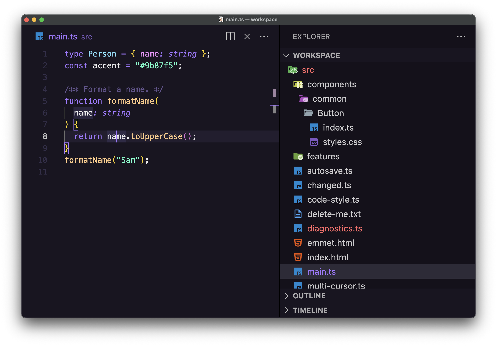
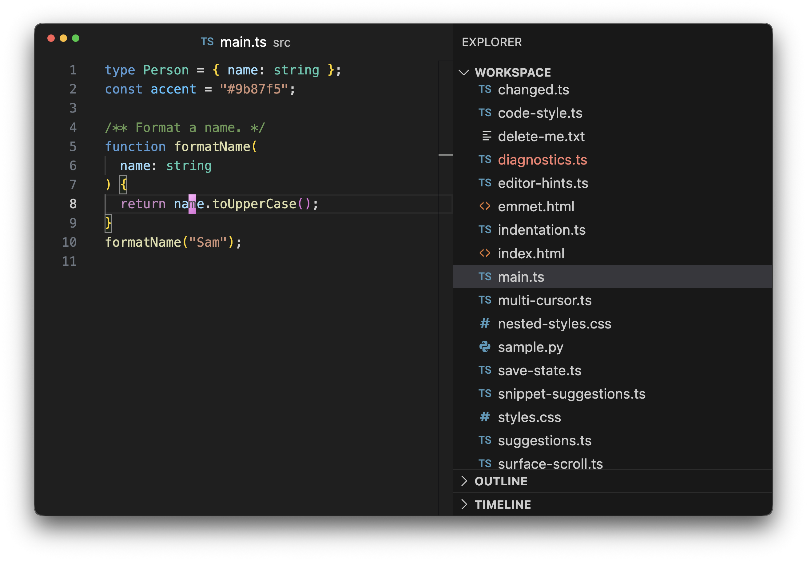
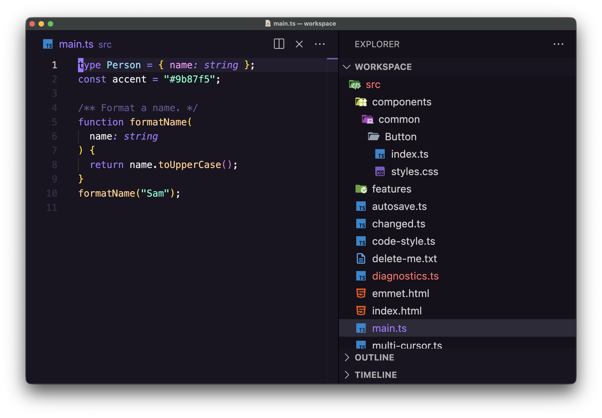

エディタのカーソル形状をブロック型に変更し、点滅を無効化して常時点灯させるとともに、グラデーション背景を適用します。さらにマルチカーソル操作の修飾キーを調整し、視認性と操作性を高めます。対応する動画のチャプターは [Cursor gradient (17:05)](https://www.youtube.com/watch?v=VmFOsK7IhI4&t=1025s) です。

## 設定（settings.json）

```json
{
  "custom-ui-style.stylesheet": {
    ".monaco-editor .cursors-layer .cursor": "background-image: linear-gradient(135deg, #ffaffc 10%, #DA70D6 100%)"
  },
  "editor.multiCursorModifier": "ctrlCmd",
  "editor.cursorBlinking": "solid",
  "editor.cursorStyle": "block",
  "workbench.colorCustomizations": {
    "editorCursor.background": "#000000"
  }
}
```

## 解説

### カーソル形状と点滅の無効化
カーソルの形状を既定の縦線（`"line"`）からブロック型（`editor.cursorStyle: "block"`）に変更します。点滅アニメーションは `editor.cursorBlinking: "solid"`（既定値 `"blink"`）で無効化し、常に点灯している状態にします。これにより、文字入力やコード参照中にカーソルを見失いにくくします。

### マルチカーソルの修飾キー
マウスクリックによるマルチカーソル追加の修飾キーを `editor.multiCursorModifier: "ctrlCmd"`（既定値 `"alt"`）に変更します。macOS では Command キー、Windows および Linux では Control キーを押しながらのクリックで複数カーソルを追加できます。これにより、一般的なテキスト選択操作との衝突を避けます。この設定はカーソルを追加するキーを変更するもので、画面上の見た目には変化がないため、比較画像から除外しています。

### グラデーションと配色の調整
Custom UI Style のスタイルシート設定を用い、カーソル要素（`.monaco-editor .cursors-layer .cursor`）にグラデーションを適用します。具体的にはピンクから紫への線形グラデーション（`linear-gradient(135deg, #ffaffc 10%, #DA70D6 100%)`）を指定します。このカーソルのスタイル設定は、第 3 章および第 4 章で設定した `custom-ui-style.stylesheet` オブジェクトの内側に新しいキーとして追加します。グラデーションの適用に伴い、重なる文字の視認性（コントラスト）を確保する必要があります。そのため、テーマの配色を調整する `workbench.colorCustomizations` オブジェクトを新しく作成し、`editorCursor.background` を `#000000` に設定します。Custom UI Style のグラデーション設定が優先され、文字反転色単独での視覚差を画像上で確認できないため、本項の比較画像は除外しています。

| Before | After |
| --- | --- |
|  |  |

設定前の縦線カーソルに対し、設定後はピンクから紫へ変化するブロックカーソルが常時点灯します。

## 設定項目の一覧

| 設定 | 既定値 | 説明 |
| --- | --- | --- |
| `custom-ui-style.stylesheet[".monaco-editor .cursors-layer .cursor"]` | 親オブジェクト `{}` | エディタカーソルにピンクから紫への線形グラデーション背景を適用します。 |
| `editor.multiCursorModifier` | `"alt"` | クリックでカーソルを追加する際の修飾キーを設定します。`ctrlCmd` で macOS は Command、Windows / Linux は Control になります。 |
| `editor.cursorBlinking` | `"blink"` | カーソルの点滅アニメーションを制御します。`solid` で点滅を無効化（常時点灯）します。 |
| `editor.cursorStyle` | `"line"` | カーソルの形状を設定します。`block` でブロック型にします。 |
| `workbench.colorCustomizations["editorCursor.background"]` | テーマ依存 | エディタカーソルの背景色を設定します。`#000000` で黒色を指定します。 |

## 注意点

Custom UI Style によるカーソルのグラデーション設定を反映するには、拡張機能の再読み込みまたは VS Code の再起動が必要です。

## 本章完了時の状態

本章の設定をすべて適用すると、エディタは以下の状態になります。



## 追加する拡張機能

本章のコミット（`.vscode/extensions.json`）での新規追加はありません。

## 変更コミット

- [`71871cc`](https://github.com/igorbabko/vscode-setup/commit/71871cc4364994f356a76c81912d15df3e92e37b)
