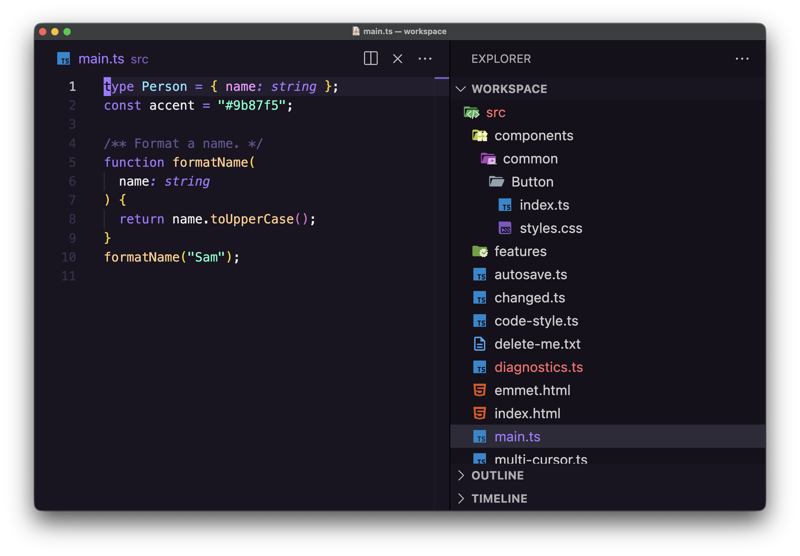
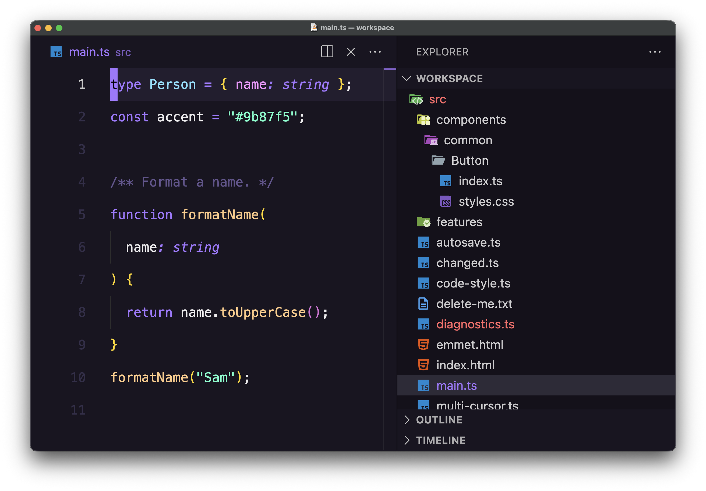
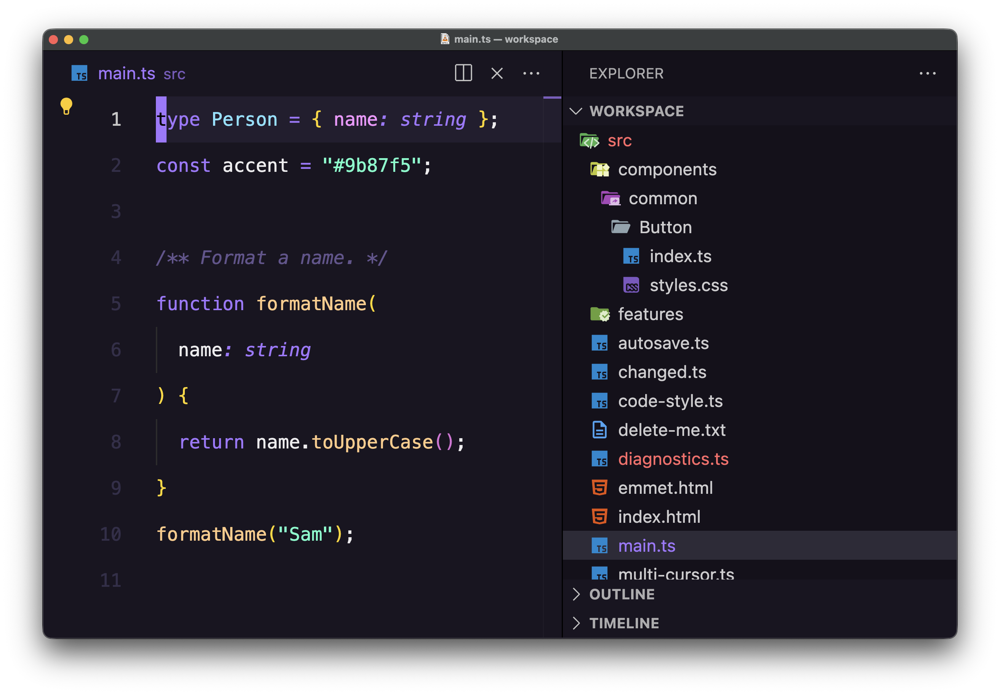

エディタのフォントに Dank Mono を指定し、サイズや行間を調整するとともに、リガチャの有効化やコメントのイタリック体描画を設定します。コードの可読性を大幅に向上させ、タイポグラフィ全体を整えます。対応する動画のチャプターは [Typography (19:11)](https://www.youtube.com/watch?v=VmFOsK7IhI4&t=1151s) です。

## 設定（settings.json）

```json
{
  "editor.fontFamily": "Dank Mono",
  "editor.fontSize": 14,
  "editor.fontLigatures": true,
  "editor.lineHeight": 2.5,
  "editor.tokenColorCustomizations": {
    "textMateRules": [
      {
        "scope": "comment",
        "settings": {
          "fontStyle": "italic"
        }
      }
    ]
  }
}
```

## 解説

### フォントファミリーと行の高さ
エディタのフォントファミリーを `editor.fontFamily: "Dank Mono"` に変更し、UI 全体とフォントを統一します。文字サイズは `editor.fontSize: 14`（ピクセル単位）に設定します。行の高さは `editor.lineHeight: 2.5`（既定値 `0`、自動計算）に広げます。行間を広く取ることで、コードの行ごとの区切りが明瞭になり、ゆったりとした読みやすいレイアウトになります。

| Before | After |
| --- | --- |
|  |  |

左の設定前に対し、右の設定後は Dank Mono と行高 2.5 を適用し、ゆったりとした行間に整えています。

### リガチャとコメントのイタリック体表示
演算子などの連続する記号を合字として美しく結合表示するため、`editor.fontLigatures: true`（既定値 `false`）を有効にします。さらに、コードとコメントを視覚的に区別しやすくします。TextMate ルール `editor.tokenColorCustomizations.textMateRules` を使い、`comment` スコープのフォントスタイルを `fontStyle: "italic"`（イタリック体）に設定します。フォールバック環境のフォントは合字に対応せず、Aura テーマも標準でコメントを斜体表示するため、画像上の変化が見られず比較画像から除外しています。

## 設定項目の一覧

| 設定 | 既定値 | 説明 |
| --- | --- | --- |
| `editor.fontFamily` | OS・環境依存（例: Hack Nerd Font Mono / Menlo 等） | エディタで使用するフォントファミリーを設定します。 |
| `editor.fontSize` | `12`（macOS）/ `14`（Windows / Linux） | エディタのフォントサイズをピクセル単位で設定します。 |
| `editor.fontLigatures` | `false` | フォントリガチャ（合字）の有効・無効を切り替えます。 |
| `editor.lineHeight` | `0`（自動計算） | エディタの行の高さを設定します（数値 `2.5` で行間を拡大）。 |
| `editor.tokenColorCustomizations.textMateRules` | `{}` | 構文のスタイルをカスタマイズする TextMate トークンルールを設定します（コメントをイタリック体に設定）。 |

## 注意点

Dank Mono フォントがシステムにインストールされていない場合、フォントの指定やリガチャ（合字）の結合表示は正しく機能しません。事前にフォントを OS にインストールしておく必要があります。

## 本章完了時の状態

本章の設定をすべて適用すると、エディタは以下の状態になります。



## 追加する拡張機能

本章のコミット（`.vscode/extensions.json`）での新規追加はありません。

## 変更コミット

- [`599a705`](https://github.com/igorbabko/vscode-setup/commit/599a7054551b9ddd9ce4e390c06ffec2d4b1ce68)
