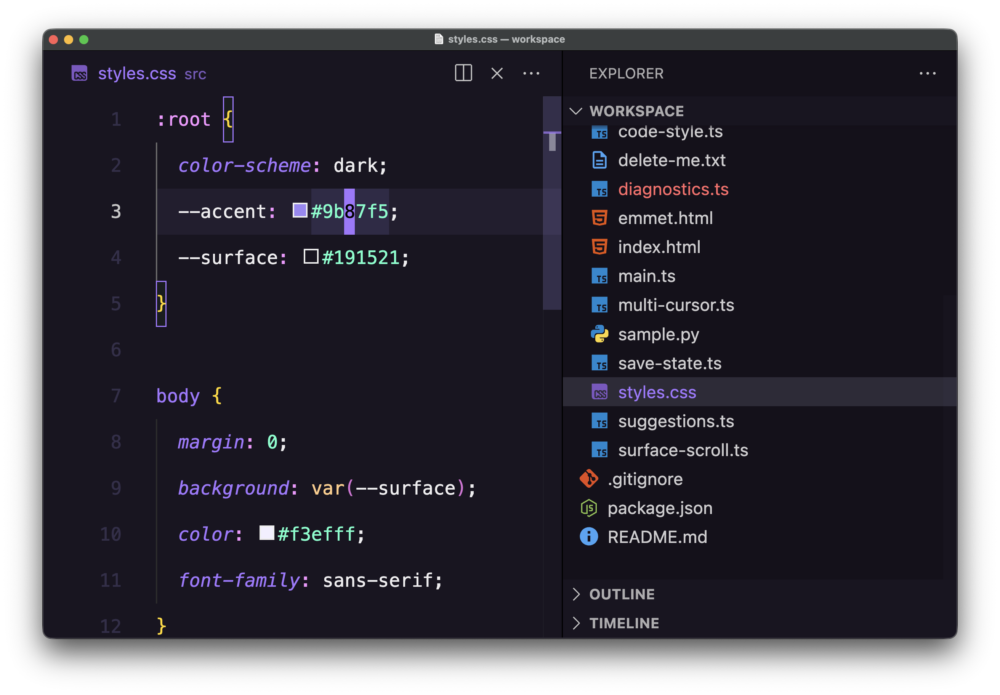
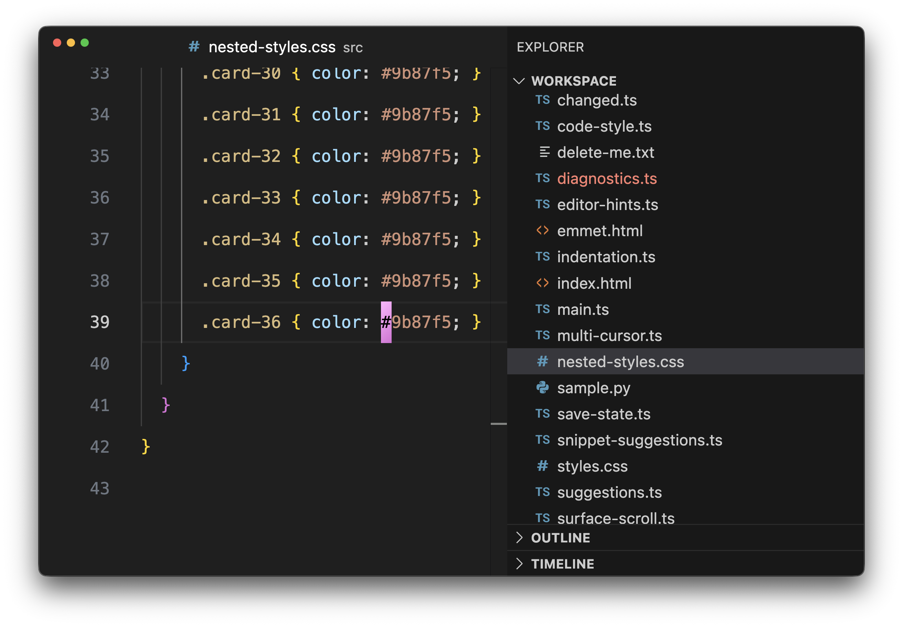
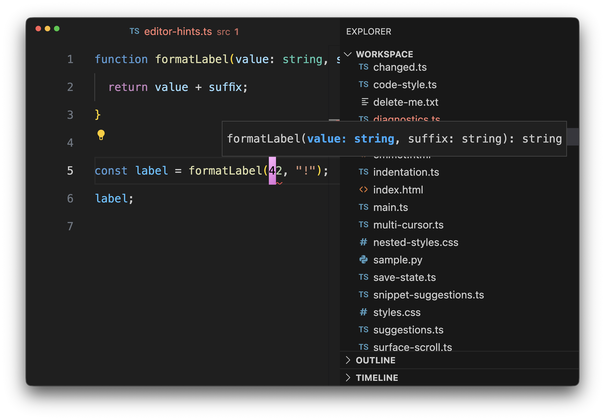
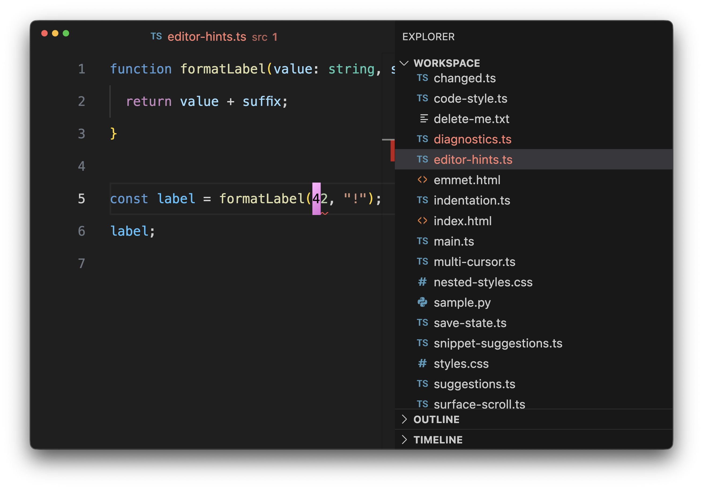
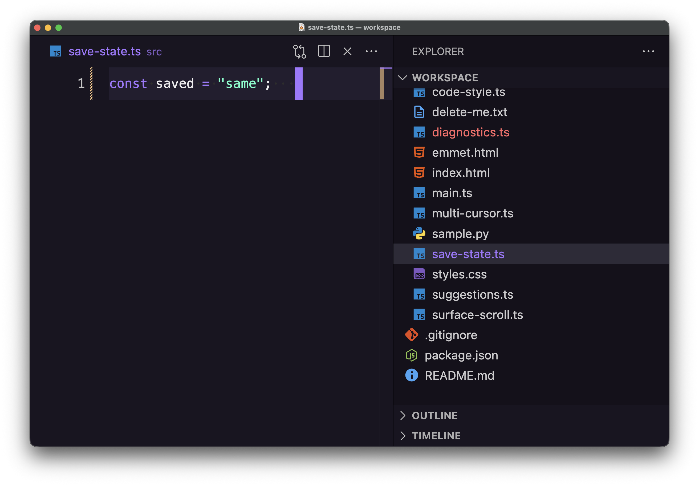
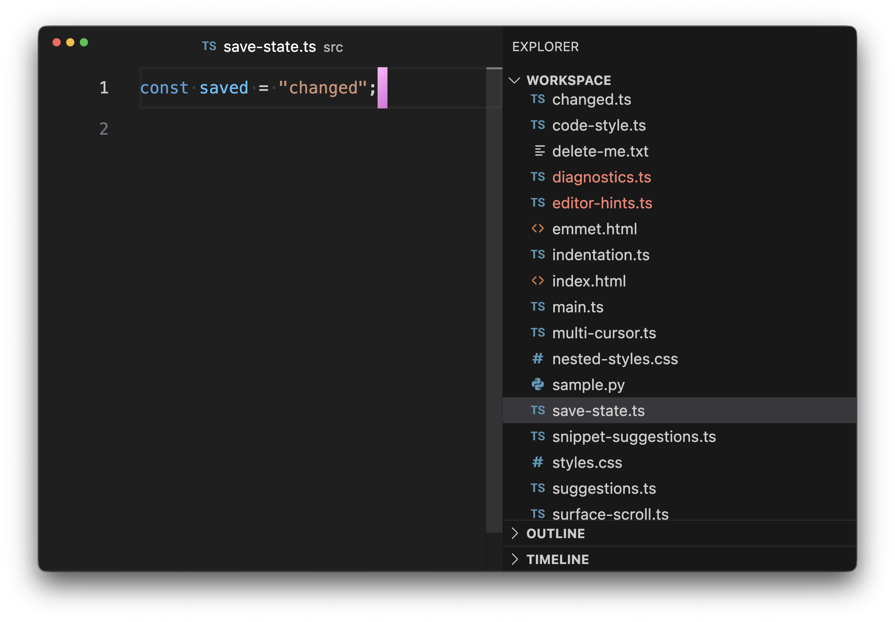
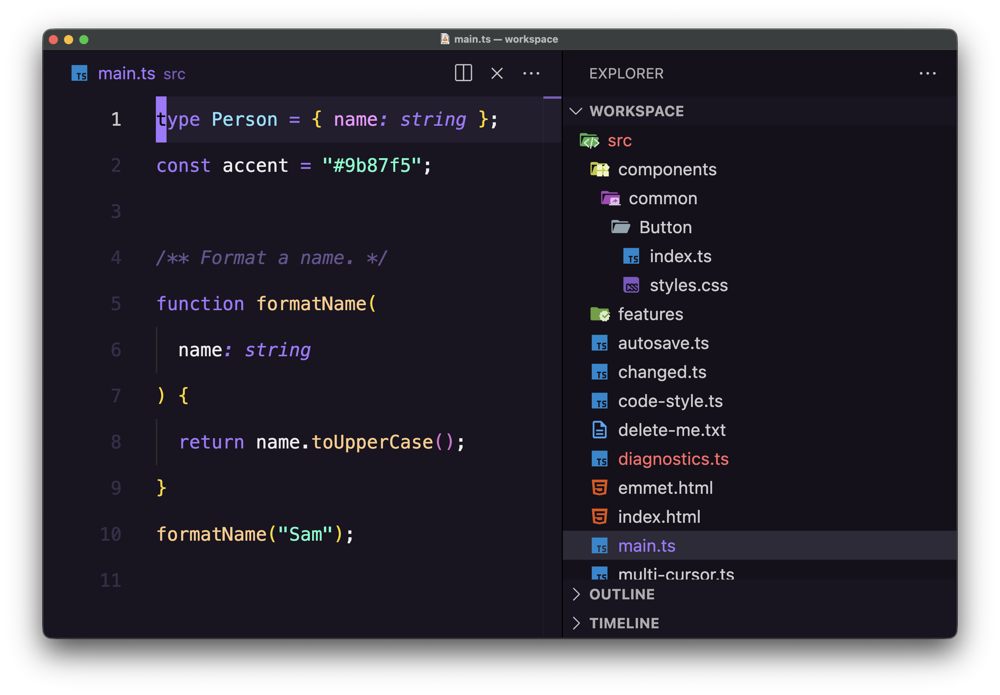

スティッキースクロールや CodeLens、ホバーポップアップなどの補助的な装飾やヒントを無効化し、エディタ画面の視覚的ノイズを削ぎ落とします。あわせて保存時の末尾空白削除と、ファイル末尾が改行で終わる自動調整を設定します。対応する動画のチャプターは [Decorations and hints (20:53)](https://www.youtube.com/watch?v=VmFOsK7IhI4&t=1253s) です。

## 設定（settings.json）

```json
{
  "editor.stickyScroll.enabled": false,
  "editor.colorDecorators": false,
  "editor.codeLens": false,
  "editor.links": false,
  "editor.matchBrackets": "never",
  "editor.parameterHints.enabled": false,
  "editor.lightbulb.enabled": "off",
  "editor.hover.enabled": false,
  "files.trimTrailingWhitespace": true,
  "files.insertFinalNewline": true,
  "scm.diffDecorations": "none"
}
```

## 解説

### コード装飾とコンテキスト表示の無効化
スクロール時に関数宣言などを上部に固定表示するスティッキースクロール（`editor.stickyScroll.enabled: false`、既定値 `true`）を無効化します。カラー値のプレビュー（`editor.colorDecorators: false`、既定値 `true`）を非表示にします。関数上部にアクションを表示する CodeLens（`editor.codeLens: false`、既定値 `true`）も非表示にします。また、エディタ内のリンク検出（`editor.links: false`、既定値 `true`）をオフにします。対応する括弧の強調ハイライト（`editor.matchBrackets: "never"`、既定値 `"always"`）もオフにして画面のノイズを減らします。

| Before | After |
| --- | --- |
|  |  |

設定前と比べて、設定後はスティッキースクロール見出しやカラープレビュー、対応する括弧の枠線などの装飾を非表示にしています。

### ヒント表示とポップアップの抑制
引数入力時に自動表示されるシグネチャヒント（`editor.parameterHints.enabled: false`、既定値 `true`）を非表示にします。コードアクション用の電球マーク（`editor.lightbulb.enabled: "off"`、既定値 `"onCode"`）を非表示にします。あわせて、マウスホバー時の説明ポップアップ（`editor.hover.enabled: false`、既定値 `true`）も非表示にします。パラメーター情報やコードアクションが必要な場合は、キーボードショートカットから手動で呼び出します。VS Code の既定のショートカットは、パラメーターヒントが macOS で `⌘⇧Space`、Windows や Linux で `Ctrl+Shift+Space` です。コードアクションは macOS で `⌘.`、Windows や Linux で `Ctrl+.` です。

| Before | After |
| --- | --- |
|  |  |

設定前と比べて、設定後は引数ヒントや電球マーク、マウスホバー時の情報ポップアップを非表示にしています。

### ファイル保存設定と Git 差分表示の整理
ファイル保存時に行末の不要な空白を自動削除する `files.trimTrailingWhitespace: true`（既定値 `false`）を設定します。あわせて保存時にファイル末尾が改行で終わるよう、`files.insertFinalNewline: true`（既定値 `false`）を設定します。これによりコーディング規約に沿った形で保存できます。また、エディタ左側のガター（行番号の横）に表示される Git 変更マークを `scm.diffDecorations: "none"`（既定値 `"all"`）で非表示にします。動画では Git の差分確認を GitHub Desktop などの外部ツールで行うため、エディタ内の差分表示を不要としています。

| Before | After |
| --- | --- |
|  |  |

設定前と比べて、設定後はガターの Git 変更差分マーカーが消え、末尾の空白や改行を保存時に自動で整えています。

## 設定項目の一覧

| 設定 | 既定値 | 説明 |
| --- | --- | --- |
| `editor.stickyScroll.enabled` | `true` | スクロール時に関数やクラスなどのコンテキストを画面上部に固定する機能を制御します。`false` で無効化します。 |
| `editor.colorDecorators` | `true` | カラーコードの横に色プレビューを表示する機能を制御します。`false` で非表示にします。 |
| `editor.codeLens` | `true` | コード上部に表示される CodeLens 注釈やアクションの表示を制御します。`false` で非表示にします。 |
| `editor.links` | `true` | エディタ内のテキストからクリック可能な URL リンクを検出する機能を制御します。`false` で無効化します。 |
| `editor.matchBrackets` | `"always"` | カーソル位置に対応する括弧の強調表示を制御します。`never` で無効化します。 |
| `editor.parameterHints.enabled` | `true` | 関数などの引数入力時にシグネチャヒントを自動表示する機能を制御します。`false` で非表示にします。 |
| `editor.lightbulb.enabled` | `"onCode"` | リファクタリングなどのコードアクションを示す電球マークを制御します。`off` で非表示にします。 |
| `editor.hover.enabled` | `true` | マウスホバー時の型情報や説明ポップアップを制御します。`false` で非表示にします。 |
| `files.trimTrailingWhitespace` | `false` | ファイル保存時に行末の余分な空白文字を自動削除します。`true` で有効化します。 |
| `files.insertFinalNewline` | `false` | ファイル保存時にファイル末尾が改行で終わるよう自動調整します。`true` で有効化します。 |
| `scm.diffDecorations` | `"all"` | ガター（行番号横）に表示される Git の変更・追加・削除マーカーを制御します。`none` で非表示にします。 |

## 注意点

ホバーやパラメーターヒント、電球マークを無効化すると、マウス操作で型定義やリファクタリング候補を確認できなくなります。必要な場合は、上記のショートカットキーから手動で呼び出す必要があります。

ガターの Git 差分マーカー（`scm.diffDecorations`）を非表示にすると、エディタ内でどの行を変更したかが視覚的に分からなくなります。Git の変更状況はソース管理ビューや外部の Git クライアントツールなどで確認する必要があります。

## 本章完了時の状態

本章の設定をすべて適用すると、エディタは以下の状態になります。



## 追加する拡張機能

本章のコミット（`.vscode/extensions.json`）での新規追加はありません。

## 変更コミット

- [`975173a`](https://github.com/igorbabko/vscode-setup/commit/975173a0f7ddf904e5d250f41dac713f8774dab4)
