スティッキースクロールや CodeLens、ホバーポップアップなどの補助的な装飾やヒントを無効化し、エディタ画面の視覚的ノイズを削ぎ落とします。あわせて保存時の末尾空白削除と、ファイル末尾が改行で終わる自動調整を設定します。対応する動画のチャプターは [Decorations and hints (20:53)](https://www.youtube.com/watch?v=VmFOsK7IhI4&t=1253s) です。

https://www.youtube.com/watch?v=VmFOsK7IhI4&t=1253s

## 設定（settings.json）

```json
{
  "editor.stickyScroll.enabled": false,
  "editor.colorDecorators": false,
  "editor.codeLens": false,
  "editor.links": false,
  "editor.matchBrackets": "never",
  "editor.parameterHints.enabled": false,
  "editor.lightbulb.enabled": "off",
  "editor.hover.enabled": false,
  "files.trimTrailingWhitespace": true,
  "files.insertFinalNewline": true,
  "scm.diffDecorations": "none"
}
```

## 解説

### コード装飾とコンテキスト表示の無効化
画面のノイズを減らすため、コード周辺の補助的な装飾やコンテキスト表示を無効化します。

| 設定 | 値 | 既定値 | 効果 |
| --- | --- | --- | --- |
| `editor.stickyScroll.enabled` | `false` | `true` | スクロール時に関数宣言などを上部に固定表示するスティッキースクロールを無効化する |
| `editor.colorDecorators` | `false` | `true` | カラー値のプレビューを非表示にする |
| `editor.codeLens` | `false` | `true` | 関数上部にアクションを表示する CodeLens を非表示にする |
| `editor.links` | `false` | `true` | エディタ内のリンク検出をオフにする |
| `editor.matchBrackets` | `"never"` | `"always"` | 対応する括弧の強調ハイライトをオフにする |

| Before | After |
| --- | --- |
| 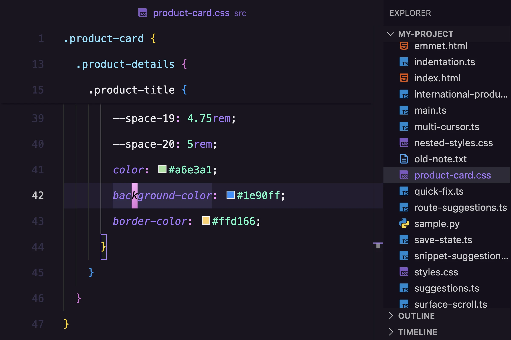 | 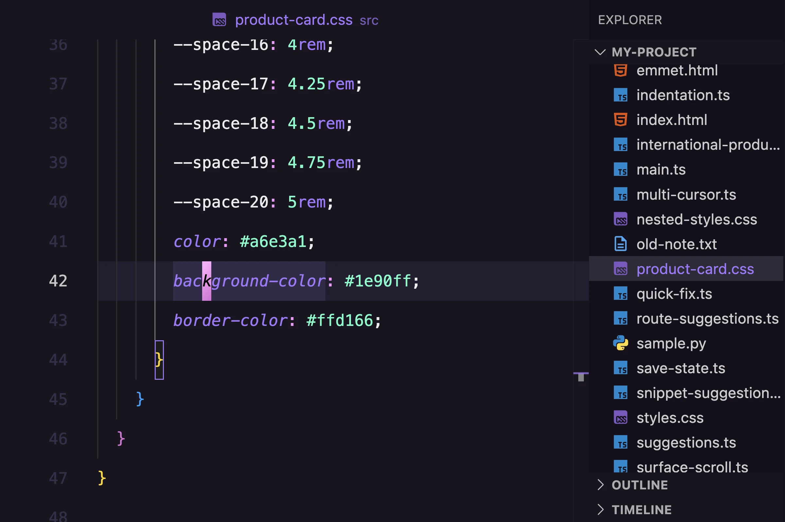 |

左では上部に固定された CSS の親階層とカラープレビューが見えていますが、右ではどちらも非表示になります。

| Before | After |
| --- | --- |
| 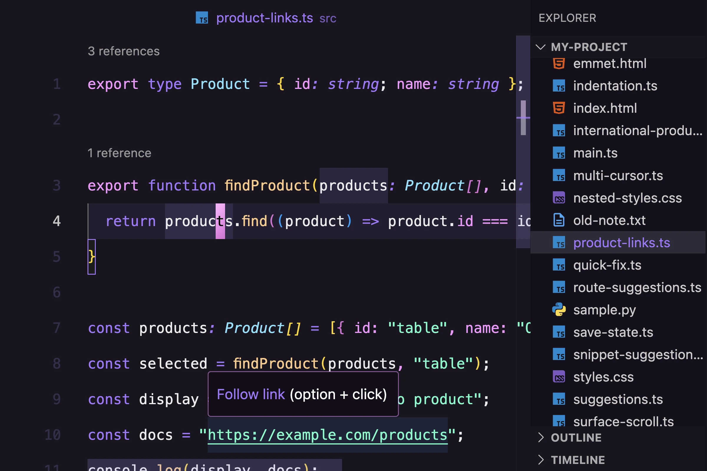 | 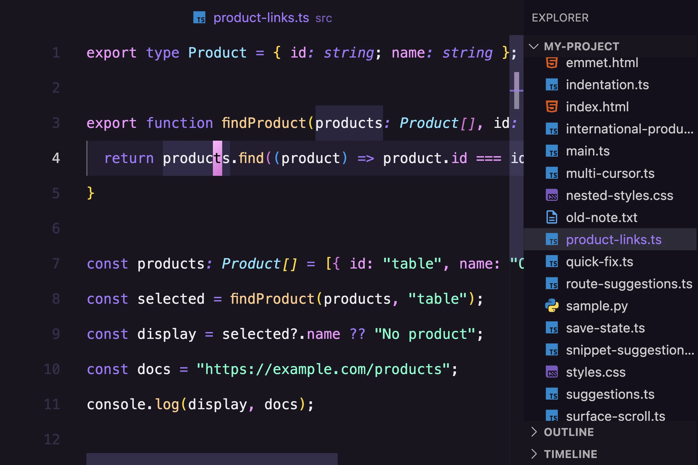 |

スティッキースクロールとカラープレビューをすでにオフにした状態で、左に出ていた参照数の CodeLens、リンクのホバー表示、対応括弧の強調が、右では 3 つとも消えます。

### ヒント表示とポップアップの抑制
入力中やマウス操作時に自動で開くヒントやポップアップを非表示にします。

| 設定 | 値 | 既定値 | 効果 |
| --- | --- | --- | --- |
| `editor.parameterHints.enabled` | `false` | `true` | 引数入力時に自動表示されるシグネチャヒントを非表示にする |
| `editor.lightbulb.enabled` | `"off"` | `"onCode"` | コードアクション用の電球マークを非表示にする |
| `editor.hover.enabled` | `false` | `true` | マウスホバー時の説明ポップアップを非表示にする |

パラメーター情報やコードアクションが必要な場合は、キーボードショートカットから手動で呼び出します。VS Code の既定のショートカットは、パラメーターヒントが macOS で `⌘⇧Space`、Windows や Linux で `Ctrl+Shift+Space` です。コードアクションは macOS で `⌘.`、Windows や Linux で `Ctrl+.` です。

| Before | After |
| --- | --- |
| 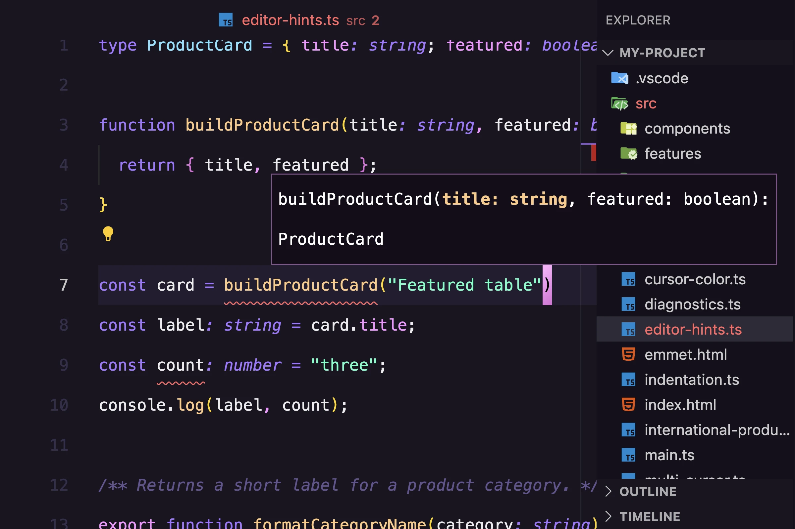 | 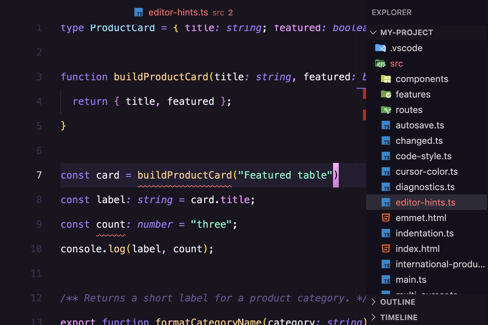 |

左では自動表示のシグネチャヒントと電球マークが出ていますが、右ではどちらも非表示になります。

| Before | After |
| --- | --- |
| 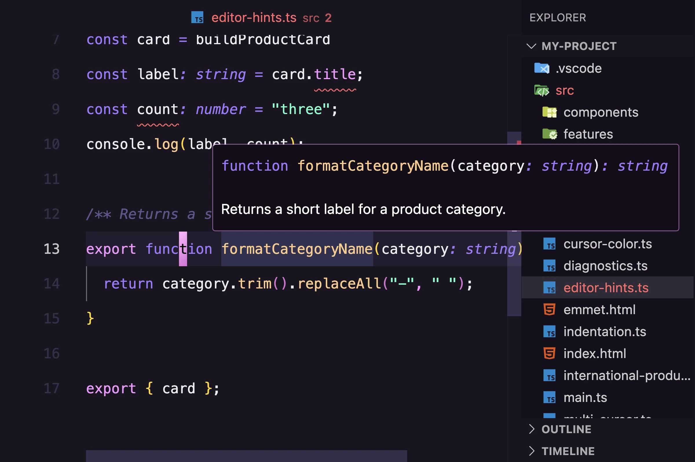 | 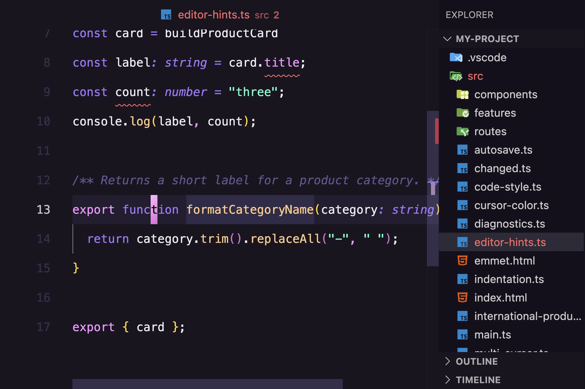 |

前の設定をオフのまま揃えた状態で、左ではホバー時に説明ポップアップが開きますが、右では開かずに閉じたままで維持されます。

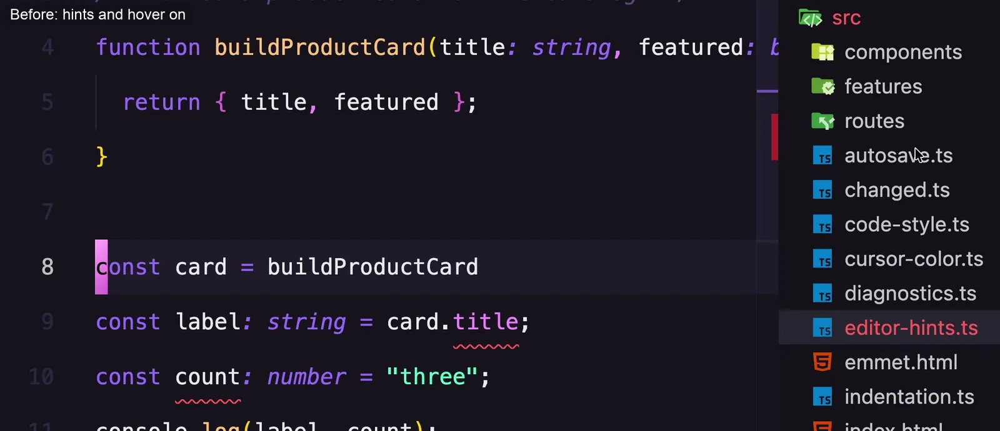

設定前ではシグネチャヒントとホバー説明ポップアップが順に表示されますが、設定後ではどちらも表示されません。

### ファイル保存設定と Git 差分表示の整理
コーディング規約に沿った保存動作を整え、エディタ内の Git 差分表示を非表示にします。

| 設定 | 値 | 既定値 | 効果 |
| --- | --- | --- | --- |
| `files.trimTrailingWhitespace` | `true` | `false` | ファイル保存時に行末の不要な空白を自動削除する |
| `files.insertFinalNewline` | `true` | `false` | 保存時にファイル末尾が改行で終わるよう自動調整する |
| `scm.diffDecorations` | `"none"` | `"all"` | エディタ左側のガター（行番号の横）に表示される Git 変更マークを非表示にする |

動画では Git の差分確認を GitHub Desktop などの外部ツールで行うため、エディタ内の差分表示を不要としています。

| Before | After |
| --- | --- |
| 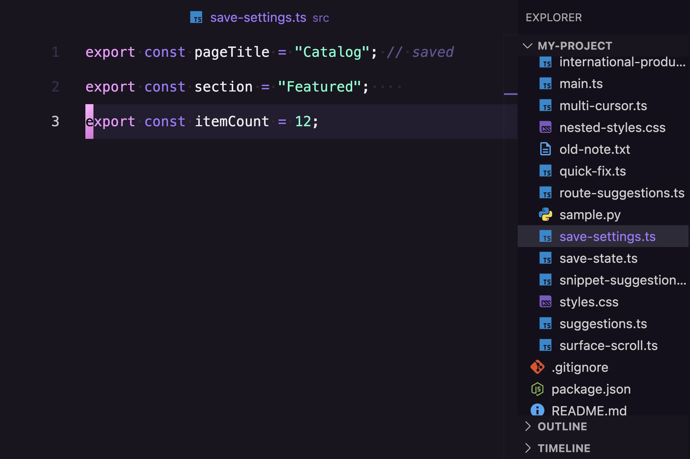 | 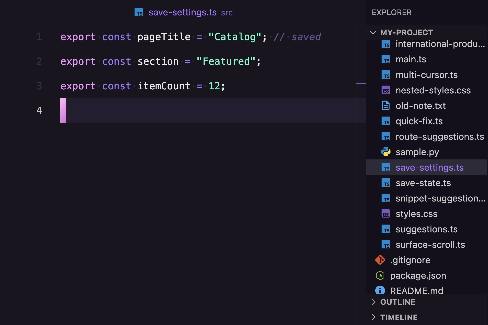 |

保存後の状態を比べると、左に残っていた行末の空白が右では削除され、ファイル末尾に改行が追加されます。

| Before | After |
| --- | --- |
|  | 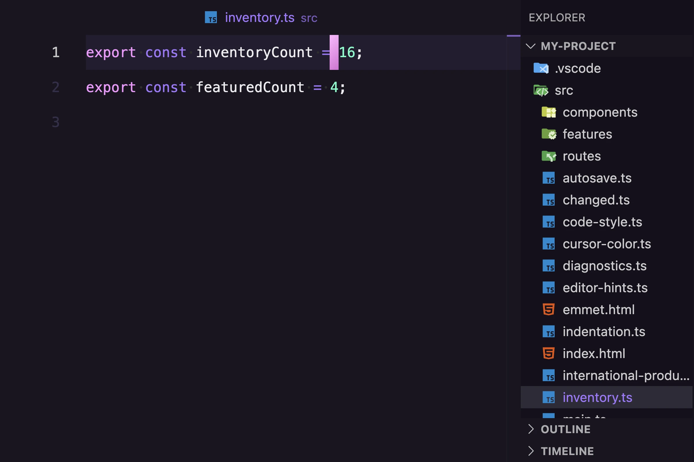 |

空白・改行の設定を引き継いだまま、左でガターと概要ルーラーに表示されていた Git の変更マーカーが、右ではどちらも消えます。

## 設定項目の一覧

| 設定 | 既定値 | 説明 |
| --- | --- | --- |
| `editor.stickyScroll.enabled` | `true` | スクロール時に関数やクラスなどのコンテキストを画面上部に固定する機能を制御します。`false` で無効化します。 |
| `editor.colorDecorators` | `true` | カラーコードの横に色プレビューを表示する機能を制御します。`false` で非表示にします。 |
| `editor.codeLens` | `true` | コード上部に表示される CodeLens 注釈やアクションの表示を制御します。`false` で非表示にします。 |
| `editor.links` | `true` | エディタ内のテキストからクリック可能な URL リンクを検出する機能を制御します。`false` で無効化します。 |
| `editor.matchBrackets` | `"always"` | カーソル位置に対応する括弧の強調表示を制御します。`never` で無効化します。 |
| `editor.parameterHints.enabled` | `true` | 関数などの引数入力時にシグネチャヒントを自動表示する機能を制御します。`false` で非表示にします。 |
| `editor.lightbulb.enabled` | `"onCode"` | リファクタリングなどのコードアクションを示す電球マークを制御します。`off` で非表示にします。 |
| `editor.hover.enabled` | `true` | マウスホバー時の型情報や説明ポップアップを制御します。`false` で非表示にします。 |
| `files.trimTrailingWhitespace` | `false` | ファイル保存時に行末の余分な空白文字を自動削除します。`true` で有効化します。 |
| `files.insertFinalNewline` | `false` | ファイル保存時にファイル末尾が改行で終わるよう自動調整します。`true` で有効化します。 |
| `scm.diffDecorations` | `"all"` | ガター（行番号横）に表示される Git の変更・追加・削除マーカーを制御します。`none` で非表示にします。 |

## 注意点

ホバーやパラメーターヒント、電球マークを無効化すると、マウス操作で型定義やリファクタリング候補を確認できなくなります。必要な場合は、上記のショートカットキーから手動で呼び出す必要があります。

ガターの Git 差分マーカー（`scm.diffDecorations`）を非表示にすると、エディタ内でどの行を変更したかが視覚的に分からなくなります。Git の変更状況はソース管理ビューや外部の Git クライアントツールなどで確認する必要があります。

## 追加する拡張機能

本章のコミット（`.vscode/extensions.json`）での新規追加はありません。

## 変更コミット

- [`975173a`](https://github.com/igorbabko/vscode-setup/commit/975173a0f7ddf904e5d250f41dac713f8774dab4)
