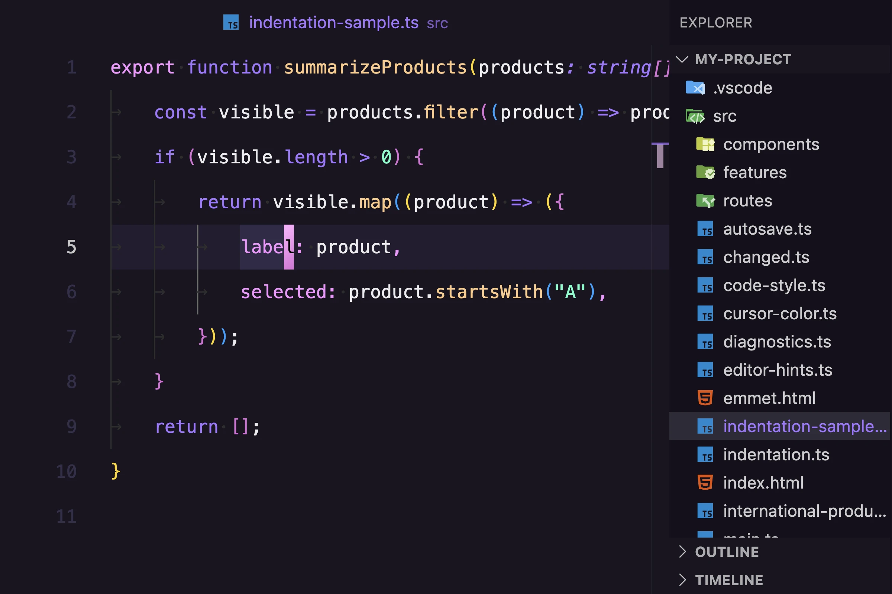
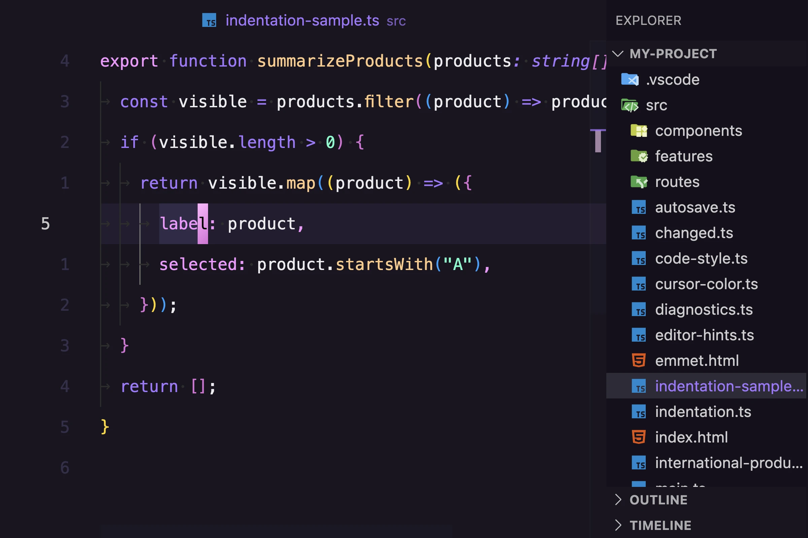
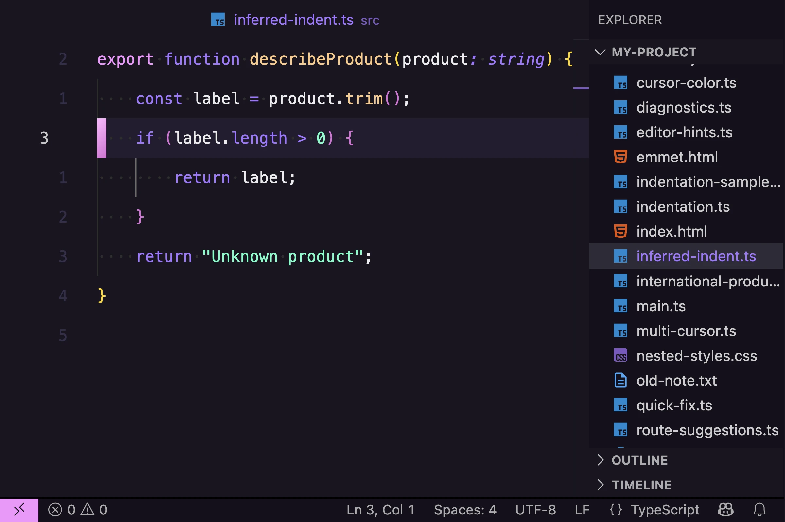
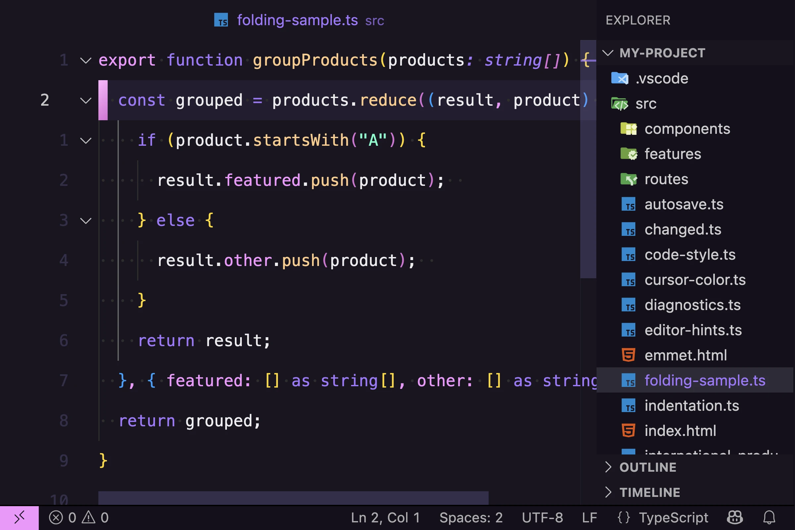
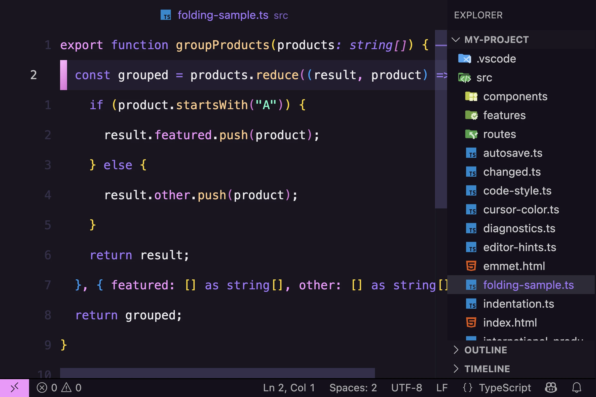
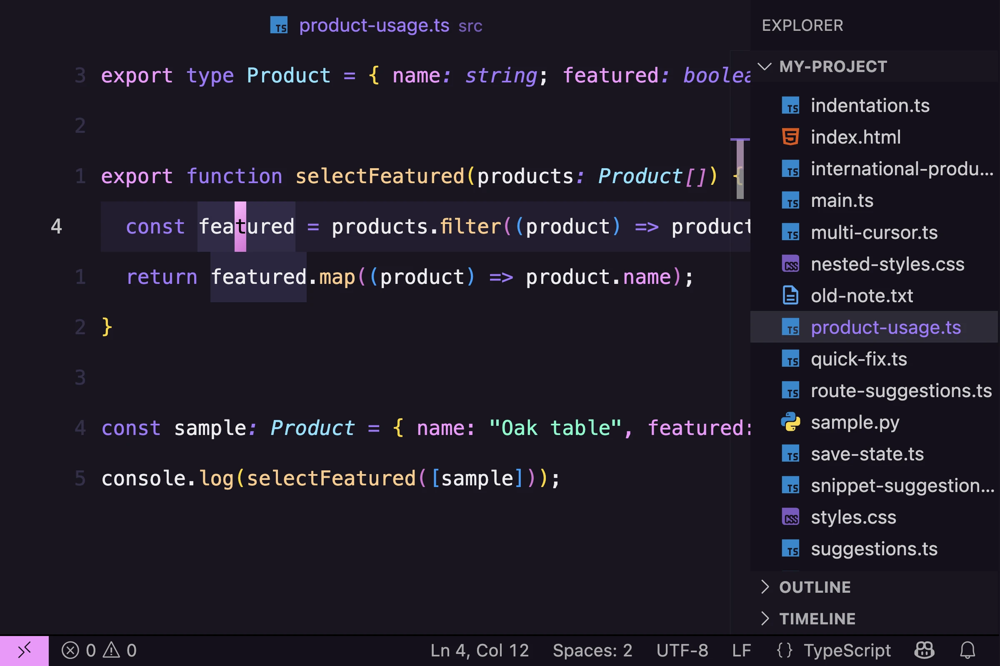
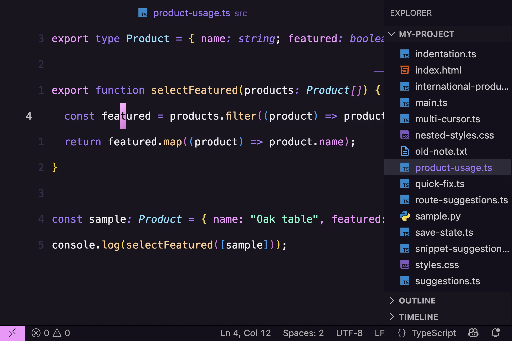
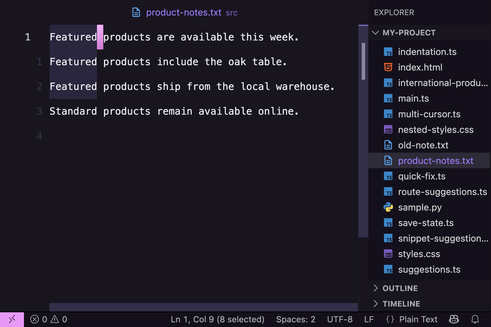
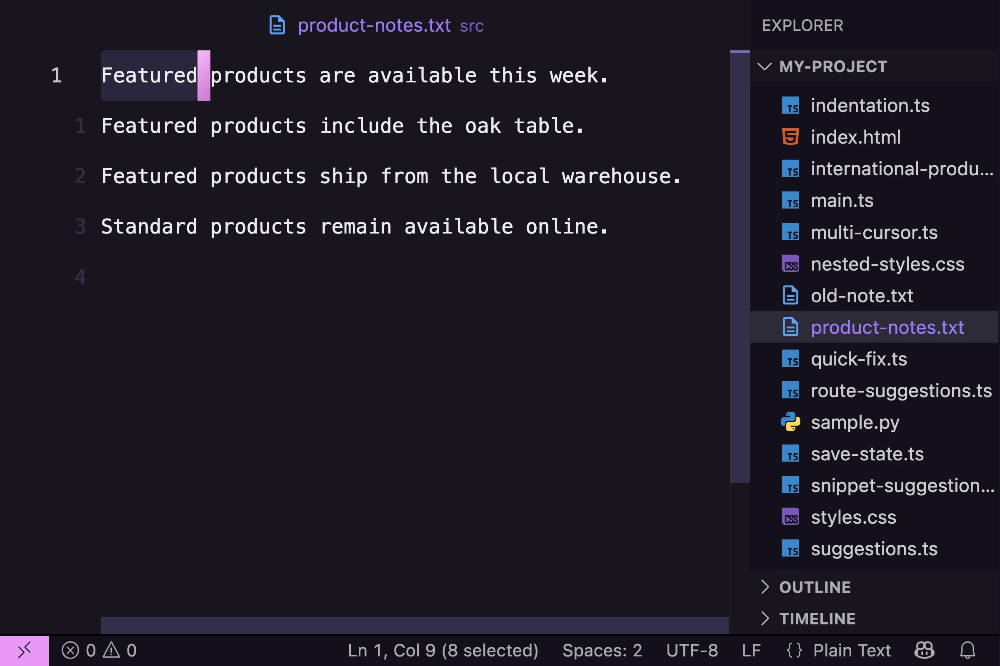

行番号を現在行からの相対表示に変更し、インデントガイドや空白文字、現在行や選択箇所のハイライトを無効化します。Vim などのキーバインドでの移動効率を高めつつ、画面上の不要な描画ラインを最小限に抑えます。対応する動画のチャプターは [Guides and highlights (26:05)](https://www.youtube.com/watch?v=VmFOsK7IhI4&t=1565s) です。

https://www.youtube.com/watch?v=VmFOsK7IhI4&t=1565s

## 設定（settings.json）

```json
{
  "editor.lineNumbers": "relative",
  "editor.tabSize": 2,
  "editor.detectIndentation": false,
  "editor.showFoldingControls": "never",
  "editor.guides.indentation": false,
  "editor.renderWhitespace": "none",
  "editor.renderLineHighlight": "none",
  "editor.occurrencesHighlight": "off",
  "editor.selectionHighlight": false
}
```

## 解説

### 相対行番号とインデント幅の統一
行番号を `editor.lineNumbers: "relative"`（既定値 `"on"`）に設定し、現在行からの行間距離を表示します。動画では Vim キーバインドにおける上下移動（方向と行数の指定）をスムーズに行うためにこの設定を採用しています。また、タブ幅をスペース 2 文字とする `editor.tabSize: 2`（既定値 `4`）を指定します。ファイルごとのインデント自動推測を `editor.detectIndentation: false`（既定値 `true`）で無効化し、設定したインデント幅を一律に適用します。

| Before | After |
| --- | --- |
|  |  |

左の絶対行番号が右では現在行からの相対行番号へ変わり、4 列幅だったタブ文字のインデントも 2 列幅へ狭まります。

| Before | After |
| --- | --- |
|  |  |

ファイル内容自体は変わらず、見た目上の変化は画面下部のステータスバーが左の `Spaces: 4` から右の `Spaces: 2` へ切り替わる点に表れます。

### ガイドラインとハイライトの排除
コード折りたたみ用の矢印コントロール（`editor.showFoldingControls: "never"`、既定値 `"mouseover"`）を常に非表示にします。コード折りたたみの操作は、キーボードショートカットで行います。VS Code の既定値は、折りたたみが macOS で `⌥⌘[`、Windows や Linux で `Ctrl+Shift+[` です。展開は macOS で `⌥⌘]`、Windows や Linux で `Ctrl+Shift+]` です。さらに、インデントの垂直ガイド線（`editor.guides.indentation: false`、既定値 `true`）を非表示にします。空白・タブの記号表示（`editor.renderWhitespace: "none"`、既定値 `"selection"`）を非表示にします。あわせて、現在行のハイライト（`editor.renderLineHighlight: "none"`、既定値 `"line"`）も非表示にします。加えて、シンボルの一致強調（`editor.occurrencesHighlight: "off"`、既定値 `"singleFile"`）をオフにします。選択文字列と一致する箇所の強調（`editor.selectionHighlight: false`、既定値 `true`）もオフにし、エディタ内のハイライト装飾を徹底して削ぎ落とします。

| Before | After |
| --- | --- |
|  |  |

ポインターをグリフマージン外の折りたたみコントロール列に置き、ブレークポイントのヒントがない状態で、左に見えていた折りたたみコントロール、インデントの垂直ガイド線、空白記号が、右ではすべて消えます。

| Before | After |
| --- | --- |
|  |  |

左では現在行の背景強調とシンボルの出現箇所ハイライトが表示されていますが、右ではどちらも消えます。

| Before | After |
| --- | --- |
|  |  |

左では選択したプレーンテキストと同じ文字列が複数箇所でハイライトされますが、右では現在選択している範囲だけが残ります。

## 設定項目の一覧

| 設定 | 既定値 | 説明 |
| --- | --- | --- |
| `editor.lineNumbers` | `"on"` | 行番号の表示方法を選択します。`relative` で現在の行からの相対距離を表示します。 |
| `editor.tabSize` | `4` | 1 つのタブ文字またはインデントレベルが表すスペースの数を設定します。 |
| `editor.detectIndentation` | `true` | ファイルを開いた際にインデント幅を自動検出するかを制御します。`false` で設定値を一律適用します。 |
| `editor.showFoldingControls` | `"mouseover"` | ガターのコード折りたたみ矢印の表示を制御します。`never` で常に非表示にします。 |
| `editor.guides.indentation` | `true` | インデントの垂直ガイド線の表示を制御します。`false` で非表示にします。 |
| `editor.renderWhitespace` | `"selection"` | 空白文字（スペースやタブ）の記号描画を制御します。`none` で非表示にします。 |
| `editor.renderLineHighlight` | `"line"` | カーソルが存在する現在行の強調表示を制御します。`none` で非表示にします。 |
| `editor.occurrencesHighlight` | `"singleFile"` | カーソルが当たっているシンボルの出現箇所のハイライトを制御します。`off` で非表示にします。 |
| `editor.selectionHighlight` | `true` | 選択中のテキストと一致する他箇所のハイライトを制御します。`false` で非表示にします。 |

## 注意点

インデントガイドや空白文字の描画を無効化すると、ネストの深さやインデントズレを視覚的に追いにくくなる場合があります。

選択文字列やシンボルのハイライトをオフにすると、同じ変数や単語がファイル内のどこで使われているかを一目で把握できなくなります。

折りたたみコントロールを非表示にした場合、コードの折りたたみや展開は上記のキーボードショートカットから実行します。

## 追加する拡張機能

本章のコミット（`.vscode/extensions.json`）での新規追加はありません。

## 変更コミット

- [`3b3f7d1`](https://github.com/igorbabko/vscode-setup/commit/3b3f7d1bce333ca80d41b0ca4193b9bd0eeb233f)
