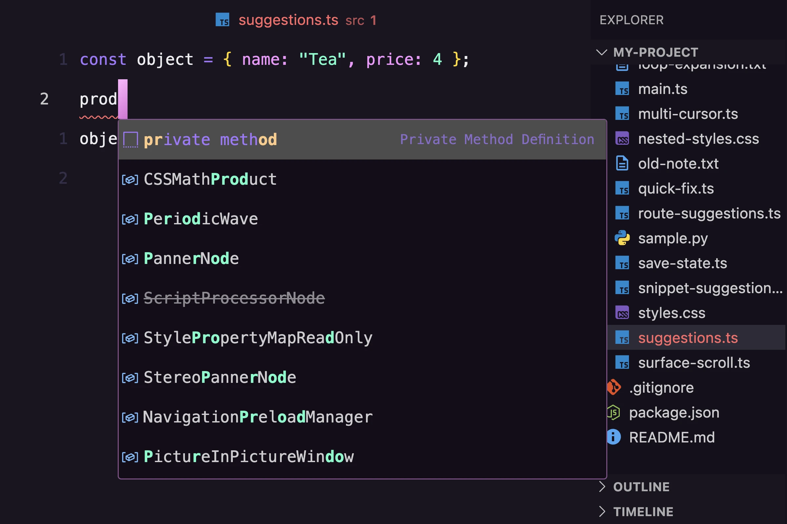
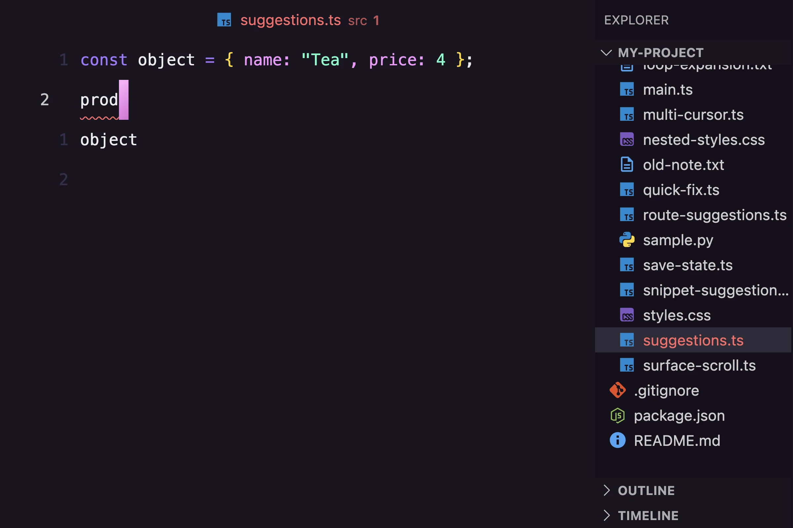
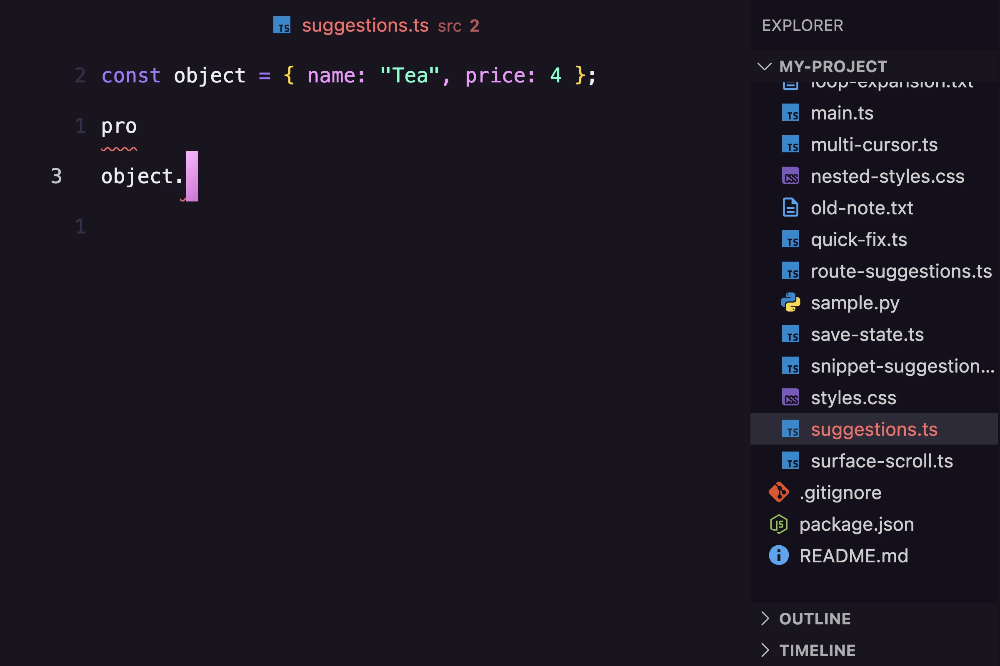
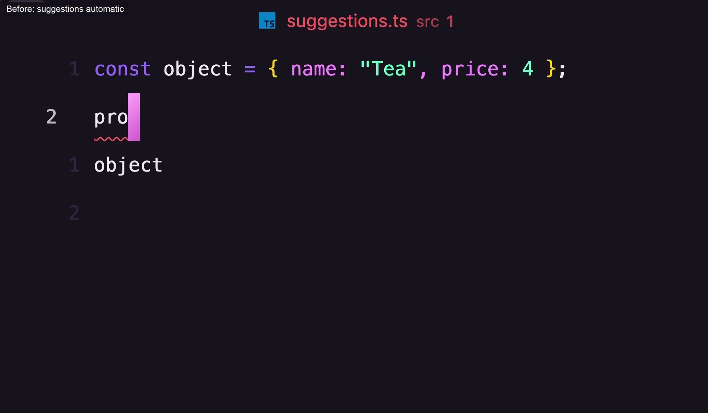
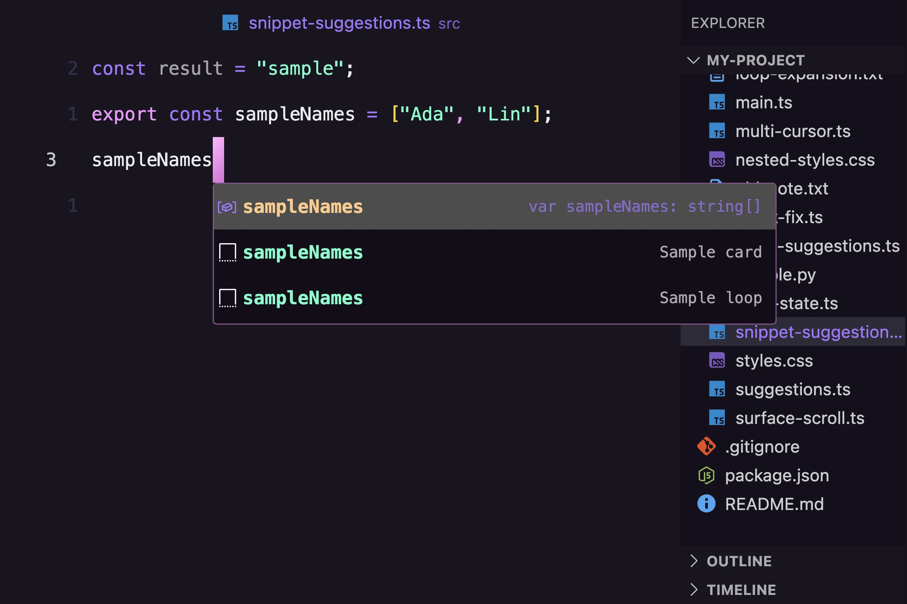
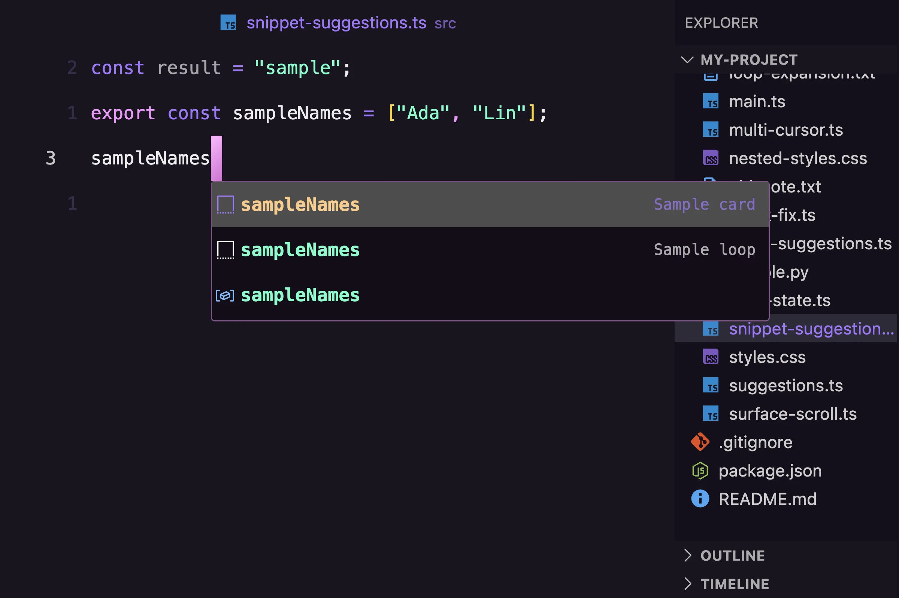
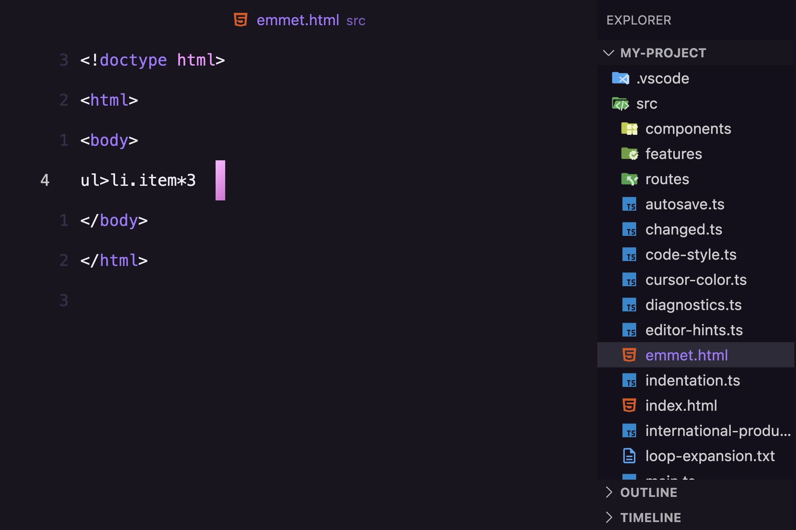
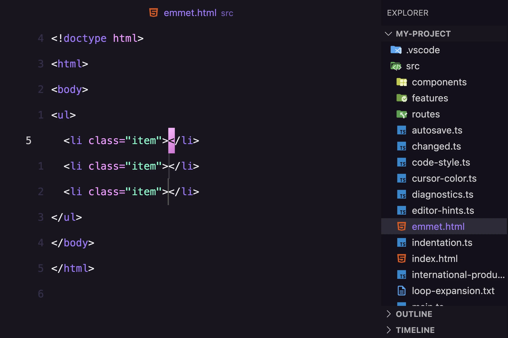
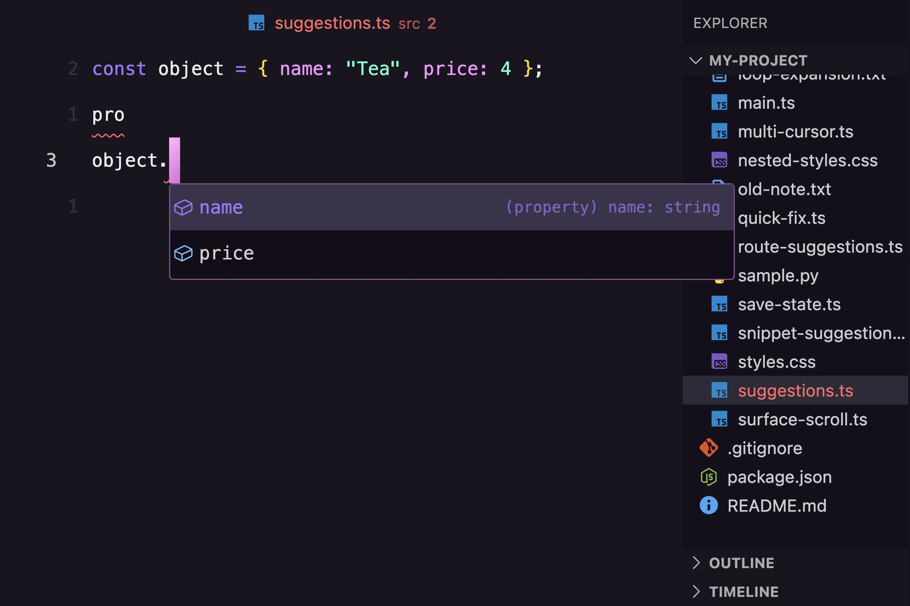

自動補完ポップアップの自動表示を抑制し、Tab キーによる補完確定やスニペットの優先表示、Emmet 展開を設定します。補完候補の過剰な割り込みを防ぎ、必要なタイミングで確実に補完を利用できるようにします。対応する動画のチャプターは [Code completions (33:11)](https://www.youtube.com/watch?v=VmFOsK7IhI4&t=1991s) です。

https://www.youtube.com/watch?v=VmFOsK7IhI4&t=1991s

## 設定（settings.json）

```json
{
  "workbench.colorCustomizations": {
    "[Aura Dracula Spirit (Soft)]": {
      "editorSuggestWidget.selectedBackground": "#3A334B"
    }
  },
  "editor.quickSuggestions": {
    "other": "off"
  },
  "editor.suggestOnTriggerCharacters": false,
  "editor.tabCompletion": "on",
  "editor.snippetSuggestions": "top",
  "emmet.triggerExpansionOnTab": true
}
```

## 解説

### 自動提案の抑制と手動呼び出し
コード入力中に補完リストが自動で頻繁に開くのを防ぎます。通常テキスト入力時のクイック提案を `editor.quickSuggestions.other: "off"`（既定値 `"on"`）で無効化します（コメントや文字列の既定値 `"off"` はそのまま維持されます）。また、`.` などのトリガー文字を入力した際の自動提案も `editor.suggestOnTriggerCharacters: false`（既定値 `true`）でオフにします。動画では、自動表示を使わず必要なときだけショートカットキーで手動表示します。手動呼び出しの既定ショートカットキーは、macOS で `⌃Space`、Windows や Linux で `Ctrl+Space` です。

| Before | After |
| --- | --- |
|  |  |

左では通常のプレフィックス入力だけで補完リストが自動で開きますが、右では開きません。`Ctrl+Space` による手動の補完呼び出しは引き続き使えます。

| Before | After |
| --- | --- |
|  |  |

通常の自動提案をオフにした状態で、左では `object.` の入力に反応してメンバー一覧が開きますが、右ではトリガー文字でも一覧が開きません。



自動提案が有効な設定前と、自動提案をオフにして `Ctrl+Space` で手動補完一覧を呼び出す設定後の挙動を比較しています。

### Tab 補完・スニペット・Emmet 展開
提案リストを開かずに Tab キーを押すだけで一致する補完を確定できるよう `editor.tabCompletion: "on"`（既定値 `"off"`）を有効にします。

| Before | After |
| --- | --- |
|  |  |

左ではプレフィックス `eachitem` がそのまま残りますが、Tab 補完を有効にした右ではループ本体へ展開されます。

また、提案リスト内でスニペットを常に最上位に表示する `editor.snippetSuggestions: "top"`（既定値 `"inline"`）を設定し、よく使うコード片を優先的に選べるようにします。

| Before | After |
| --- | --- |
|  |  |

同じ通常候補と 2 つのスニペットを比べると、左のインライン順から右の最上位表示へ並び順が変わります。

さらに、HTML 等の略称を Tab キーで展開できるよう `emmet.triggerExpansionOnTab: true`（既定値 `false`）を有効化します。

| Before | After |
| --- | --- |
|  |  |

Emmet の効果だけを切り分けるため左右とも Tab 補完をオフにしています。左では `ul>li.item*3` がそのまま残りますが、右では 3 つのリスト項目へ展開されます。

### 選択中補完アイテムの配色
提案リストで現在選択されている項目の背景色を紫色（`#3A334B`）に変更します。`workbench.colorCustomizations` にテーマ名 `[Aura Dracula Spirit (Soft)]` のブロックを定義し、特定テーマに限定して適用します。この設定も、第 05 章や第 09 章で追加した `workbench.colorCustomizations` の中へ併記して記述します。

| Before | After |
| --- | --- |
|  |  |

選択中の `name` 候補の背景色が、左のテーマ既定の灰色から右の紫色へ切り替わります。

## 設定項目の一覧

| 設定 | 既定値 | 説明 |
| --- | --- | --- |
| `workbench.colorCustomizations["[Aura Dracula Spirit (Soft)]"].editorSuggestWidget.selectedBackground` | テーマ依存 | 対象カラーテーマにおける補完候補ポップアップの選択中項目の背景色を設定します。 |
| `editor.quickSuggestions.other` | `"on"` | 通常テキスト入力中の自動補完ポップアップ表示を制御します。`off` でトリガーを無効化します。 |
| `editor.suggestOnTriggerCharacters` | `true` | `.` などのトリガー文字入力時の自動提案表示を制御します。`false` で無効化します。 |
| `editor.tabCompletion` | `"off"` | Tab キーによる一致補完の挿入を制御します。`on` で有効化します。 |
| `editor.snippetSuggestions` | `"inline"` | 提案リスト内でのスニペットの表示位置を制御します。`top` で最上位に配置します。 |
| `emmet.triggerExpansionOnTab` | `false` | Tab キー押下時の Emmet 略称展開を有効化します。 |

## 注意点

自動補完ポップアップを抑制すると、文字入力中に自動で候補一覧が開かなくなります。候補一覧を表示して選択したい場合は、補完呼び出しショートカット（macOS の既定値は `⌃Space`、Windows / Linux は `Ctrl+Space`）を手動で押す必要があります。

## 追加する拡張機能

本章のコミット（`.vscode/extensions.json`）での新規追加はありません。

## 変更コミット

- [`40f6488`](https://github.com/igorbabko/vscode-setup/commit/40f648854e63745a60078d73cd741509ad854bdf)
