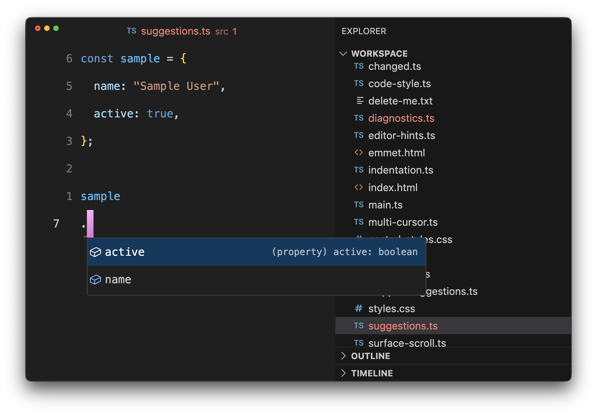
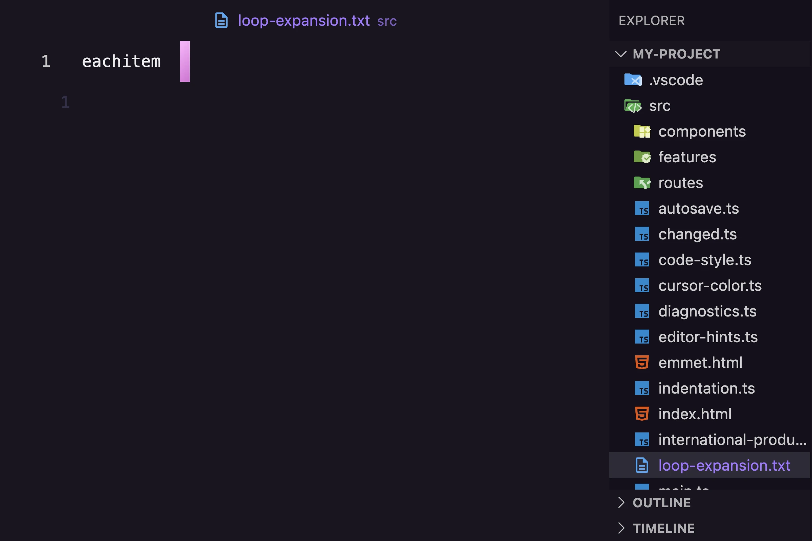
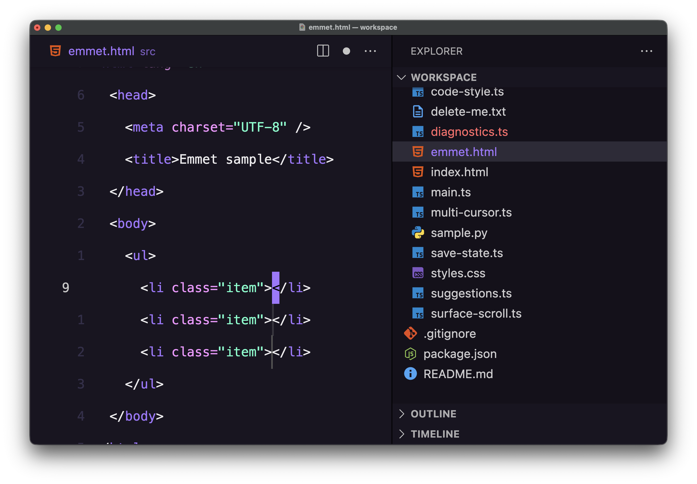

自動補完ポップアップの自動表示を抑制し、Tab キーによる補完確定やスニペットの優先表示、Emmet 展開を設定します。補完候補の過剰な割り込みを防ぎ、必要なタイミングで確実に補完を利用できるようにします。対応する動画のチャプターは [Code completions (33:11)](https://www.youtube.com/watch?v=VmFOsK7IhI4&t=1991s) です。

## 設定（settings.json）

```json
{
  "workbench.colorCustomizations": {
    "[Aura Dracula Spirit (Soft)]": {
      "editorSuggestWidget.selectedBackground": "#3A334B"
    }
  },
  "editor.quickSuggestions": {
    "other": "off"
  },
  "editor.suggestOnTriggerCharacters": false,
  "editor.tabCompletion": "on",
  "editor.snippetSuggestions": "top",
  "emmet.triggerExpansionOnTab": true
}
```

## 解説

### 自動提案の抑制と手動呼び出し
コード入力中に自動で補完候補が頻繁に表示されるのを防ぎます。通常テキスト入力時のクイック提案を `editor.quickSuggestions.other: "off"`（既定値 `"on"`）で無効化します（コメントや文字列の既定値 `"off"` はそのまま維持されます）。また、`.` などのトリガー文字を入力した際の自動提案表示も `editor.suggestOnTriggerCharacters: false`（既定値 `true`）でオフにします。動画では、補完リストは自動表示させず、必要なときのみショートカットキーで手動表示させる方針をとっています。補完候補を手動で呼び出すショートカットキーの既定値は、macOS で `⌃Space`、Windows や Linux で `Ctrl+Space` です。

| Before | After |
| --- | --- |
|  |  |

設定前と比べて、設定後は文字入力時の補完ポップアップが自動表示されず、手動呼び出しのみに抑制されています。

### Tab 補完・スニペット・Emmet 展開
提案リストを開かずに Tab キーを押すだけで一致する補完を確定できるよう `editor.tabCompletion: "on"`（既定値 `"off"`）を有効にします。また、提案リスト内でスニペットを常に最上位に表示する `editor.snippetSuggestions: "top"`（既定値 `"inline"`）を設定し、よく使うコード片を優先的に選べるようにします。さらに、HTML 等の略称を Tab キーで展開できるよう `emmet.triggerExpansionOnTab: true`（既定値 `false`）を有効化します。

| Before | After |
| --- | --- |
|  |  |

設定前と比べて、設定後は補完リストの最上位にスニペットを配置し、Tab キー操作で確定や展開が実行できます。

### 選択中補完アイテムの配色
提案リストで現在選択されている項目の背景色を紫色（`#3A334B`）に変更します。`workbench.colorCustomizations` にテーマ名 `[Aura Dracula Spirit (Soft)]` のブロックを定義し、特定テーマに限定して適用します。この設定も、第 05 章や第 09 章で追加した `workbench.colorCustomizations` の中へ併記して記述します。指定した背景色（#3A334B）は Aura テーマ標準の補完選択色とほぼ同一であり、画像上の変化を確認できないため比較画像から除外しています。

## 設定項目の一覧

| 設定 | 既定値 | 説明 |
| --- | --- | --- |
| `workbench.colorCustomizations["[Aura Dracula Spirit (Soft)]"].editorSuggestWidget.selectedBackground` | テーマ依存 | 対象カラーテーマにおける補完候補ポップアップの選択中項目の背景色を設定します。 |
| `editor.quickSuggestions.other` | `"on"` | 通常テキスト入力中の自動補完ポップアップ表示を制御します。`off` でトリガーを無効化します。 |
| `editor.suggestOnTriggerCharacters` | `true` | `.` などのトリガー文字入力時の自動提案表示を制御します。`false` で無効化します。 |
| `editor.tabCompletion` | `"off"` | Tab キーによる一致補完の挿入を制御します。`on` で有効化します。 |
| `editor.snippetSuggestions` | `"inline"` | 提案リスト内でのスニペットの表示位置を制御します。`top` で最上位に配置します。 |
| `emmet.triggerExpansionOnTab` | `false` | Tab キー押下時の Emmet 略称展開を有効化します。 |

## 注意点

自動補完ポップアップを抑制すると、文字入力中に自動で候補一覧が開かなくなります。候補一覧を表示して選択したい場合は、補完呼び出しショートカット（macOS の既定値は `⌃Space`、Windows / Linux は `Ctrl+Space`）を手動で押す必要があります。

## 本章完了時の状態

本章の設定をすべて適用すると、エディタは以下の状態になります。


## 追加する拡張機能

本章のコミット（`.vscode/extensions.json`）での新規追加はありません。

## 変更コミット

- [`40f6488`](https://github.com/igorbabko/vscode-setup/commit/40f648854e63745a60078d73cd741509ad854bdf)
