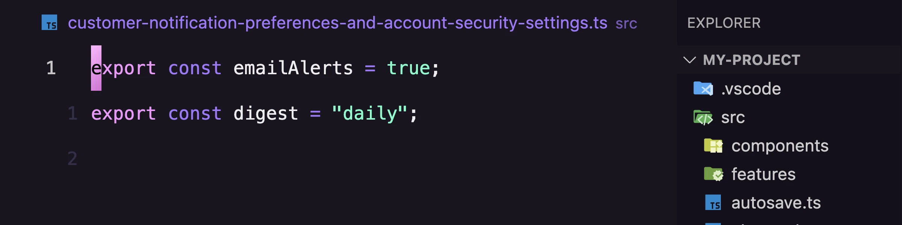
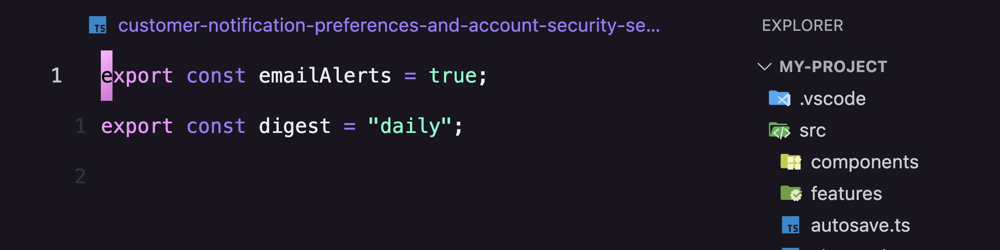
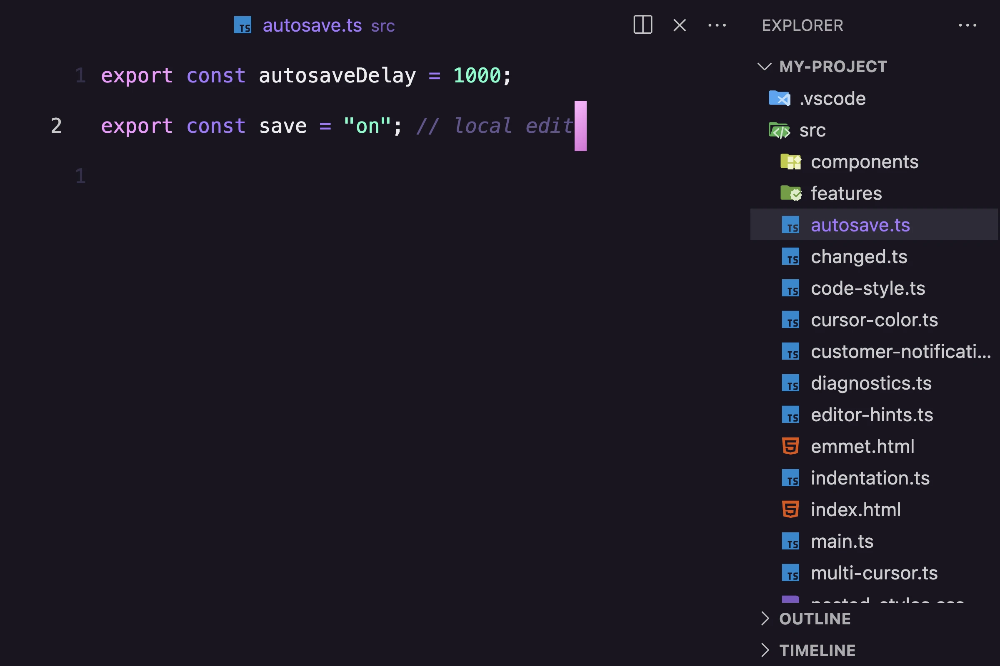
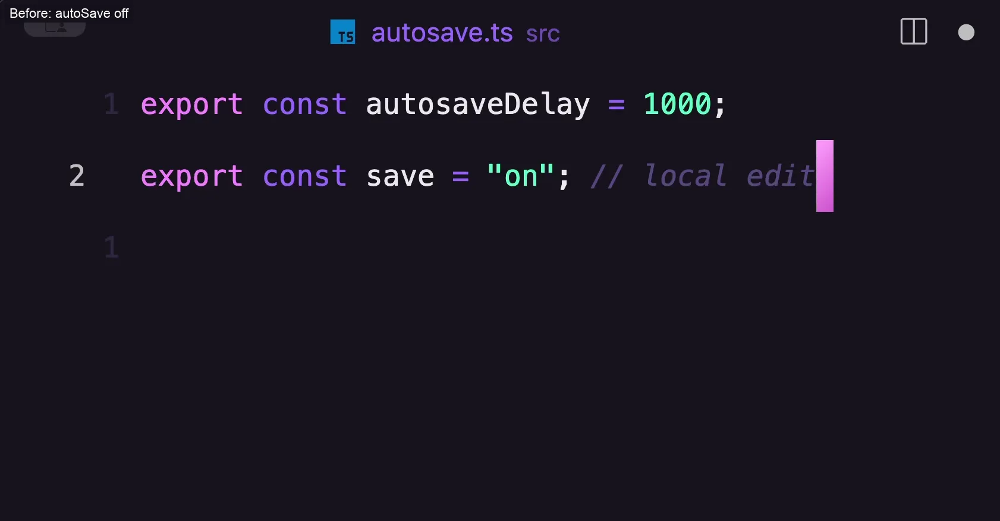
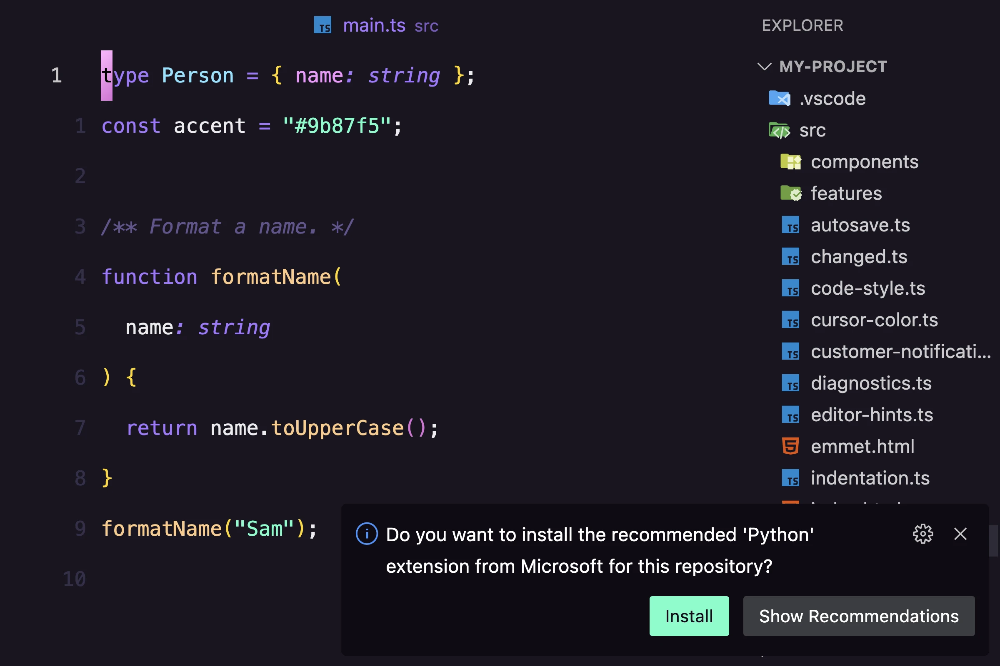
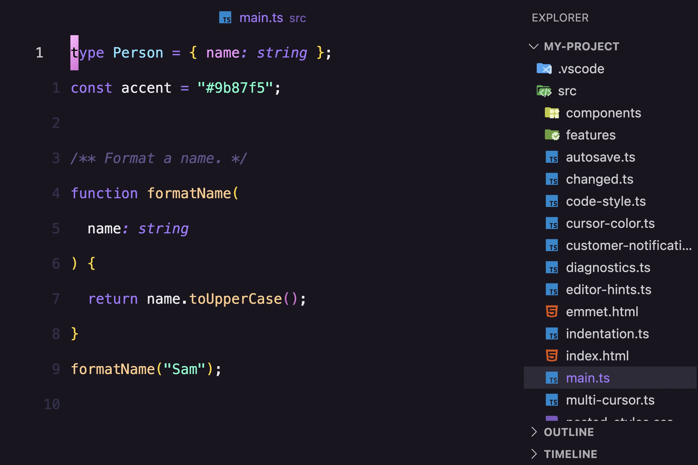
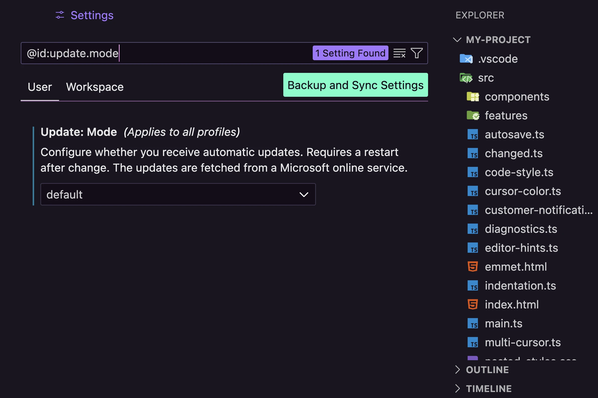
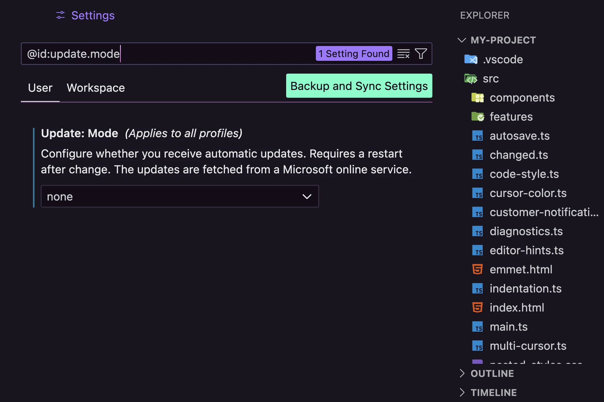

エディタタブのアイコン余白やサイドバー背景色を調整し、ファイルの遅延自動保存や自動更新の停止、拡張機能おすすめ通知の抑制を設定します。UI の微小な崩れを解消し、予期しない動作を防いで環境全体を仕上げます。対応する動画のチャプターは [Final changes (36:54)](https://www.youtube.com/watch?v=VmFOsK7IhI4&t=2214s) です。

https://www.youtube.com/watch?v=VmFOsK7IhI4&t=2214s

## 設定（settings.json）

```json
{
  "custom-ui-style.stylesheet": {
    ".title .monaco-icon-label.file-icon": "margin: 0 60px"
  },
  "workbench.colorCustomizations": {
    "[Aura Dracula Spirit (Soft)]": {
      "sideBar.background": "#191521"
    }
  },
  "files.autoSave": "afterDelay",
  "update.mode": "none",
  "extensions.ignoreRecommendations": true
}
```

## 解説

### UI 余白とサイドバー背景色の調整
サイドバーを開いた際に、左上のウィンドウ操作ボタンとタブのファイル名表示が重なる問題を防ぎます。Custom UI Style のスタイルシート設定で `.title .monaco-icon-label.file-icon` に左右マージン `margin: 0 60px` を追加します。このセレクタも、第 03 章から第 05 章で追加した `custom-ui-style.stylesheet` に追記します。また、サイドバーの背景色をエディタ背景色と統一します。第 10 章で追加した `workbench.colorCustomizations` の `[Aura Dracula Spirit (Soft)]` 内に `sideBar.background: "#191521"` を追記します。

| Before | After |
| --- | --- |
|  |  |

左ではタイトルに収まっていた長いファイル名が、右では 60px の左右マージンにより末尾が省略記号で表示されます。あわせてサイドバーの背景色も `#14111B` から `#191521` へ変わります。

### 自動保存と拡張機能通知の抑制
ファイル編集後の保存忘れを防ぐため、`files.autoSave: "afterDelay"`（既定値 `"off"`）を設定します。入力後一定時間（既定の待機時間）が経過すると自動で保存されます。

| Before | After |
| --- | --- |
|  |  |

左では編集後の未保存マーカーが残ったままですが、右では実測 1000 ms の遅延保存がディスクへ書き込まれて未保存マーカーが消えます。



同じファイルを編集すると、設定前では未保存マーカーが残り続けますが、`afterDelay` を有効にした設定後では 1000 ms の遅延後に保存されてマーカーが消えます。

また、作業中のポップアップ通知を減らすため、`extensions.ignoreRecommendations: true`（既定値 `false`）を設定して拡張機能のおすすめ通知を非表示にします。

| Before | After |
| --- | --- |
|  |  |

左では Python ワークスペース向けの拡張機能おすすめ通知トーストが表示されますが、右では表示されません。

### VS Code 本体の自動更新停止
VS Code の自動更新モードを `update.mode: "none"`（既定値 `"default"`）に設定し、自動アップデートを無効化します。動画では、VS Code の自動更新によって Custom UI Style などの拡張機能との互換性が崩れるリスクを避けるため、手動でタイミングを選んで更新する方針をとっています。

| Before | After |
| --- | --- |
|  |  |

`update.mode` で絞り込んだ Settings UI 上で、左の `Default` から右の `None` へ値が切り替わる様子を示しています。なお、この比較は Settings UI 上の設定値のみを確認したものであり、実行時の更新動作自体は `--disable-updates` によって抑止されています。

## 設定項目の一覧

| 設定 | 既定値 | 説明 |
| --- | --- | --- |
| `custom-ui-style.stylesheet[".title .monaco-icon-label.file-icon"]` | 親オブジェクト `{}` | エディタタブ内のファイルアイコンラベルの左右マージンを設定し、ウィンドウボタンとの重なりを防ぎます。 |
| `workbench.colorCustomizations["[Aura Dracula Spirit (Soft)]"].sideBar.background` | テーマ依存 | 対象テーマ適用時のサイドバーの背景色を設定します。 |
| `files.autoSave` | `"off"` | ファイルの自動保存を制御します。`afterDelay` で指定時間の経過後に自動保存します。 |
| `update.mode` | `"default"` | VS Code の組み込み自動更新モードを制御します。`none` で自動更新を停止します。 |
| `extensions.ignoreRecommendations` | `false` | 拡張機能のおすすめ通知の表示を制御します。`true` で通知を抑制します。 |

## 注意点

Custom UI Style によるマージン設定を正しく反映するには、VS Code の再起動が必要です。

`update.mode: "none"` を設定すると、VS Code の新機能やセキュリティ更新も自動適用されなくなります。定期的に手動で更新を確認・適用する必要があります（Linux のパッケージマネージャー経由の更新は別系統です）。

## 追加する拡張機能

本章のコミット（`.vscode/extensions.json`）での新規追加はありません。

## 変更コミット

- [`da275c0`](https://github.com/igorbabko/vscode-setup/commit/da275c09488fec3b53f2541ad8d482dca51b499b)

## おわりに

本書では、Igor Babko 氏のセットアップ動画に基づき、テーマ設定から UI 要素の最小化、タイポグラフィ、補完や装飾の抑制までを章ごとに順を追って設定しました。

各章では変更点に絞って設定スニペットを提示してきましたが、全設定を統合した完成状態は最終コミット [`da275c0`](https://github.com/igorbabko/vscode-setup/commit/da275c09488fec3b53f2541ad8d482dca51b499b) の `.vscode/settings.json` で確認できます。ご自身の環境に合わせて必要な設定を取り入れ、快適なミニマル環境を構築してください。
